# HTML View

**Let your agent deliver readable HTML reliably: documents, data reports, dashboards and clickable prototypes.**

[简体中文](README.md) · English

Give your agent Markdown, pre-aggregated CSV/JSON or a product flow, and it hands back **one HTML file that works offline**. Charts, themes and interactions are embedded in the file: no server to run, nothing fetched from the network. Before handing it over, the agent opens it in a real browser to check narrow screens and the printed page, and exports PDF or PNG when you need one.

The skill covers more than layout. Given loose notes, meeting minutes or JSON, the agent first reorders the content around what the reader has to do. For a dashboard, it settles the one question the screen answers, then saves the accent color for the item that needs attention.

[Quick start](#quick-start) · [What you get](#showcase) · [Built-in themes](#themes) · [**45 data charts and 43 diagrams**](#gallery) · [Install details](#install) · [Update and uninstall](#update-uninstall)

<p align="center"><a href="docs/showcase/previews/en/dashboard-hero.png"><picture><source media="(max-width: 600px)" srcset="docs/showcase/previews/en/dashboard-mobile.png">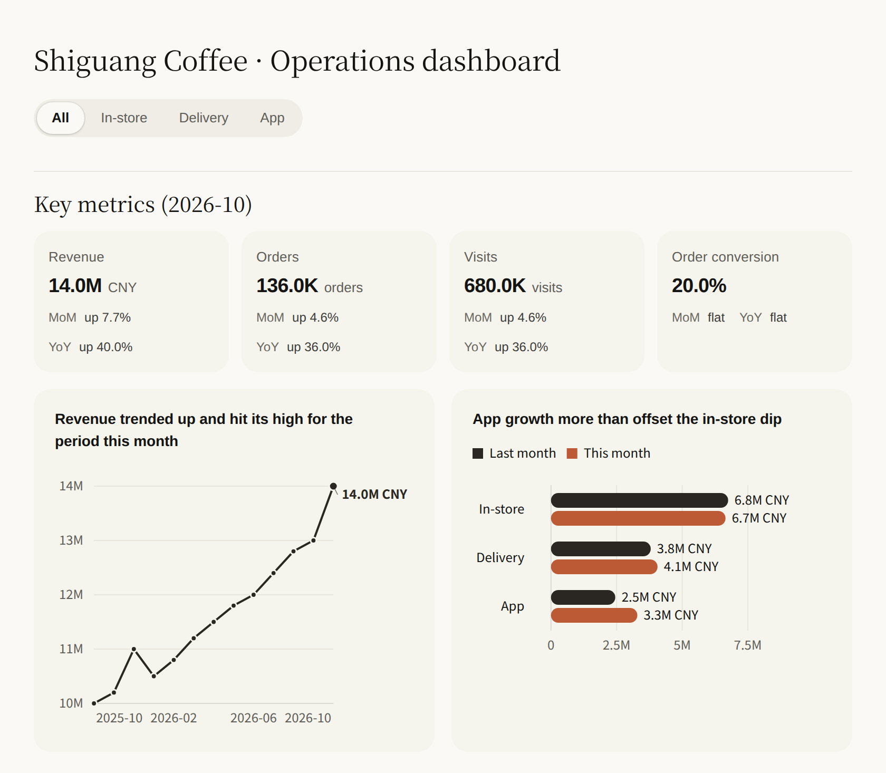</picture></a></p>

*A generated dashboard: two columns on wide screens, one column on phones. Channel views switch offline; all sample data is fictional.*

<a id="quick-start"></a>

## Quick start

**1. Install.** You need Git and Node.js 22+. Download the script, read it, then run it:

```bash
# macOS / Linux / WSL
curl -fsSL --proto '=https' -o install-html-view.sh https://raw.githubusercontent.com/fengwk/html-view-skill/main/scripts/install.sh
bash ./install-html-view.sh
```

```powershell
# Windows PowerShell
Invoke-WebRequest -UseBasicParsing -Uri 'https://raw.githubusercontent.com/fengwk/html-view-skill/main/scripts/install.ps1' -OutFile '.\install-html-view.ps1'
.\install-html-view.ps1
```

**2. Restart your agent.** `html-view` shows up in the skill list of Codex, Pi and Claude Code. For other agents, see [Install details](#install).

**3. Ask for the HTML you need.** For example:

> Use HTML View to turn `proposal.md` into a technical design reviewers can comment on. Keep the decisions and risks, and draw the call chain between services. Deliver the HTML and a checked PDF.

> Turn these pre-aggregated CSV files into an offline dashboard. The first screen should show the key metrics, the revenue trend and the channel differences. Every number should open into rows I can check, and missing values must not become 0.

> Build a clickable expense-claim prototype with a list, a detail page, and failed and successful submission states. Walk through the submit flow at phone width.

After generating the HTML, the agent runs `htmlview audit` on its content and resources, then `htmlview check` to open it at desktop width, phone width and on the printed page. Screenshots, PDF export and standalone charts need Chrome or Chromium on the machine (set `CHROME_PATH` if it isn't found).

The skill's own instructions are written in Chinese. Agents follow them fine, and the pages they produce use the language of your content: English input gives English headings, chart labels, number formats and PDF footers.

<a id="showcase"></a>

## What you get

| Output | What you can do with the file |
|---|---|
| Reading document | Jump from the table of contents, match numbered figures and tables to the text, comment on any passage; check the print layout and export PDF |
| Data report | Read month-over-month and year-over-year changes, open the underlying rows, check metric definitions, sources and raw values |
| Dashboard | Scan key metrics, trends and outliers on the first screen; switch between precomputed channel or region views without querying live data |
| Clickable prototype | Walk through screen changes, form validation, filters and state changes; no backend is called |

<table>
<tr><td width="50%"><strong>Reading document · Notification platform design</strong><br><a href="docs/showcase/previews/en/doc-reading.png"></a></td><td width="50%"><strong>Data report · Shiguang Coffee monthly report</strong><br><a href="docs/showcase/previews/en/data-periodic.png">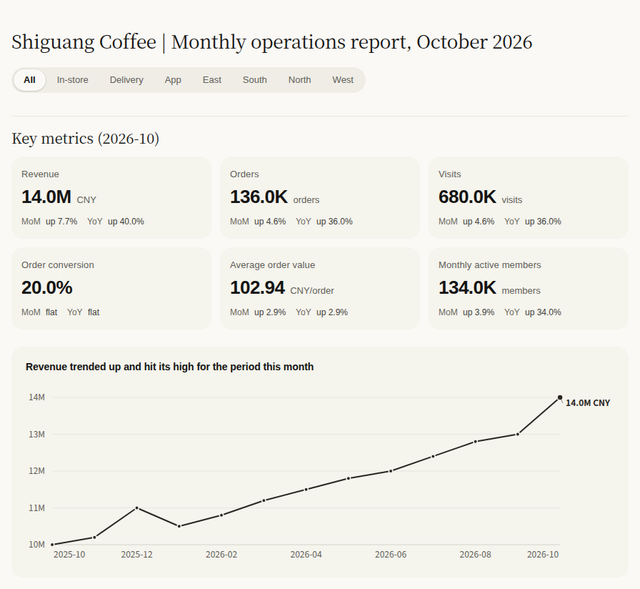</a></td></tr>
</table>

**Clickable prototype · Retention Watch**

<table>
<tr><td width="72%"><a href="docs/showcase/previews/en/ui-desktop-overview.png"></a></td><td width="28%"><a href="docs/showcase/previews/en/ui-mobile-filtered.png">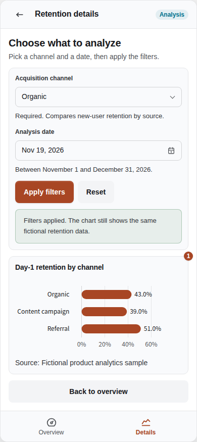</a></td></tr>
</table>

One prototype: the overview on desktop, the channel and date filters on a phone. Its colors come from `--brand` and `--scheme`.

[Sample sources and how to reproduce them →](docs/showcase/README.en.md)

<a id="themes"></a>

## Built-in themes

Documents, reports and single-chart HTML files can switch themes without changing their content or data. Compare one chart across every theme first, then open the same document to compare accents, numbering, status colors and diagram frames.

<!-- themes:begin -->
<table>
<tr>
<td colspan="2" align="center"><a href="docs/showcase/gallery/en/theme-claude.svg"></a><br><b>Claude</b><br><sub><code>light theme</code></sub></td>
</tr>
<tr>
<td align="center" valign="top" width="50%"><a href="docs/showcase/gallery/en/theme-paper.svg">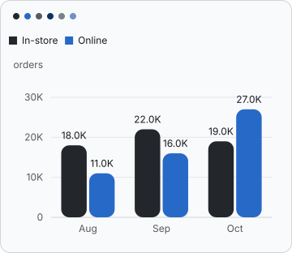</a><br><b>Paper</b><br><sub><code>light theme</code></sub></td>
<td align="center" valign="top" width="50%"><a href="docs/showcase/gallery/en/theme-obsidian.svg"></a><br><b>Obsidian</b><br><sub><code>dark theme</code></sub></td>
</tr>
<tr>
<td align="center" valign="top" width="50%"><a href="docs/showcase/gallery/en/theme-tokyo.svg"></a><br><b>Tokyo Night</b><br><sub><code>dark theme</code></sub></td>
<td align="center" valign="top" width="50%"><a href="docs/showcase/gallery/en/theme-kanagawa.svg"></a><br><b>Kanagawa</b><br><sub><code>dark theme</code></sub></td>
</tr>
<tr>
<td align="center" valign="top" width="50%"><a href="docs/showcase/gallery/en/theme-terminal.svg">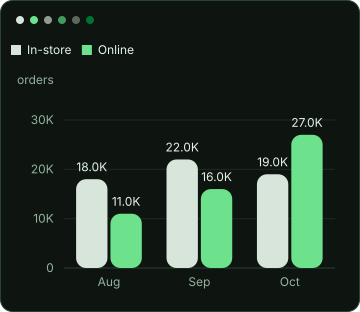</a><br><b>Terminal</b><br><sub><code>dark theme</code></sub></td>
<td align="center" valign="top" width="50%"><a href="docs/showcase/gallery/en/theme-cloudmusic.svg">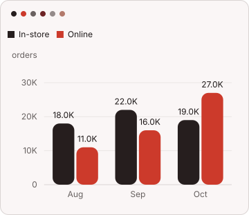</a><br><b>Cloud Music</b><br><sub><code>light theme</code></sub></td>
</tr>
</table>

**Full page samples**: the same document in each theme. Click a theme name to open it; one stays open at a time.

<details name="theme-page" open>
<summary><b>Claude</b> · light theme</summary>

<a href="docs/showcase/gallery/en/theme-claude-page.png"></a>

</details>
<details name="theme-page">
<summary><b>Paper</b> · light theme</summary>

<a href="docs/showcase/gallery/en/theme-paper-page.png">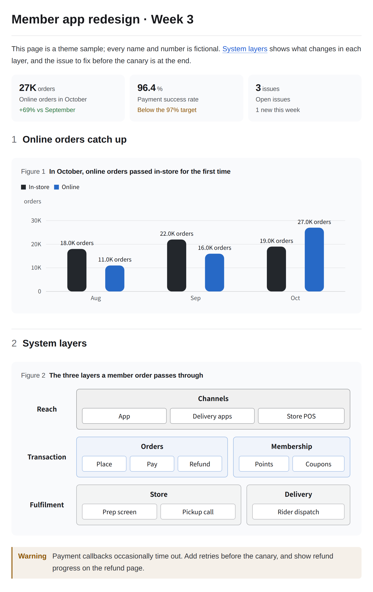</a>

</details>
<details name="theme-page">
<summary><b>Obsidian</b> · dark theme</summary>

<a href="docs/showcase/gallery/en/theme-obsidian-page.png">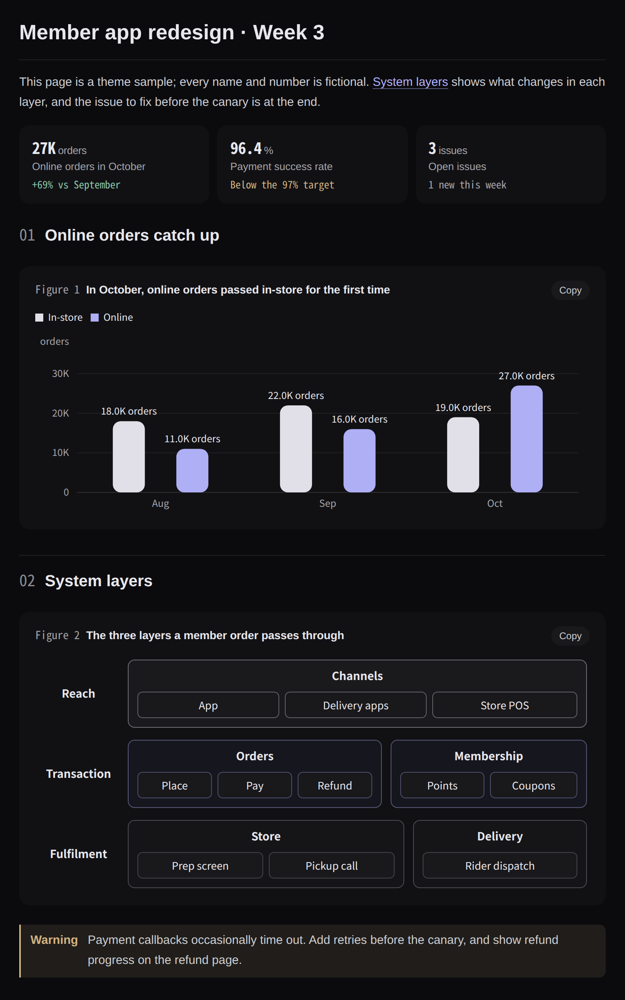</a>

</details>
<details name="theme-page">
<summary><b>Tokyo Night</b> · dark theme</summary>

<a href="docs/showcase/gallery/en/theme-tokyo-page.png">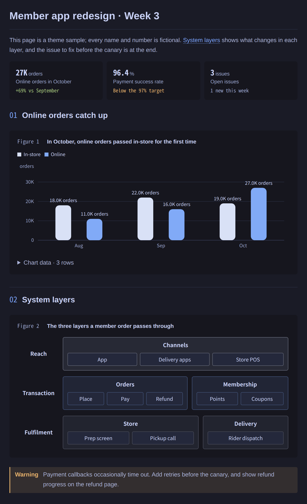</a>

</details>
<details name="theme-page">
<summary><b>Kanagawa</b> · dark theme</summary>

<a href="docs/showcase/gallery/en/theme-kanagawa-page.png">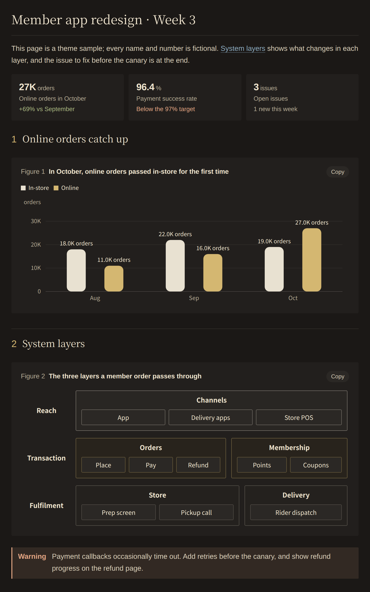</a>

</details>
<details name="theme-page">
<summary><b>Terminal</b> · dark theme</summary>

<a href="docs/showcase/gallery/en/theme-terminal-page.png">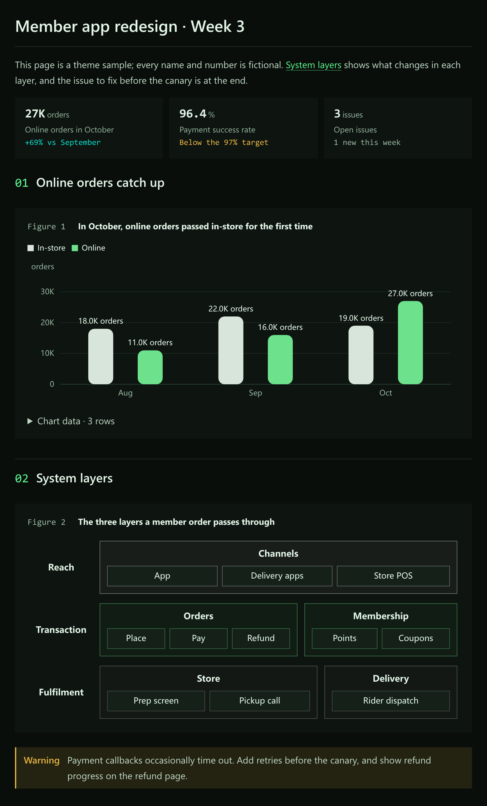</a>

</details>
<details name="theme-page">
<summary><b>Cloud Music</b> · light theme</summary>

<a href="docs/showcase/gallery/en/theme-cloudmusic-page.png">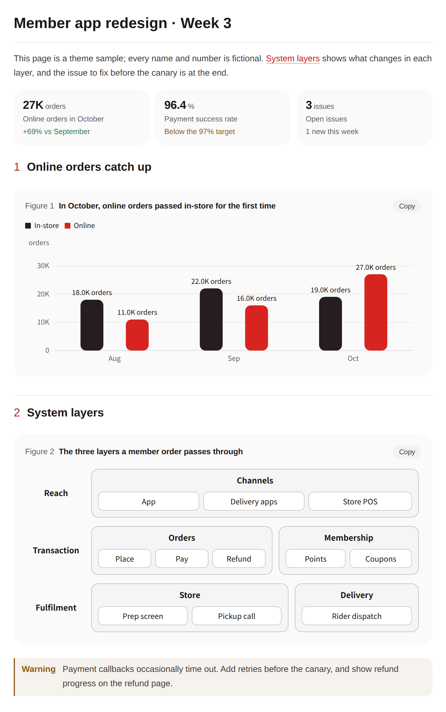</a>

</details>
<!-- themes:end -->

Use `htmlview style report.html --theme obsidian` to switch to a built-in theme, or `--theme-file harbor.json` to apply your own. The theme is embedded in the HTML, so there is no JSON file to share alongside it. To add a built-in theme, put the JSON in the [library theme directory](packages/kchart/assets/themes/), run `npm run build` and `npm run vendor` in `packages/kchart` to carry it into the skill, then review the rendered samples and refresh this section with the [gallery generator](docs/showcase/README.en.md#readme-gallery). UI mockups take their colors from `--brand` and `--scheme`. [Theme format and maintenance →](docs/architecture.en.md#themes)

<a id="gallery"></a>

## KChart gallery

Charts in HTML View are drawn by its bundled KChart library: **45 data charts, 38 controlled variants, 40 Mermaid diagram types, 3 native diagrams and 8 mind-map layouts**. Every one of them appears below as a real render in the Claude palette (see [Built-in themes](#themes) for the others), one per cell in a two-column grid. Wide charts get a full row instead of shrinking their text to fit. On a phone GitHub scales both columns down to the screen; click an image to open the full-size SVG. Each Mermaid example also parses in Mermaid 12.3.0 itself; ZenUML needs Mermaid's external plugin.

[Build the full, filterable gallery →](docs/showcase/README.en.md#full-gallery)

<!-- gallery:begin -->
<a id="charts"></a>

### Data charts

[Trends over time](#trends) · [Comparisons, targets and ranges](#comparison) · [Parts of a whole and change](#composition) · [Distributions and correlation](#distribution) · [Matrices and many measures](#matrix) · [Hierarchies](#hierarchy) · [Networks, flows and paths](#relations) · [Maps](#geography)

<a id="trends"></a>

#### Trends over time

<table>
<tr>
<td align="center" valign="top" width="50%"><a href="docs/showcase/gallery/en/chart-line.svg"></a><br><b>Line</b><br><sub><code>line</code></sub></td>
<td align="center" valign="top" width="50%"><a href="docs/showcase/gallery/en/chart-sparkline.svg"></a><br><b>Sparkline</b><br><sub><code>sparkline</code></sub></td>
</tr>
<tr>
<td align="center" valign="top" width="50%"><a href="docs/showcase/gallery/en/chart-area.svg">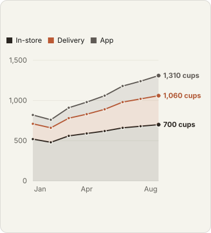</a><br><b>Stacked area</b><br><sub><code>area</code></sub></td>
<td align="center" valign="top" width="50%"><a href="docs/showcase/gallery/en/chart-candlestick.svg">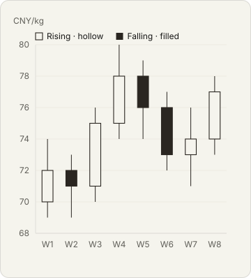</a><br><b>Open, close, high, low</b><br><sub><code>candlestick</code></sub></td>
</tr>
<tr>
<td colspan="2" align="center"><a href="docs/showcase/gallery/en/chart-small-multiples.svg"></a><br><b>Small multiples</b><br><sub><code>small-multiples</code></sub></td>
</tr>
<tr>
<td align="center" valign="top" width="50%"><a href="docs/showcase/gallery/en/chart-stream.svg"></a><br><b>Streamgraph</b><br><sub><code>stream</code></sub></td>
<td align="center" valign="top" width="50%"><a href="docs/showcase/gallery/en/chart-split-compare.svg"></a><br><b>Mirrored comparison</b><br><sub><code>split-compare</code></sub></td>
</tr>
<tr>
<td colspan="2" align="center"><a href="docs/showcase/gallery/en/chart-combo.svg">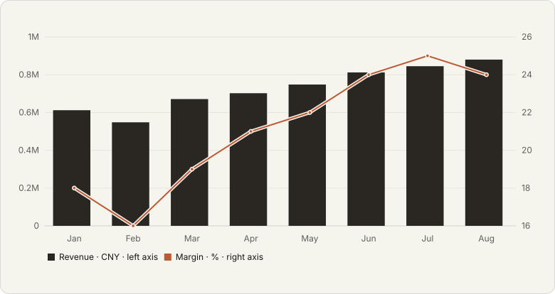</a><br><b>Dual-axis combo</b><br><sub><code>combo</code></sub></td>
</tr>
<tr>
<td colspan="2" align="center"><a href="docs/showcase/gallery/en/chart-bump.svg">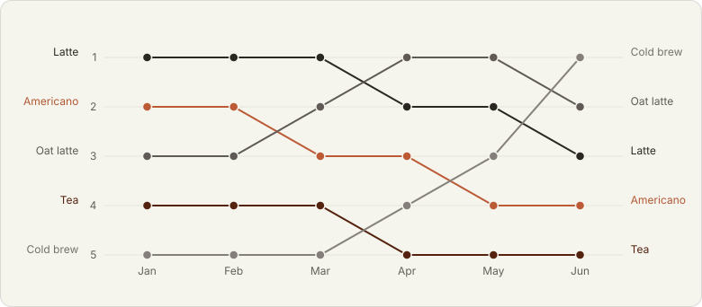</a><br><b>Rank changes</b><br><sub><code>bump</code></sub></td>
</tr>
<tr>
<td colspan="2" align="center"><a href="docs/showcase/gallery/en/chart-launch-fan.svg">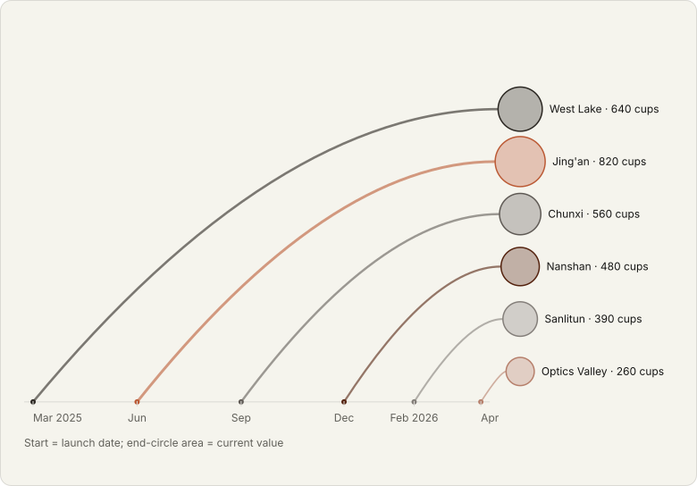</a><br><b>From launch to now</b><br><sub><code>launch-fan</code></sub></td>
</tr>
</table>

<a id="comparison"></a>

#### Comparisons, targets and ranges

<table>
<tr>
<td align="center" valign="top" width="50%"><a href="docs/showcase/gallery/en/chart-bar.svg"></a><br><b>Bars</b><br><sub><code>bar</code></sub></td>
<td align="center" valign="top" width="50%"><a href="docs/showcase/gallery/en/chart-gauge.svg">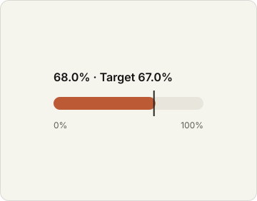</a><br><b>Progress</b><br><sub><code>gauge</code></sub></td>
</tr>
<tr>
<td align="center" valign="top" width="50%"><a href="docs/showcase/gallery/en/chart-column.svg">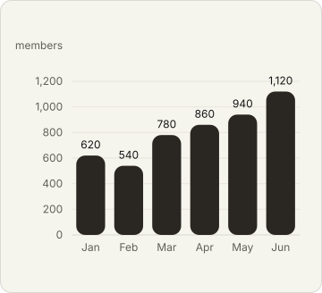</a><br><b>Columns</b><br><sub><code>column</code></sub></td>
<td align="center" valign="top" width="50%"><a href="docs/showcase/gallery/en/chart-dumbbell.svg"></a><br><b>Before and after</b><br><sub><code>dumbbell</code></sub></td>
</tr>
<tr>
<td align="center" valign="top" width="50%"><a href="docs/showcase/gallery/en/chart-slope.svg">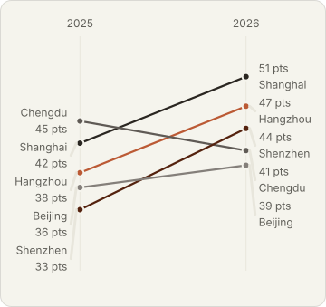</a><br><b>Slope</b><br><sub><code>slope</code></sub></td>
<td align="center" valign="top" width="50%"><a href="docs/showcase/gallery/en/chart-bullet.svg"></a><br><b>Actual vs target</b><br><sub><code>bullet</code></sub></td>
</tr>
<tr>
<td colspan="2" align="center"><a href="docs/showcase/gallery/en/chart-interval.svg">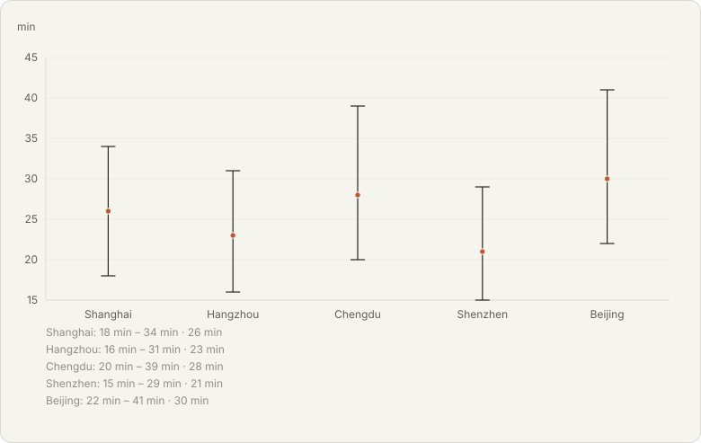</a><br><b>Range and median</b><br><sub><code>interval</code></sub></td>
</tr>
</table>

<a id="composition"></a>

#### Parts of a whole and change

<table>
<tr>
<td colspan="2" align="center"><a href="docs/showcase/gallery/en/chart-share.svg"></a><br><b>Share bar</b><br><sub><code>share</code></sub></td>
</tr>
<tr>
<td align="center" valign="top" width="50%"><a href="docs/showcase/gallery/en/chart-pie.svg">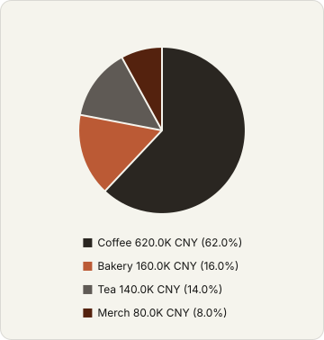</a><br><b>Pie</b><br><sub><code>pie</code></sub></td>
<td align="center" valign="top" width="50%"><a href="docs/showcase/gallery/en/chart-funnel.svg">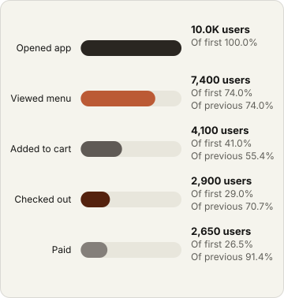</a><br><b>Funnel</b><br><sub><code>funnel</code></sub></td>
</tr>
<tr>
<td align="center" valign="top" width="50%"><a href="docs/showcase/gallery/en/chart-donut.svg"></a><br><b>Donut</b><br><sub><code>donut</code></sub></td>
<td align="center" valign="top" width="50%"><a href="docs/showcase/gallery/en/chart-waffle.svg"></a><br><b>Waffle</b><br><sub><code>waffle</code></sub></td>
</tr>
<tr>
<td align="center" valign="top" width="50%"><a href="docs/showcase/gallery/en/chart-radial-share.svg"></a><br><b>Share and intensity</b><br><sub><code>radial-share</code></sub></td>
<td align="center" valign="top" width="50%"><a href="docs/showcase/gallery/en/chart-rose.svg"></a><br><b>Rose</b><br><sub><code>rose</code></sub></td>
</tr>
<tr>
<td colspan="2" align="center"><a href="docs/showcase/gallery/en/chart-waterfall.svg"></a><br><b>Waterfall</b><br><sub><code>waterfall</code></sub></td>
</tr>
<tr>
<td colspan="2" align="center"><a href="docs/showcase/gallery/en/chart-tally.svg"></a><br><b>Multiple-choice shares</b><br><sub><code>tally</code></sub></td>
</tr>
</table>

<a id="distribution"></a>

#### Distributions and correlation

<table>
<tr>
<td align="center" valign="top" width="50%"><a href="docs/showcase/gallery/en/chart-histogram.svg"></a><br><b>Histogram</b><br><sub><code>histogram</code></sub></td>
<td align="center" valign="top" width="50%"><a href="docs/showcase/gallery/en/chart-boxplot.svg">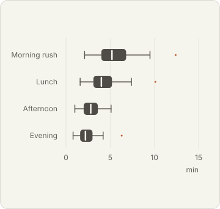</a><br><b>Box plot</b><br><sub><code>boxplot</code></sub></td>
</tr>
<tr>
<td align="center" valign="top" width="50%"><a href="docs/showcase/gallery/en/chart-violin.svg">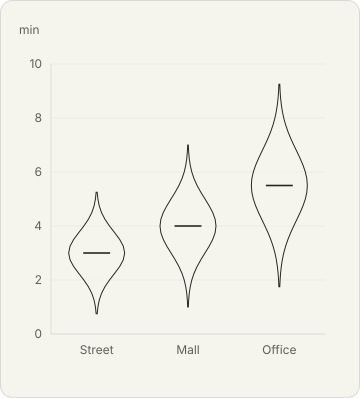</a><br><b>Violin</b><br><sub><code>violin</code></sub></td>
<td align="center" valign="top" width="50%"><a href="docs/showcase/gallery/en/chart-scatter.svg"></a><br><b>Scatter</b><br><sub><code>scatter</code></sub></td>
</tr>
<tr>
<td colspan="2" align="center"><a href="docs/showcase/gallery/en/chart-strip.svg"></a><br><b>Strip plot</b><br><sub><code>strip</code></sub></td>
</tr>
</table>

<a id="matrix"></a>

#### Matrices and many measures

<table>
<tr>
<td align="center" valign="top" width="50%"><a href="docs/showcase/gallery/en/chart-heatmap.svg"></a><br><b>Heatmap</b><br><sub><code>heatmap</code></sub></td>
<td align="center" valign="top" width="50%"><a href="docs/showcase/gallery/en/chart-bubble-matrix.svg">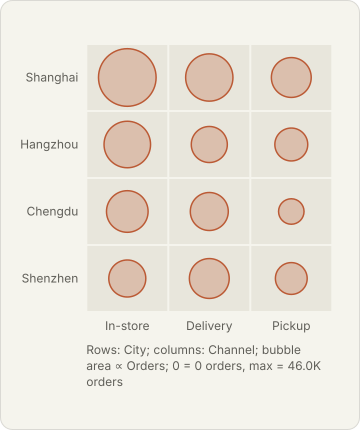</a><br><b>Bubble matrix</b><br><sub><code>bubble-matrix</code></sub></td>
</tr>
<tr>
<td colspan="2" align="center"><a href="docs/showcase/gallery/en/chart-radar.svg"></a><br><b>Radar</b><br><sub><code>radar</code></sub></td>
</tr>
<tr>
<td colspan="2" align="center"><a href="docs/showcase/gallery/en/chart-parallel.svg">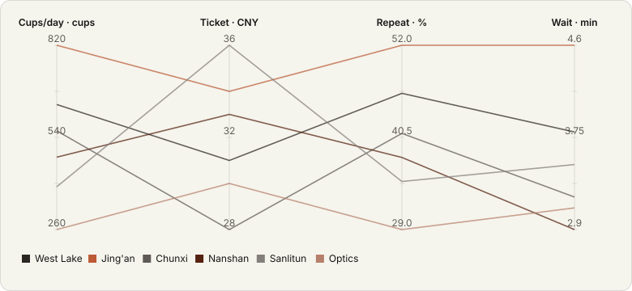</a><br><b>Parallel coordinates</b><br><sub><code>parallel</code></sub></td>
</tr>
<tr>
<td colspan="2" align="center"><a href="docs/showcase/gallery/en/chart-calendar.svg"></a><br><b>Calendar</b><br><sub><code>calendar</code></sub></td>
</tr>
</table>

<a id="hierarchy"></a>

#### Hierarchies

<table>
<tr>
<td colspan="2" align="center"><a href="docs/showcase/gallery/en/chart-tree.svg">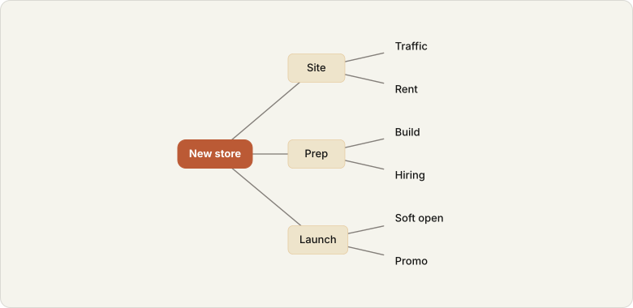</a><br><b>Tree</b><br><sub><code>tree</code></sub></td>
</tr>
<tr>
<td colspan="2" align="center"><a href="docs/showcase/gallery/en/chart-mindmap.svg"></a><br><b>Mind map</b><br><sub><code>mindmap</code></sub></td>
</tr>
<tr>
<td align="center" valign="top" width="50%"><a href="docs/showcase/gallery/en/chart-treemap.svg">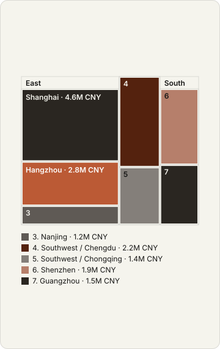</a><br><b>Treemap</b><br><sub><code>treemap</code></sub></td>
<td align="center" valign="top" width="50%"><a href="docs/showcase/gallery/en/chart-sunburst.svg"></a><br><b>Sunburst</b><br><sub><code>sunburst</code></sub></td>
</tr>
</table>

<a id="relations"></a>

#### Networks, flows and paths

<table>
<tr>
<td colspan="2" align="center"><a href="docs/showcase/gallery/en/chart-network.svg"></a><br><b>Network</b><br><sub><code>network</code></sub></td>
</tr>
<tr>
<td colspan="2" align="center"><a href="docs/showcase/gallery/en/chart-sankey.svg">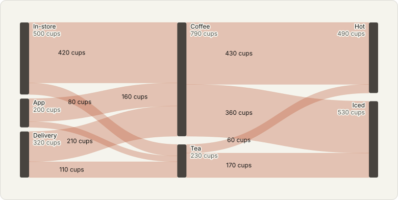</a><br><b>Sankey</b><br><sub><code>sankey</code></sub></td>
</tr>
<tr>
<td colspan="2" align="center"><a href="docs/showcase/gallery/en/chart-threads.svg"></a><br><b>Path threads</b><br><sub><code>threads</code></sub></td>
</tr>
</table>

<a id="geography"></a>

#### Maps

<table>
<tr>
<td colspan="2" align="center"><a href="docs/showcase/gallery/en/chart-choropleth.svg"></a><br><b>Choropleth</b><br><sub><code>choropleth</code></sub></td>
</tr>
<tr>
<td colspan="2" align="center"><a href="docs/showcase/gallery/en/chart-geo-scatter.svg">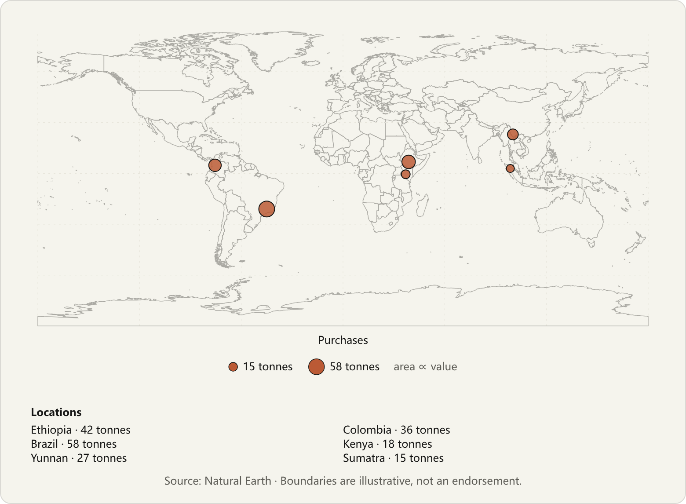</a><br><b>Points on a map</b><br><sub><code>geo-scatter</code></sub></td>
</tr>
</table>

<a id="diagrams"></a>

### Diagrams

[Flows, states and journeys](#process) · [Sequences and data models](#model) · [Railroad grammars in four notations](#grammar) · [Plans, boards and protocols](#planning) · [Architecture, layers and file trees](#architecture) · [Five C4 views](#c4) · [Mermaid charts](#mermaid-data) · [Analysis and strategy](#analysis) · [One tree, eight mind-map layouts](#mindmaps)

<a id="process"></a>

#### Flows, states and journeys

<table>
<tr>
<td colspan="2" align="center"><a href="docs/showcase/gallery/en/diagram-flowchart.svg"></a><br><b>Flowchart</b><br><sub><code>flowchart</code></sub></td>
</tr>
<tr>
<td align="center" valign="top" width="50%"><a href="docs/showcase/gallery/en/diagram-stateDiagram-v2.svg">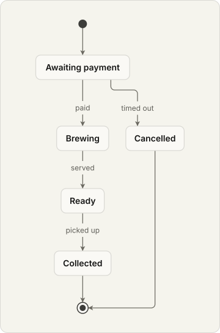</a><br><b>State diagram</b><br><sub><code>stateDiagram-v2</code></sub></td>
<td align="center" valign="top" width="50%"><a href="docs/showcase/gallery/en/diagram-journey.svg">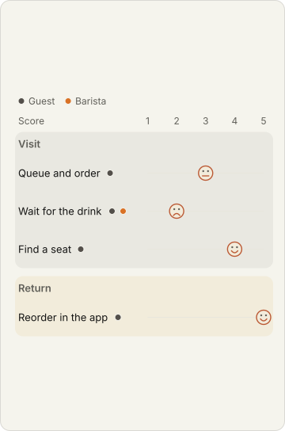</a><br><b>Customer journey</b><br><sub><code>journey</code></sub></td>
</tr>
<tr>
<td colspan="2" align="center"><a href="docs/showcase/gallery/en/diagram-swimlane.svg">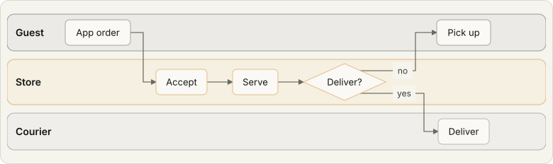</a><br><b>Swimlanes</b><br><sub><code>swimlane</code></sub></td>
</tr>
<tr>
<td colspan="2" align="center"><a href="docs/showcase/gallery/en/diagram-swimlane-beta.svg">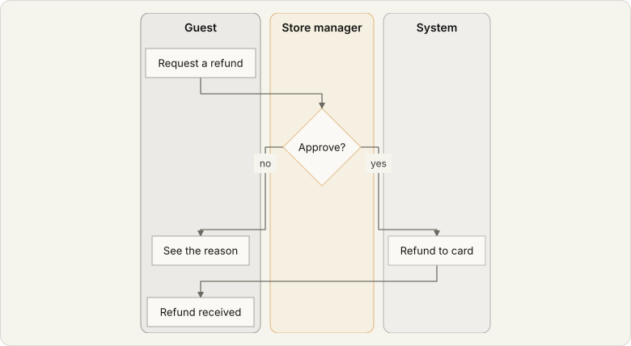</a><br><b>Mermaid swimlanes</b><br><sub><code>swimlane-beta</code></sub></td>
</tr>
<tr>
<td colspan="2" align="center"><a href="docs/showcase/gallery/en/diagram-agentflow-beta.svg">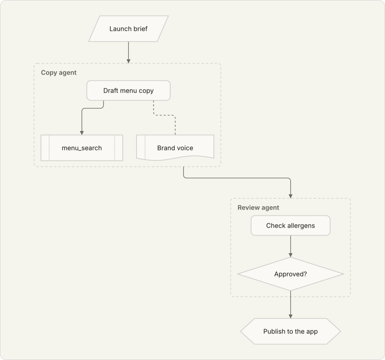</a><br><b>Agent flow</b><br><sub><code>agentflow-beta</code></sub></td>
</tr>
<tr>
<td colspan="2" align="center"><a href="docs/showcase/gallery/en/diagram-eventmodeling.svg"></a><br><b>Event model</b><br><sub><code>eventmodeling</code></sub></td>
</tr>
</table>

<a id="model"></a>

#### Sequences and data models

<table>
<tr>
<td colspan="2" align="center"><a href="docs/showcase/gallery/en/diagram-sequenceDiagram.svg"></a><br><b>Sequence</b><br><sub><code>sequenceDiagram</code></sub></td>
</tr>
<tr>
<td align="center" valign="top" width="50%"><a href="docs/showcase/gallery/en/diagram-zenuml.svg"></a><br><b>ZenUML</b><br><sub><code>zenuml</code></sub></td>
<td align="center" valign="top" width="50%"><a href="docs/showcase/gallery/en/diagram-requirementDiagram.svg">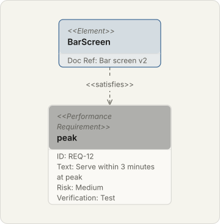</a><br><b>Requirements</b><br><sub><code>requirementDiagram</code></sub></td>
</tr>
<tr>
<td align="center" valign="top" width="50%"><a href="docs/showcase/gallery/en/diagram-usecase-beta.svg"></a><br><b>Use cases</b><br><sub><code>usecase-beta</code></sub></td>
<td align="center" valign="top" width="50%"><a href="docs/showcase/gallery/en/diagram-classDiagram.svg"></a><br><b>Class diagram</b><br><sub><code>classDiagram</code></sub></td>
</tr>
<tr>
<td colspan="2" align="center"><a href="docs/showcase/gallery/en/diagram-erDiagram.svg"></a><br><b>ER diagram</b><br><sub><code>erDiagram</code></sub></td>
</tr>
</table>

<a id="grammar"></a>

#### Railroad grammars in four notations

<table>
<tr>
<td colspan="2" align="center"><a href="docs/showcase/gallery/en/diagram-railroad-beta.svg"></a><br><b>Function style</b><br><sub><code>railroad-beta</code></sub></td>
</tr>
<tr>
<td colspan="2" align="center"><a href="docs/showcase/gallery/en/diagram-railroad-ebnf-beta.svg"></a><br><b>EBNF</b><br><sub><code>railroad-ebnf-beta</code></sub></td>
</tr>
<tr>
<td colspan="2" align="center"><a href="docs/showcase/gallery/en/diagram-railroad-abnf-beta.svg">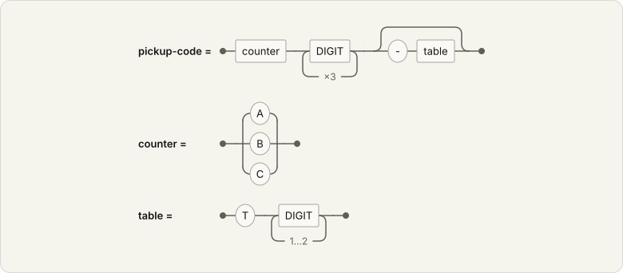</a><br><b>ABNF</b><br><sub><code>railroad-abnf-beta</code></sub></td>
</tr>
<tr>
<td colspan="2" align="center"><a href="docs/showcase/gallery/en/diagram-railroad-peg-beta.svg"></a><br><b>PEG</b><br><sub><code>railroad-peg-beta</code></sub></td>
</tr>
</table>

<a id="planning"></a>

#### Plans, boards and protocols

<table>
<tr>
<td colspan="2" align="center"><a href="docs/showcase/gallery/en/diagram-gantt.svg">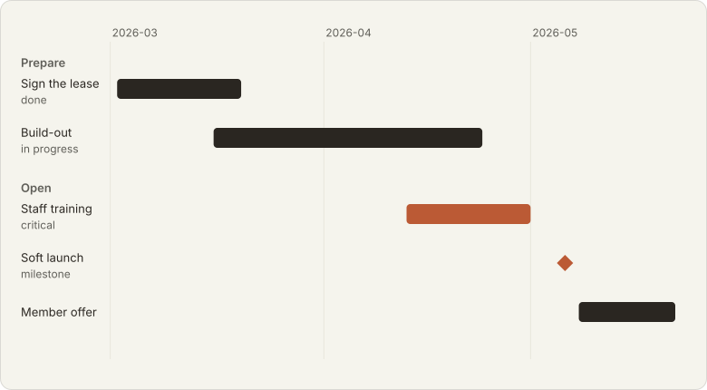</a><br><b>Gantt</b><br><sub><code>gantt</code></sub></td>
</tr>
<tr>
<td colspan="2" align="center"><a href="docs/showcase/gallery/en/diagram-timeline.svg">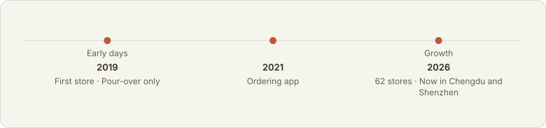</a><br><b>Timeline</b><br><sub><code>timeline</code></sub></td>
</tr>
<tr>
<td colspan="2" align="center"><a href="docs/showcase/gallery/en/diagram-gitGraph.svg">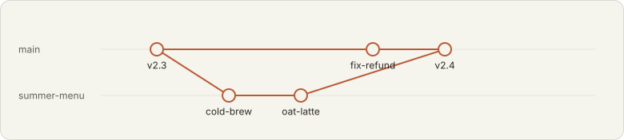</a><br><b>Git graph</b><br><sub><code>gitGraph</code></sub></td>
</tr>
<tr>
<td colspan="2" align="center"><a href="docs/showcase/gallery/en/diagram-kanban.svg">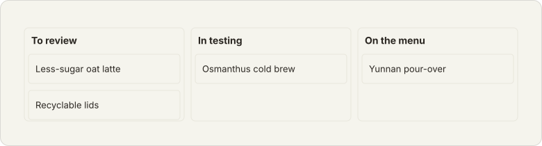</a><br><b>Kanban</b><br><sub><code>kanban</code></sub></td>
</tr>
<tr>
<td colspan="2" align="center"><a href="docs/showcase/gallery/en/diagram-packet.svg">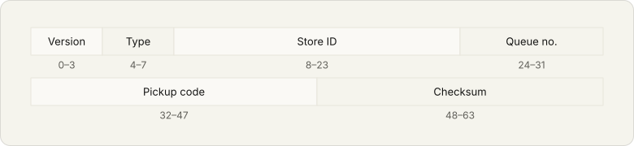</a><br><b>Packet layout</b><br><sub><code>packet</code></sub></td>
</tr>
</table>

<a id="architecture"></a>

#### Architecture, layers and file trees

<table>
<tr>
<td colspan="2" align="center"><a href="docs/showcase/gallery/en/diagram-layers.svg"></a><br><b>Layers</b><br><sub><code>layers</code></sub></td>
</tr>
<tr>
<td colspan="2" align="center"><a href="docs/showcase/gallery/en/diagram-blocks.svg"></a><br><b>Overview board</b><br><sub><code>blocks</code></sub></td>
</tr>
<tr>
<td colspan="2" align="center"><a href="docs/showcase/gallery/en/diagram-architecture-beta.svg"></a><br><b>Architecture</b><br><sub><code>architecture-beta</code></sub></td>
</tr>
<tr>
<td colspan="2" align="center"><a href="docs/showcase/gallery/en/diagram-block.svg"></a><br><b>Block diagram</b><br><sub><code>block</code></sub></td>
</tr>
<tr>
<td colspan="2" align="center"><a href="docs/showcase/gallery/en/diagram-treeView-beta.svg"></a><br><b>File tree</b><br><sub><code>treeView-beta</code></sub></td>
</tr>
</table>

<a id="c4"></a>

#### Five C4 views

<table>
<tr>
<td align="center" valign="top" width="50%"><a href="docs/showcase/gallery/en/diagram-C4Context.svg">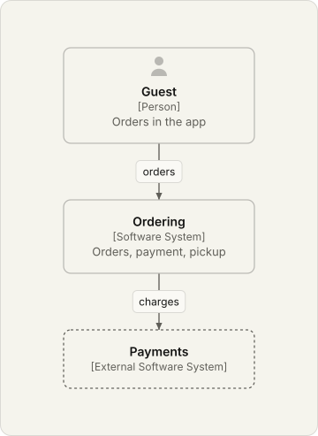</a><br><b>Context</b><br><sub><code>C4Context</code></sub></td>
<td align="center" valign="top" width="50%"><a href="docs/showcase/gallery/en/diagram-C4Dynamic.svg"></a><br><b>Dynamic</b><br><sub><code>C4Dynamic</code></sub></td>
</tr>
<tr>
<td align="center" valign="top" width="50%"><a href="docs/showcase/gallery/en/diagram-C4Container.svg">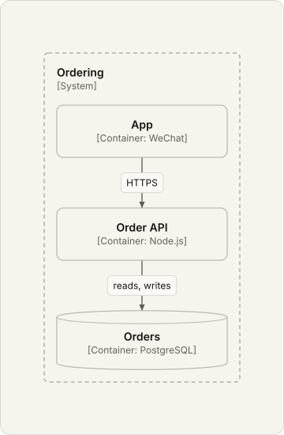</a><br><b>Containers</b><br><sub><code>C4Container</code></sub></td>
<td align="center" valign="top" width="50%"><a href="docs/showcase/gallery/en/diagram-C4Component.svg"></a><br><b>Components</b><br><sub><code>C4Component</code></sub></td>
</tr>
<tr>
<td colspan="2" align="center"><a href="docs/showcase/gallery/en/diagram-C4Deployment.svg"></a><br><b>Deployment</b><br><sub><code>C4Deployment</code></sub></td>
</tr>
</table>

<a id="mermaid-data"></a>

#### Mermaid charts

<table>
<tr>
<td align="center" valign="top" width="50%"><a href="docs/showcase/gallery/en/diagram-pie.svg">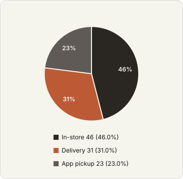</a><br><b>Pie</b><br><sub><code>pie</code></sub></td>
<td align="center" valign="top" width="50%"><a href="docs/showcase/gallery/en/diagram-treemap.svg">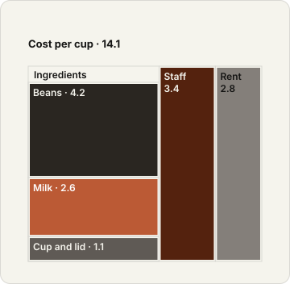</a><br><b>Treemap</b><br><sub><code>treemap</code></sub></td>
</tr>
<tr>
<td colspan="2" align="center"><a href="docs/showcase/gallery/en/diagram-xychart.svg">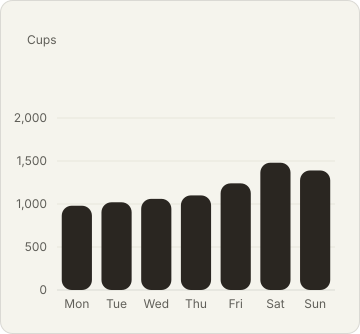</a><br><b>XY chart</b><br><sub><code>xychart</code></sub></td>
</tr>
<tr>
<td align="center" valign="top" width="50%"><a href="docs/showcase/gallery/en/diagram-sankey.svg"></a><br><b>Sankey</b><br><sub><code>sankey</code></sub></td>
<td align="center" valign="top" width="50%"><a href="docs/showcase/gallery/en/diagram-radar-beta.svg">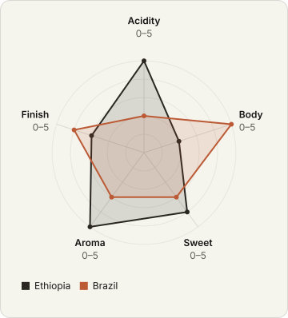</a><br><b>Radar</b><br><sub><code>radar-beta</code></sub></td>
</tr>
</table>

<a id="analysis"></a>

#### Analysis and strategy

<table>
<tr>
<td colspan="2" align="center"><a href="docs/showcase/gallery/en/diagram-quadrantChart.svg">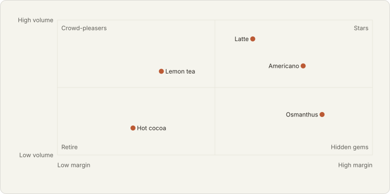</a><br><b>Quadrant chart</b><br><sub><code>quadrantChart</code></sub></td>
</tr>
<tr>
<td colspan="2" align="center"><a href="docs/showcase/gallery/en/diagram-ishikawa.svg"></a><br><b>Fishbone</b><br><sub><code>ishikawa</code></sub></td>
</tr>
<tr>
<td colspan="2" align="center"><a href="docs/showcase/gallery/en/diagram-cynefin-beta.svg"></a><br><b>Cynefin</b><br><sub><code>cynefin-beta</code></sub></td>
</tr>
<tr>
<td colspan="2" align="center"><a href="docs/showcase/gallery/en/diagram-venn-beta.svg"></a><br><b>Venn</b><br><sub><code>venn-beta</code></sub></td>
</tr>
<tr>
<td colspan="2" align="center"><a href="docs/showcase/gallery/en/diagram-wardley-beta.svg"></a><br><b>Wardley map</b><br><sub><code>wardley-beta</code></sub></td>
</tr>
</table>

<a id="mindmaps"></a>

#### One tree, eight mind-map layouts

<table>
<tr>
<td colspan="2" align="center"><a href="docs/showcase/gallery/en/diagram-mindmap.svg"></a><br><b>Mermaid mind map</b><br><sub><code>mindmap</code></sub></td>
</tr>
<tr>
<td colspan="2" align="center"><a href="docs/showcase/gallery/en/mindmap-bilateral.svg"></a><br><b>Bilateral</b><br><sub><code>mindmap / bilateral</code></sub></td>
</tr>
<tr>
<td colspan="2" align="center"><a href="docs/showcase/gallery/en/mindmap-right.svg"></a><br><b>Right</b><br><sub><code>mindmap / right</code></sub></td>
</tr>
<tr>
<td colspan="2" align="center"><a href="docs/showcase/gallery/en/mindmap-left.svg"></a><br><b>Left</b><br><sub><code>mindmap / left</code></sub></td>
</tr>
<tr>
<td colspan="2" align="center"><a href="docs/showcase/gallery/en/mindmap-radial.svg"></a><br><b>Radial</b><br><sub><code>mindmap / radial</code></sub></td>
</tr>
<tr>
<td colspan="2" align="center"><a href="docs/showcase/gallery/en/mindmap-org.svg"></a><br><b>Org chart</b><br><sub><code>mindmap / org</code></sub></td>
</tr>
<tr>
<td colspan="2" align="center"><a href="docs/showcase/gallery/en/mindmap-brace.svg"></a><br><b>Brace</b><br><sub><code>mindmap / brace</code></sub></td>
</tr>
<tr>
<td colspan="2" align="center"><a href="docs/showcase/gallery/en/mindmap-fishbone.svg"></a><br><b>Fishbone</b><br><sub><code>mindmap / fishbone</code></sub></td>
</tr>
<tr>
<td colspan="2" align="center"><a href="docs/showcase/gallery/en/mindmap-timeline.svg"></a><br><b>Timeline</b><br><sub><code>mindmap / timeline</code></sub></td>
</tr>
</table>

<a id="variants"></a>

### Variants

[Bars, lines and marks](#variants-marks) · [Shares and stages](#variants-part) · [Targets, gaps and distributions](#variants-value) · [Matrices, calendars and networks](#variants-pattern)

<a id="variants-marks"></a>

#### Bars, lines and marks

<table>
<tr>
<td align="center" valign="top" width="50%"><a href="docs/showcase/gallery/en/variant-bar-solid.svg"></a><br><b>Bars · Solid</b><br><sub><code>bar / solid</code></sub></td>
<td align="center" valign="top" width="50%"><a href="docs/showcase/gallery/en/variant-bar-lollipop.svg"></a><br><b>Bars · Lollipop</b><br><sub><code>bar / lollipop</code></sub></td>
</tr>
<tr>
<td align="center" valign="top" width="50%"><a href="docs/showcase/gallery/en/variant-bar-rungs.svg"></a><br><b>Bars · Unit rungs</b><br><sub><code>bar / rungs</code></sub></td>
<td align="center" valign="top" width="50%"><a href="docs/showcase/gallery/en/variant-column-rungs.svg"></a><br><b>Columns · Unit rungs</b><br><sub><code>column / rungs</code></sub></td>
</tr>
<tr>
<td colspan="2" align="center"><a href="docs/showcase/gallery/en/variant-bar-pictorial.svg"></a><br><b>Bars · Pictogram</b><br><sub><code>bar / pictorial</code></sub></td>
</tr>
<tr>
<td align="center" valign="top" width="50%"><a href="docs/showcase/gallery/en/variant-column-solid.svg"></a><br><b>Columns · Solid</b><br><sub><code>column / solid</code></sub></td>
<td align="center" valign="top" width="50%"><a href="docs/showcase/gallery/en/variant-column-lollipop.svg"></a><br><b>Columns · Lollipop</b><br><sub><code>column / lollipop</code></sub></td>
</tr>
<tr>
<td align="center" valign="top" width="50%"><a href="docs/showcase/gallery/en/variant-column-pictorial.svg"></a><br><b>Columns · Pictogram</b><br><sub><code>column / pictorial</code></sub></td>
<td align="center" valign="top" width="50%"><a href="docs/showcase/gallery/en/variant-line-counter.svg"></a><br><b>Line · Latest value</b><br><sub><code>line / counter</code></sub></td>
</tr>
<tr>
<td colspan="2" align="center"><a href="docs/showcase/gallery/en/variant-line-barcode.svg"></a><br><b>Line · Barcode</b><br><sub><code>line / barcode</code></sub></td>
</tr>
</table>

<a id="variants-part"></a>

#### Shares and stages

<table>
<tr>
<td align="center" valign="top" width="50%"><a href="docs/showcase/gallery/en/variant-share-solid.svg"></a><br><b>Share bar · Solid</b><br><sub><code>share / solid</code></sub></td>
<td align="center" valign="top" width="50%"><a href="docs/showcase/gallery/en/variant-share-ticks.svg"></a><br><b>Share bar · Ticks</b><br><sub><code>share / ticks</code></sub></td>
</tr>
<tr>
<td align="center" valign="top" width="50%"><a href="docs/showcase/gallery/en/variant-donut-solid.svg"></a><br><b>Donut · Solid</b><br><sub><code>donut / solid</code></sub></td>
<td align="center" valign="top" width="50%"><a href="docs/showcase/gallery/en/variant-funnel-bars.svg"></a><br><b>Funnel · Bars</b><br><sub><code>funnel / bars</code></sub></td>
</tr>
<tr>
<td align="center" valign="top" width="50%"><a href="docs/showcase/gallery/en/variant-donut-ticks.svg"></a><br><b>Donut · Ticks</b><br><sub><code>donut / ticks</code></sub></td>
<td align="center" valign="top" width="50%"><a href="docs/showcase/gallery/en/variant-waffle-dots.svg"></a><br><b>Waffle · Dots</b><br><sub><code>waffle / dots</code></sub></td>
</tr>
<tr>
<td colspan="2" align="center"><a href="docs/showcase/gallery/en/variant-funnel-hourglass.svg"></a><br><b>Funnel · Hourglass</b><br><sub><code>funnel / hourglass</code></sub></td>
</tr>
<tr>
<td colspan="2" align="center"><a href="docs/showcase/gallery/en/variant-waffle-field.svg"></a><br><b>Waffle · Open field</b><br><sub><code>waffle / field</code></sub></td>
</tr>
</table>

<a id="variants-value"></a>

#### Targets, gaps and distributions

<table>
<tr>
<td colspan="2" align="center"><a href="docs/showcase/gallery/en/variant-gauge-bar.svg"></a><br><b>Progress · Bar</b><br><sub><code>gauge / bar</code></sub></td>
</tr>
<tr>
<td align="center" valign="top" width="50%"><a href="docs/showcase/gallery/en/variant-gauge-arc.svg"></a><br><b>Progress · Arc</b><br><sub><code>gauge / arc</code></sub></td>
<td align="center" valign="top" width="50%"><a href="docs/showcase/gallery/en/variant-gauge-ticks.svg"></a><br><b>Progress · Ticks</b><br><sub><code>gauge / ticks</code></sub></td>
</tr>
<tr>
<td align="center" valign="top" width="50%"><a href="docs/showcase/gallery/en/variant-dumbbell-solid.svg"></a><br><b>Before and after · Solid</b><br><sub><code>dumbbell / solid</code></sub></td>
<td align="center" valign="top" width="50%"><a href="docs/showcase/gallery/en/variant-histogram-solid.svg"></a><br><b>Histogram · Solid</b><br><sub><code>histogram / solid</code></sub></td>
</tr>
<tr>
<td align="center" valign="top" width="50%"><a href="docs/showcase/gallery/en/variant-dumbbell-rungs.svg"></a><br><b>Before and after · Unit rungs</b><br><sub><code>dumbbell / rungs</code></sub></td>
<td align="center" valign="top" width="50%"><a href="docs/showcase/gallery/en/variant-scatter-plumb.svg"></a><br><b>Scatter · Drop lines</b><br><sub><code>scatter / plumb</code></sub></td>
</tr>
<tr>
<td colspan="2" align="center"><a href="docs/showcase/gallery/en/variant-waterfall-solid.svg"></a><br><b>Waterfall · Solid</b><br><sub><code>waterfall / solid</code></sub></td>
</tr>
<tr>
<td colspan="2" align="center"><a href="docs/showcase/gallery/en/variant-waterfall-rungs.svg"></a><br><b>Waterfall · Unit rungs</b><br><sub><code>waterfall / rungs</code></sub></td>
</tr>
<tr>
<td align="center" valign="top" width="50%"><a href="docs/showcase/gallery/en/variant-histogram-rungs.svg"></a><br><b>Histogram · Unit rungs</b><br><sub><code>histogram / rungs</code></sub></td>
<td align="center" valign="top" width="50%"><a href="docs/showcase/gallery/en/variant-scatter-dots.svg"></a><br><b>Scatter · Dots</b><br><sub><code>scatter / dots</code></sub></td>
</tr>
</table>

<a id="variants-pattern"></a>

#### Matrices, calendars and networks

<table>
<tr>
<td colspan="2" align="center"><a href="docs/showcase/gallery/en/variant-heatmap-cells.svg"></a><br><b>Heatmap · Cells</b><br><sub><code>heatmap / cells</code></sub></td>
</tr>
<tr>
<td align="center" valign="top" width="50%"><a href="docs/showcase/gallery/en/variant-heatmap-dots.svg"></a><br><b>Heatmap · Dots</b><br><sub><code>heatmap / dots</code></sub></td>
<td align="center" valign="top" width="50%"><a href="docs/showcase/gallery/en/variant-heatmap-arc.svg"></a><br><b>Heatmap · Arc</b><br><sub><code>heatmap / arc</code></sub></td>
</tr>
<tr>
<td colspan="2" align="center"><a href="docs/showcase/gallery/en/variant-calendar-cells.svg"></a><br><b>Calendar · Cells</b><br><sub><code>calendar / cells</code></sub></td>
</tr>
<tr>
<td colspan="2" align="center"><a href="docs/showcase/gallery/en/variant-calendar-dots.svg"></a><br><b>Calendar · Dots</b><br><sub><code>calendar / dots</code></sub></td>
</tr>
<tr>
<td align="center" valign="top" width="50%"><a href="docs/showcase/gallery/en/variant-network-lines.svg"></a><br><b>Network · Lines</b><br><sub><code>network / lines</code></sub></td>
<td align="center" valign="top" width="50%"><a href="docs/showcase/gallery/en/variant-network-membrane.svg"></a><br><b>Network · Membrane</b><br><sub><code>network / membrane</code></sub></td>
</tr>
<tr>
<td colspan="2" align="center"><a href="docs/showcase/gallery/en/variant-mindmap-editorial.svg"></a><br><b>Mind map · Editorial</b><br><sub><code>mindmap / editorial</code></sub></td>
</tr>
<tr>
<td colspan="2" align="center"><a href="docs/showcase/gallery/en/variant-mindmap-cards.svg"></a><br><b>Mind map · Cards</b><br><sub><code>mindmap / cards</code></sub></td>
</tr>
</table>
<!-- gallery:end -->

<a id="install"></a>

## Install details

The installer clones the repository to `~/.agents/skill-lib/html-view-skill` and links its `skills/html-view` folder into two places:

| Link | Read by |
|---|---|
| `~/.agents/skills/html-view` | [Codex](https://learn.chatgpt.com/docs/build-skills#where-codex-loads-local-skills), [Pi](https://docs.pi.dev/latest/skills) |
| `~/.claude/skills/html-view` | [Claude Code](https://code.claude.com/docs/en/skills#where-skills-live) |

Each tool chooses its own folder; the Agent Skills specification does not define a shared location. For other agents, link or copy `skills/html-view` into the folder they load skills from.

- **Safe to rerun.** A valid existing clone is reused and never pulled automatically. A broken clone or one from another origin is reported, not replaced. Each link is checked on its own, and an existing file, folder or broken link with the same name is left untouched.
- **Manual clones work too.** Clone to the location above, then run the script to add the links.
- **Native Windows** uses directory junctions instead of symbolic links. Whether each agent picks up a junction has not been tested on native Windows yet. WSL uses the `$HOME` of its Linux environment.
- **If PowerShell blocks the script** only because it came from the internet under `RemoteSigned`, check it, run `Unblock-File -LiteralPath '.\install-html-view.ps1'`, then run it again. You don't need to change the system policy.

<a id="update-uninstall"></a>

## Update and uninstall

**Update** by pulling the clone; both links keep pointing at it.

```bash
git -C "$HOME/.agents/skill-lib/html-view-skill" pull --ff-only
```

**Uninstall** by checking that both links point at this project, then removing them. Without `-r`, `rm` only removes a link; if a real folder sits there, it fails instead of deleting it.

```bash
readlink ~/.agents/skills/html-view ~/.claude/skills/html-view   # should end in …/html-view-skill/skills/html-view
rm ~/.agents/skills/html-view ~/.claude/skills/html-view
```

On Windows, remove each junction with `cmd /c rmdir "<path>"`; without `/s` it removes only the junction. Once nothing else uses the clone, move `~/.agents/skill-lib/html-view-skill` away. If the installer skipped an existing entry with the same name, that entry isn't part of this project, so keep it.

<a id="cli"></a>

## CLI and maintenance

From the repository root, build a sample document and check it:

```sh
node skills/html-view/scripts/htmlview doc build docs/showcase/examples/en/notification-platform.md --type tech-spec --out notification-platform.html
node skills/html-view/scripts/htmlview audit notification-platform.html
node skills/html-view/scripts/htmlview check notification-platform.html --paper a3-portrait
node skills/html-view/scripts/htmlview export notification-platform.html --format pdf --paper a3-portrait --out notification-platform.pdf
```

`check` uses a real browser to test narrow screens, overflow inside charts and the printed page. PDF export stops when something would be clipped instead of shrinking charts or text. Try A4 landscape for wide charts and A3 portrait for tall ones; if it still doesn't fit, rearrange the content or attach the full SVG. Before sharing HTML, check the metadata in its source: documents may record the Markdown source path, and reports embed their sources and calculation evidence.

Further reading, in Chinese: [skill entry](skills/html-view/SKILL.md) · [CLI and regression tests](skills/html-view/scripts/README.md) · [installer tests](scripts/tests/install.test.mjs) · [KChart API](packages/kchart/README.md) · [architecture and themes](docs/architecture.md) (the architecture notes also exist [in English](docs/architecture.en.md)).

To change KChart, work in `packages/kchart`; once `npm ci && npm test` passes, `npm run build && npm run vendor` mirrors the build into `skills/html-view/vendor/kchart`. The skill imports only that mirror, so installing it never needs npm. See [the architecture notes](docs/architecture.en.md) for the layout and build flow.

<a id="license"></a>

## License

Original code and documentation are under the [MIT License](LICENSE). Prism keeps its [upstream MIT license](skills/html-view/assets/vendor/prism.js). Terms for icons, brand marks and Natural Earth map data are in the [third-party notice](packages/kchart/NOTICE.md). See the [acknowledgments](NOTICE.md) for the source of the dashboard design guidance.
