# HTML View

**Let your agent deliver readable HTML reliably: documents, data reports, dashboards and clickable prototypes.**

[简体中文](README.md) · English

Give your agent Markdown, pre-aggregated CSV/JSON or a product flow, and it hands back **one HTML file that works offline**. Charts, themes and interactions are embedded in the file: no server to run, nothing fetched from the network. Before handing it over, the agent opens it in a real browser to check narrow screens and the printed page, and exports PDF or PNG when you need one.

[Quick start](#quick-start) · [Built-in themes](#themes) · [What you get](#showcase) · [Featured charts](#featured) · [Comments and copy](#review) · [Update and uninstall](#update-uninstall) · [Full gallery](docs/showcase/README.en.md)

<p align="center"><a href="docs/showcase/previews/hero-stack-transparent@2x.png"></a></p>

*The same dashboard in four themes. The image is a transparent PNG, so it sits on GitHub’s dark and light backgrounds alike.*

<p align="center"><a href="docs/showcase/previews/html-view-promo.mp4">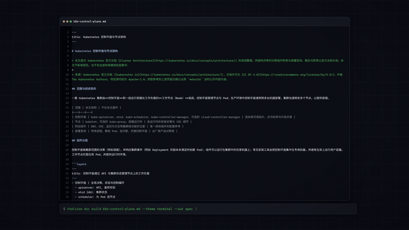</a></p>

*The opening of the 46-second silent promo: one render, then the four themes. Click to open the full MP4.*

<a id="quick-start"></a>

## Quick start

**1. Install.** You need Git and Node.js 22+. In a project directory, run:

```bash
npx skills add fengwk/html-view-skill
```

Add `-g` for a global install:

```bash
npx skills add fengwk/html-view-skill -g
```

List the skills the repository would install first:

```bash
npx skills add fengwk/html-view-skill --list
```

This repository currently lists `html-view`. `npx skills` installs the skill into the canonical folder and links it into each agent’s skill directory.

**2. Restart your agent.** `html-view` shows up in the skill list. Other install methods are in the next section.

**3. Ask for the HTML you need.** For example:

> Use HTML View to turn `proposal.md` into a technical design reviewers can comment on. Keep the decisions and risks, and draw the call chain between services. Deliver the HTML and a checked PDF.

> Turn these pre-aggregated CSV files into an offline dashboard. The first screen should show the key metrics, the trend and the breakdown. Leave missing values blank rather than treating them as zero.

> Build a clickable release-approval prototype with a list, a detail page, a validation failure and a successful submission. Walk through the submit flow at phone width.

After generating the HTML, the agent runs `htmlview audit` on its content and resources, then `htmlview check` to open it at desktop width, phone width and on the printed page. Screenshots, PDF export and standalone charts need Chrome or Chromium on the machine (set `CHROME_PATH` if it isn't found).

The skill's own instructions are written in Chinese. Agents follow them fine, and the pages they produce use the language of your content: English input gives English headings, chart labels, number formats and PDF footers.

### Other install methods

You can also use the installer. On macOS, Linux or WSL, run this in a terminal:

```bash
curl -fsSL https://raw.githubusercontent.com/fengwk/html-view-skill/main/scripts/install.sh | bash
```

In Windows PowerShell, download the script, then run it:

```powershell
Invoke-WebRequest -UseBasicParsing -Uri 'https://raw.githubusercontent.com/fengwk/html-view-skill/main/scripts/install.ps1' -OutFile '.\install-html-view.ps1'
.\install-html-view.ps1
```

The script clones the repository to `~/.agents/skill-lib/html-view-skill` and sets up the links for Codex, Pi and Claude Code. Details are in [Install details](#install).

<a id="themes"></a>

## Built-in themes

Documents, reports and single-chart HTML files can switch themes without changing their content or data. The default theme is Terminal. The four shots below are the same kubernetes/kubernetes October 2026 dashboard in Paper, Claude, Tokyo Night and Terminal. The other themes and the full-page samples stay collapsed until you open one.

<table>
<tr>
<td align="center" valign="top" width="50%"><a href="docs/showcase/previews/en/theme-compare-paper.png">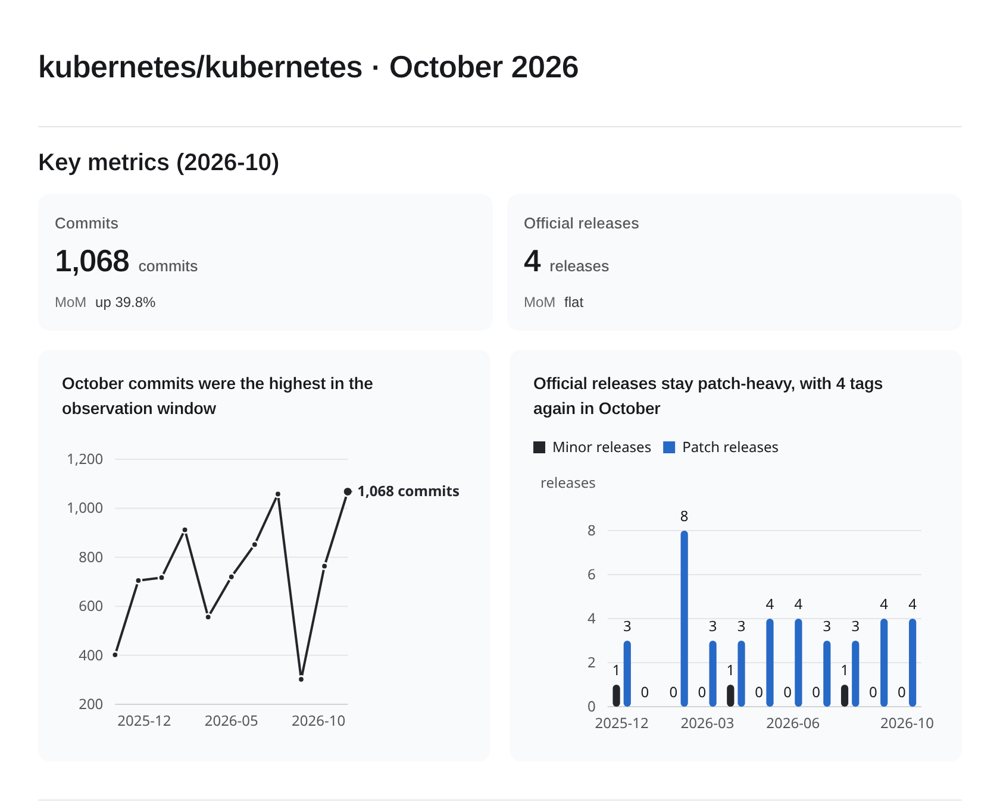</a><br><b>Paper</b><br><sub><code>light theme</code></sub></td>
<td align="center" valign="top" width="50%"><a href="docs/showcase/previews/en/theme-compare-claude.png">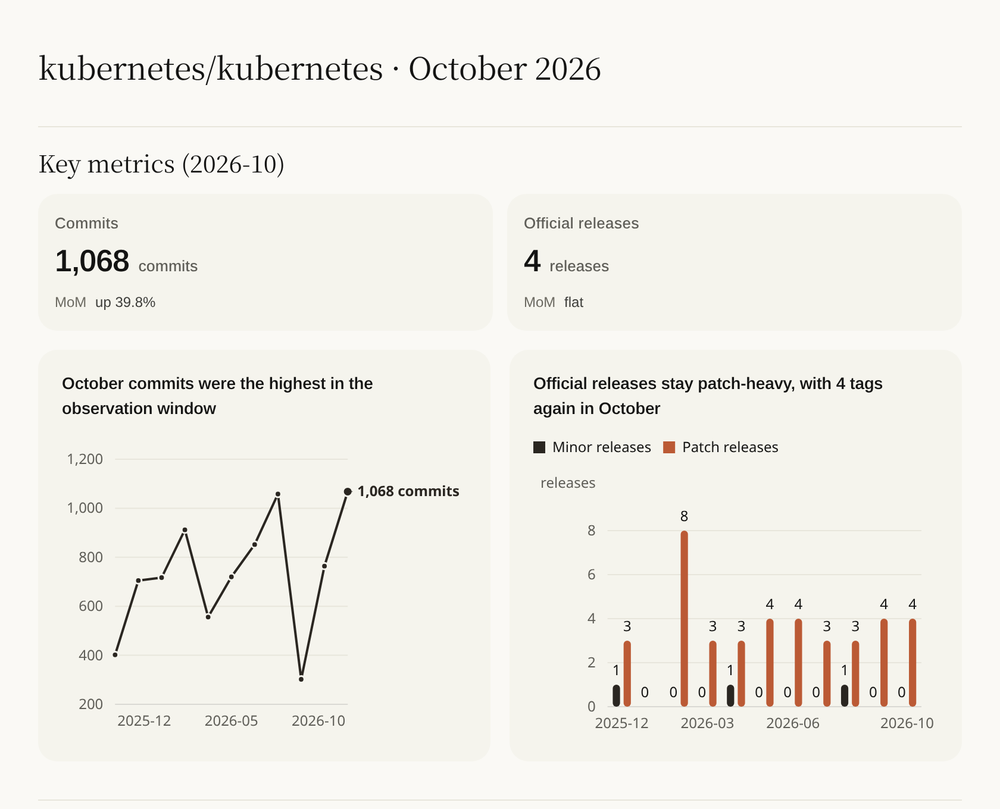</a><br><b>Claude</b><br><sub><code>light theme</code></sub></td>
</tr>
<tr>
<td align="center" valign="top" width="50%"><a href="docs/showcase/previews/en/theme-compare-tokyo.png">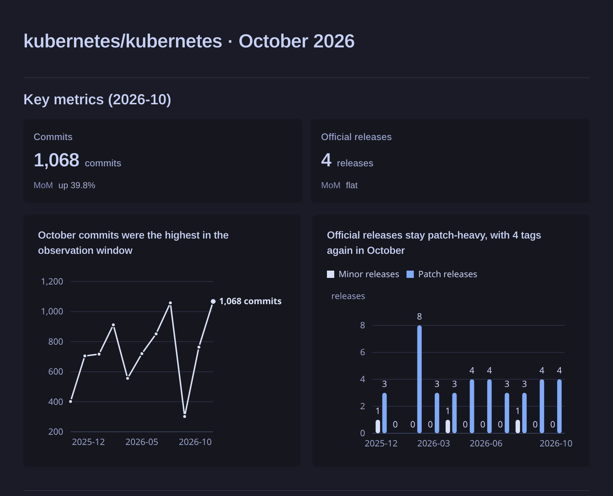</a><br><b>Tokyo Night</b><br><sub><code>dark theme</code></sub></td>
<td align="center" valign="top" width="50%"><a href="docs/showcase/previews/en/theme-compare-terminal.png">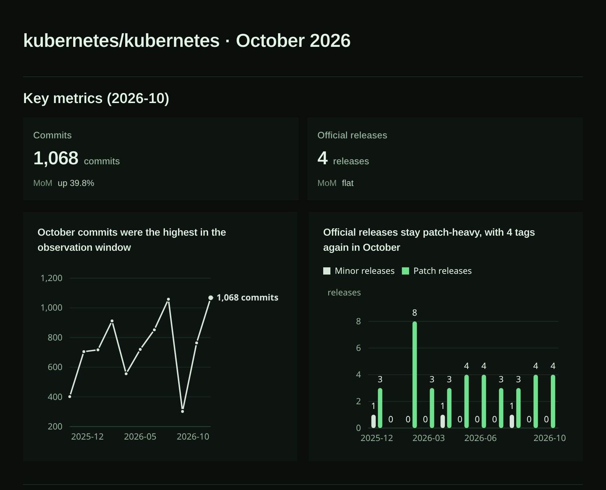</a><br><b>Terminal</b><br><sub><code>dark theme</code></sub></td>
</tr>
</table>

The same chart in all seven built-in themes:

<!-- themes:begin -->
<table>
<tr>
<td align="center" valign="top" width="25%"><a href="docs/showcase/gallery/en/theme-paper.svg"></a><br><b>Paper</b><br><sub><code>light theme</code></sub></td>
<td align="center" valign="top" width="25%"><a href="docs/showcase/gallery/en/theme-claude.svg">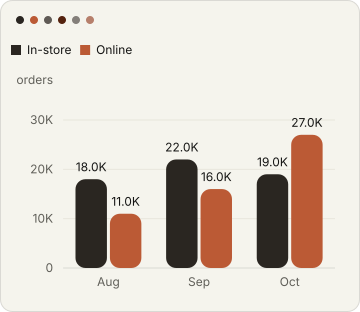</a><br><b>Claude</b><br><sub><code>light theme</code></sub></td>
<td align="center" valign="top" width="25%"><a href="docs/showcase/gallery/en/theme-tokyo.svg">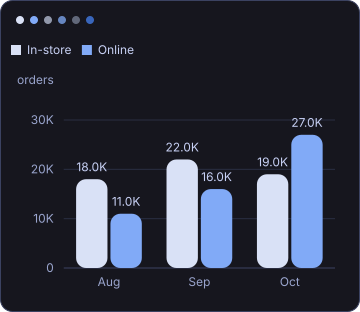</a><br><b>Tokyo Night</b><br><sub><code>dark theme</code></sub></td>
<td align="center" valign="top" width="25%"><a href="docs/showcase/gallery/en/theme-terminal.svg"></a><br><b>Terminal</b><br><sub><code>dark theme</code></sub></td>
</tr>
</table>

<table>
<tr>
<td align="center" valign="top" width="33%"><a href="docs/showcase/gallery/en/theme-obsidian.svg">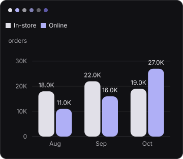</a><br><b>Obsidian</b><br><sub><code>dark theme</code></sub></td>
<td align="center" valign="top" width="33%"><a href="docs/showcase/gallery/en/theme-kanagawa.svg">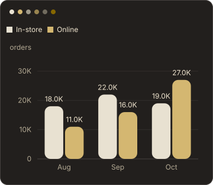</a><br><b>Kanagawa</b><br><sub><code>dark theme</code></sub></td>
<td align="center" valign="top" width="33%"><a href="docs/showcase/gallery/en/theme-cloudmusic.svg"></a><br><b>Cloud Music</b><br><sub><code>light theme</code></sub></td>
</tr>
</table>

**Full page samples**: the same document in each theme. Click a theme name to open it; one stays open at a time.

<details name="theme-page">
<summary><b>Claude</b> · light theme</summary>

<a href="docs/showcase/gallery/en/theme-claude-page.png">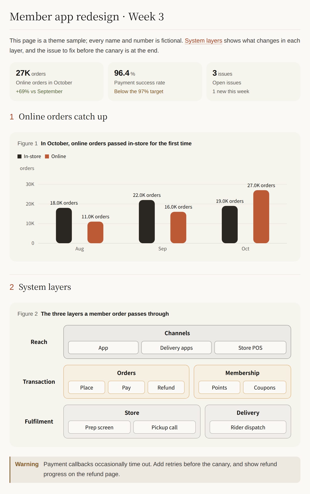</a>

</details>
<details name="theme-page">
<summary><b>Paper</b> · light theme</summary>

<a href="docs/showcase/gallery/en/theme-paper-page.png"></a>

</details>
<details name="theme-page">
<summary><b>Obsidian</b> · dark theme</summary>

<a href="docs/showcase/gallery/en/theme-obsidian-page.png"></a>

</details>
<details name="theme-page">
<summary><b>Tokyo Night</b> · dark theme</summary>

<a href="docs/showcase/gallery/en/theme-tokyo-page.png"></a>

</details>
<details name="theme-page">
<summary><b>Kanagawa</b> · dark theme</summary>

<a href="docs/showcase/gallery/en/theme-kanagawa-page.png"></a>

</details>
<details name="theme-page">
<summary><b>Terminal</b> · dark theme</summary>

<a href="docs/showcase/gallery/en/theme-terminal-page.png"></a>

</details>
<details name="theme-page">
<summary><b>Cloud Music</b> · light theme</summary>

<a href="docs/showcase/gallery/en/theme-cloudmusic-page.png"></a>

</details>
<!-- themes:end -->

Use `htmlview style report.html --theme obsidian` to switch to a built-in theme, or `--theme-file harbor.json` to apply your own palette. The HTML embeds the theme, so you do not need to attach the JSON when you share it. To add a built-in theme, put the JSON in the [library theme directory](packages/kchart/assets/themes/), run `npm run build` and `npm run vendor` in `packages/kchart`, then refresh this section with the [gallery generator](docs/showcase/README.en.md#readme-gallery) after reviewing the samples. Prototype colors come from `--brand` and `--scheme`. [Theme format and maintenance →](docs/architecture.en.md#themes)

<a id="showcase"></a>

## What you get

The three complete product shots below were rendered by the current skill in the default Terminal theme. Prototype colors come from `--brand` and `--scheme`, not from the document themes. The reading document is a condensed restatement of the official Kubernetes [Cluster Architecture](https://kubernetes.io/docs/concepts/architecture/) page, licensed [CC BY 4.0](https://creativecommons.org/licenses/by/4.0/), © The Kubernetes Authors. Dashboard and monthly-report figures come from public GitHub metadata for [kubernetes/kubernetes](https://github.com/kubernetes/kubernetes), fetched at 2026-11-24T17:22Z; that repository is Apache-2.0. The release-approval flow is a sample prototype, not the real Kubernetes release process. Definitions and reproduction steps are in [SOURCES.md](docs/showcase/SOURCES.md) and the [showcase folder](docs/showcase/README.en.md).

| Output | What you can do with the file |
|---|---|
| [Reading document](skills/html-view/references/artifacts/doc.md) | Jump from the table of contents, match numbered figures and tables to the text, comment on any passage; check the print layout and export PDF |
| [Data report](skills/html-view/references/artifacts/data.md) | Read month-over-month and year-over-year changes, open the underlying rows, check metric definitions, sources and raw values |
| [Dashboard](skills/html-view/references/artifacts/data.md) | Scan key metrics, trends and outliers on the first screen; switch between precomputed views without querying live data |
| [Clickable prototype](skills/html-view/references/artifacts/ui.md) | Walk through screen changes, form validation and state changes; no backend is called |

**Reading document · Kubernetes control plane and node architecture**

<p align="center"><a href="docs/showcase/previews/en/doc-reading.png"></a></p>

<p align="center"><a href="docs/showcase/previews/en/doc-architecture.png">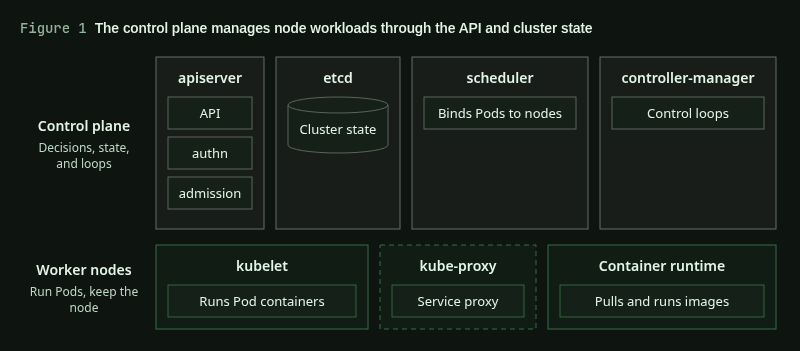</a></p>

**Report and dashboard · kubernetes/kubernetes · October 2026**

<table>
<tr><td width="50%"><a href="docs/showcase/previews/en/data-periodic.png"></a></td><td width="50%"><a href="docs/showcase/previews/en/dashboard-hero.png"></a></td></tr>
</table>

The monthly report and the dashboard use the same figures. The dashboard is two columns on a wide screen and one column on a phone; the phone first screen is in the [showcase folder](docs/showcase/README.en.md).

**Clickable prototype · Release approval**

<table>
<tr><td width="72%" valign="top"><a href="docs/showcase/previews/en/ui-desktop-overview.png">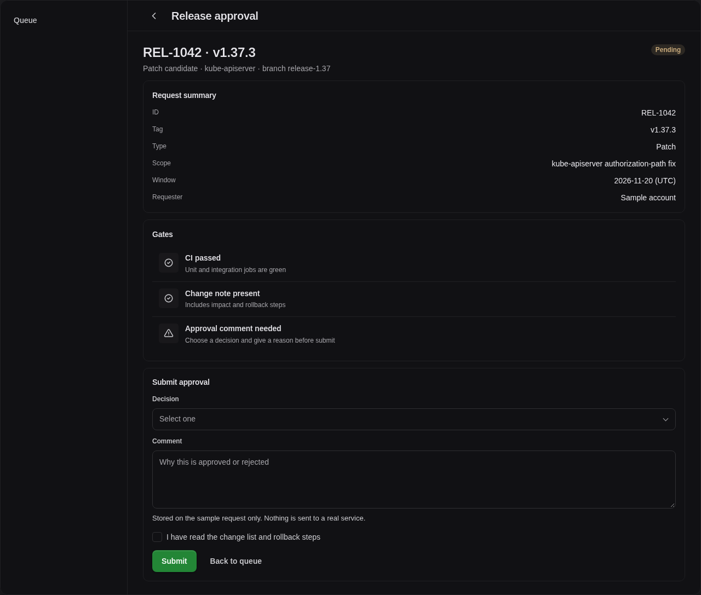</a></td><td width="28%" valign="top"><a href="docs/showcase/previews/en/ui-mobile-invalid.png">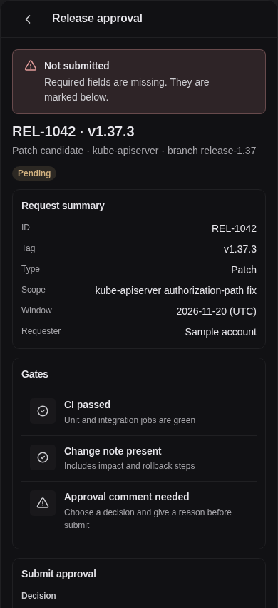</a></td></tr>
</table>

One prototype: the detail page on desktop, submit validation on a phone. The list, detail, validation-failure and success screens all click through. Colors come from `--brand` and `--scheme`.

[Sample sources and how to reproduce them →](docs/showcase/README.en.md)

<a id="featured"></a>

## Featured charts

These eight figures were rendered by the current skill. The Gantt chart is labeled as a sample. The full set of KChart data charts, diagrams and variants is in the [showcase gallery](docs/showcase/README.en.md#gallery).

<table>
<tr>
<td align="center" valign="top" width="50%"><a href="docs/showcase/previews/gallery/en/swimlane.png">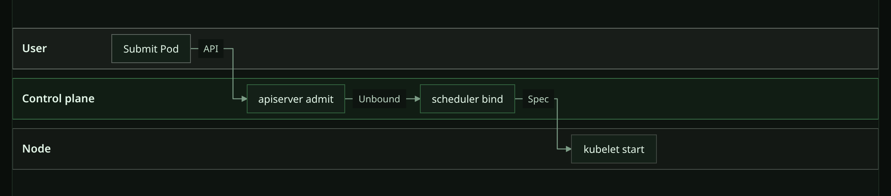</a><br><b>Swimlane</b><br><sub><code>swimlane</code></sub></td>
<td align="center" valign="top" width="50%"><a href="docs/showcase/previews/gallery/en/C4Context.png">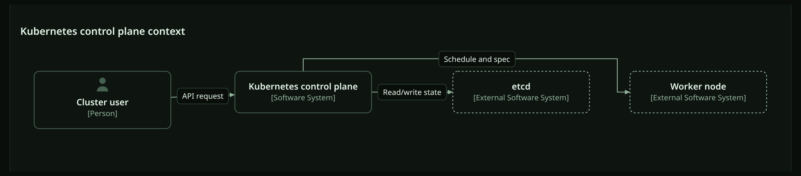</a><br><b>C4 context</b><br><sub><code>C4Context</code></sub></td>
</tr>
<tr>
<td align="center" valign="top" width="50%"><a href="docs/showcase/previews/gallery/en/gitGraph.png">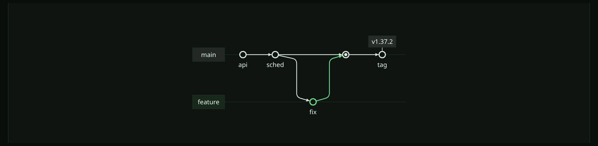</a><br><b>Git graph</b><br><sub><code>gitGraph</code></sub></td>
<td align="center" valign="top" width="50%"><a href="docs/showcase/previews/gallery/en/layers.png">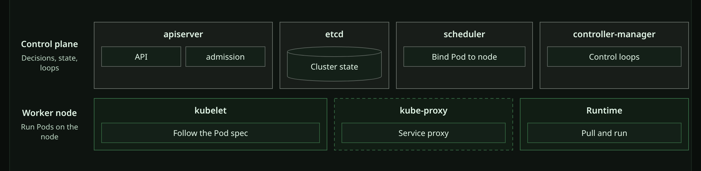</a><br><b>Layers</b><br><sub><code>layers</code></sub></td>
</tr>
<tr>
<td align="center" valign="top" width="50%"><a href="docs/showcase/previews/gallery/en/kchart-line.png">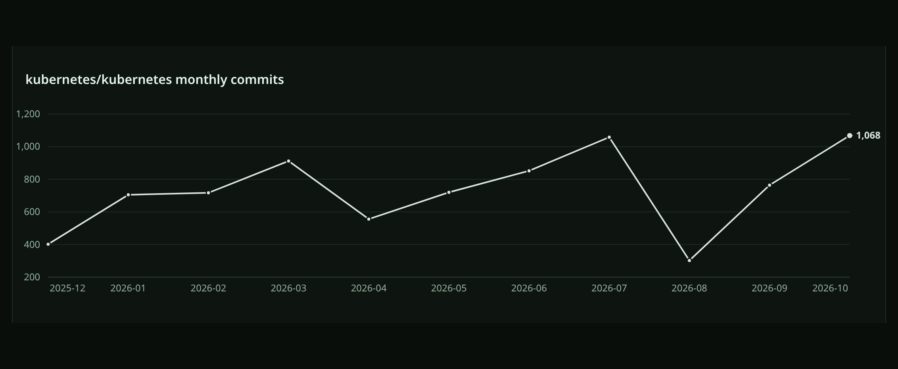</a><br><b>Line chart</b><br><sub><code>line</code></sub></td>
<td align="center" valign="top" width="50%"><a href="docs/showcase/previews/gallery/en/sequenceDiagram.png">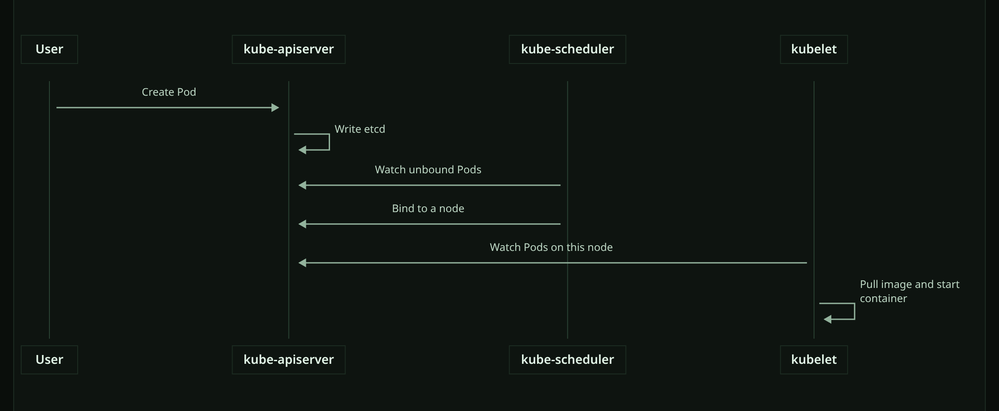</a><br><b>Sequence diagram</b><br><sub><code>sequenceDiagram</code></sub></td>
</tr>
<tr>
<td align="center" valign="top" width="50%"><a href="docs/showcase/previews/gallery/en/kchart-donut.png">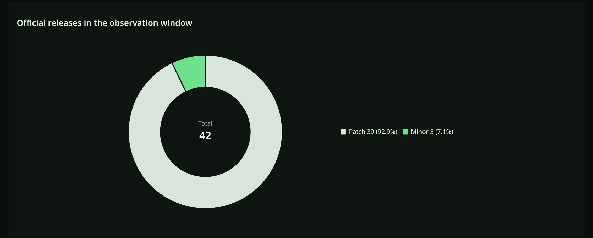</a><br><b>Donut</b><br><sub><code>donut</code></sub></td>
<td align="center" valign="top" width="50%"><a href="docs/showcase/previews/gallery/en/gantt.png">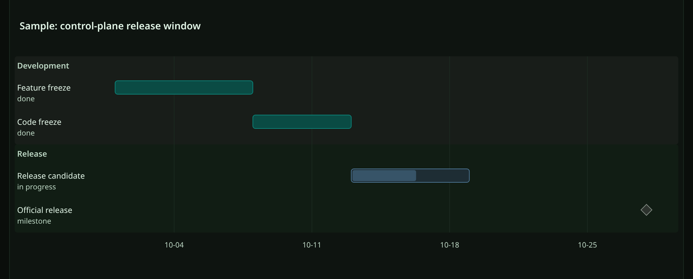</a><br><b>Gantt (sample)</b><br><sub><code>gantt</code></sub></td>
</tr>
</table>

<a id="review"></a>

## Comments and copy

Rendered documents support comments on a text selection. Select a passage, choose Comment, and the note is stored locally. Copy all exports a `Review Document` block for an agent, including `File`, the selected text and the comment.

Figures and code blocks show a copy icon on hover or keyboard focus. It copies the figure source or the code; the icon turns into a check mark when the copy succeeds. On touch devices the icon stays visible.

<a id="update-uninstall"></a>

## Update and uninstall

If you installed with `npx skills add`:

```bash
npx skills update html-view
npx skills remove html-view
```

Add `-g` for a global install:

```bash
npx skills update -g html-view
npx skills remove -g html-view
```

If you used the installer, update by pulling the clone; both links keep pointing at it:

```bash
git -C "$HOME/.agents/skill-lib/html-view-skill" pull --ff-only
```

**Uninstall** by checking that both links point at this project, then removing them. Without `-r`, `rm` only removes a link; if a real folder sits there, it fails instead of deleting it.

```bash
readlink ~/.agents/skills/html-view ~/.claude/skills/html-view   # should end in …/html-view-skill/skills/html-view
rm ~/.agents/skills/html-view ~/.claude/skills/html-view
```

On Windows, remove each junction with `cmd /c rmdir "<path>"`; without `/s` it removes only the junction. Once nothing else uses the clone, move `~/.agents/skill-lib/html-view-skill` away. If the installer skipped an existing entry with the same name, that entry isn't part of this project, so keep it.

<a id="install"></a>

## Install details

The installer ([`scripts/install.sh`](scripts/install.sh), [`scripts/install.ps1`](scripts/install.ps1)) clones the repository to `~/.agents/skill-lib/html-view-skill` and links its `skills/html-view` folder into two places:

| Link | Read by |
|---|---|
| `~/.agents/skills/html-view` | [Codex](https://learn.chatgpt.com/docs/build-skills#where-codex-loads-local-skills), [Pi](https://docs.pi.dev/latest/skills) |
| `~/.claude/skills/html-view` | [Claude Code](https://code.claude.com/docs/en/skills#where-skills-live) |

Each tool chooses its own folder; the Agent Skills specification does not define a shared location. For other agents, link or copy `skills/html-view` into the folder they load skills from.

- **Safe to rerun.** A valid existing clone is reused and never pulled automatically. A broken clone or one from another origin is reported, not replaced. Each link is checked on its own, and an existing file, folder or broken link with the same name is left untouched.
- **An interrupted download installs nothing.** The script starts only once it has been read in full, so a dropped connection changes nothing.
- **Manual clones work too.** Clone to the location above, then run the script to add the links.
- **Native Windows** uses directory junctions instead of symbolic links. Whether each agent picks up a junction has not been tested on native Windows yet. WSL uses the `$HOME` of its Linux environment.
- **If PowerShell blocks the script** only because it came from the internet under `RemoteSigned`, check it, run `Unblock-File -LiteralPath '.\install-html-view.ps1'`, then run it again. You don't need to change the system policy.

<a id="cli"></a>

## CLI and maintenance

From the repository root, build a sample document and check it:

```sh
node skills/html-view/scripts/htmlview doc build docs/showcase/examples/en/k8s-control-plane.md --type tech-spec --out k8s-control-plane.html
node skills/html-view/scripts/htmlview audit k8s-control-plane.html
node skills/html-view/scripts/htmlview check k8s-control-plane.html --paper a3-portrait
node skills/html-view/scripts/htmlview export k8s-control-plane.html --format pdf --paper a3-portrait --out k8s-control-plane.pdf
```

`check` uses a real browser to test narrow screens, overflow inside charts and the printed page. PDF export stops when something would be clipped instead of shrinking charts or text. Try A4 landscape for wide charts and A3 portrait for tall ones; if it still doesn't fit, rearrange the content or attach the full SVG. Before sharing HTML, check the metadata in its source: documents may record the Markdown source path, and reports embed their sources and calculation evidence.

Further reading, in Chinese: [skill entry](skills/html-view/SKILL.md) · [CLI and regression tests](skills/html-view/scripts/README.md) · [installer tests](scripts/tests/install.test.mjs) · [KChart API](packages/kchart/README.md) · [architecture and themes](docs/architecture.md) (the architecture notes also exist [in English](docs/architecture.en.md)).

To change KChart, work in `packages/kchart`; once `npm ci && npm test` passes, `npm run build && npm run vendor` mirrors the build into `skills/html-view/vendor/kchart`. The skill imports only that mirror, so installing it never needs npm. See [the architecture notes](docs/architecture.en.md) for the layout and build flow.

<a id="license"></a>

## License

Original code and documentation are under the [MIT License](LICENSE). Prism keeps its [upstream MIT license](skills/html-view/assets/vendor/prism.js). Terms for icons, brand marks and Natural Earth map data are in the [third-party notice](packages/kchart/NOTICE.md). See the [acknowledgments](NOTICE.md) for the source of the dashboard design guidance.

The reading-document sample is based on the official Kubernetes [Cluster Architecture](https://kubernetes.io/docs/concepts/architecture/) page, licensed [CC BY 4.0](https://creativecommons.org/licenses/by/4.0/), © The Kubernetes Authors. Dashboard and monthly-report figures come from public GitHub metadata for `kubernetes/kubernetes`, which is Apache-2.0. See [SOURCES.md](docs/showcase/SOURCES.md).
