# HTML View

**让 Agent 稳定交付好读的 HTML：文档、数据报表、Dashboard 与可点击原型。**

简体中文 · [English](README.en.md)

把 Markdown、已汇总的 CSV／JSON 或一段产品流程交给 Agent，它会交回一个**可以离线打开的 HTML 文件**。图表、主题和交互都内嵌在文件里，不用启动服务器，也不从网络加载资源。交付前，Agent 会在真实浏览器里检查窄屏和打印版心，需要时再导出 PDF 或 PNG。

技能不只管排版。拿到零散笔记、会议记录或 JSON 时，Agent 先按读者要做的事重排内容；做 Dashboard 时，先定这一屏回答什么问题，再把强调色只留给需要处理的那一项。

[快速开始](#quick-start) · [交付样张](#showcase) · [**45 种数据图与 30 种结构图**](#gallery) · [七套主题](#themes) · [安装说明](#install) · [更新与卸载](#update-uninstall)

<p align="center"><a href="docs/showcase/previews/zh-CN/dashboard-hero.png"><picture><source media="(max-width: 600px)" srcset="docs/showcase/previews/zh-CN/dashboard-mobile.png"></picture></a></p>

*实际生成的 Dashboard：宽屏双列，手机上改为单列。渠道视图可离线切换；样例数据均为虚构。*

<a id="quick-start"></a>

## 快速开始

**1. 安装。** 需要 Git 和 Node.js 22+。先下载脚本，看过再执行：

```bash
# macOS / Linux / WSL
curl -fsSL --proto '=https' -o install-html-view.sh https://raw.githubusercontent.com/fengwk/html-view-skill/main/scripts/install.sh
bash ./install-html-view.sh
```

```powershell
# Windows PowerShell
Invoke-WebRequest -UseBasicParsing -Uri 'https://raw.githubusercontent.com/fengwk/html-view-skill/main/scripts/install.ps1' -OutFile '.\install-html-view.ps1'
.\install-html-view.ps1
```

**2. 重开 Agent。** Codex、Pi 和 Claude Code 的技能列表里会出现 `html-view`。其他 Agent 见[安装说明](#install)。

**3. 说出你要的 HTML。** 例如：

> 用 HTML View 把 `proposal.md` 做成一份可以批注的技术方案。保留决策和风险，画清服务之间的调用链；交付 HTML 和检查过的 PDF。

> 把这些已汇总的 CSV 做成离线 Dashboard。首屏看关键指标、收入趋势和渠道差异，数字要能打开明细核对；缺失别填成 0。

> 做一个可点的报销原型。包含列表、详情、提交失败和成功状态；在手机宽度实际走一次提交流程。

Agent 生成 HTML 后会运行 `htmlview audit` 检查内容和资源，再用 `htmlview check` 在桌面、手机和打印版心下实际打开。截图、导出 PDF 和渲染独立图需要本机有 Chrome 或 Chromium（可用 `CHROME_PATH` 指定）。

<a id="showcase"></a>

## 交付样张

| 产物 | 打开文件后，你能做什么 |
|---|---|
| [阅读文档](skills/html-view/references/artifacts/doc.md) | 从目录跳转、对照编号与图表、逐段批注；检查打印后导出 PDF |
| [数据报表](skills/html-view/references/artifacts/data.md) | 看同比环比，打开明细，核对指标口径、来源和原始读数 |
| [Dashboard](skills/html-view/references/artifacts/data.md) | 首屏扫读关键指标、趋势和异常；用预计算视图切换渠道或区域，不查询线上数据 |
| [可点击原型](skills/html-view/references/artifacts/ui.md) | 走通页面切换、表单校验、筛选和状态变化；不调用业务服务 |

<table>
<tr><td width="50%"><strong>阅读文档 · 通知平台技术方案</strong><br><a href="docs/showcase/previews/zh-CN/doc-reading.png"></a></td><td width="50%"><strong>数据报表 · 拾光咖啡月报</strong><br><a href="docs/showcase/previews/zh-CN/data-periodic.png">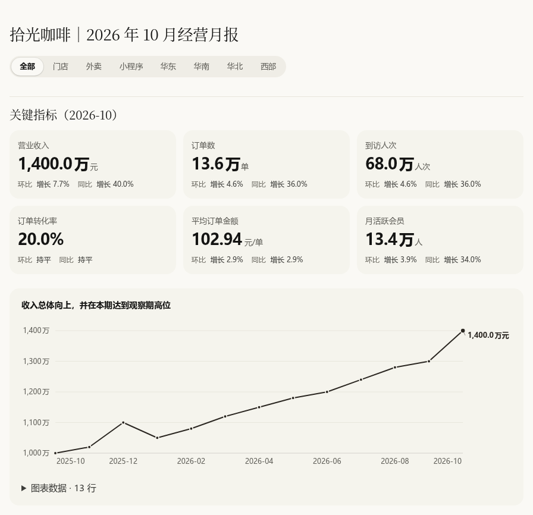</a></td></tr>
</table>

**可点击原型 · 留存观察台**

<table>
<tr><td width="72%"><a href="docs/showcase/previews/zh-CN/ui-desktop-overview.png"></a></td><td width="28%"><a href="docs/showcase/previews/zh-CN/ui-mobile-filtered.png">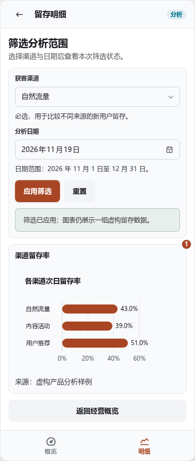</a></td></tr>
</table>

同一份原型，桌面看经营概览，手机走渠道与日期筛选。原型的配色由 `--brand` 和 `--scheme` 控制。

[样例源码与复现方式 →](docs/showcase/README.md)

<a id="gallery"></a>

## KChart 图谱

HTML View 的图表由自带的 KChart 库绘制：**45 种数据图、38 项受控变体、27 种 Mermaid 子集图型、3 种原生结构图、8 种脑图布局**。下面每一种都有一张真实渲染的样张，统一使用 Claude 配色。每张图占一格，两列对齐；宽图占满一行，不为拼图缩小文字。手机上 GitHub 会把两列按屏宽缩小，点击图片可打开原尺寸 SVG。

[生成可筛选的完整图库 →](docs/showcase/README.md#full-gallery)

<!-- gallery:begin -->
<a id="charts"></a>

### 数据图

[趋势与时间](#trends) · [比较、目标与区间](#comparison) · [构成与增减](#composition) · [分布与相关](#distribution) · [矩阵与多维](#matrix) · [层级](#hierarchy) · [网络、流量与路径](#relations) · [地图](#geography)

<a id="trends"></a>

#### 趋势与时间

<table>
<tr>
<td align="center" valign="top" width="50%"><a href="docs/showcase/gallery/zh-CN/chart-line.svg"></a><br><b>走势</b><br><sub><code>line</code></sub></td>
<td align="center" valign="top" width="50%"><a href="docs/showcase/gallery/zh-CN/chart-sparkline.svg"></a><br><b>迷你走势</b><br><sub><code>sparkline</code></sub></td>
</tr>
<tr>
<td align="center" valign="top" width="50%"><a href="docs/showcase/gallery/zh-CN/chart-area.svg">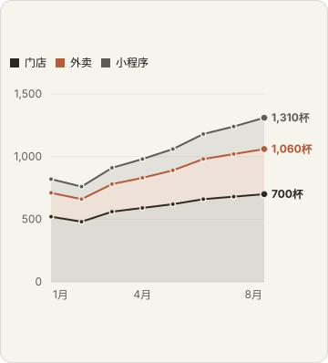</a><br><b>堆叠面积</b><br><sub><code>area</code></sub></td>
<td align="center" valign="top" width="50%"><a href="docs/showcase/gallery/zh-CN/chart-candlestick.svg"></a><br><b>开收与高低</b><br><sub><code>candlestick</code></sub></td>
</tr>
<tr>
<td colspan="2" align="center"><a href="docs/showcase/gallery/zh-CN/chart-small-multiples.svg">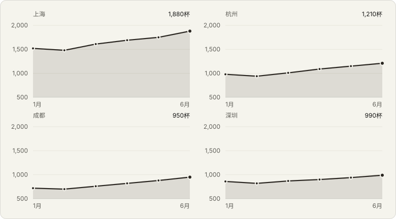</a><br><b>小多图</b><br><sub><code>small-multiples</code></sub></td>
</tr>
<tr>
<td align="center" valign="top" width="50%"><a href="docs/showcase/gallery/zh-CN/chart-stream.svg"></a><br><b>流图</b><br><sub><code>stream</code></sub></td>
<td align="center" valign="top" width="50%"><a href="docs/showcase/gallery/zh-CN/chart-split-compare.svg"></a><br><b>上下对照</b><br><sub><code>split-compare</code></sub></td>
</tr>
<tr>
<td colspan="2" align="center"><a href="docs/showcase/gallery/zh-CN/chart-combo.svg">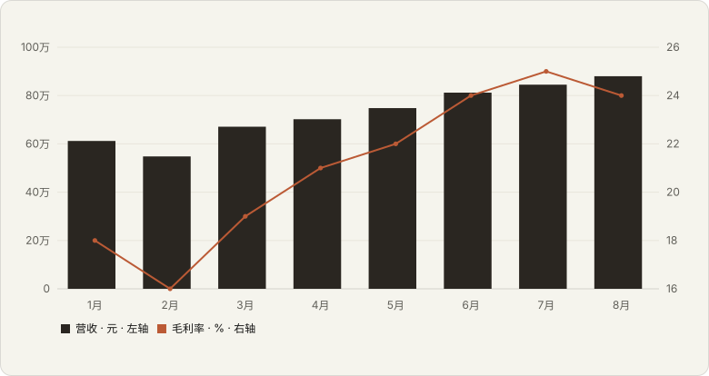</a><br><b>双轴组合</b><br><sub><code>combo</code></sub></td>
</tr>
<tr>
<td colspan="2" align="center"><a href="docs/showcase/gallery/zh-CN/chart-bump.svg">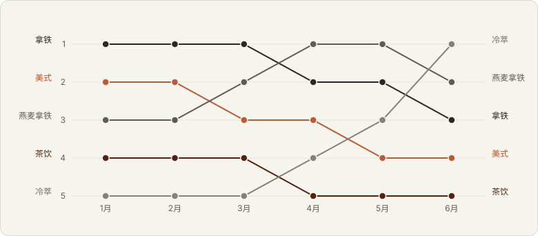</a><br><b>排名变动</b><br><sub><code>bump</code></sub></td>
</tr>
<tr>
<td colspan="2" align="center"><a href="docs/showcase/gallery/zh-CN/chart-launch-fan.svg"></a><br><b>从开张到现在</b><br><sub><code>launch-fan</code></sub></td>
</tr>
</table>

<a id="comparison"></a>

#### 比较、目标与区间

<table>
<tr>
<td align="center" valign="top" width="50%"><a href="docs/showcase/gallery/zh-CN/chart-bar.svg"></a><br><b>横向比较</b><br><sub><code>bar</code></sub></td>
<td align="center" valign="top" width="50%"><a href="docs/showcase/gallery/zh-CN/chart-column.svg">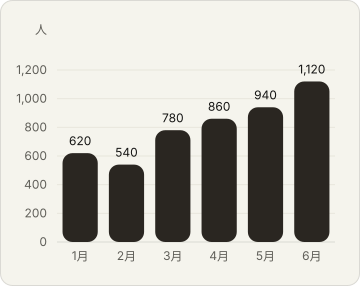</a><br><b>纵向比较</b><br><sub><code>column</code></sub></td>
</tr>
<tr>
<td align="center" valign="top" width="50%"><a href="docs/showcase/gallery/zh-CN/chart-dumbbell.svg">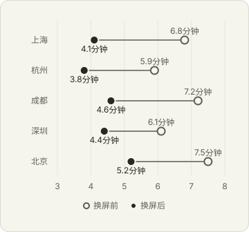</a><br><b>前后差距</b><br><sub><code>dumbbell</code></sub></td>
<td align="center" valign="top" width="50%"><a href="docs/showcase/gallery/zh-CN/chart-bullet.svg">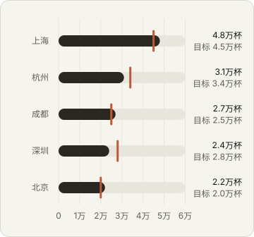</a><br><b>实际与目标</b><br><sub><code>bullet</code></sub></td>
</tr>
<tr>
<td align="center" valign="top" width="50%"><a href="docs/showcase/gallery/zh-CN/chart-slope.svg">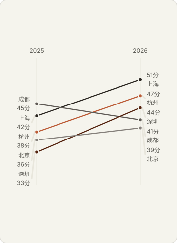</a><br><b>变化方向</b><br><sub><code>slope</code></sub></td>
<td align="center" valign="top" width="50%"><a href="docs/showcase/gallery/zh-CN/chart-interval.svg"></a><br><b>区间与中位数</b><br><sub><code>interval</code></sub></td>
</tr>
<tr>
<td colspan="2" align="center"><a href="docs/showcase/gallery/zh-CN/chart-gauge.svg"></a><br><b>完成度</b><br><sub><code>gauge</code></sub></td>
</tr>
</table>

<a id="composition"></a>

#### 构成与增减

<table>
<tr>
<td align="center" valign="top" width="50%"><a href="docs/showcase/gallery/zh-CN/chart-share.svg">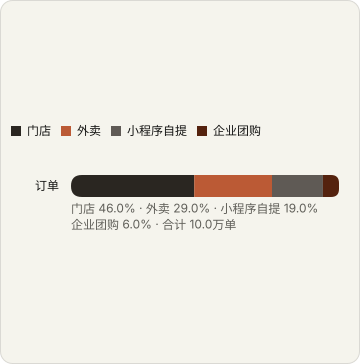</a><br><b>占比条</b><br><sub><code>share</code></sub></td>
<td align="center" valign="top" width="50%"><a href="docs/showcase/gallery/zh-CN/chart-waffle.svg">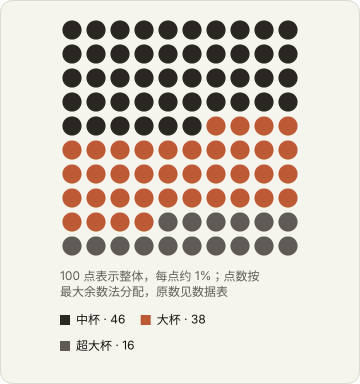</a><br><b>百格图</b><br><sub><code>waffle</code></sub></td>
</tr>
<tr>
<td align="center" valign="top" width="50%"><a href="docs/showcase/gallery/zh-CN/chart-pie.svg">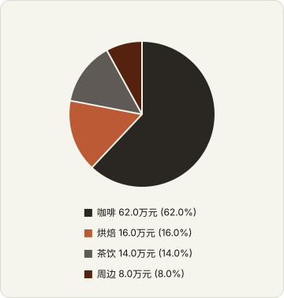</a><br><b>饼图</b><br><sub><code>pie</code></sub></td>
<td align="center" valign="top" width="50%"><a href="docs/showcase/gallery/zh-CN/chart-funnel.svg">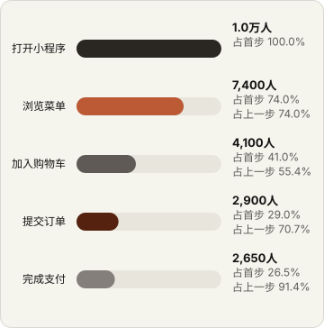</a><br><b>漏斗</b><br><sub><code>funnel</code></sub></td>
</tr>
<tr>
<td align="center" valign="top" width="50%"><a href="docs/showcase/gallery/zh-CN/chart-donut.svg"></a><br><b>环形图</b><br><sub><code>donut</code></sub></td>
<td align="center" valign="top" width="50%"><a href="docs/showcase/gallery/zh-CN/chart-radial-share.svg">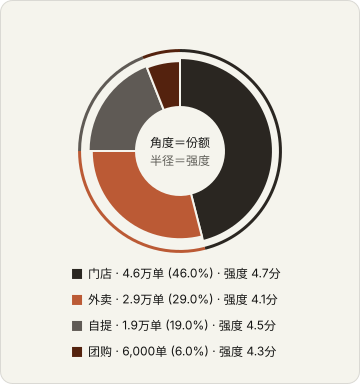</a><br><b>份额与强度</b><br><sub><code>radial-share</code></sub></td>
</tr>
<tr>
<td align="center" valign="top" width="50%"><a href="docs/showcase/gallery/zh-CN/chart-rose.svg"></a><br><b>玫瑰图</b><br><sub><code>rose</code></sub></td>
<td align="center" valign="top" width="50%"><a href="docs/showcase/gallery/zh-CN/chart-tally.svg">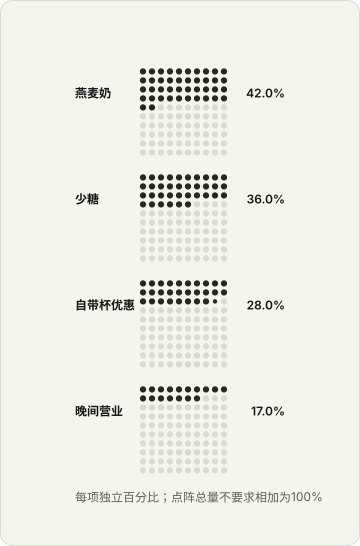</a><br><b>多选比例</b><br><sub><code>tally</code></sub></td>
</tr>
<tr>
<td colspan="2" align="center"><a href="docs/showcase/gallery/zh-CN/chart-waterfall.svg">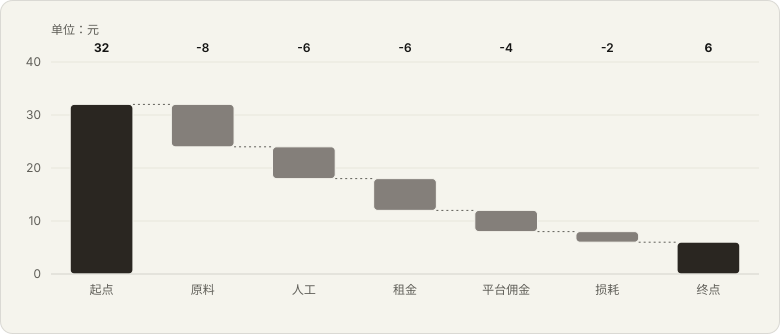</a><br><b>瀑布</b><br><sub><code>waterfall</code></sub></td>
</tr>
</table>

<a id="distribution"></a>

#### 分布与相关

<table>
<tr>
<td align="center" valign="top" width="50%"><a href="docs/showcase/gallery/zh-CN/chart-histogram.svg">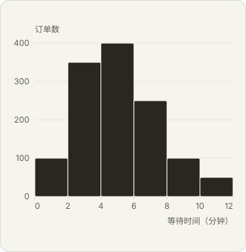</a><br><b>直方图</b><br><sub><code>histogram</code></sub></td>
<td align="center" valign="top" width="50%"><a href="docs/showcase/gallery/zh-CN/chart-scatter.svg"></a><br><b>散点图</b><br><sub><code>scatter</code></sub></td>
</tr>
<tr>
<td colspan="2" align="center"><a href="docs/showcase/gallery/zh-CN/chart-boxplot.svg"></a><br><b>箱线图</b><br><sub><code>boxplot</code></sub></td>
</tr>
<tr>
<td align="center" valign="top" width="50%"><a href="docs/showcase/gallery/zh-CN/chart-violin.svg"></a><br><b>小提琴图</b><br><sub><code>violin</code></sub></td>
<td align="center" valign="top" width="50%"><a href="docs/showcase/gallery/zh-CN/chart-strip.svg">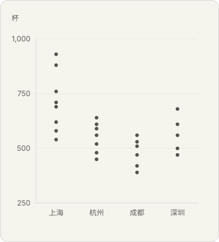</a><br><b>散点条</b><br><sub><code>strip</code></sub></td>
</tr>
</table>

<a id="matrix"></a>

#### 矩阵与多维

<table>
<tr>
<td colspan="2" align="center"><a href="docs/showcase/gallery/zh-CN/chart-heatmap.svg"></a><br><b>热力图</b><br><sub><code>heatmap</code></sub></td>
</tr>
<tr>
<td align="center" valign="top" width="50%"><a href="docs/showcase/gallery/zh-CN/chart-bubble-matrix.svg">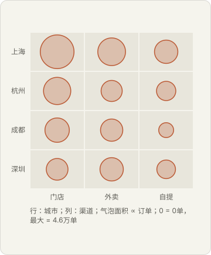</a><br><b>气泡矩阵</b><br><sub><code>bubble-matrix</code></sub></td>
<td align="center" valign="top" width="50%"><a href="docs/showcase/gallery/zh-CN/chart-radar.svg">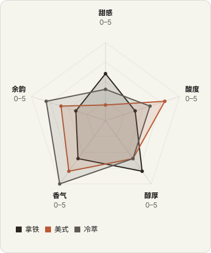</a><br><b>雷达图</b><br><sub><code>radar</code></sub></td>
</tr>
<tr>
<td colspan="2" align="center"><a href="docs/showcase/gallery/zh-CN/chart-parallel.svg"></a><br><b>平行坐标</b><br><sub><code>parallel</code></sub></td>
</tr>
<tr>
<td colspan="2" align="center"><a href="docs/showcase/gallery/zh-CN/chart-calendar.svg">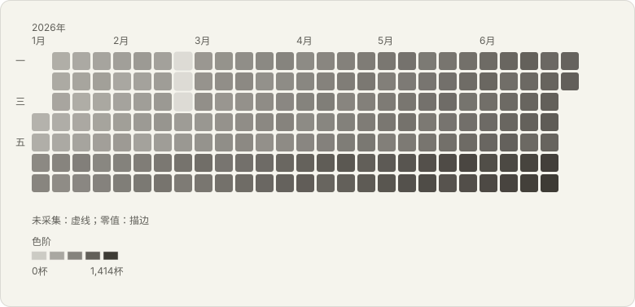</a><br><b>日历</b><br><sub><code>calendar</code></sub></td>
</tr>
</table>

<a id="hierarchy"></a>

#### 层级

<table>
<tr>
<td align="center" valign="top" width="50%"><a href="docs/showcase/gallery/zh-CN/chart-tree.svg">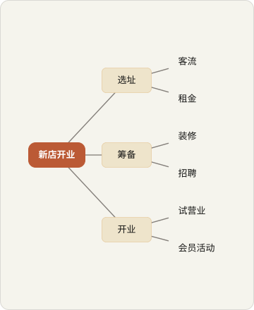</a><br><b>层级树</b><br><sub><code>tree</code></sub></td>
<td align="center" valign="top" width="50%"><a href="docs/showcase/gallery/zh-CN/chart-treemap.svg"></a><br><b>矩形树图</b><br><sub><code>treemap</code></sub></td>
</tr>
<tr>
<td colspan="2" align="center"><a href="docs/showcase/gallery/zh-CN/chart-mindmap.svg">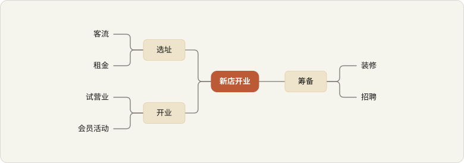</a><br><b>脑图</b><br><sub><code>mindmap</code></sub></td>
</tr>
<tr>
<td colspan="2" align="center"><a href="docs/showcase/gallery/zh-CN/chart-sunburst.svg">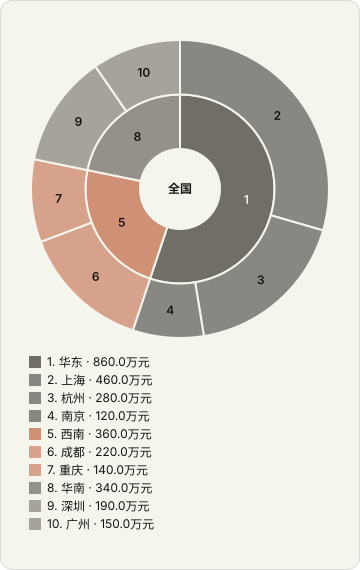</a><br><b>旭日图</b><br><sub><code>sunburst</code></sub></td>
</tr>
</table>

<a id="relations"></a>

#### 网络、流量与路径

<table>
<tr>
<td colspan="2" align="center"><a href="docs/showcase/gallery/zh-CN/chart-network.svg"></a><br><b>关系网络</b><br><sub><code>network</code></sub></td>
</tr>
<tr>
<td colspan="2" align="center"><a href="docs/showcase/gallery/zh-CN/chart-sankey.svg"></a><br><b>桑基图</b><br><sub><code>sankey</code></sub></td>
</tr>
<tr>
<td colspan="2" align="center"><a href="docs/showcase/gallery/zh-CN/chart-threads.svg"></a><br><b>路径流向</b><br><sub><code>threads</code></sub></td>
</tr>
</table>

<a id="geography"></a>

#### 地图

<table>
<tr>
<td colspan="2" align="center"><a href="docs/showcase/gallery/zh-CN/chart-choropleth.svg">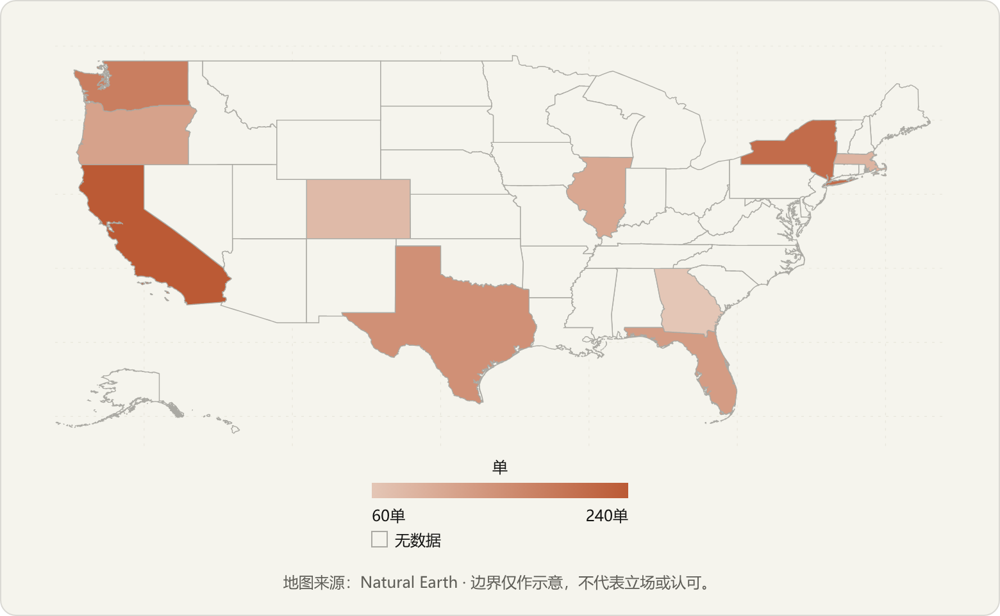</a><br><b>分区着色</b><br><sub><code>choropleth</code></sub></td>
</tr>
<tr>
<td colspan="2" align="center"><a href="docs/showcase/gallery/zh-CN/chart-geo-scatter.svg"></a><br><b>地图散点</b><br><sub><code>geo-scatter</code></sub></td>
</tr>
</table>

<a id="diagrams"></a>

### 结构图

[流程、状态与旅程](#process) · [时序与数据模型](#model) · [排期、看板与协议](#planning) · [架构与分层](#architecture) · [C4 的五个视角](#c4) · [Mermaid 数值图](#mermaid-data) · [一棵树，八种脑图布局](#mindmaps)

<a id="process"></a>

#### 流程、状态与旅程

<table>
<tr>
<td colspan="2" align="center"><a href="docs/showcase/gallery/zh-CN/diagram-flowchart.svg">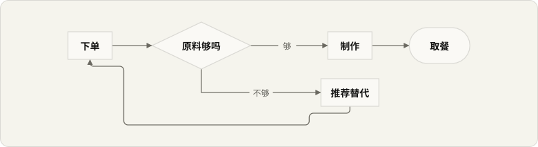</a><br><b>流程图</b><br><sub><code>flowchart</code></sub></td>
</tr>
<tr>
<td colspan="2" align="center"><a href="docs/showcase/gallery/zh-CN/diagram-stateDiagram-v2.svg"></a><br><b>状态图</b><br><sub><code>stateDiagram-v2</code></sub></td>
</tr>
<tr>
<td colspan="2" align="center"><a href="docs/showcase/gallery/zh-CN/diagram-journey.svg"></a><br><b>体验旅程</b><br><sub><code>journey</code></sub></td>
</tr>
<tr>
<td colspan="2" align="center"><a href="docs/showcase/gallery/zh-CN/diagram-swimlane.svg"></a><br><b>泳道图</b><br><sub><code>swimlane</code></sub></td>
</tr>
</table>

<a id="model"></a>

#### 时序与数据模型

<table>
<tr>
<td colspan="2" align="center"><a href="docs/showcase/gallery/zh-CN/diagram-sequenceDiagram.svg">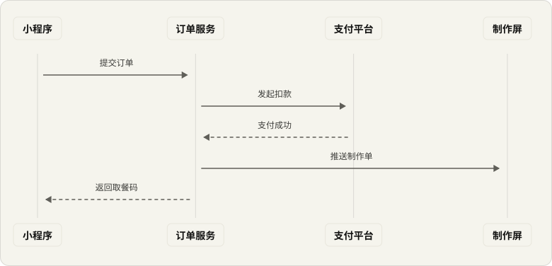</a><br><b>时序图</b><br><sub><code>sequenceDiagram</code></sub></td>
</tr>
<tr>
<td colspan="2" align="center"><a href="docs/showcase/gallery/zh-CN/diagram-zenuml.svg">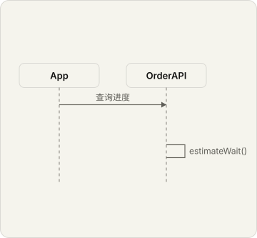</a><br><b>ZenUML</b><br><sub><code>zenuml</code></sub></td>
</tr>
<tr>
<td colspan="2" align="center"><a href="docs/showcase/gallery/zh-CN/diagram-erDiagram.svg"></a><br><b>ER 图</b><br><sub><code>erDiagram</code></sub></td>
</tr>
<tr>
<td align="center" valign="top" width="50%"><a href="docs/showcase/gallery/zh-CN/diagram-classDiagram.svg"></a><br><b>类图</b><br><sub><code>classDiagram</code></sub></td>
<td align="center" valign="top" width="50%"><a href="docs/showcase/gallery/zh-CN/diagram-requirementDiagram.svg"></a><br><b>需求图</b><br><sub><code>requirementDiagram</code></sub></td>
</tr>
</table>

<a id="planning"></a>

#### 排期、看板与协议

<table>
<tr>
<td colspan="2" align="center"><a href="docs/showcase/gallery/zh-CN/diagram-gantt.svg">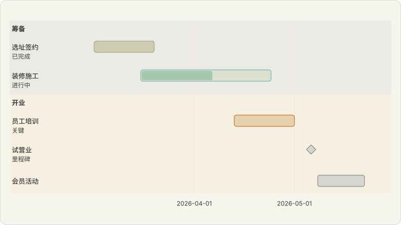</a><br><b>甘特图</b><br><sub><code>gantt</code></sub></td>
</tr>
<tr>
<td colspan="2" align="center"><a href="docs/showcase/gallery/zh-CN/diagram-timeline.svg">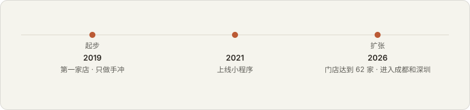</a><br><b>时间线</b><br><sub><code>timeline</code></sub></td>
</tr>
<tr>
<td colspan="2" align="center"><a href="docs/showcase/gallery/zh-CN/diagram-gitGraph.svg">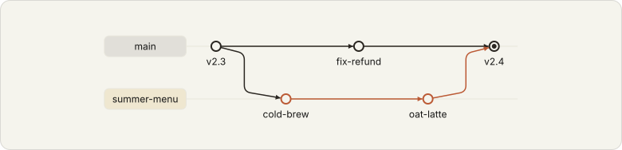</a><br><b>Git 分支</b><br><sub><code>gitGraph</code></sub></td>
</tr>
<tr>
<td colspan="2" align="center"><a href="docs/showcase/gallery/zh-CN/diagram-kanban.svg"></a><br><b>看板</b><br><sub><code>kanban</code></sub></td>
</tr>
<tr>
<td colspan="2" align="center"><a href="docs/showcase/gallery/zh-CN/diagram-packet-beta.svg">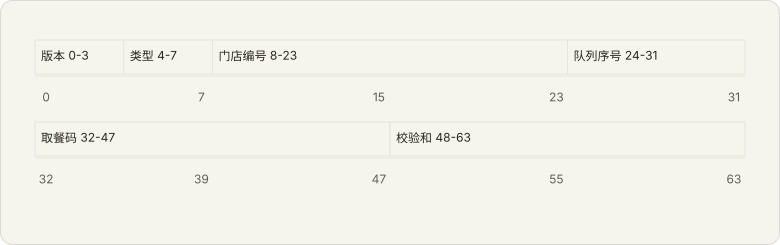</a><br><b>报文位域</b><br><sub><code>packet-beta</code></sub></td>
</tr>
<tr>
<td colspan="2" align="center"><a href="docs/showcase/gallery/zh-CN/diagram-quadrantChart.svg">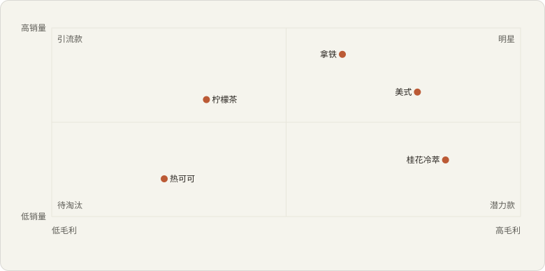</a><br><b>四象限</b><br><sub><code>quadrantChart</code></sub></td>
</tr>
</table>

<a id="architecture"></a>

#### 架构与分层

<table>
<tr>
<td colspan="2" align="center"><a href="docs/showcase/gallery/zh-CN/diagram-layers.svg">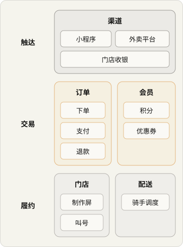</a><br><b>分层图</b><br><sub><code>layers</code></sub></td>
</tr>
<tr>
<td colspan="2" align="center"><a href="docs/showcase/gallery/zh-CN/diagram-blocks.svg"></a><br><b>能力块</b><br><sub><code>blocks</code></sub></td>
</tr>
<tr>
<td colspan="2" align="center"><a href="docs/showcase/gallery/zh-CN/diagram-architecture-beta.svg"></a><br><b>架构图</b><br><sub><code>architecture-beta</code></sub></td>
</tr>
<tr>
<td colspan="2" align="center"><a href="docs/showcase/gallery/zh-CN/diagram-block-beta.svg"></a><br><b>块图</b><br><sub><code>block-beta</code></sub></td>
</tr>
</table>

<a id="c4"></a>

#### C4 的五个视角

<table>
<tr>
<td align="center" valign="top" width="50%"><a href="docs/showcase/gallery/zh-CN/diagram-C4Context.svg"></a><br><b>系统上下文</b><br><sub><code>C4Context</code></sub></td>
<td align="center" valign="top" width="50%"><a href="docs/showcase/gallery/zh-CN/diagram-C4Deployment.svg"></a><br><b>部署</b><br><sub><code>C4Deployment</code></sub></td>
</tr>
<tr>
<td colspan="2" align="center"><a href="docs/showcase/gallery/zh-CN/diagram-C4Container.svg"></a><br><b>容器</b><br><sub><code>C4Container</code></sub></td>
</tr>
<tr>
<td align="center" valign="top" width="50%"><a href="docs/showcase/gallery/zh-CN/diagram-C4Component.svg">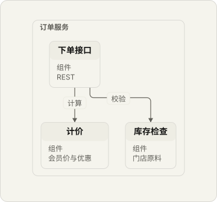</a><br><b>组件</b><br><sub><code>C4Component</code></sub></td>
<td align="center" valign="top" width="50%"><a href="docs/showcase/gallery/zh-CN/diagram-C4Dynamic.svg">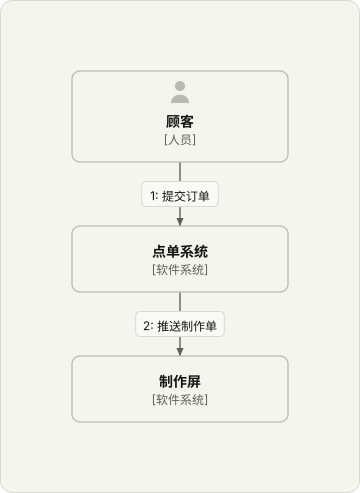</a><br><b>动态</b><br><sub><code>C4Dynamic</code></sub></td>
</tr>
</table>

<a id="mermaid-data"></a>

#### Mermaid 数值图

<table>
<tr>
<td align="center" valign="top" width="50%"><a href="docs/showcase/gallery/zh-CN/diagram-pie.svg">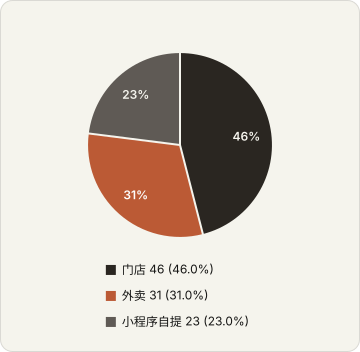</a><br><b>饼图</b><br><sub><code>pie</code></sub></td>
<td align="center" valign="top" width="50%"><a href="docs/showcase/gallery/zh-CN/diagram-xychart-beta.svg">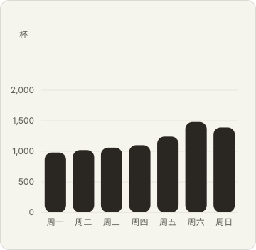</a><br><b>XY 图</b><br><sub><code>xychart-beta</code></sub></td>
</tr>
<tr>
<td align="center" valign="top" width="50%"><a href="docs/showcase/gallery/zh-CN/diagram-sankey-beta.svg">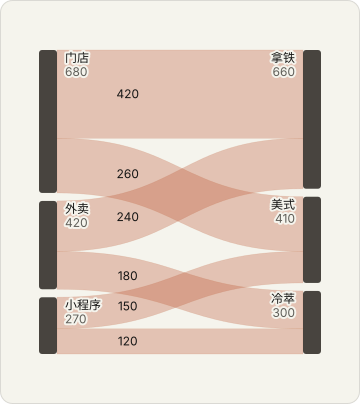</a><br><b>桑基图</b><br><sub><code>sankey-beta</code></sub></td>
<td align="center" valign="top" width="50%"><a href="docs/showcase/gallery/zh-CN/diagram-treemap-beta.svg">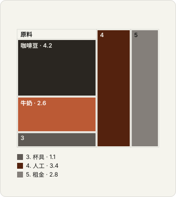</a><br><b>矩形树图</b><br><sub><code>treemap-beta</code></sub></td>
</tr>
<tr>
<td colspan="2" align="center"><a href="docs/showcase/gallery/zh-CN/diagram-radar-beta.svg">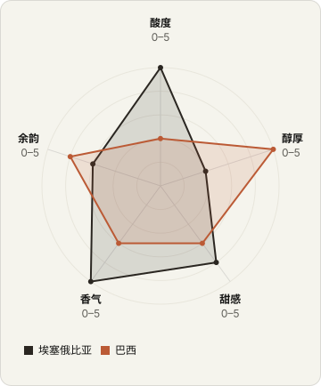</a><br><b>雷达图</b><br><sub><code>radar-beta</code></sub></td>
</tr>
</table>

<a id="mindmaps"></a>

#### 一棵树，八种脑图布局

<table>
<tr>
<td colspan="2" align="center"><a href="docs/showcase/gallery/zh-CN/diagram-mindmap.svg"></a><br><b>Mermaid 脑图</b><br><sub><code>mindmap</code></sub></td>
</tr>
<tr>
<td colspan="2" align="center"><a href="docs/showcase/gallery/zh-CN/mindmap-bilateral.svg"></a><br><b>双侧</b><br><sub><code>mindmap / bilateral</code></sub></td>
</tr>
<tr>
<td colspan="2" align="center"><a href="docs/showcase/gallery/zh-CN/mindmap-right.svg"></a><br><b>向右</b><br><sub><code>mindmap / right</code></sub></td>
</tr>
<tr>
<td align="center" valign="top" width="50%"><a href="docs/showcase/gallery/zh-CN/mindmap-left.svg">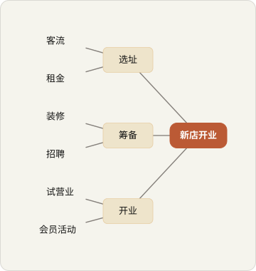</a><br><b>向左</b><br><sub><code>mindmap / left</code></sub></td>
<td align="center" valign="top" width="50%"><a href="docs/showcase/gallery/zh-CN/mindmap-brace.svg">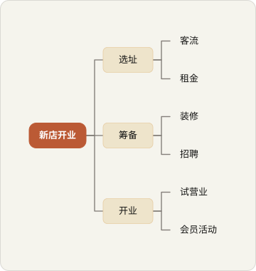</a><br><b>括号</b><br><sub><code>mindmap / brace</code></sub></td>
</tr>
<tr>
<td colspan="2" align="center"><a href="docs/showcase/gallery/zh-CN/mindmap-radial.svg">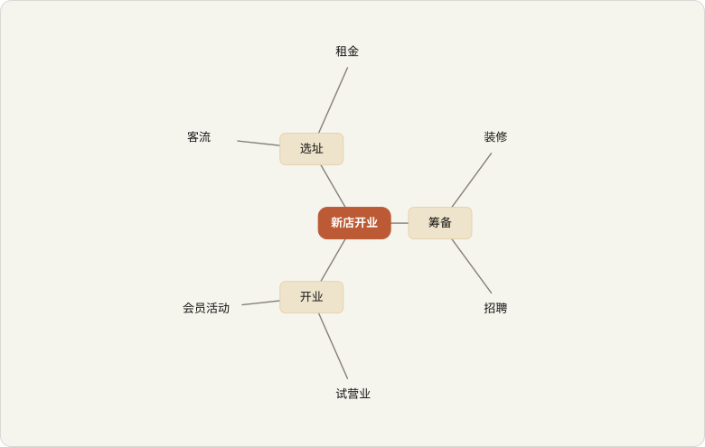</a><br><b>放射</b><br><sub><code>mindmap / radial</code></sub></td>
</tr>
<tr>
<td colspan="2" align="center"><a href="docs/showcase/gallery/zh-CN/mindmap-org.svg">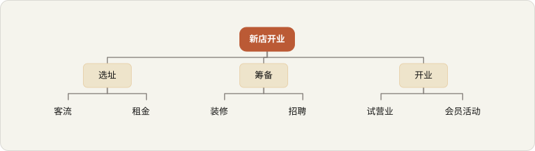</a><br><b>组织</b><br><sub><code>mindmap / org</code></sub></td>
</tr>
<tr>
<td colspan="2" align="center"><a href="docs/showcase/gallery/zh-CN/mindmap-fishbone.svg"></a><br><b>鱼骨</b><br><sub><code>mindmap / fishbone</code></sub></td>
</tr>
<tr>
<td colspan="2" align="center"><a href="docs/showcase/gallery/zh-CN/mindmap-timeline.svg">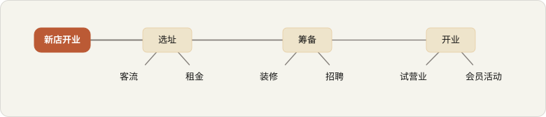</a><br><b>时间线</b><br><sub><code>mindmap / timeline</code></sub></td>
</tr>
</table>

<a id="variants"></a>

### 受控变体

[柱、线与标记](#variants-marks) · [占比与阶段](#variants-part) · [目标、差距与分布](#variants-value) · [矩阵、日历与网络](#variants-pattern)

<a id="variants-marks"></a>

#### 柱、线与标记

<table>
<tr>
<td align="center" valign="top" width="50%"><a href="docs/showcase/gallery/zh-CN/variant-bar-solid.svg">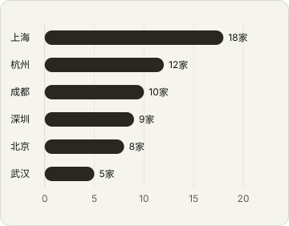</a><br><b>横向比较 · 实心</b><br><sub><code>bar / solid</code></sub></td>
<td align="center" valign="top" width="50%"><a href="docs/showcase/gallery/zh-CN/variant-bar-lollipop.svg"></a><br><b>横向比较 · 棒棒糖</b><br><sub><code>bar / lollipop</code></sub></td>
</tr>
<tr>
<td align="center" valign="top" width="50%"><a href="docs/showcase/gallery/zh-CN/variant-bar-rungs.svg"></a><br><b>横向比较 · 单位刻度</b><br><sub><code>bar / rungs</code></sub></td>
<td align="center" valign="top" width="50%"><a href="docs/showcase/gallery/zh-CN/variant-column-lollipop.svg">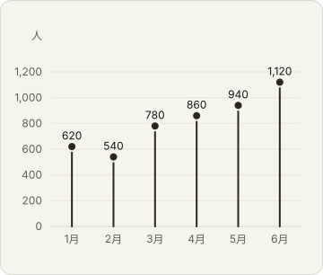</a><br><b>纵向比较 · 棒棒糖</b><br><sub><code>column / lollipop</code></sub></td>
</tr>
<tr>
<td align="center" valign="top" width="50%"><a href="docs/showcase/gallery/zh-CN/variant-bar-pictorial.svg">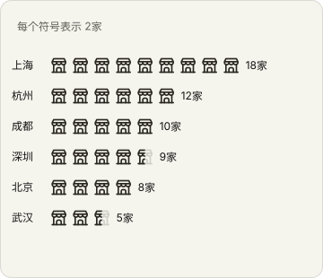</a><br><b>横向比较 · 图标</b><br><sub><code>bar / pictorial</code></sub></td>
<td align="center" valign="top" width="50%"><a href="docs/showcase/gallery/zh-CN/variant-column-rungs.svg"></a><br><b>纵向比较 · 单位刻度</b><br><sub><code>column / rungs</code></sub></td>
</tr>
<tr>
<td align="center" valign="top" width="50%"><a href="docs/showcase/gallery/zh-CN/variant-column-solid.svg"></a><br><b>纵向比较 · 实心</b><br><sub><code>column / solid</code></sub></td>
<td align="center" valign="top" width="50%"><a href="docs/showcase/gallery/zh-CN/variant-line-barcode.svg"></a><br><b>走势 · 条码</b><br><sub><code>line / barcode</code></sub></td>
</tr>
<tr>
<td align="center" valign="top" width="50%"><a href="docs/showcase/gallery/zh-CN/variant-column-pictorial.svg"></a><br><b>纵向比较 · 图标</b><br><sub><code>column / pictorial</code></sub></td>
<td align="center" valign="top" width="50%"><a href="docs/showcase/gallery/zh-CN/variant-line-counter.svg"></a><br><b>走势 · 末值突出</b><br><sub><code>line / counter</code></sub></td>
</tr>
</table>

<a id="variants-part"></a>

#### 占比与阶段

<table>
<tr>
<td align="center" valign="top" width="50%"><a href="docs/showcase/gallery/zh-CN/variant-share-solid.svg"></a><br><b>占比条 · 实心</b><br><sub><code>share / solid</code></sub></td>
<td align="center" valign="top" width="50%"><a href="docs/showcase/gallery/zh-CN/variant-share-ticks.svg"></a><br><b>占比条 · 刻度</b><br><sub><code>share / ticks</code></sub></td>
</tr>
<tr>
<td align="center" valign="top" width="50%"><a href="docs/showcase/gallery/zh-CN/variant-donut-solid.svg"></a><br><b>环形图 · 实心</b><br><sub><code>donut / solid</code></sub></td>
<td align="center" valign="top" width="50%"><a href="docs/showcase/gallery/zh-CN/variant-funnel-hourglass.svg"></a><br><b>漏斗 · 沙漏</b><br><sub><code>funnel / hourglass</code></sub></td>
</tr>
<tr>
<td align="center" valign="top" width="50%"><a href="docs/showcase/gallery/zh-CN/variant-donut-ticks.svg"></a><br><b>环形图 · 刻度</b><br><sub><code>donut / ticks</code></sub></td>
<td align="center" valign="top" width="50%"><a href="docs/showcase/gallery/zh-CN/variant-waffle-field.svg"></a><br><b>百格图 · 疏朗点阵</b><br><sub><code>waffle / field</code></sub></td>
</tr>
<tr>
<td align="center" valign="top" width="50%"><a href="docs/showcase/gallery/zh-CN/variant-funnel-bars.svg"></a><br><b>漏斗 · 横条</b><br><sub><code>funnel / bars</code></sub></td>
<td align="center" valign="top" width="50%"><a href="docs/showcase/gallery/zh-CN/variant-waffle-dots.svg"></a><br><b>百格图 · 点阵</b><br><sub><code>waffle / dots</code></sub></td>
</tr>
</table>

<a id="variants-value"></a>

#### 目标、差距与分布

<table>
<tr>
<td colspan="2" align="center"><a href="docs/showcase/gallery/zh-CN/variant-gauge-bar.svg"></a><br><b>完成度 · 条形</b><br><sub><code>gauge / bar</code></sub></td>
</tr>
<tr>
<td align="center" valign="top" width="50%"><a href="docs/showcase/gallery/zh-CN/variant-gauge-arc.svg"></a><br><b>完成度 · 圆弧</b><br><sub><code>gauge / arc</code></sub></td>
<td align="center" valign="top" width="50%"><a href="docs/showcase/gallery/zh-CN/variant-gauge-ticks.svg"></a><br><b>完成度 · 刻度</b><br><sub><code>gauge / ticks</code></sub></td>
</tr>
<tr>
<td align="center" valign="top" width="50%"><a href="docs/showcase/gallery/zh-CN/variant-dumbbell-solid.svg"></a><br><b>前后差距 · 实心</b><br><sub><code>dumbbell / solid</code></sub></td>
<td align="center" valign="top" width="50%"><a href="docs/showcase/gallery/zh-CN/variant-histogram-solid.svg"></a><br><b>直方图 · 实心</b><br><sub><code>histogram / solid</code></sub></td>
</tr>
<tr>
<td align="center" valign="top" width="50%"><a href="docs/showcase/gallery/zh-CN/variant-dumbbell-rungs.svg"></a><br><b>前后差距 · 单位刻度</b><br><sub><code>dumbbell / rungs</code></sub></td>
<td align="center" valign="top" width="50%"><a href="docs/showcase/gallery/zh-CN/variant-scatter-plumb.svg"></a><br><b>散点图 · 垂线</b><br><sub><code>scatter / plumb</code></sub></td>
</tr>
<tr>
<td colspan="2" align="center"><a href="docs/showcase/gallery/zh-CN/variant-waterfall-solid.svg"></a><br><b>瀑布 · 实心</b><br><sub><code>waterfall / solid</code></sub></td>
</tr>
<tr>
<td colspan="2" align="center"><a href="docs/showcase/gallery/zh-CN/variant-waterfall-rungs.svg"></a><br><b>瀑布 · 单位刻度</b><br><sub><code>waterfall / rungs</code></sub></td>
</tr>
<tr>
<td align="center" valign="top" width="50%"><a href="docs/showcase/gallery/zh-CN/variant-histogram-rungs.svg"></a><br><b>直方图 · 单位刻度</b><br><sub><code>histogram / rungs</code></sub></td>
<td align="center" valign="top" width="50%"><a href="docs/showcase/gallery/zh-CN/variant-scatter-dots.svg"></a><br><b>散点图 · 点阵</b><br><sub><code>scatter / dots</code></sub></td>
</tr>
</table>

<a id="variants-pattern"></a>

#### 矩阵、日历与网络

<table>
<tr>
<td colspan="2" align="center"><a href="docs/showcase/gallery/zh-CN/variant-heatmap-cells.svg"></a><br><b>热力图 · 方格</b><br><sub><code>heatmap / cells</code></sub></td>
</tr>
<tr>
<td align="center" valign="top" width="50%"><a href="docs/showcase/gallery/zh-CN/variant-heatmap-dots.svg"></a><br><b>热力图 · 点阵</b><br><sub><code>heatmap / dots</code></sub></td>
<td align="center" valign="top" width="50%"><a href="docs/showcase/gallery/zh-CN/variant-heatmap-arc.svg"></a><br><b>热力图 · 圆弧</b><br><sub><code>heatmap / arc</code></sub></td>
</tr>
<tr>
<td colspan="2" align="center"><a href="docs/showcase/gallery/zh-CN/variant-calendar-cells.svg"></a><br><b>日历 · 方格</b><br><sub><code>calendar / cells</code></sub></td>
</tr>
<tr>
<td colspan="2" align="center"><a href="docs/showcase/gallery/zh-CN/variant-calendar-dots.svg"></a><br><b>日历 · 点阵</b><br><sub><code>calendar / dots</code></sub></td>
</tr>
<tr>
<td align="center" valign="top" width="50%"><a href="docs/showcase/gallery/zh-CN/variant-network-lines.svg"></a><br><b>关系网络 · 连线</b><br><sub><code>network / lines</code></sub></td>
<td align="center" valign="top" width="50%"><a href="docs/showcase/gallery/zh-CN/variant-network-membrane.svg"></a><br><b>关系网络 · 弦膜</b><br><sub><code>network / membrane</code></sub></td>
</tr>
<tr>
<td colspan="2" align="center"><a href="docs/showcase/gallery/zh-CN/variant-mindmap-editorial.svg"></a><br><b>脑图 · 编辑式</b><br><sub><code>mindmap / editorial</code></sub></td>
</tr>
<tr>
<td colspan="2" align="center"><a href="docs/showcase/gallery/zh-CN/variant-mindmap-cards.svg"></a><br><b>脑图 · 卡片式</b><br><sub><code>mindmap / cards</code></sub></td>
</tr>
</table>
<!-- gallery:end -->

<a id="themes"></a>

## 同一张图，七套主题

<!-- themes:begin -->
<table>
<tr>
<td colspan="2" align="center"><a href="docs/showcase/gallery/zh-CN/theme-claude.svg"></a><br><b>Claude</b><br><sub><code>陶土 · 亮色</code></sub></td>
</tr>
<tr>
<td align="center" valign="top" width="50%"><a href="docs/showcase/gallery/zh-CN/theme-paper.svg"></a><br><b>Paper</b><br><sub><code>素白 · 亮色</code></sub></td>
<td align="center" valign="top" width="50%"><a href="docs/showcase/gallery/zh-CN/theme-obsidian.svg"></a><br><b>Obsidian</b><br><sub><code>黑曜 · 暗色</code></sub></td>
</tr>
<tr>
<td align="center" valign="top" width="50%"><a href="docs/showcase/gallery/zh-CN/theme-tokyo.svg"></a><br><b>Tokyo Night</b><br><sub><code>夜都 · 暗色</code></sub></td>
<td align="center" valign="top" width="50%"><a href="docs/showcase/gallery/zh-CN/theme-kanagawa.svg"></a><br><b>Kanagawa</b><br><sub><code>神奈川 · 暗色</code></sub></td>
</tr>
<tr>
<td align="center" valign="top" width="50%"><a href="docs/showcase/gallery/zh-CN/theme-terminal.svg"></a><br><b>Terminal</b><br><sub><code>终端 · 暗色</code></sub></td>
<td align="center" valign="top" width="50%"><a href="docs/showcase/gallery/zh-CN/theme-cloudmusic.svg"></a><br><b>Cloud Music</b><br><sub><code>云音 · 亮色</code></sub></td>
</tr>
</table>
<!-- themes:end -->

文档和报表换主题不用改内容：`htmlview style report.html --theme obsidian`。KChart 的程序接口可以直接传入一套自定义主题对象。要让 CLI 认出一个新的主题名，需要登记一份调色盘、加一个小型主题 CSS，不用改各图型的绘制逻辑。[主题扩展说明 →](docs/architecture.md#themes)

<a id="install"></a>

## 安装说明

安装脚本把仓库克隆到 `~/.agents/skill-lib/html-view-skill`，再从其中的 `skills/html-view` 建两个链接：

| 链接 | 读取它的 Agent |
|---|---|
| `~/.agents/skills/html-view` | [Codex](https://learn.chatgpt.com/docs/build-skills#where-codex-loads-local-skills)、[Pi](https://docs.pi.dev/latest/skills) |
| `~/.claude/skills/html-view` | [Claude Code](https://code.claude.com/docs/en/skills#where-skills-live) |

这两个目录是各工具自己的约定，Agent Skills 规范没有规定统一位置。其他 Agent 请把 `skills/html-view` 链接或复制到它读取技能的目录。

- **可以重复运行。** 已有有效检出就直接复用，不自动拉取；检出损坏或来源不对就报错，不会覆盖。两个链接分别检查，同名文件、目录或断链都原样保留。
- **也可以手动克隆。** 克隆到上面的位置后运行脚本，它会补齐链接。
- **原生 Windows** 用目录联接（junction）代替符号链接，各 Agent 能否识别联接还没有在原生 Windows 上实测。WSL 使用其 Linux 环境中的 `$HOME`。
- **PowerShell 拦截脚本时：** 如果 `RemoteSigned` 只因文件来自互联网而拦截，核对内容后运行 `Unblock-File -LiteralPath '.\install-html-view.ps1'` 再执行，不必修改系统策略。

<a id="update-uninstall"></a>

## 更新与卸载

**更新：** 拉取克隆即可，两个链接仍指向同一个检出。

```bash
git -C "$HOME/.agents/skill-lib/html-view-skill" pull --ff-only
```

**卸载：** 先确认两个链接指向本项目，再删除链接。`rm` 不带 `-r` 时只删链接；如果那里是真实目录，它会报错而不是删除。

```bash
readlink ~/.agents/skills/html-view ~/.claude/skills/html-view   # 应指向 …/html-view-skill/skills/html-view
rm ~/.agents/skills/html-view ~/.claude/skills/html-view
```

Windows 上用 `cmd /c rmdir "<路径>"` 删除目录联接，不带 `/s` 时只删联接本身。最后确认没有其他入口在用，再移走 `~/.agents/skill-lib/html-view-skill`。安装时被跳过的同名项不属于本项目，请保留。

<a id="cli"></a>

## CLI 与维护

在项目根目录，从示例源构建一份文档并检查：

```sh
node skills/html-view/scripts/htmlview doc build docs/showcase/examples/zh-CN/notification-platform.md --type tech-spec --out notification-platform.html
node skills/html-view/scripts/htmlview audit notification-platform.html
node skills/html-view/scripts/htmlview check notification-platform.html --paper a3-portrait
node skills/html-view/scripts/htmlview export notification-platform.html --format pdf --paper a3-portrait --out notification-platform.pdf
```

`check` 用真实浏览器检查窄屏、图内溢出和打印版心；PDF 遇到裁切会停止，不会缩小图或字号。宽图可试 A4 横向，高图可试 A3 纵向；仍放不下就重排，或附上完整 SVG。分享 HTML 前请检查源码中的元数据：文档可能含 Markdown 源路径，报表内嵌了来源和计算证据。

[技能入口](skills/html-view/SKILL.md) · [CLI 与回归测试](skills/html-view/scripts/README.md) · [安装测试](scripts/tests/install.test.mjs) · [KChart API](skills/html-view/kchart/README.md) · [架构与主题扩展](docs/architecture.md)

<a id="license"></a>

## 许可

自有源码与文档采用 [MIT License](LICENSE)。Prism 保留其[上游 MIT 许可](skills/html-view/assets/vendor/prism.js)；图标、品牌商标和 Natural Earth 地图数据的条款见[第三方资产声明](skills/html-view/kchart/NOTICE.md)；看板设计指南的出处见[致谢](NOTICE.md)。
