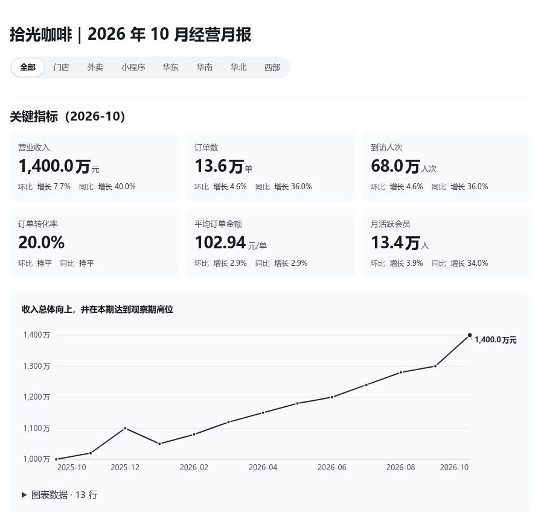
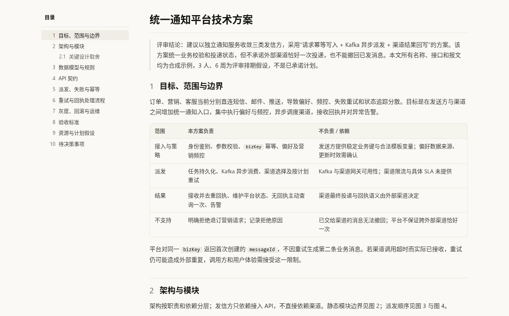
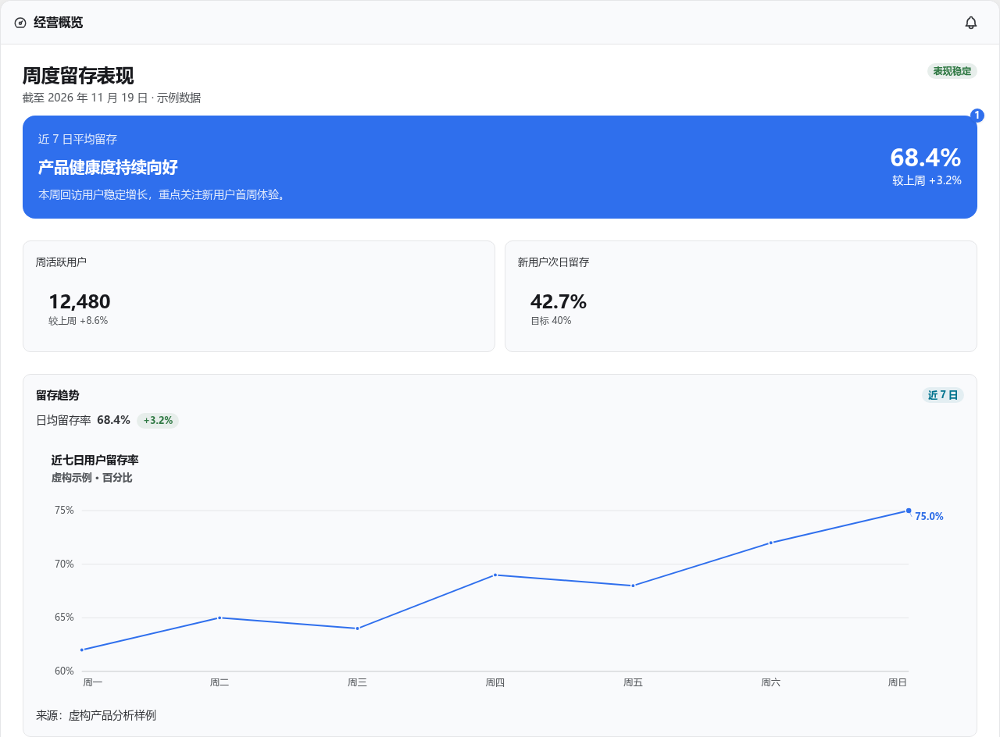
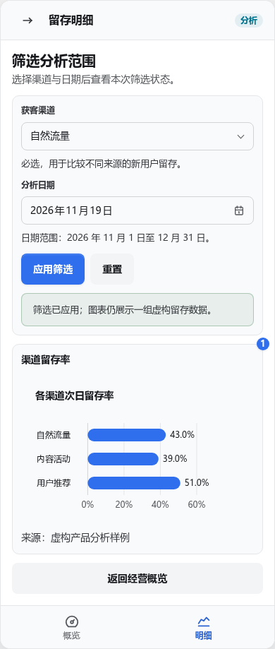
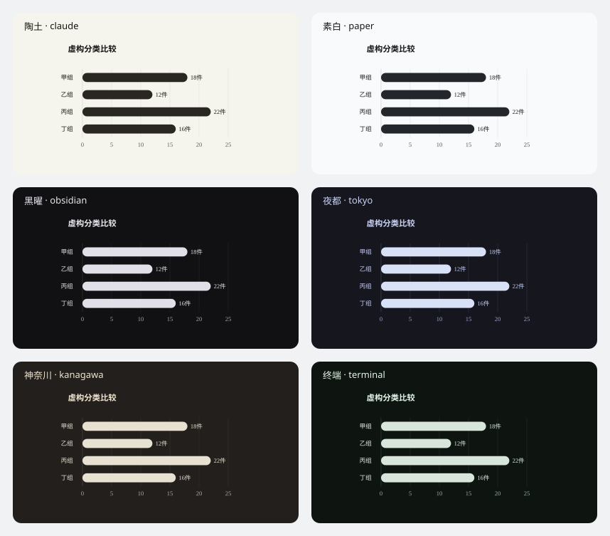
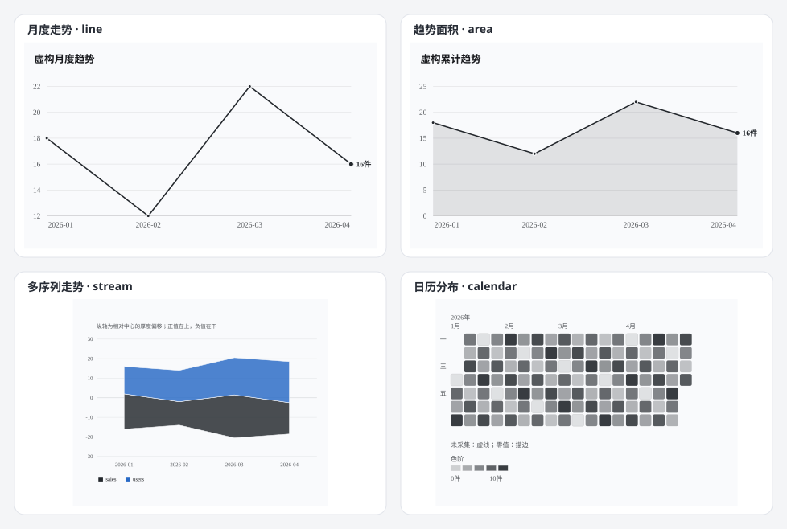
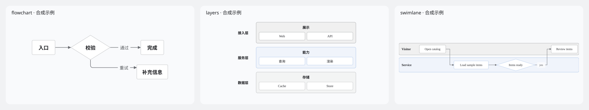

# HTML View

**让方案好读，让报表能核对，让原型可以点。**

HTML View 是一项 Agent Skill，也是一套本地 CLI。它把 Markdown、已汇总的 CSV/JSON 和界面声明变成可离线打开的 HTML。内置的 **KChart** 从声明排版并生成静态 SVG，数据图和结构图共用字体测量、主题与输出；默认不播放动画，不加载远程字体、图表脚本或图片。

[安装](#安装) · [技能入口](skills/html-view/SKILL.md) · [复现样张](docs/showcase/README.md) · [KChart API](skills/html-view/kchart/README.md) · [实现约定](docs/architecture.md)



## 安装

安装需要 Git。先把脚本下载到本地，查看内容后，再用对应平台的 shell 执行。

### macOS / Linux / WSL：Bash

1. 下载：

   ```bash
   curl -fsSL --proto '=https' -o install-html-view.sh https://raw.githubusercontent.com/fengwk/html-view-skill/main/scripts/install.sh
   ```
2. 执行：

   ```bash
   bash ./install-html-view.sh
   ```

### Windows：PowerShell

1. 下载：

   ```powershell
   Invoke-WebRequest -UseBasicParsing -Uri 'https://raw.githubusercontent.com/fengwk/html-view-skill/main/scripts/install.ps1' -OutFile '.\install-html-view.ps1'
   ```
2. 执行：

   ```powershell
   .\install-html-view.ps1
   ```

   如果 PowerShell 的 `RemoteSigned` 策略仅因文件来自互联网而拦截，确认脚本可信后，可以对该文件执行 `Unblock-File -LiteralPath '.\install-html-view.ps1'`，再运行，不必改系统策略。

### 安装位置与更新

脚本第一次把仓库克隆到 `$HOME/.agents/skill-lib/html-view-skill`。也可以先手动克隆到这个位置，再运行脚本补齐链接。脚本只校验并复用此处已有的检出，不重新克隆，也不自动 `pull`；从其他目录运行不会改变检出位置。如果该位置不是本项目的有效 Git 检出，或缺少已跟踪的技能文件，脚本报错退出；修复或移走异常目录后再运行。

脚本把检出的 `skills/html-view` 链接到下面两个位置。任一入口已有同名文件、目录或链接（包括断开的链接）时，原样跳过，另一入口仍会检查。安装后可以重新打开客户端查看技能。

原生 Windows 在本地磁盘上使用目录联接（junction），客户端对这类链接的识别尚未在原生 Windows 实测。WSL 按 Linux 安装，使用 WSL 自己的 `$HOME`。

| 个人技能入口 | 已确认的客户端 |
|---|---|
| `$HOME/.agents/skills/html-view` | [Codex](https://learn.chatgpt.com/docs/build-skills#where-codex-loads-local-skills)、[Pi](https://docs.pi.dev/latest/skills) |
| `$HOME/.claude/skills/html-view` | [Claude Code](https://code.claude.com/docs/en/skills#where-skills-live) |

这些是常用位置，不是 [Agent Skills 规范](https://agentskills.io/specification)规定的统一目录。其他客户端请查各自的发现规则。

要更新，运行 `git -C "$HOME/.agents/skill-lib/html-view-skill" pull --ff-only`，链接不需要重建。要卸载，先确认入口指向本项目，再移除这两个链接；不再需要源码时可另行移走检出。

运行 `htmlview` 需要 **Node.js 22+**。浏览器检查、截图、PDF 导出和独立图渲染另需 Chrome 或 Chromium；找不到时，将 `CHROME_PATH` 设为浏览器可执行文件的路径。可用 `node "$HOME/.agents/skill-lib/html-view-skill/skills/html-view/scripts/htmlview" --help` 验证 CLI。生成的 HTML 可离线打开。

## 一套工具，三种产物

| 你手里有什么 | 得到什么 | 从哪里开始 |
|---|---|---|
| Markdown 方案、说明或纪要 | 有目录、编号、图表和批注的阅读文档 | [`doc build`](skills/html-view/references/artifacts/doc.md) |
| 已汇总的 CSV 或 JSON | 带来源、口径和数字证据的报表 | [`data validate` → `data build`](skills/html-view/references/artifacts/data.md) |
| 产品流程、屏幕和状态 | 可点击的手机、桌面或响应式界面稿 | [`ui new`](skills/html-view/references/artifacts/ui.md) |

以下是当前实现实际渲染的合成示例，不是模板示意图，也不代表生产数据。

### 阅读文档 · 统一通知平台

从 [Markdown 源](docs/showcase/examples/notification-platform.md) 生成。左栏浏览章节，正文保留评审结论、职责表、交叉引用和可批注区域；架构图与时序图均直接读声明。

[](docs/showcase/previews/doc-reading.png)

[打开分层架构图原尺寸截图 ↗](docs/showcase/previews/doc-architecture.png)

### 数据报表 · 拾光咖啡经营月报

[数据包](docs/showcase/examples/coffee/report.json) 指定指标、聚合口径和比较期间。页面把经营摘要、同比环比、趋势和渠道视图绑定到同一份数据；缺失记录不画成零。修订数字时，改数据包并重建，不改截图或 HTML 里的读数。

### 界面稿 · 留存观察台

桌面呈现经营概览，手机展示选择渠道、日期后的明细状态。下拉与日历自绘，底层仍使用原生控件的值和校验规则。两张图用同一份[原型输入](skills/html-view/scripts/tests/fixtures/ui/retention-dashboard.html)生成；按[复现说明](docs/showcase/README.md)可打开并点击完整原型。

<table>
  <tr>
    <td width="70%"><a href="docs/showcase/previews/ui-desktop-overview.png"></a></td>
    <td width="30%"><a href="docs/showcase/previews/ui-mobile-filtered.png"></a></td>
  </tr>
</table>

## KChart 图谱

**45 种数据图 · 38 项受控变体（含默认布局别名） · 27 种 Mermaid 子集图型 · 3 种原生结构图。** 作者选图型，填数据、字段和阅读意图，渲染器决定刻度、留白、折行与坐标。装不下时保留图内滚动；需要打印时按实际纸面重新布局，不靠整体缩小把字压进版心。

### 同一张图，六种主题



### 从问题出发选图

| 读者要看什么 | 实际渲染示例 |
|---|---|
| 比较与构成 | [柱形、饼、环和漏斗](docs/showcase/previews/comparison-composition.svg) |
| 趋势与时间 | [折线、面积、流图和日历](docs/showcase/previews/trend-time.svg) |
| 分布和离群 | [直方、箱形、小提琴和点带](docs/showcase/previews/statistical-distribution.svg) |
| 关系与矩阵 | [散点、热力、雷达和平行坐标](docs/showcase/previews/relationships-matrix.svg) |



### 把关系画清楚



同一份树能切换八种脑图布局：[双侧、向右、向左、放射](docs/showcase/previews/mindmap-layouts-a.svg) · [组织、括号、鱼骨、时间线](docs/showcase/previews/mindmap-layouts-b.svg)。完整图库包含 **774 张 SVG**，按图型、主题和词语筛选，可查看原始声明和独立 SVG。

```sh
node skills/html-view/scripts/lab/showcase/generate.mjs
```

打开脚本打印目录中的 `index.html`。

## CLI 快速开始

在仓库根目录，从示例源构建文档并导出 PDF：

```sh
node skills/html-view/scripts/htmlview doc build docs/showcase/examples/notification-platform.md --type tech-spec --out notification-platform.html
node skills/html-view/scripts/htmlview audit notification-platform.html
node skills/html-view/scripts/htmlview check notification-platform.html --paper a3-portrait
node skills/html-view/scripts/htmlview export notification-platform.html --format pdf --paper a3-portrait --out notification-platform.pdf
```

用 `node skills/html-view/scripts/htmlview --help` 查看全部命令。遇到裁切时，宽图可用 A4 横向，高图可用 A3 纵向；仍放不下就拆图、改布局或附完整 SVG。程序集成使用 KChart 的 `kchart/chart` 和 `kchart/diagram` 两个入口，见[本地打包与接口说明](skills/html-view/kchart/README.md)。

**公开产物前先检查源内容和元数据。** 文档 HTML 会保存用于重建的 Markdown 路径，数据报表会保留来源与计算证据。即便页面可以离线打开，源码中也可能含作者不打算公开的文件名、查询说明或数据。建议从准备公开的源生成公开副本；提交问题时先检查日志里的绝对路径和输入数据。

## 开发验证

用 Node.js 22+ 运行 `node --test scripts/tests/install.test.mjs` 检查安装。Bash 和 PowerShell 测试在临时 HOME 中运行，把克隆定向到本地 Git 仓库，不依赖 GitHub；缺少对应的 shell 或 Git 时跳过。渲染和 CLI 的回归命令见 [维护说明](skills/html-view/scripts/README.md)。

## 许可

HTML View 和 KChart 的自有源码及文档遵循 [MIT License](LICENSE)。Prism 保留其[上游 MIT 许可](skills/html-view/assets/vendor/prism.js)；KChart 随附的 [第三方资产声明](skills/html-view/kchart/NOTICE.md)记录图标、品牌商标和 Natural Earth 地图数据各自的条款。
