# HTML View

**让 Agent 稳定交付好读的 HTML：文档、数据报表、Dashboard 与可点击原型。**

简体中文 · [English](README.en.md)

把 Markdown、已汇总的 CSV／JSON 或一段产品流程交给 Agent，它会交回一个**可以离线打开的 HTML 文件**。图表、主题和交互都内嵌在文件里，不用启动服务器，也不从网络加载资源。交付前，Agent 会在真实浏览器里检查窄屏和打印版心，需要时再导出 PDF 或 PNG。

[快速开始](#quick-start) · [内置主题](#themes) · [交付样张](#showcase) · [精选图表](#featured) · [批注与复制](#review) · [更新与卸载](#update-uninstall) · [完整图库](docs/showcase/README.md)

<p align="center"><a href="docs/showcase/previews/hero-stack-transparent@2x.png">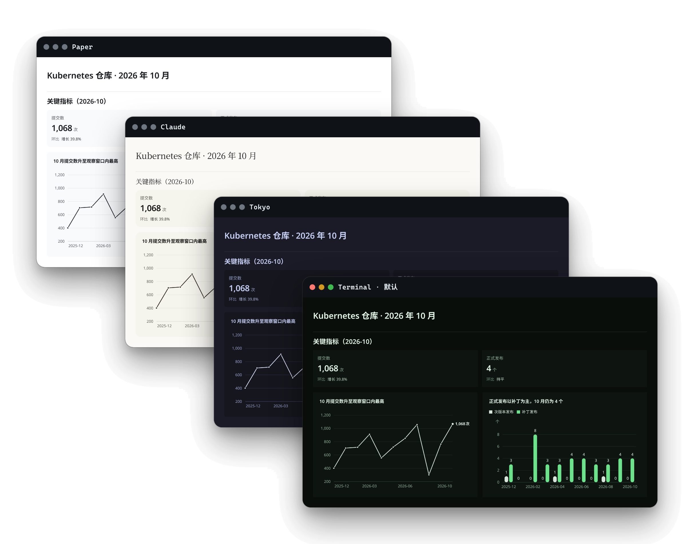</a></p>

*同一份看板，四套主题叠放。图为透明背景，在 GitHub 深色和浅色模式下都可以直接叠在页面上。*

<p align="center"><a href="docs/showcase/previews/html-view-promo.mp4"></a></p>

<a id="quick-start"></a>

## 快速开始

**1. 安装。** 需要 Git 和 Node.js 22+。在项目目录执行：

```bash
npx skills add fengwk/html-view-skill
```

全局安装加上 `-g`：

```bash
npx skills add fengwk/html-view-skill -g
```

先查看仓库里会被装上的技能：

```bash
npx skills add fengwk/html-view-skill --list
```

当前仓库会列出 `html-view`。`npx skills` 把技能安装到规范目录，再链到各 Agent 读取技能的位置。

**2. 重开 Agent。** 技能列表里会出现 `html-view`。

**3. 说出你要的 HTML。** 例如：

> 把 `proposal.md` 做成能批注的技术方案，决策和风险留着，服务之间怎么调用也画出来。给我 HTML，再出一份检查过的 PDF。

> 这些 CSV 已经汇总过了，做个离线 Dashboard。首屏放关键指标、趋势和构成，缺的数空着，别填成 0。

> 做个能点的发布审批，要有列表、详情、校验失败和提交成功这几个页面。用手机宽度把提交流程走一遍。

生成 HTML 之后，用 `htmlview audit` 检查内容和资源，再用 `htmlview check` 在桌面、手机和打印版心下打开看一下。截图、导出 PDF 或单独出图需要本机有 Chrome 或 Chromium，找不到时可以设 `CHROME_PATH`。

<a id="themes"></a>

## 内置主题

文档、报表和单图 HTML 都可以换主题，内容和数据不变。默认主题是 Terminal。下面先用同一份 Kubernetes 仓库 2026 年 10 月看板，对照 Paper、Claude、Tokyo Night 和 Terminal 四套样式。其他主题和整页样张默认不展开。

<table>
<tr>
<td align="center" valign="top" width="50%"><a href="docs/showcase/previews/zh-CN/theme-compare-paper.png">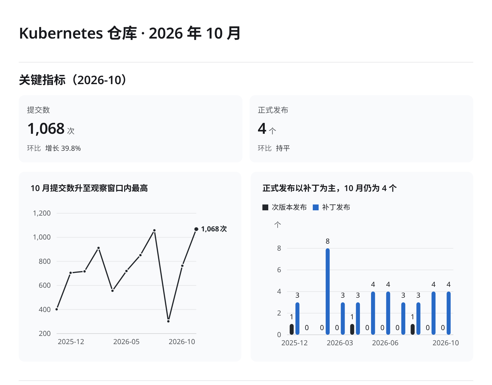</a><br><b>Paper</b><br><sub><code>素白 · 亮色</code></sub></td>
<td align="center" valign="top" width="50%"><a href="docs/showcase/previews/zh-CN/theme-compare-claude.png">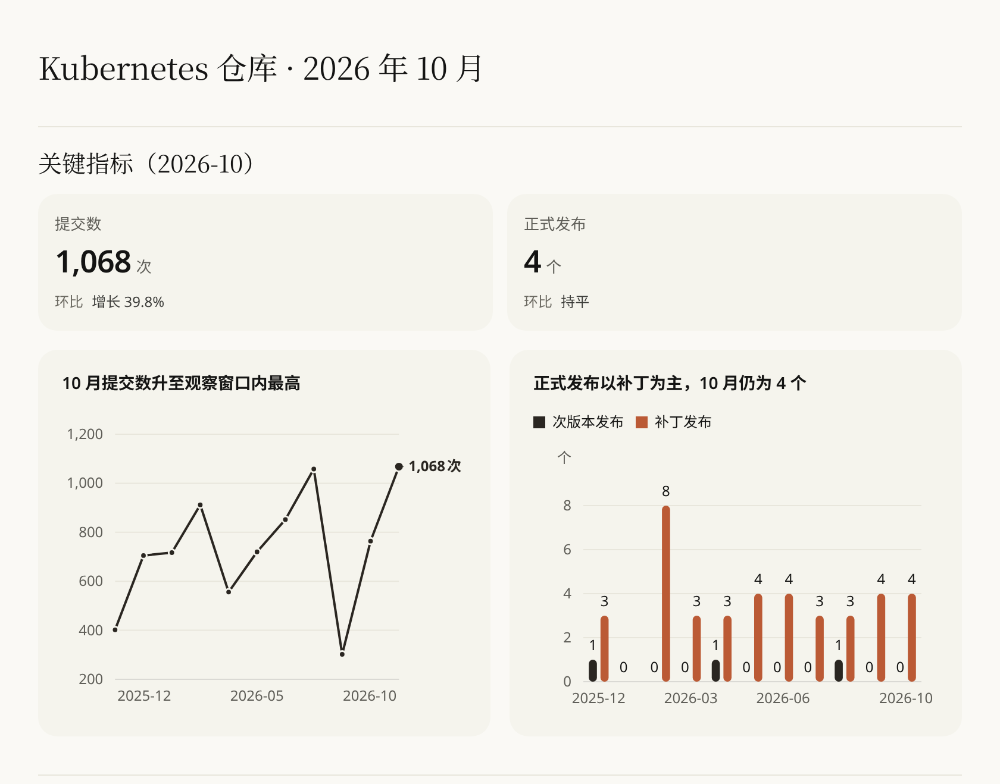</a><br><b>Claude</b><br><sub><code>陶土 · 亮色</code></sub></td>
</tr>
<tr>
<td align="center" valign="top" width="50%"><a href="docs/showcase/previews/zh-CN/theme-compare-tokyo.png">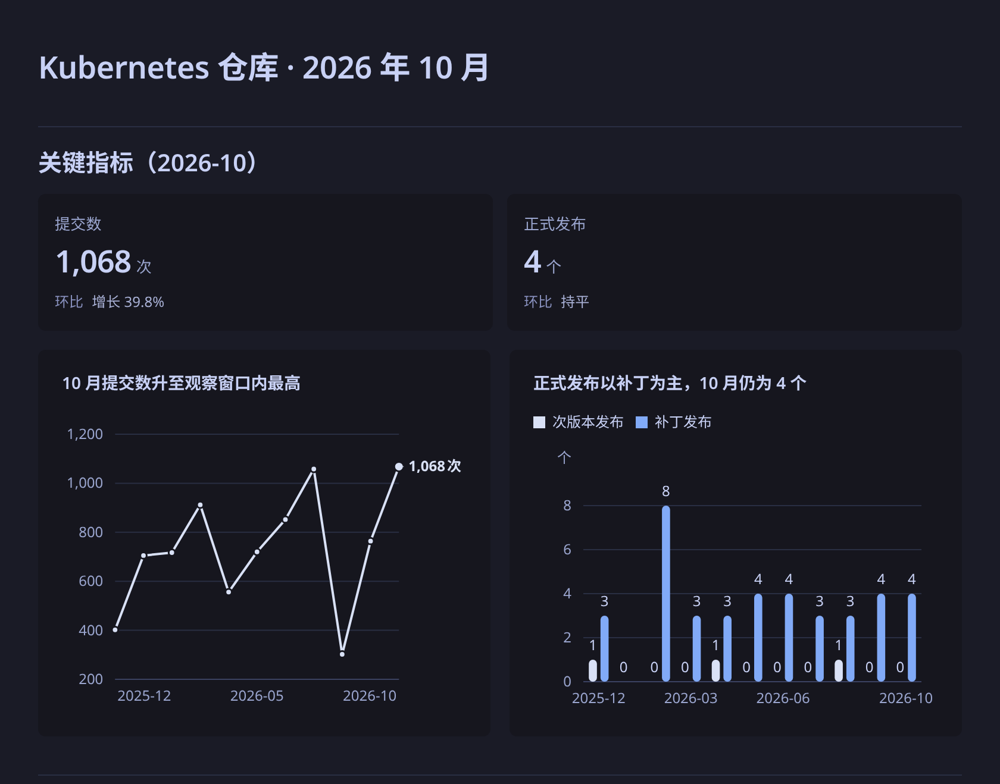</a><br><b>Tokyo Night</b><br><sub><code>夜都 · 暗色</code></sub></td>
<td align="center" valign="top" width="50%"><a href="docs/showcase/previews/zh-CN/theme-compare-terminal.png">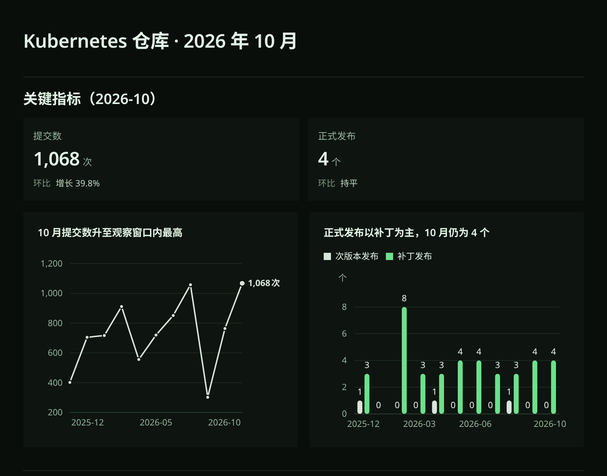</a><br><b>Terminal</b><br><sub><code>终端 · 暗色</code></sub></td>
</tr>
</table>

同一张图在全部 7 套主题下的配色：

<!-- themes:begin -->
<table>
<tr>
<td align="center" valign="top" width="25%"><a href="docs/showcase/gallery/zh-CN/theme-paper.svg"></a><br><b>Paper</b><br><sub><code>素白 · 亮色</code></sub></td>
<td align="center" valign="top" width="25%"><a href="docs/showcase/gallery/zh-CN/theme-claude.svg"></a><br><b>Claude</b><br><sub><code>陶土 · 亮色</code></sub></td>
<td align="center" valign="top" width="25%"><a href="docs/showcase/gallery/zh-CN/theme-tokyo.svg"></a><br><b>Tokyo Night</b><br><sub><code>夜都 · 暗色</code></sub></td>
<td align="center" valign="top" width="25%"><a href="docs/showcase/gallery/zh-CN/theme-terminal.svg"></a><br><b>Terminal</b><br><sub><code>终端 · 暗色</code></sub></td>
</tr>
</table>

<table>
<tr>
<td align="center" valign="top" width="33%"><a href="docs/showcase/gallery/zh-CN/theme-obsidian.svg">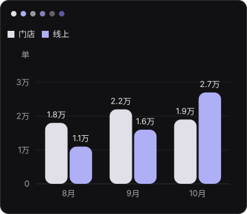</a><br><b>Obsidian</b><br><sub><code>黑曜 · 暗色</code></sub></td>
<td align="center" valign="top" width="33%"><a href="docs/showcase/gallery/zh-CN/theme-kanagawa.svg"></a><br><b>Kanagawa</b><br><sub><code>神奈川 · 暗色</code></sub></td>
<td align="center" valign="top" width="33%"><a href="docs/showcase/gallery/zh-CN/theme-cloudmusic.svg"></a><br><b>Cloud Music</b><br><sub><code>云音 · 亮色</code></sub></td>
</tr>
</table>

**完整样张**：同一份文档在各主题下的效果。点主题名展开，一次只展开一套。

<details name="theme-page">
<summary><b>Claude</b> · 陶土 · 亮色</summary>

<a href="docs/showcase/gallery/zh-CN/theme-claude-page.png">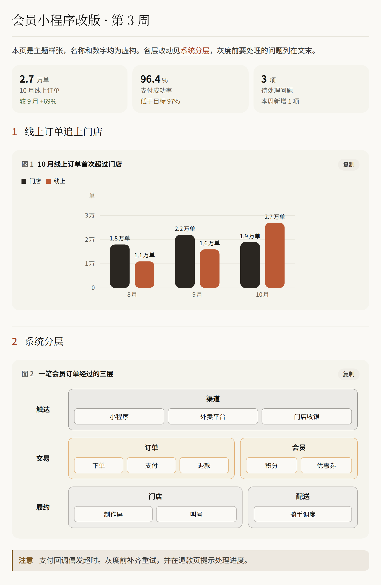</a>

</details>
<details name="theme-page">
<summary><b>Paper</b> · 素白 · 亮色</summary>

<a href="docs/showcase/gallery/zh-CN/theme-paper-page.png">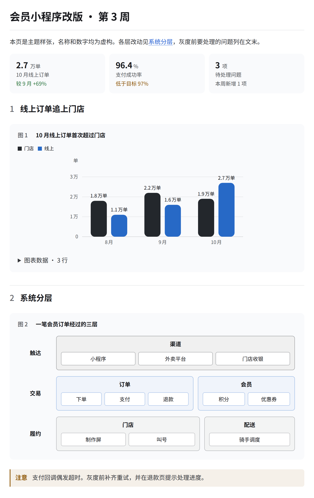</a>

</details>
<details name="theme-page">
<summary><b>Obsidian</b> · 黑曜 · 暗色</summary>

<a href="docs/showcase/gallery/zh-CN/theme-obsidian-page.png">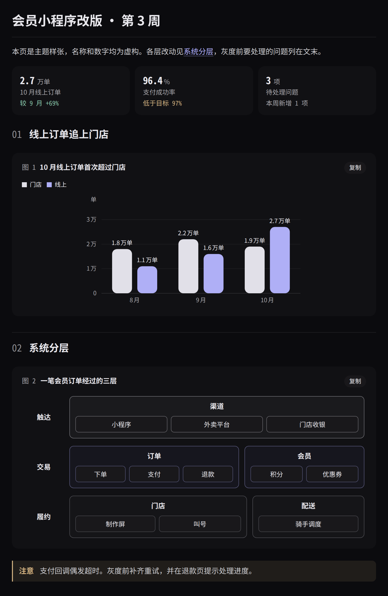</a>

</details>
<details name="theme-page">
<summary><b>Tokyo Night</b> · 夜都 · 暗色</summary>

<a href="docs/showcase/gallery/zh-CN/theme-tokyo-page.png">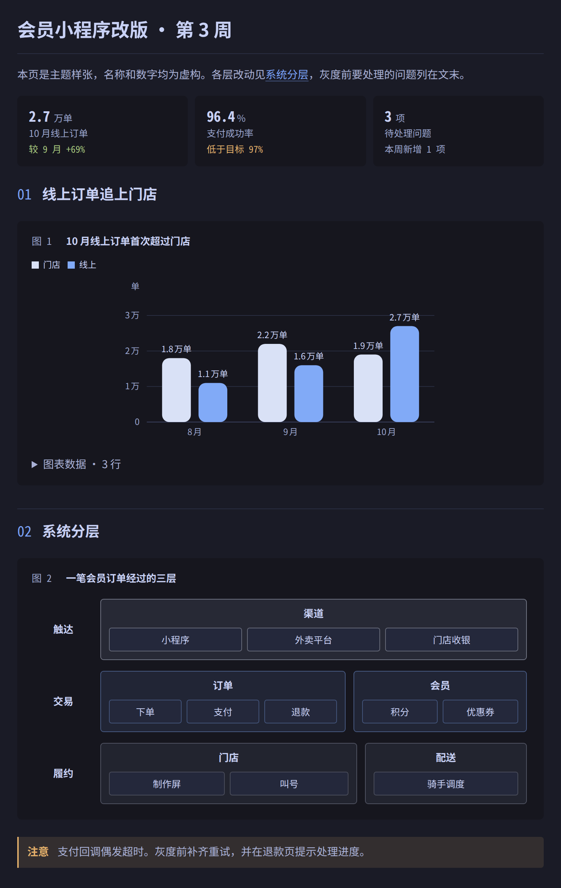</a>

</details>
<details name="theme-page">
<summary><b>Kanagawa</b> · 神奈川 · 暗色</summary>

<a href="docs/showcase/gallery/zh-CN/theme-kanagawa-page.png">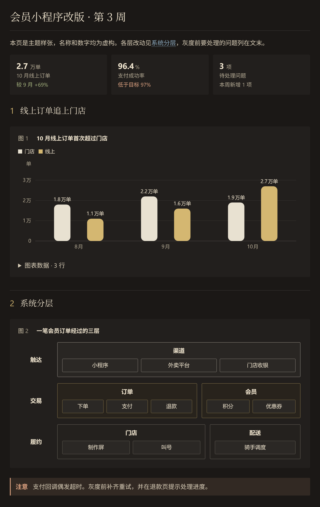</a>

</details>
<details name="theme-page">
<summary><b>Terminal</b> · 终端 · 暗色</summary>

<a href="docs/showcase/gallery/zh-CN/theme-terminal-page.png">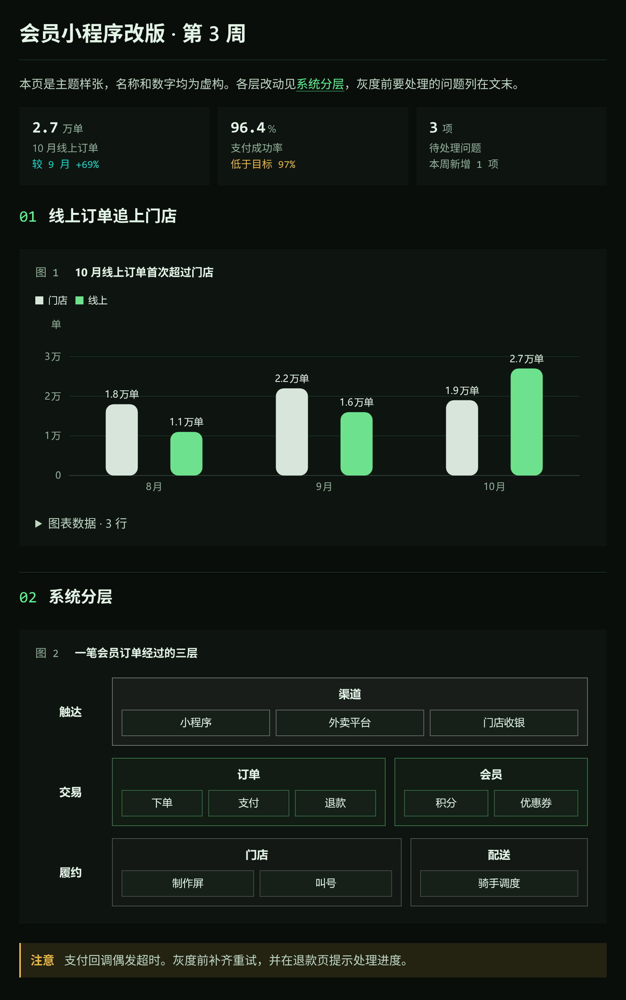</a>

</details>
<details name="theme-page">
<summary><b>Cloud Music</b> · 云音 · 亮色</summary>

<a href="docs/showcase/gallery/zh-CN/theme-cloudmusic-page.png">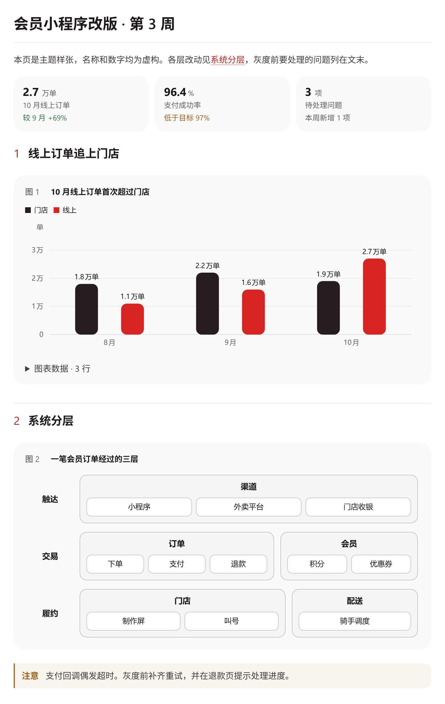</a>

</details>
<!-- themes:end -->

用 `htmlview style report.html --theme obsidian` 换成内置主题，或用 `--theme-file harbor.json` 应用自己的配色。HTML 会内嵌主题，分享时不用附上 JSON。新增内置主题要把 JSON 放进[库的主题目录](packages/kchart/assets/themes/)，再在 `packages/kchart` 运行 `npm run build` 和 `npm run vendor` 带进技能，审查实际样张后用[图谱生成器](docs/showcase/README.md#readme-gallery)刷新本节。界面稿的配色由 `--brand` 和 `--scheme` 控制。[主题格式与维护 →](docs/architecture.md#themes)

<a id="showcase"></a>

## 交付样张

下面三组完整样张都由当前技能渲染，并使用默认的 Terminal 主题。界面稿的配色由 `--brand` 和 `--scheme` 控制，不走文档主题。

| 产物 | 打开文件后，你能做什么 |
|---|---|
| [阅读文档](skills/html-view/references/artifacts/doc.md) | 从目录跳转、对照编号与图表、逐段批注；检查打印后导出 PDF |
| [数据报表](skills/html-view/references/artifacts/data.md) | 看同比环比，打开明细，核对指标口径、来源和原始读数 |
| [Dashboard](skills/html-view/references/artifacts/data.md) | 首屏扫读关键指标、趋势和异常；用预计算视图切换，不查询线上数据 |
| [可点击原型](skills/html-view/references/artifacts/ui.md) | 走通页面切换、表单校验和状态变化；不调用业务服务 |

**阅读文档 · Kubernetes 控制平面与节点架构**

<p align="center"><a href="docs/showcase/previews/zh-CN/doc-reading.png"></a></p>

<p align="center"><a href="docs/showcase/previews/zh-CN/doc-architecture.png">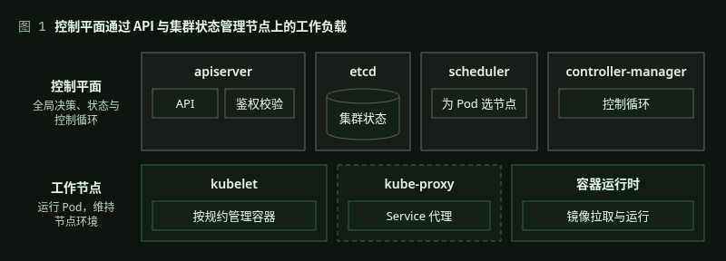</a></p>

**数据报表与看板 · Kubernetes 仓库 · 2026 年 10 月**

<table>
<tr><td width="50%"><a href="docs/showcase/previews/zh-CN/data-periodic.png"></a></td><td width="50%"><a href="docs/showcase/previews/zh-CN/dashboard-hero.png">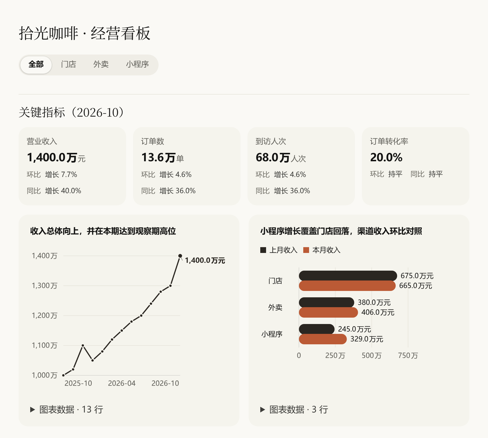</a></td></tr>
</table>

月报与看板使用同一组数字。宽屏看板是双列，手机上改为单列；手机首屏见[样张目录](docs/showcase/README.md)。

**可点击原型 · 发布审批**

<table>
<tr><td width="72%" valign="top"><a href="docs/showcase/previews/zh-CN/ui-desktop-overview.png"></a></td><td width="28%" valign="top"><a href="docs/showcase/previews/zh-CN/ui-mobile-invalid.png">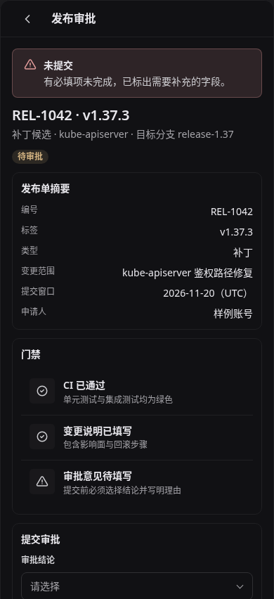</a></td></tr>
</table>

同一份原型，桌面看详情，手机走提交校验。列表、详情、校验失败和提交成功都可以点通。配色由 `--brand` 和 `--scheme` 控制。

[样例源码与复现方式 →](docs/showcase/README.md)

<a id="featured"></a>

## 精选图表

下面 8 张是用当前技能实际渲染的结构图和数据图。甘特图标题已标明「样例」。完整的 KChart 数据图、结构图和变体见 [样张与完整图库](docs/showcase/README.md#gallery)。

<table>
<tr>
<td align="center" valign="top" width="50%"><a href="docs/showcase/previews/gallery/zh-CN/swimlane.png">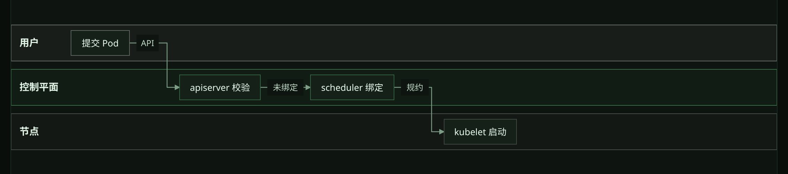</a><br><b>泳道图</b><br><sub><code>swimlane</code></sub></td>
<td align="center" valign="top" width="50%"><a href="docs/showcase/previews/gallery/zh-CN/C4Context.png">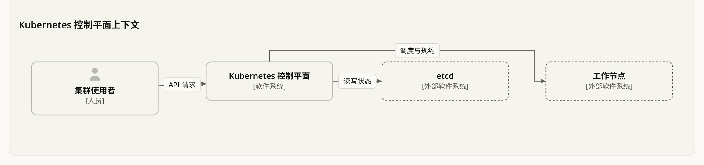</a><br><b>C4 上下文</b><br><sub><code>C4Context</code></sub></td>
</tr>
<tr>
<td align="center" valign="top" width="50%"><a href="docs/showcase/previews/gallery/zh-CN/gitGraph.png">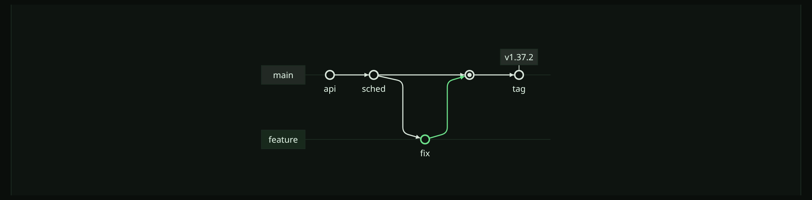</a><br><b>Git 图</b><br><sub><code>gitGraph</code></sub></td>
<td align="center" valign="top" width="50%"><a href="docs/showcase/previews/gallery/zh-CN/layers.png">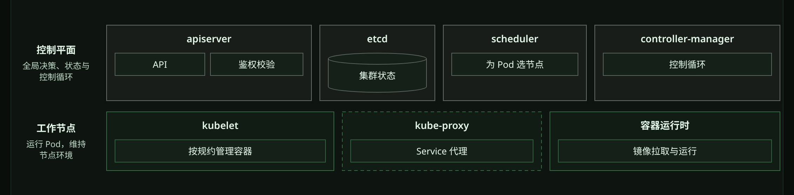</a><br><b>分层图</b><br><sub><code>layers</code></sub></td>
</tr>
<tr>
<td align="center" valign="top" width="50%"><a href="docs/showcase/previews/gallery/zh-CN/kchart-line.png">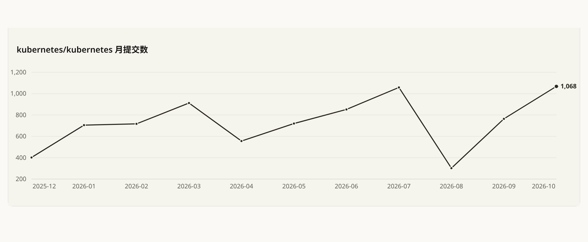</a><br><b>折线图</b><br><sub><code>line</code></sub></td>
<td align="center" valign="top" width="50%"><a href="docs/showcase/previews/gallery/zh-CN/sequenceDiagram.png">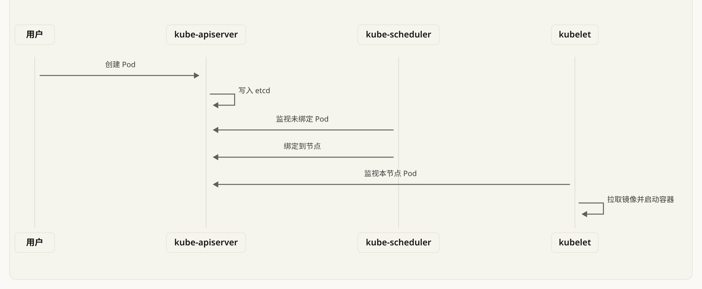</a><br><b>时序图</b><br><sub><code>sequenceDiagram</code></sub></td>
</tr>
<tr>
<td align="center" valign="top" width="50%"><a href="docs/showcase/previews/gallery/zh-CN/kchart-donut.png">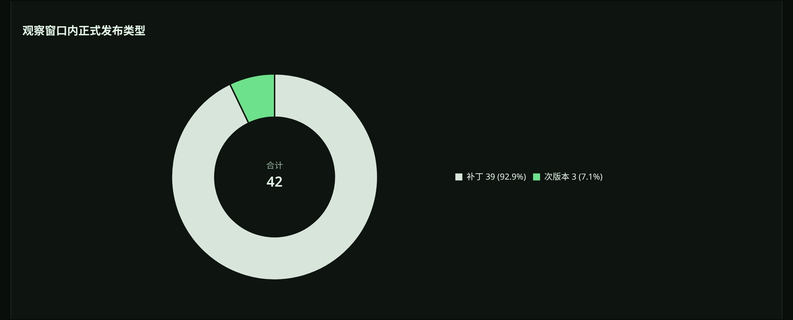</a><br><b>环形图</b><br><sub><code>donut</code></sub></td>
<td align="center" valign="top" width="50%"><a href="docs/showcase/previews/gallery/zh-CN/gantt.png">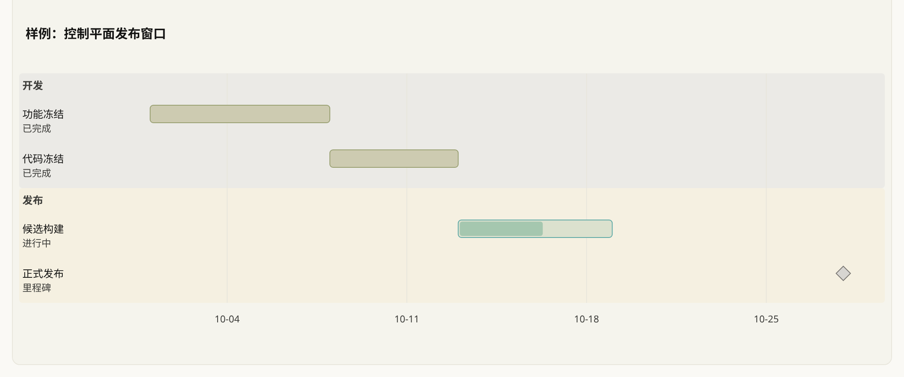</a><br><b>甘特图（样例）</b><br><sub><code>gantt</code></sub></td>
</tr>
</table>

<a id="review"></a>

## 批注与复制

渲染后的文档支持划词评论。选中一段正文后会出现「评论」，写完保存在本机；「复制全部」会导出给 Agent 阅读的文本，其中包括 `Review Document`、`File`、选区和评论。

图和代码块在鼠标悬停（或键盘焦点）时显示复制图标，用来复制图的源码或代码；复制成功后图标会换成勾。触控设备上图标始终可见。

<a id="update-uninstall"></a>

## 更新与卸载

若用 `npx skills add` 安装：

```bash
npx skills update html-view
npx skills remove html-view
```

全局安装加上 `-g`：

```bash
npx skills update -g html-view
npx skills remove -g html-view
```

若用安装脚本，更新时拉取克隆即可，两个链接仍指向同一个检出：

```bash
git -C "$HOME/.agents/skill-lib/html-view-skill" pull --ff-only
```

卸载时先确认两个链接指向本项目，再删除链接。`rm` 不带 `-r` 时只删链接；如果那里是真实目录，它会报错而不是删除。

```bash
readlink ~/.agents/skills/html-view ~/.claude/skills/html-view   # 应指向 …/html-view-skill/skills/html-view
rm ~/.agents/skills/html-view ~/.claude/skills/html-view
```

Windows 上用 `cmd /c rmdir "<路径>"` 删除目录联接，不带 `/s` 时只删联接本身。最后确认没有其他入口在用，再移走 `~/.agents/skill-lib/html-view-skill`。安装时被跳过的同名项不属于本项目，请保留。

<a id="install"></a>

## 安装说明

安装脚本（[`scripts/install.sh`](scripts/install.sh)、[`scripts/install.ps1`](scripts/install.ps1)）把仓库克隆到 `~/.agents/skill-lib/html-view-skill`，再从其中的 `skills/html-view` 建两个链接：

| 链接 | 读取它的 Agent |
|---|---|
| `~/.agents/skills/html-view` | [Codex](https://learn.chatgpt.com/docs/build-skills#where-codex-loads-local-skills)、[Pi](https://docs.pi.dev/latest/skills) |
| `~/.claude/skills/html-view` | [Claude Code](https://code.claude.com/docs/en/skills#where-skills-live) |

这两个目录是各工具自己的约定，Agent Skills 规范没有规定统一位置。其他 Agent 请把 `skills/html-view` 链接或复制到它读取技能的目录。

- **可以重复运行。** 已有有效检出就直接复用，不自动拉取；检出损坏或来源不对就报错，不会覆盖。两个链接分别检查，同名文件、目录或断链都原样保留。
- **下载中断不会装一半。** 脚本下载完整后才开始执行；网络在中途断开时什么都不改。
- **也可以手动克隆。** 克隆到上面的位置后运行脚本，它会补齐链接。
- **原生 Windows** 用目录联接（junction）代替符号链接，各 Agent 能否识别联接还没有在原生 Windows 上实测。WSL 使用其 Linux 环境中的 `$HOME`。
- **PowerShell 拦截脚本时：** 如果 `RemoteSigned` 只因文件来自互联网而拦截，核对内容后运行 `Unblock-File -LiteralPath '.\install-html-view.ps1'` 再执行，不必修改系统策略。

<a id="cli"></a>

## CLI 与维护

在项目根目录，从示例源构建一份文档并检查：

```sh
node skills/html-view/scripts/htmlview doc build docs/showcase/examples/zh-CN/k8s-control-plane.md --type tech-spec --out k8s-control-plane.html
node skills/html-view/scripts/htmlview audit k8s-control-plane.html
node skills/html-view/scripts/htmlview check k8s-control-plane.html --paper a3-portrait
node skills/html-view/scripts/htmlview export k8s-control-plane.html --format pdf --paper a3-portrait --out k8s-control-plane.pdf
```

`check` 用真实浏览器检查窄屏、图内溢出和打印版心；PDF 遇到裁切会停止，不会缩小图或字号。宽图可试 A4 横向，高图可试 A3 纵向；仍放不下就重排，或附上完整 SVG。分享 HTML 前请检查源码中的元数据：文档可能含 Markdown 源路径，报表内嵌了来源和计算证据。

[技能入口](skills/html-view/SKILL.md) · [CLI 与回归测试](skills/html-view/scripts/README.md) · [安装测试](scripts/tests/install.test.mjs) · [KChart API](packages/kchart/README.md) · [架构与主题扩展](docs/architecture.md)

改 KChart 时在 `packages/kchart` 开发，`npm ci && npm test` 通过后 `npm run build && npm run vendor` 把构建物镜像到 `skills/html-view/vendor/kchart`；技能只从镜像导入，安装时不需要 npm。目录分工和构建流程见[实现约定](docs/architecture.md)。

<a id="license"></a>

## 许可

自有源码与文档采用 [MIT License](LICENSE)。Prism 保留其[上游 MIT 许可](skills/html-view/assets/vendor/prism.js)；图标、品牌商标和 Natural Earth 地图数据的条款见[第三方资产声明](packages/kchart/NOTICE.md)；看板设计指南的出处见[致谢](NOTICE.md)。
