# Samples and the full gallery

[简体中文](README.md) · English

The product shots on the repository homepage were rendered by the current skill. The reading document, monthly report and dashboard use Kubernetes documentation and public data from `kubernetes/kubernetes`; sources and licenses are in [SOURCES.md](SOURCES.md). The release-approval prototype is a sample flow and is not connected to any backend. The Chinese and English samples share the same numbers and structure; only the text differs.

Every render here uses the skill's build mirror at `skills/html-view/vendor/kchart`, the same import the CLI uses at runtime. To upgrade KChart, change the library in `packages/kchart`, run `npm run build`, refresh the mirror with `npm run vendor`, and regenerate these images; never edit the mirror by hand.

The promo video is at [previews/html-view-promo.mp4](previews/html-view-promo.mp4) (46 seconds, silent). The short GIF on the homepage is [previews/html-view-promo.gif](previews/html-view-promo.gif), covering the left-to-right render and the multi-theme fan-out.

<a id="examples"></a>

## Samples used on the homepage

| Sample | Source | Screenshots |
|---|---|---|
| Kubernetes control plane and node architecture | [中文](examples/zh-CN/k8s-control-plane.md) · [English](examples/en/k8s-control-plane.md) | Body and table of contents: [中文](previews/zh-CN/doc-reading.png) · [English](previews/en/doc-reading.png)<br>Layer diagram: [中文](previews/zh-CN/doc-architecture.png) · [English](previews/en/doc-architecture.png) |
| kubernetes/kubernetes October 2026 engineering report | Report package, narrative and CSV: [中文](examples/zh-CN/k8s-monthly-report/) · [English](examples/en/k8s-monthly-report/) | [中文](previews/zh-CN/data-periodic.png) · [English](previews/en/data-periodic.png) |
| kubernetes/kubernetes · October 2026 dashboard | The same package with `layout: dashboard`: [中文](examples/zh-CN/k8s-engineering/) · [English](examples/en/k8s-engineering/) | Desktop: [中文](previews/zh-CN/dashboard-hero.png) · [English](previews/en/dashboard-hero.png)<br>Phone: [中文](previews/zh-CN/dashboard-mobile.png) · [English](previews/en/dashboard-mobile.png) |
| Release-approval prototype | [中文](examples/zh-CN/release-approval.html) · [English](examples/en/release-approval.html) | Desktop list: [中文](previews/zh-CN/ui-desktop-overview.png) · [English](previews/en/ui-desktop-overview.png)<br>Phone validation failure: [中文](previews/zh-CN/ui-mobile-invalid.png) · [English](previews/en/ui-mobile-invalid.png) |

Build the HTML from the repository root with the CLI, for example:

```sh
node skills/html-view/scripts/htmlview doc build docs/showcase/examples/en/k8s-control-plane.md --type tech-spec --theme terminal --out k8s-control-plane.html
node skills/html-view/scripts/htmlview data build docs/showcase/examples/en/k8s-monthly-report/report.json --theme terminal --out k8s-monthly-report.html
node skills/html-view/scripts/htmlview data build docs/showcase/examples/en/k8s-engineering/report.json --theme terminal --out k8s-dashboard.html
```

The prototype can be opened as HTML, or started with `htmlview ui new` and edited only between `<!-- htmlview:content -->` and `<!-- /htmlview:content -->`, then restyled with `htmlview style`. Still frames of the featured diagrams and charts are in [previews/gallery/](previews/gallery/).

The repository still keeps an earlier set of synthetic samples (notification platform, Shiguang Coffee, Retention Watch) for regression and `render-examples.mjs`:

```sh
node docs/showcase/render-examples.mjs
```

That script writes HTML and screenshots under the system temp directory and does not change repository files.

<a id="readme-gallery"></a>

## Reproduce the theme plates and the full gallery

```sh
node docs/showcase/render-readme-gallery.mjs
node docs/showcase/sync-readme.mjs <directory printed by the previous command>
```

The first command measures SVG glyphs in Chrome and renders the Chinese and English galleries at their final display widths, one SVG per sample. The full gallery uses even HTML tables, one row at a time: ordinary charts occupy a 360px cell, usually two to a row; charts that do not fit, or that are very tall, take a 780px row of their own. Text is never shrunk to fit. Nearby charts of similar height share a row so captions line up. When a group has an odd number of ordinary charts, the last row uses three columns instead of leaving one chart alone above a packed row. If a group has a single ordinary chart left after its wide figures, that chart still occupies a full-width row. The main gallery uses Claude only; the theme comparison reuses one two-series dataset for every built-in theme. The full-page theme shots are the same one-pager, built and audited by the CLI in each theme, then captured by Chrome at 780px and 2× as `theme-<id>-page.png`. The homepage README shows those pages in collapsed blocks; none is open by default. The output directory contains `gallery/<locale>/` images, a `gallery.<locale>.md` and `themes.<locale>.md` fragment for each language, and a `manifest.json` that lists every sample.

The second command replaces the images in this folder's `gallery/`, writes the `themes` fragments into the repository-root `README.md` and `README.en.md`, and writes the `gallery` fragments into this page and `README.en.md` between the marked blocks. If any marker pair is missing or duplicated, it changes no files. Group anchors use language-neutral slugs such as `trends`, `c4` and `variants-marks`. Image files are named by sample id, for example `chart-line.svg`, `theme-claude.svg` and `theme-claude-page.png`. Map previews are 2× PNGs that link to the full SVG.

<a id="gallery"></a>

## KChart gallery

HTML View draws charts with the bundled KChart library. The gallery shows **45 data charts, 38 controlled variants, 40 Mermaid diagram kinds, 3 native structure diagrams and 8 mind-map layouts**. The full index is in the [skill entry](../../skills/html-view/SKILL.md#按读者要看什么选图) (in Chinese). Every tile below is a real render in the Claude theme; other themes are on the [Built-in themes](../../README.en.md#themes) section of the homepage. Each chart occupies one cell in an even table: ordinary charts sit two or three to a row, wide charts take a full row of their own, and text is never shrunk to tile them. On a phone, GitHub shrinks both columns to the screen width; click a picture to open the full-size SVG. Every Mermaid example also parses in Mermaid 12.3.0 itself; ZenUML needs Mermaid’s external plugin.

[Generate a filterable gallery →](#full-gallery)

<!-- gallery:begin -->
<a id="charts"></a>

### Data charts

[Trends over time](#trends) · [Comparisons, targets and ranges](#comparison) · [Parts of a whole and change](#composition) · [Distributions and correlation](#distribution) · [Matrices and many measures](#matrix) · [Hierarchies](#hierarchy) · [Networks, flows and paths](#relations) · [Maps](#geography)

<a id="trends"></a>

#### Trends over time

<table>
<tr>
<td align="center" valign="top" width="50%"><a href="gallery/en/chart-line.svg">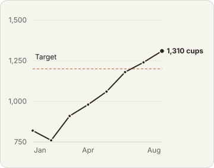</a><br><b>Line</b><br><sub><code>line</code></sub></td>
<td align="center" valign="top" width="50%"><a href="gallery/en/chart-sparkline.svg">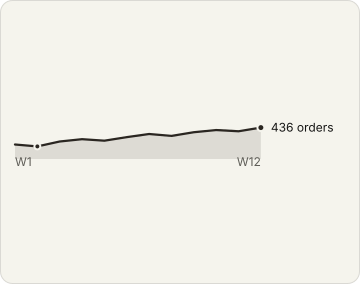</a><br><b>Sparkline</b><br><sub><code>sparkline</code></sub></td>
</tr>
</table>

<table>
<tr>
<td align="center" valign="top" width="50%"><a href="gallery/en/chart-area.svg">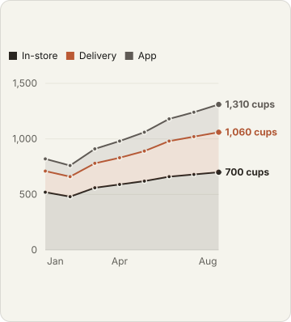</a><br><b>Stacked area</b><br><sub><code>area</code></sub></td>
<td align="center" valign="top" width="50%"><a href="gallery/en/chart-candlestick.svg">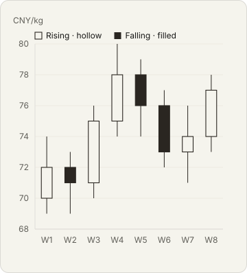</a><br><b>Open, close, high, low</b><br><sub><code>candlestick</code></sub></td>
</tr>
</table>

<table>
<tr>
<td align="center"><a href="gallery/en/chart-small-multiples.svg">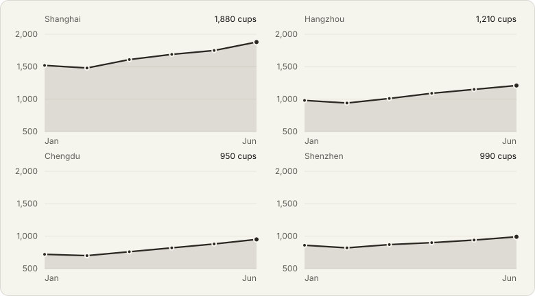</a><br><b>Small multiples</b><br><sub><code>small-multiples</code></sub></td>
</tr>
</table>

<table>
<tr>
<td align="center" valign="top" width="50%"><a href="gallery/en/chart-stream.svg">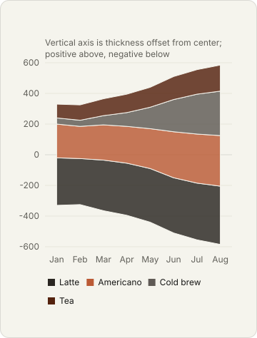</a><br><b>Streamgraph</b><br><sub><code>stream</code></sub></td>
<td align="center" valign="top" width="50%"><a href="gallery/en/chart-split-compare.svg">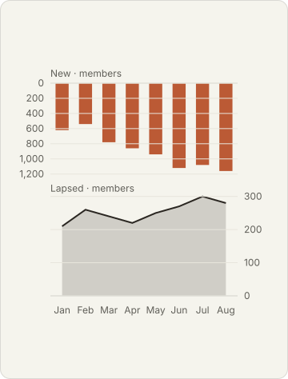</a><br><b>Mirrored comparison</b><br><sub><code>split-compare</code></sub></td>
</tr>
</table>

<table>
<tr>
<td align="center"><a href="gallery/en/chart-combo.svg">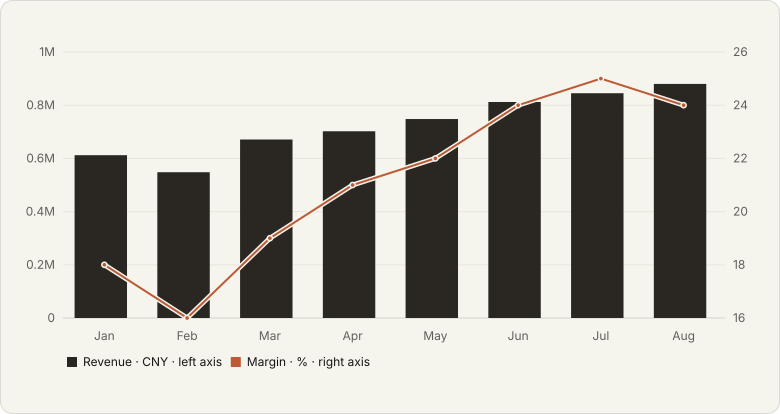</a><br><b>Dual-axis combo</b><br><sub><code>combo</code></sub></td>
</tr>
</table>

<table>
<tr>
<td align="center"><a href="gallery/en/chart-bump.svg">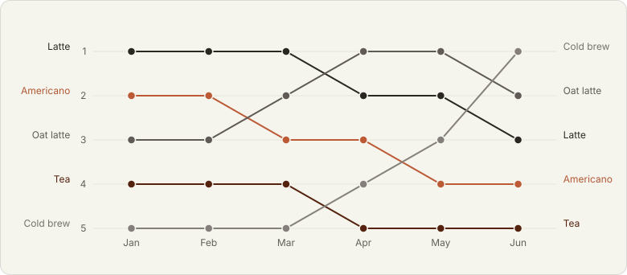</a><br><b>Rank changes</b><br><sub><code>bump</code></sub></td>
</tr>
</table>

<table>
<tr>
<td align="center"><a href="gallery/en/chart-launch-fan.svg">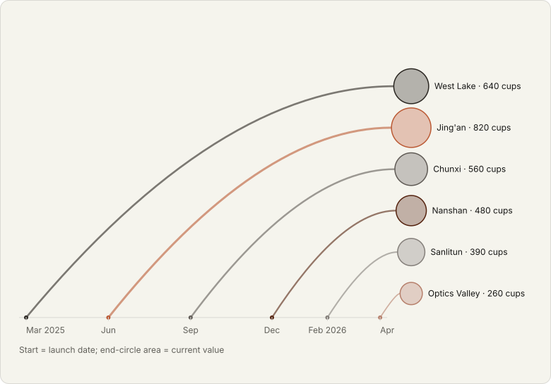</a><br><b>From launch to now</b><br><sub><code>launch-fan</code></sub></td>
</tr>
</table>

<a id="comparison"></a>

#### Comparisons, targets and ranges

<table>
<tr>
<td align="center" valign="top" width="50%"><a href="gallery/en/chart-bar.svg">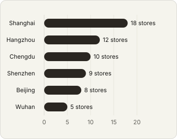</a><br><b>Bars</b><br><sub><code>bar</code></sub></td>
<td align="center" valign="top" width="50%"><a href="gallery/en/chart-gauge.svg">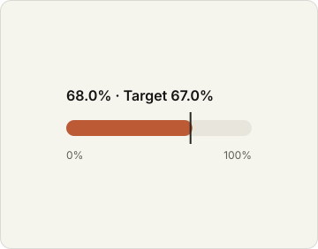</a><br><b>Progress</b><br><sub><code>gauge</code></sub></td>
</tr>
</table>

<table>
<tr>
<td align="center" valign="top" width="50%"><a href="gallery/en/chart-column.svg">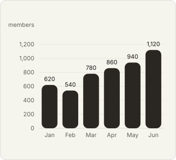</a><br><b>Columns</b><br><sub><code>column</code></sub></td>
<td align="center" valign="top" width="50%"><a href="gallery/en/chart-dumbbell.svg">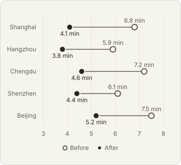</a><br><b>Before and after</b><br><sub><code>dumbbell</code></sub></td>
</tr>
</table>

<table>
<tr>
<td align="center" valign="top" width="50%"><a href="gallery/en/chart-slope.svg">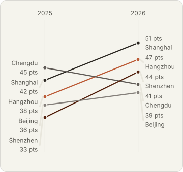</a><br><b>Slope</b><br><sub><code>slope</code></sub></td>
<td align="center" valign="top" width="50%"><a href="gallery/en/chart-bullet.svg">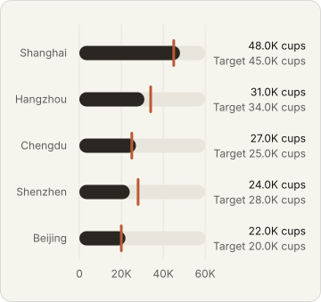</a><br><b>Actual vs target</b><br><sub><code>bullet</code></sub></td>
</tr>
</table>

<table>
<tr>
<td align="center"><a href="gallery/en/chart-interval.svg">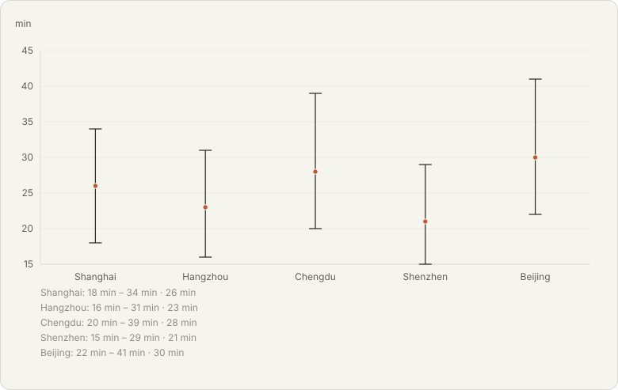</a><br><b>Range and median</b><br><sub><code>interval</code></sub></td>
</tr>
</table>

<a id="composition"></a>

#### Parts of a whole and change

<table>
<tr>
<td align="center" valign="top" width="50%"><a href="gallery/en/chart-share.svg">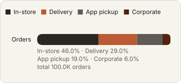</a><br><b>Share bar</b><br><sub><code>share</code></sub></td>
<td align="center" valign="top" width="50%"><a href="gallery/en/chart-pie.svg">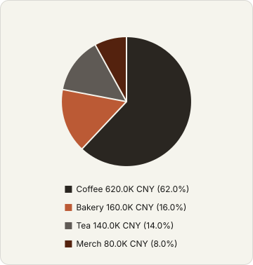</a><br><b>Pie</b><br><sub><code>pie</code></sub></td>
</tr>
</table>

<table>
<tr>
<td align="center" valign="top" width="50%"><a href="gallery/en/chart-funnel.svg">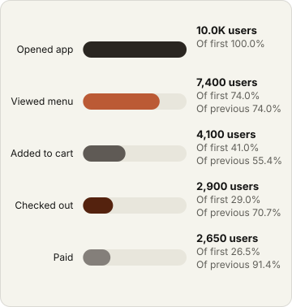</a><br><b>Funnel</b><br><sub><code>funnel</code></sub></td>
<td align="center" valign="top" width="50%"><a href="gallery/en/chart-donut.svg">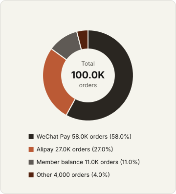</a><br><b>Donut</b><br><sub><code>donut</code></sub></td>
</tr>
</table>

<table>
<tr>
<td align="center" valign="top" width="33%"><a href="gallery/en/chart-waffle.svg">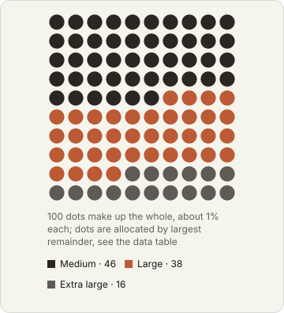</a><br><b>Waffle</b><br><sub><code>waffle</code></sub></td>
<td align="center" valign="top" width="33%"><a href="gallery/en/chart-radial-share.svg">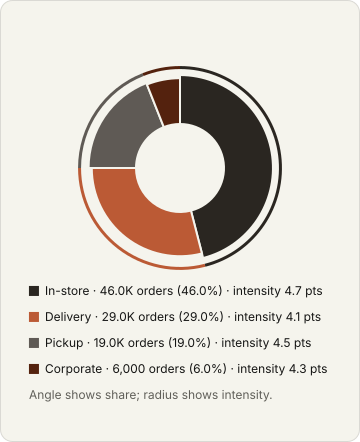</a><br><b>Share and intensity</b><br><sub><code>radial-share</code></sub></td>
<td align="center" valign="top" width="33%"><a href="gallery/en/chart-rose.svg">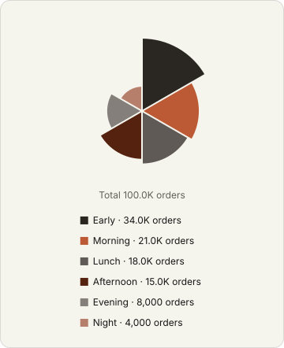</a><br><b>Rose</b><br><sub><code>rose</code></sub></td>
</tr>
</table>

<table>
<tr>
<td align="center"><a href="gallery/en/chart-waterfall.svg">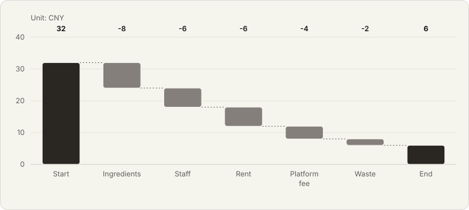</a><br><b>Waterfall</b><br><sub><code>waterfall</code></sub></td>
</tr>
</table>

<table>
<tr>
<td align="center"><a href="gallery/en/chart-tally.svg">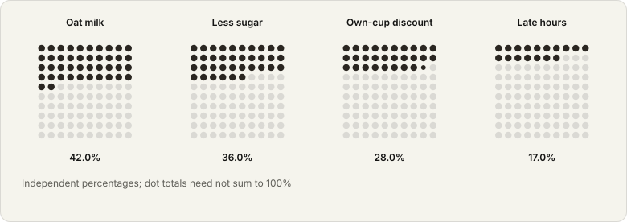</a><br><b>Multiple-choice shares</b><br><sub><code>tally</code></sub></td>
</tr>
</table>

<a id="distribution"></a>

#### Distributions and correlation

<table>
<tr>
<td align="center" valign="top" width="50%"><a href="gallery/en/chart-histogram.svg">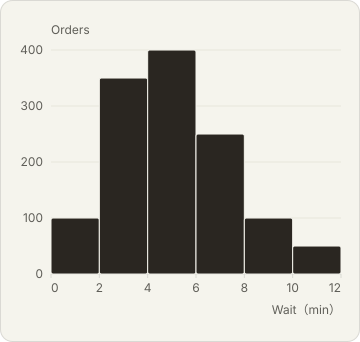</a><br><b>Histogram</b><br><sub><code>histogram</code></sub></td>
<td align="center" valign="top" width="50%"><a href="gallery/en/chart-scatter.svg">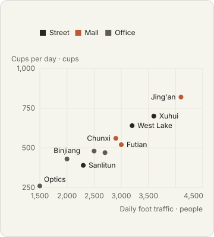</a><br><b>Scatter</b><br><sub><code>scatter</code></sub></td>
</tr>
</table>

<table>
<tr>
<td align="center" valign="top" width="33%"><a href="gallery/en/chart-boxplot.svg">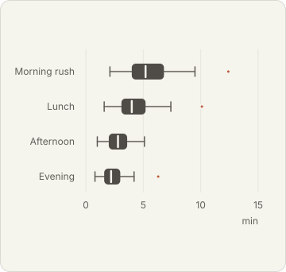</a><br><b>Box plot</b><br><sub><code>boxplot</code></sub></td>
<td align="center" valign="top" width="33%"><a href="gallery/en/chart-violin.svg">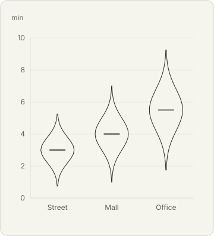</a><br><b>Violin</b><br><sub><code>violin</code></sub></td>
<td align="center" valign="top" width="33%"><a href="gallery/en/chart-strip.svg">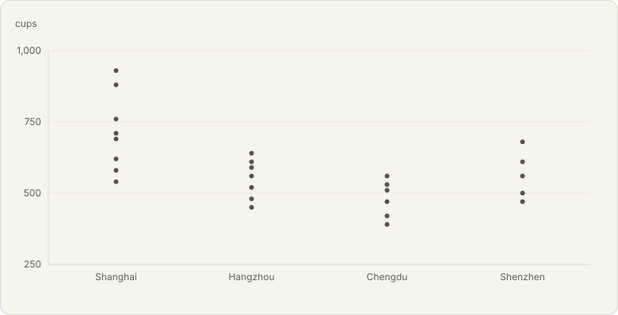</a><br><b>Strip plot</b><br><sub><code>strip</code></sub></td>
</tr>
</table>

<a id="matrix"></a>

#### Matrices and many measures

<table>
<tr>
<td align="center" valign="top" width="33%"><a href="gallery/en/chart-heatmap.svg">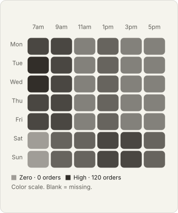</a><br><b>Heatmap</b><br><sub><code>heatmap</code></sub></td>
<td align="center" valign="top" width="33%"><a href="gallery/en/chart-bubble-matrix.svg">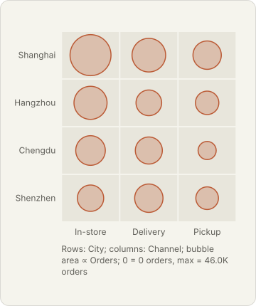</a><br><b>Bubble matrix</b><br><sub><code>bubble-matrix</code></sub></td>
<td align="center" valign="top" width="33%"><a href="gallery/en/chart-radar.svg">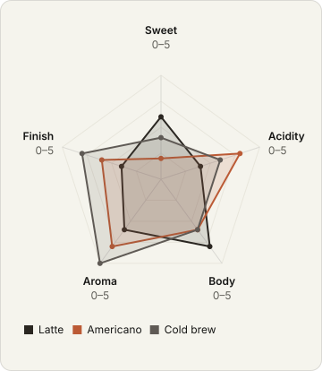</a><br><b>Radar</b><br><sub><code>radar</code></sub></td>
</tr>
</table>

<table>
<tr>
<td align="center"><a href="gallery/en/chart-parallel.svg">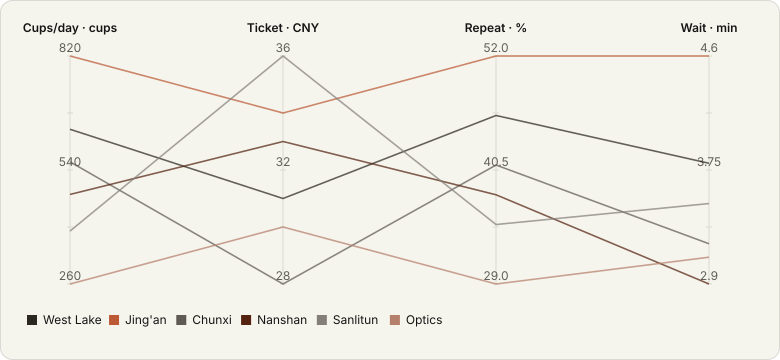</a><br><b>Parallel coordinates</b><br><sub><code>parallel</code></sub></td>
</tr>
</table>

<table>
<tr>
<td align="center"><a href="gallery/en/chart-calendar.svg">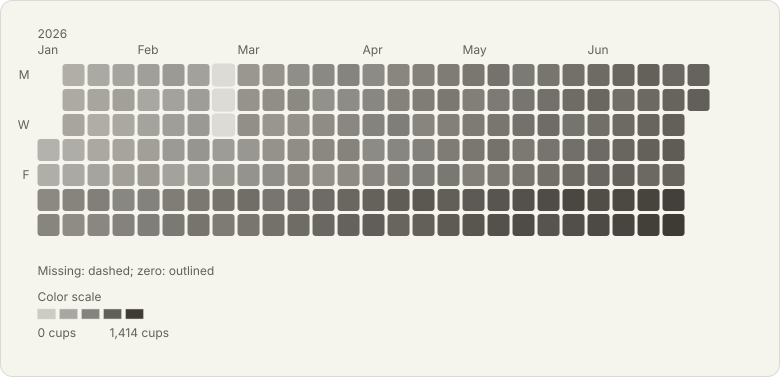</a><br><b>Calendar</b><br><sub><code>calendar</code></sub></td>
</tr>
</table>

<a id="hierarchy"></a>

#### Hierarchies

<table>
<tr>
<td align="center"><a href="gallery/en/chart-tree.svg">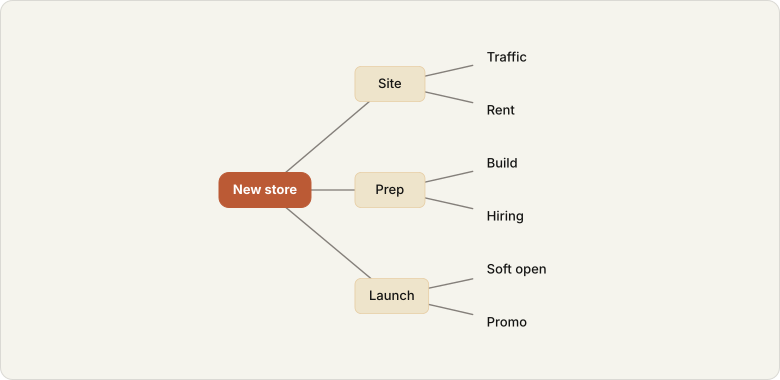</a><br><b>Tree</b><br><sub><code>tree</code></sub></td>
</tr>
</table>

<table>
<tr>
<td align="center"><a href="gallery/en/chart-mindmap.svg">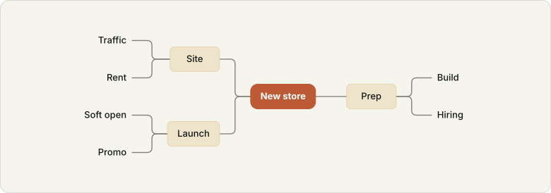</a><br><b>Mind map</b><br><sub><code>mindmap</code></sub></td>
</tr>
</table>

<table>
<tr>
<td align="center" valign="top" width="50%"><a href="gallery/en/chart-treemap.svg">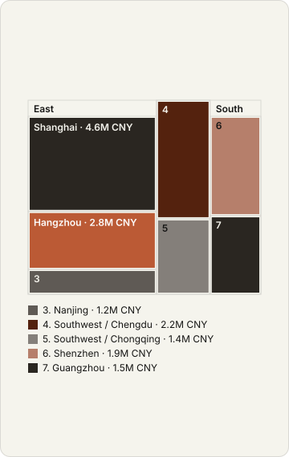</a><br><b>Treemap</b><br><sub><code>treemap</code></sub></td>
<td align="center" valign="top" width="50%"><a href="gallery/en/chart-sunburst.svg">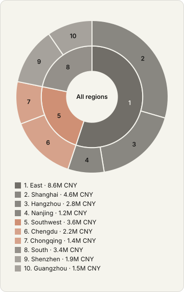</a><br><b>Sunburst</b><br><sub><code>sunburst</code></sub></td>
</tr>
</table>

<a id="relations"></a>

#### Networks, flows and paths

<table>
<tr>
<td align="center"><a href="gallery/en/chart-network.svg">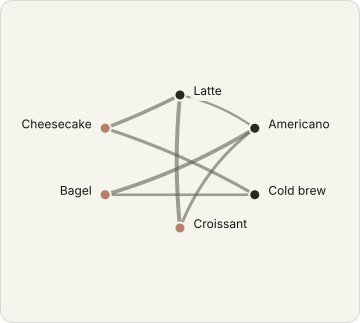</a><br><b>Network</b><br><sub><code>network</code></sub></td>
</tr>
</table>

<table>
<tr>
<td align="center"><a href="gallery/en/chart-sankey.svg">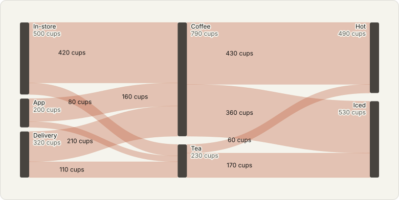</a><br><b>Sankey</b><br><sub><code>sankey</code></sub></td>
</tr>
</table>

<table>
<tr>
<td align="center"><a href="gallery/en/chart-threads.svg">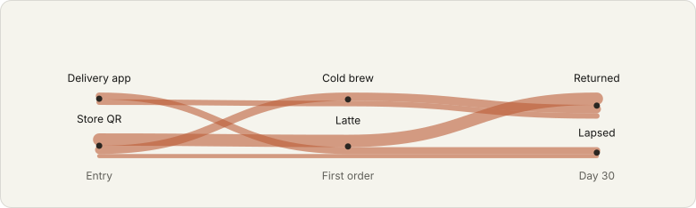</a><br><b>Path threads</b><br><sub><code>threads</code></sub></td>
</tr>
</table>

<a id="geography"></a>

#### Maps

<table>
<tr>
<td align="center"><a href="gallery/en/chart-choropleth.svg">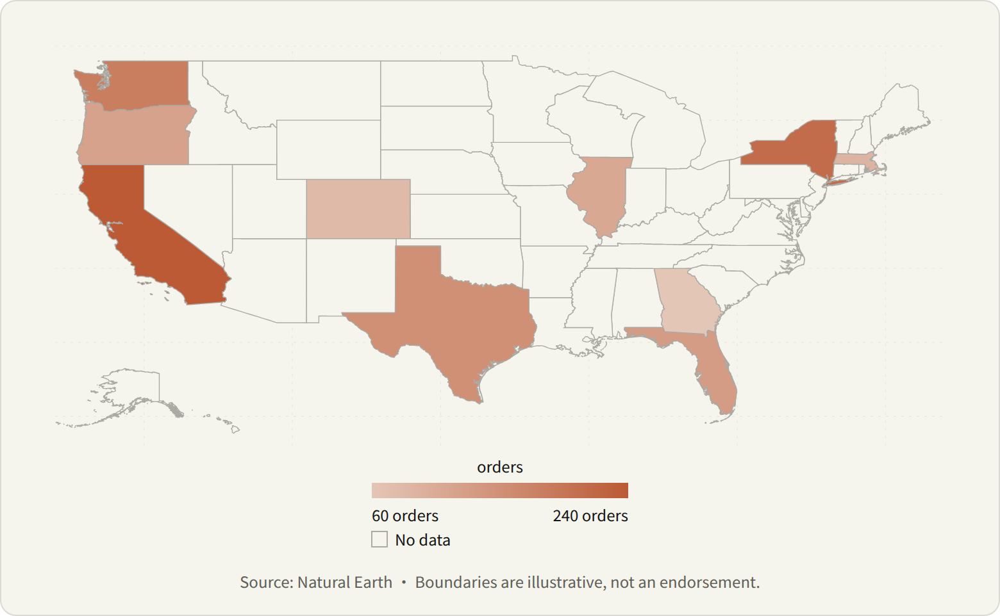</a><br><b>Choropleth</b><br><sub><code>choropleth</code></sub></td>
</tr>
</table>

<table>
<tr>
<td align="center"><a href="gallery/en/chart-geo-scatter.svg">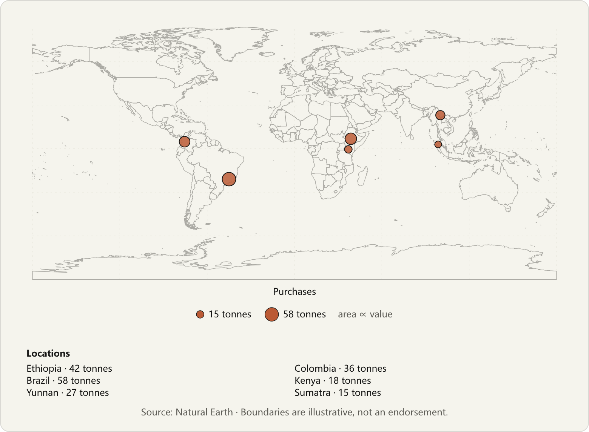</a><br><b>Points on a map</b><br><sub><code>geo-scatter</code></sub></td>
</tr>
</table>

<a id="diagrams"></a>

### Diagrams

[Flows, states and journeys](#process) · [Sequences and data models](#model) · [Railroad grammars in four notations](#grammar) · [Plans, boards and protocols](#planning) · [Architecture, layers and file trees](#architecture) · [Five C4 views](#c4) · [Mermaid charts](#mermaid-data) · [Analysis and strategy](#analysis) · [One tree, eight mind-map layouts](#mindmaps)

<a id="process"></a>

#### Flows, states and journeys

<table>
<tr>
<td align="center"><a href="gallery/en/diagram-flowchart.svg">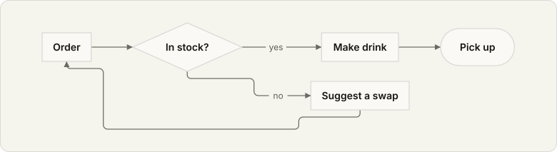</a><br><b>Flowchart</b><br><sub><code>flowchart</code></sub></td>
</tr>
</table>

<table>
<tr>
<td align="center" valign="top" width="50%"><a href="gallery/en/diagram-stateDiagram-v2.svg">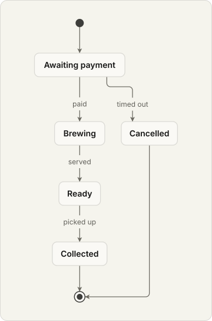</a><br><b>State diagram</b><br><sub><code>stateDiagram-v2</code></sub></td>
<td align="center" valign="top" width="50%"><a href="gallery/en/diagram-journey.svg">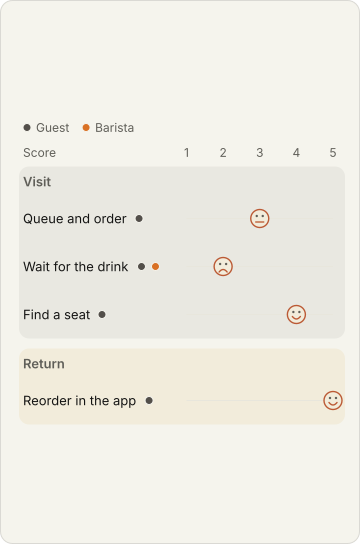</a><br><b>Customer journey</b><br><sub><code>journey</code></sub></td>
</tr>
</table>

<table>
<tr>
<td align="center"><a href="gallery/en/diagram-swimlane.svg">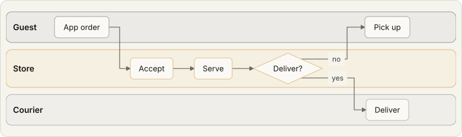</a><br><b>Swimlanes</b><br><sub><code>swimlane</code></sub></td>
</tr>
</table>

<table>
<tr>
<td align="center"><a href="gallery/en/diagram-swimlane-beta.svg">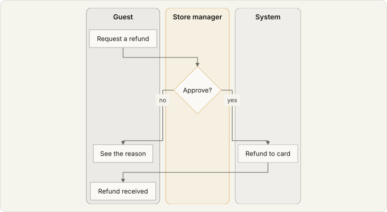</a><br><b>Mermaid swimlanes</b><br><sub><code>swimlane-beta</code></sub></td>
</tr>
</table>

<table>
<tr>
<td align="center"><a href="gallery/en/diagram-agentflow-beta.svg"></a><br><b>Agent flow</b><br><sub><code>agentflow-beta</code></sub></td>
</tr>
</table>

<table>
<tr>
<td align="center"><a href="gallery/en/diagram-eventmodeling.svg"></a><br><b>Event model</b><br><sub><code>eventmodeling</code></sub></td>
</tr>
</table>

<a id="model"></a>

#### Sequences and data models

<table>
<tr>
<td align="center"><a href="gallery/en/diagram-sequenceDiagram.svg"></a><br><b>Sequence</b><br><sub><code>sequenceDiagram</code></sub></td>
</tr>
</table>

<table>
<tr>
<td align="center" valign="top" width="50%"><a href="gallery/en/diagram-zenuml.svg"></a><br><b>ZenUML</b><br><sub><code>zenuml</code></sub></td>
<td align="center" valign="top" width="50%"><a href="gallery/en/diagram-requirementDiagram.svg"></a><br><b>Requirements</b><br><sub><code>requirementDiagram</code></sub></td>
</tr>
</table>

<table>
<tr>
<td align="center" valign="top" width="50%"><a href="gallery/en/diagram-usecase-beta.svg"></a><br><b>Use cases</b><br><sub><code>usecase-beta</code></sub></td>
<td align="center" valign="top" width="50%"><a href="gallery/en/diagram-classDiagram.svg"></a><br><b>Class diagram</b><br><sub><code>classDiagram</code></sub></td>
</tr>
</table>

<table>
<tr>
<td align="center"><a href="gallery/en/diagram-erDiagram.svg"></a><br><b>ER diagram</b><br><sub><code>erDiagram</code></sub></td>
</tr>
</table>

<a id="grammar"></a>

#### Railroad grammars in four notations

<table>
<tr>
<td align="center"><a href="gallery/en/diagram-railroad-beta.svg"></a><br><b>Function style</b><br><sub><code>railroad-beta</code></sub></td>
</tr>
</table>

<table>
<tr>
<td align="center" valign="top" width="50%"><a href="gallery/en/diagram-railroad-ebnf-beta.svg"></a><br><b>EBNF</b><br><sub><code>railroad-ebnf-beta</code></sub></td>
<td align="center" valign="top" width="50%"><a href="gallery/en/diagram-railroad-peg-beta.svg"></a><br><b>PEG</b><br><sub><code>railroad-peg-beta</code></sub></td>
</tr>
</table>

<table>
<tr>
<td align="center"><a href="gallery/en/diagram-railroad-abnf-beta.svg"></a><br><b>ABNF</b><br><sub><code>railroad-abnf-beta</code></sub></td>
</tr>
</table>

<a id="planning"></a>

#### Plans, boards and protocols

<table>
<tr>
<td align="center"><a href="gallery/en/diagram-gantt.svg"></a><br><b>Gantt</b><br><sub><code>gantt</code></sub></td>
</tr>
</table>

<table>
<tr>
<td align="center"><a href="gallery/en/diagram-timeline.svg"></a><br><b>Timeline</b><br><sub><code>timeline</code></sub></td>
</tr>
</table>

<table>
<tr>
<td align="center"><a href="gallery/en/diagram-gitGraph.svg"></a><br><b>Git graph</b><br><sub><code>gitGraph</code></sub></td>
</tr>
</table>

<table>
<tr>
<td align="center"><a href="gallery/en/diagram-kanban.svg"></a><br><b>Kanban</b><br><sub><code>kanban</code></sub></td>
</tr>
</table>

<table>
<tr>
<td align="center"><a href="gallery/en/diagram-packet.svg"></a><br><b>Packet layout</b><br><sub><code>packet</code></sub></td>
</tr>
</table>

<a id="architecture"></a>

#### Architecture, layers and file trees

<table>
<tr>
<td align="center"><a href="gallery/en/diagram-layers.svg"></a><br><b>Layers</b><br><sub><code>layers</code></sub></td>
</tr>
</table>

<table>
<tr>
<td align="center"><a href="gallery/en/diagram-blocks.svg"></a><br><b>Overview board</b><br><sub><code>blocks</code></sub></td>
</tr>
</table>

<table>
<tr>
<td align="center"><a href="gallery/en/diagram-architecture-beta.svg"></a><br><b>Architecture</b><br><sub><code>architecture-beta</code></sub></td>
</tr>
</table>

<table>
<tr>
<td align="center"><a href="gallery/en/diagram-block.svg"></a><br><b>Block diagram</b><br><sub><code>block</code></sub></td>
</tr>
</table>

<table>
<tr>
<td align="center"><a href="gallery/en/diagram-treeView-beta.svg"></a><br><b>File tree</b><br><sub><code>treeView-beta</code></sub></td>
</tr>
</table>

<a id="c4"></a>

#### Five C4 views

<table>
<tr>
<td align="center" valign="top" width="50%"><a href="gallery/en/diagram-C4Context.svg"></a><br><b>Context</b><br><sub><code>C4Context</code></sub></td>
<td align="center" valign="top" width="50%"><a href="gallery/en/diagram-C4Dynamic.svg"></a><br><b>Dynamic</b><br><sub><code>C4Dynamic</code></sub></td>
</tr>
</table>

<table>
<tr>
<td align="center" valign="top" width="50%"><a href="gallery/en/diagram-C4Container.svg"></a><br><b>Containers</b><br><sub><code>C4Container</code></sub></td>
<td align="center" valign="top" width="50%"><a href="gallery/en/diagram-C4Component.svg"></a><br><b>Components</b><br><sub><code>C4Component</code></sub></td>
</tr>
</table>

<table>
<tr>
<td align="center"><a href="gallery/en/diagram-C4Deployment.svg"></a><br><b>Deployment</b><br><sub><code>C4Deployment</code></sub></td>
</tr>
</table>

<a id="mermaid-data"></a>

#### Mermaid charts

<table>
<tr>
<td align="center" valign="top" width="50%"><a href="gallery/en/diagram-pie.svg"></a><br><b>Pie</b><br><sub><code>pie</code></sub></td>
<td align="center" valign="top" width="50%"><a href="gallery/en/diagram-treemap.svg"></a><br><b>Treemap</b><br><sub><code>treemap</code></sub></td>
</tr>
</table>

<table>
<tr>
<td align="center" valign="top" width="33%"><a href="gallery/en/diagram-xychart.svg"></a><br><b>XY chart</b><br><sub><code>xychart</code></sub></td>
<td align="center" valign="top" width="33%"><a href="gallery/en/diagram-sankey.svg"></a><br><b>Sankey</b><br><sub><code>sankey</code></sub></td>
<td align="center" valign="top" width="33%"><a href="gallery/en/diagram-radar-beta.svg"></a><br><b>Radar</b><br><sub><code>radar-beta</code></sub></td>
</tr>
</table>

<a id="analysis"></a>

#### Analysis and strategy

<table>
<tr>
<td align="center"><a href="gallery/en/diagram-quadrantChart.svg"></a><br><b>Quadrant chart</b><br><sub><code>quadrantChart</code></sub></td>
</tr>
</table>

<table>
<tr>
<td align="center"><a href="gallery/en/diagram-ishikawa.svg"></a><br><b>Fishbone</b><br><sub><code>ishikawa</code></sub></td>
</tr>
</table>

<table>
<tr>
<td align="center"><a href="gallery/en/diagram-cynefin-beta.svg"></a><br><b>Cynefin</b><br><sub><code>cynefin-beta</code></sub></td>
</tr>
</table>

<table>
<tr>
<td align="center"><a href="gallery/en/diagram-venn-beta.svg"></a><br><b>Venn</b><br><sub><code>venn-beta</code></sub></td>
</tr>
</table>

<table>
<tr>
<td align="center"><a href="gallery/en/diagram-wardley-beta.svg"></a><br><b>Wardley map</b><br><sub><code>wardley-beta</code></sub></td>
</tr>
</table>

<a id="mindmaps"></a>

#### One tree, eight mind-map layouts

<table>
<tr>
<td align="center"><a href="gallery/en/diagram-mindmap.svg"></a><br><b>Mermaid mind map</b><br><sub><code>mindmap</code></sub></td>
</tr>
</table>

<table>
<tr>
<td align="center"><a href="gallery/en/mindmap-bilateral.svg"></a><br><b>Bilateral</b><br><sub><code>mindmap / bilateral</code></sub></td>
</tr>
</table>

<table>
<tr>
<td align="center"><a href="gallery/en/mindmap-right.svg"></a><br><b>Right</b><br><sub><code>mindmap / right</code></sub></td>
</tr>
</table>

<table>
<tr>
<td align="center"><a href="gallery/en/mindmap-left.svg"></a><br><b>Left</b><br><sub><code>mindmap / left</code></sub></td>
</tr>
</table>

<table>
<tr>
<td align="center"><a href="gallery/en/mindmap-radial.svg"></a><br><b>Radial</b><br><sub><code>mindmap / radial</code></sub></td>
</tr>
</table>

<table>
<tr>
<td align="center"><a href="gallery/en/mindmap-org.svg"></a><br><b>Org chart</b><br><sub><code>mindmap / org</code></sub></td>
</tr>
</table>

<table>
<tr>
<td align="center"><a href="gallery/en/mindmap-brace.svg"></a><br><b>Brace</b><br><sub><code>mindmap / brace</code></sub></td>
</tr>
</table>

<table>
<tr>
<td align="center"><a href="gallery/en/mindmap-fishbone.svg"></a><br><b>Fishbone</b><br><sub><code>mindmap / fishbone</code></sub></td>
</tr>
</table>

<table>
<tr>
<td align="center"><a href="gallery/en/mindmap-timeline.svg"></a><br><b>Timeline</b><br><sub><code>mindmap / timeline</code></sub></td>
</tr>
</table>

<a id="variants"></a>

### Variants

[Bars, lines and marks](#variants-marks) · [Shares and stages](#variants-part) · [Targets, gaps and distributions](#variants-value) · [Matrices, calendars and networks](#variants-pattern)

<a id="variants-marks"></a>

#### Bars, lines and marks

<table>
<tr>
<td align="center" valign="top" width="50%"><a href="gallery/en/variant-bar-solid.svg"></a><br><b>Bars · Solid</b><br><sub><code>bar / solid</code></sub></td>
<td align="center" valign="top" width="50%"><a href="gallery/en/variant-bar-lollipop.svg"></a><br><b>Bars · Lollipop</b><br><sub><code>bar / lollipop</code></sub></td>
</tr>
</table>

<table>
<tr>
<td align="center" valign="top" width="50%"><a href="gallery/en/variant-bar-rungs.svg"></a><br><b>Bars · Unit rungs</b><br><sub><code>bar / rungs</code></sub></td>
<td align="center" valign="top" width="50%"><a href="gallery/en/variant-column-rungs.svg"></a><br><b>Columns · Unit rungs</b><br><sub><code>column / rungs</code></sub></td>
</tr>
</table>

<table>
<tr>
<td align="center"><a href="gallery/en/variant-bar-pictorial.svg"></a><br><b>Bars · Pictogram</b><br><sub><code>bar / pictorial</code></sub></td>
</tr>
</table>

<table>
<tr>
<td align="center" valign="top" width="50%"><a href="gallery/en/variant-column-solid.svg"></a><br><b>Columns · Solid</b><br><sub><code>column / solid</code></sub></td>
<td align="center" valign="top" width="50%"><a href="gallery/en/variant-column-lollipop.svg"></a><br><b>Columns · Lollipop</b><br><sub><code>column / lollipop</code></sub></td>
</tr>
</table>

<table>
<tr>
<td align="center" valign="top" width="33%"><a href="gallery/en/variant-column-pictorial.svg"></a><br><b>Columns · Pictogram</b><br><sub><code>column / pictorial</code></sub></td>
<td align="center" valign="top" width="33%"><a href="gallery/en/variant-line-counter.svg"></a><br><b>Line · Latest value</b><br><sub><code>line / counter</code></sub></td>
<td align="center" valign="top" width="33%"><a href="gallery/en/variant-line-barcode.svg"></a><br><b>Line · Barcode</b><br><sub><code>line / barcode</code></sub></td>
</tr>
</table>

<a id="variants-part"></a>

#### Shares and stages

<table>
<tr>
<td align="center" valign="top" width="50%"><a href="gallery/en/variant-share-solid.svg"></a><br><b>Share bar · Solid</b><br><sub><code>share / solid</code></sub></td>
<td align="center" valign="top" width="50%"><a href="gallery/en/variant-share-ticks.svg"></a><br><b>Share bar · Ticks</b><br><sub><code>share / ticks</code></sub></td>
</tr>
</table>

<table>
<tr>
<td align="center" valign="top" width="50%"><a href="gallery/en/variant-donut-solid.svg"></a><br><b>Donut · Solid</b><br><sub><code>donut / solid</code></sub></td>
<td align="center" valign="top" width="50%"><a href="gallery/en/variant-donut-ticks.svg"></a><br><b>Donut · Ticks</b><br><sub><code>donut / ticks</code></sub></td>
</tr>
</table>

<table>
<tr>
<td align="center" valign="top" width="50%"><a href="gallery/en/variant-funnel-bars.svg"></a><br><b>Funnel · Bars</b><br><sub><code>funnel / bars</code></sub></td>
<td align="center" valign="top" width="50%"><a href="gallery/en/variant-funnel-hourglass.svg"></a><br><b>Funnel · Hourglass</b><br><sub><code>funnel / hourglass</code></sub></td>
</tr>
</table>

<table>
<tr>
<td align="center" valign="top" width="50%"><a href="gallery/en/variant-waffle-dots.svg"></a><br><b>Waffle · Dots</b><br><sub><code>waffle / dots</code></sub></td>
<td align="center" valign="top" width="50%"><a href="gallery/en/variant-waffle-field.svg"></a><br><b>Waffle · Open field</b><br><sub><code>waffle / field</code></sub></td>
</tr>
</table>

<a id="variants-value"></a>

#### Targets, gaps and distributions

<table>
<tr>
<td align="center" valign="top" width="50%"><a href="gallery/en/variant-gauge-bar.svg"></a><br><b>Progress · Bar</b><br><sub><code>gauge / bar</code></sub></td>
<td align="center" valign="top" width="50%"><a href="gallery/en/variant-gauge-arc.svg"></a><br><b>Progress · Arc</b><br><sub><code>gauge / arc</code></sub></td>
</tr>
</table>

<table>
<tr>
<td align="center" valign="top" width="50%"><a href="gallery/en/variant-gauge-ticks.svg"></a><br><b>Progress · Ticks</b><br><sub><code>gauge / ticks</code></sub></td>
<td align="center" valign="top" width="50%"><a href="gallery/en/variant-dumbbell-solid.svg"></a><br><b>Before and after · Solid</b><br><sub><code>dumbbell / solid</code></sub></td>
</tr>
</table>

<table>
<tr>
<td align="center" valign="top" width="33%"><a href="gallery/en/variant-histogram-solid.svg"></a><br><b>Histogram · Solid</b><br><sub><code>histogram / solid</code></sub></td>
<td align="center" valign="top" width="33%"><a href="gallery/en/variant-dumbbell-rungs.svg"></a><br><b>Before and after · Unit rungs</b><br><sub><code>dumbbell / rungs</code></sub></td>
<td align="center" valign="top" width="33%"><a href="gallery/en/variant-scatter-plumb.svg"></a><br><b>Scatter · Drop lines</b><br><sub><code>scatter / plumb</code></sub></td>
</tr>
</table>

<table>
<tr>
<td align="center"><a href="gallery/en/variant-waterfall-solid.svg"></a><br><b>Waterfall · Solid</b><br><sub><code>waterfall / solid</code></sub></td>
</tr>
</table>

<table>
<tr>
<td align="center"><a href="gallery/en/variant-waterfall-rungs.svg"></a><br><b>Waterfall · Unit rungs</b><br><sub><code>waterfall / rungs</code></sub></td>
</tr>
</table>

<table>
<tr>
<td align="center" valign="top" width="50%"><a href="gallery/en/variant-histogram-rungs.svg"></a><br><b>Histogram · Unit rungs</b><br><sub><code>histogram / rungs</code></sub></td>
<td align="center" valign="top" width="50%"><a href="gallery/en/variant-scatter-dots.svg"></a><br><b>Scatter · Dots</b><br><sub><code>scatter / dots</code></sub></td>
</tr>
</table>

<a id="variants-pattern"></a>

#### Matrices, calendars and networks

<table>
<tr>
<td align="center" valign="top" width="33%"><a href="gallery/en/variant-heatmap-cells.svg"></a><br><b>Heatmap · Cells</b><br><sub><code>heatmap / cells</code></sub></td>
<td align="center" valign="top" width="33%"><a href="gallery/en/variant-heatmap-dots.svg"></a><br><b>Heatmap · Dots</b><br><sub><code>heatmap / dots</code></sub></td>
<td align="center" valign="top" width="33%"><a href="gallery/en/variant-heatmap-arc.svg"></a><br><b>Heatmap · Arc</b><br><sub><code>heatmap / arc</code></sub></td>
</tr>
</table>

<table>
<tr>
<td align="center"><a href="gallery/en/variant-calendar-cells.svg"></a><br><b>Calendar · Cells</b><br><sub><code>calendar / cells</code></sub></td>
</tr>
</table>

<table>
<tr>
<td align="center"><a href="gallery/en/variant-calendar-dots.svg"></a><br><b>Calendar · Dots</b><br><sub><code>calendar / dots</code></sub></td>
</tr>
</table>

<table>
<tr>
<td align="center" valign="top" width="50%"><a href="gallery/en/variant-network-lines.svg"></a><br><b>Network · Lines</b><br><sub><code>network / lines</code></sub></td>
<td align="center" valign="top" width="50%"><a href="gallery/en/variant-network-membrane.svg"></a><br><b>Network · Membrane</b><br><sub><code>network / membrane</code></sub></td>
</tr>
</table>

<table>
<tr>
<td align="center"><a href="gallery/en/variant-mindmap-editorial.svg"></a><br><b>Mind map · Editorial</b><br><sub><code>mindmap / editorial</code></sub></td>
</tr>
</table>

<table>
<tr>
<td align="center"><a href="gallery/en/variant-mindmap-cards.svg"></a><br><b>Mind map · Cards</b><br><sub><code>mindmap / cards</code></sub></td>
</tr>
</table>
<!-- gallery:end -->

<a id="full-gallery"></a>

## Generate a filterable KChart gallery

```sh
node skills/html-view/scripts/lab/showcase/generate.mjs
# or choose a new local directory
node skills/html-view/scripts/lab/showcase/generate.mjs --out ./kchart-showcase
```

Open `index.html` in the output directory. It starts on Claude; you can filter by theme and chart type, search, and inspect declarations. Every built-in theme can be previewed. The book contains 45 base charts, 38 controlled variants, 40 Mermaid kinds, 3 native structure diagrams and 8 mind-map layouts. Wide charts scroll inside the frame, or you can open the full-size SVG. The generator refuses to write into an unknown non-empty directory or through a symlink, and it will not overwrite the preview images in this repository.

[Back to the homepage](../../README.en.md) · [Theme comparison](../../README.en.md#themes)
