# 样张与完整图库

简体中文 · [English](README.en.md)

仓库首页的样张由当前技能渲染。阅读文档、月报和看板使用 Kubernetes 文档与 `kubernetes/kubernetes` 的公开数据，来源与许可见 [SOURCES.md](SOURCES.md)。发布审批原型是示意流程，不连接业务服务。中英文样例使用同一组数字和同样的结构，只有文字不同。

这里所有图都用技能内的构建镜像 `skills/html-view/vendor/kchart` 渲染，与 CLI 运行时使用同一个导入入口。升级 KChart 时先在 `packages/kchart` 改库、`npm run build` 后用 `npm run vendor` 刷新镜像，再重新生成本页的图；不要手改镜像文件。

宣传视频见 [previews/html-view-promo.mp4](previews/html-view-promo.mp4)（46 秒，无声）。首页用的短 GIF 是 [previews/html-view-promo.gif](previews/html-view-promo.gif)，内容是从左到右渲染再展开多主题的前段。

<a id="examples"></a>

## 当前首页使用的样例

| 示例 | 源 | 截图 |
|---|---|---|
| Kubernetes 控制平面与节点架构 | [中文](examples/zh-CN/k8s-control-plane.md) · [English](examples/en/k8s-control-plane.md) | 正文与目录：[中文](previews/zh-CN/doc-reading.png) · [English](previews/en/doc-reading.png)<br>分层架构：[中文](previews/zh-CN/doc-architecture.png) · [English](previews/en/doc-architecture.png) |
| Kubernetes 仓库 2026 年 10 月工程月报 | 报表声明、叙述和 CSV：[中文](examples/zh-CN/k8s-monthly-report/) · [English](examples/en/k8s-monthly-report/) | [中文](previews/zh-CN/data-periodic.png) · [English](previews/en/data-periodic.png) |
| Kubernetes 仓库 · 2026 年 10 月看板 | 同一数据包，`layout: dashboard`：[中文](examples/zh-CN/k8s-engineering/) · [English](examples/en/k8s-engineering/) | 桌面首屏：[中文](previews/zh-CN/dashboard-hero.png) · [English](previews/en/dashboard-hero.png)<br>手机首屏：[中文](previews/zh-CN/dashboard-mobile.png) · [English](previews/en/dashboard-mobile.png) |
| 发布审批原型 | [中文](examples/zh-CN/release-approval.html) · [English](examples/en/release-approval.html) | 桌面列表：[中文](previews/zh-CN/ui-desktop-overview.png) · [English](previews/en/ui-desktop-overview.png)<br>手机校验失败：[中文](previews/zh-CN/ui-mobile-invalid.png) · [English](previews/en/ui-mobile-invalid.png) |

在仓库根目录用 CLI 从这些源构建 HTML，例如：

```sh
node skills/html-view/scripts/htmlview doc build docs/showcase/examples/zh-CN/k8s-control-plane.md --type tech-spec --theme terminal --out k8s-control-plane.html
node skills/html-view/scripts/htmlview data build docs/showcase/examples/zh-CN/k8s-monthly-report/report.json --theme terminal --out k8s-monthly-report.html
node skills/html-view/scripts/htmlview data build docs/showcase/examples/zh-CN/k8s-engineering/report.json --theme terminal --out k8s-dashboard.html
```

原型可直接打开 HTML，或先 `htmlview ui new` 再把内容写进 `<!-- htmlview:content -->` 与 `<!-- /htmlview:content -->` 之间，改完运行 `htmlview style`。精选结构图和数据图的静帧在 [previews/gallery/](previews/gallery/)。

仓库里仍保留一套较早的合成样例（通知平台、拾光咖啡、留存观察台），供回归和 `render-examples.mjs` 使用：

```sh
node docs/showcase/render-examples.mjs
```

该脚本在系统临时目录输出 HTML 和截图，不会改动仓库文件。

<a id="readme-gallery"></a>

## 复现主题对照与完整图谱

```sh
node docs/showcase/render-readme-gallery.mjs
node docs/showcase/sync-readme.mjs <上一条命令打印的目录>
```

第一条命令用 Chrome 实测 SVG 字形，按最终显示宽度渲染中英文两套图谱，每个样例一张 SVG。完整图谱按行使用等列表格：普通图按 360px 占一格，通常两张一行；放不下或竖向过高的图按 780px 单独占满一行，不缩小文字。同组内高度相近的图配成一行，同行单元格等高，图注因此对齐。某一组普通图为奇数时，最后一行改用三列，避免一张图单独占一行、下一行又排满两张。若一组在宽图之后只剩一张普通图，这一张仍单独占满一行。主图谱只用 Claude，主题对照对每套内置主题复用同一份双系列数据。对照下方的完整样张由 CLI 用每套内置主题生成并审计同一份 one-pager，再由 Chrome 按 780px、2× 截成 `theme-<id>-page.png`；首页 README 用折叠块展示，默认都不展开。输出目录包含 `gallery/<语言>/` 图片、每种语言的 `gallery.<语言>.md` 和 `themes.<语言>.md` 片段，以及登记每张样例的 `manifest.json`。

第二条命令把图片替换到本目录的 `gallery/`，把 `themes` 片段写进仓库根目录的 `README.md` 和 `README.en.md`，把 `gallery` 片段写进本页和 `README.en.md` 的标记之间。任何一对标记缺失或重复时，它不改动任何文件。分组锚点使用与语言无关的 slug，例如 `trends`、`c4`、`variants-marks`；图片文件按样例 ID 命名，例如 `chart-line.svg`、`theme-claude.svg`、`theme-claude-page.png`。地图预览是 2× PNG，点击打开完整 SVG。

<a id="gallery"></a>

## KChart 图谱

HTML View 的图表由自带的 KChart 库绘制。图谱展示 **45 种数据图、38 项受控变体、40 种 Mermaid 写法的图、3 种原生结构图、8 种脑图布局**；完整入口见[图型索引](../../skills/html-view/SKILL.md#按读者要看什么选图)。下方样张均为实际渲染，统一使用 Claude 配色，其他主题见[内置主题](../../README.md#themes)。每张图占一格，按等列表格分行：普通图两张或三张一行，宽图单独占满一行，不为拼图缩小文字。手机上 GitHub 会把两列按屏宽缩小，点击图片可打开原尺寸 SVG。每个 Mermaid 示例也能被 Mermaid 12.3.0 本身解析；ZenUML 需要 Mermaid 的外部插件。

[生成可筛选的完整图库 →](#full-gallery)

<!-- gallery:begin -->
<a id="charts"></a>

### 数据图

[趋势与时间](#trends) · [比较、目标与区间](#comparison) · [构成与增减](#composition) · [分布与相关](#distribution) · [矩阵与多维](#matrix) · [层级](#hierarchy) · [网络、流量与路径](#relations) · [地图](#geography)

<a id="trends"></a>

#### 趋势与时间

<table>
<tr>
<td align="center" valign="top" width="50%"><a href="gallery/zh-CN/chart-line.svg">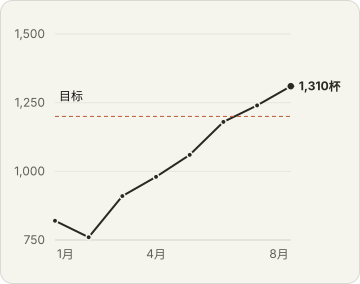</a><br><b>走势</b><br><sub><code>line</code></sub></td>
<td align="center" valign="top" width="50%"><a href="gallery/zh-CN/chart-sparkline.svg">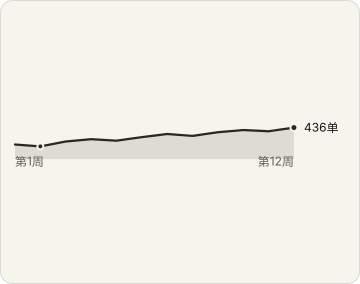</a><br><b>迷你走势</b><br><sub><code>sparkline</code></sub></td>
</tr>
</table>

<table>
<tr>
<td align="center" valign="top" width="50%"><a href="gallery/zh-CN/chart-area.svg">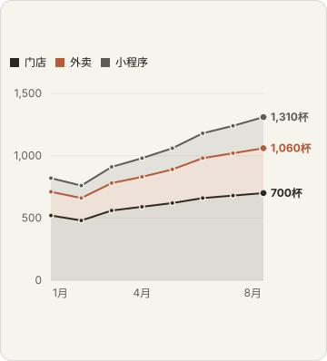</a><br><b>堆叠面积</b><br><sub><code>area</code></sub></td>
<td align="center" valign="top" width="50%"><a href="gallery/zh-CN/chart-candlestick.svg">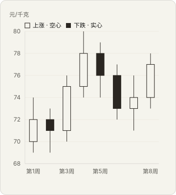</a><br><b>开收与高低</b><br><sub><code>candlestick</code></sub></td>
</tr>
</table>

<table>
<tr>
<td align="center"><a href="gallery/zh-CN/chart-small-multiples.svg">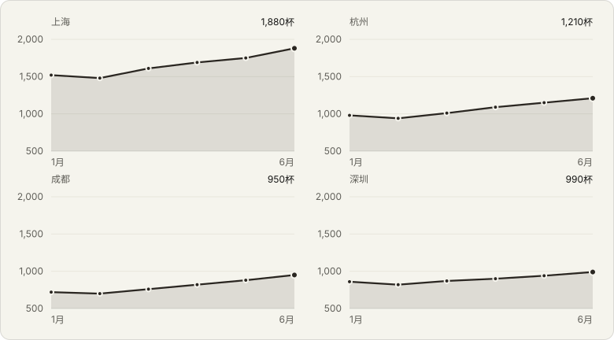</a><br><b>小多图</b><br><sub><code>small-multiples</code></sub></td>
</tr>
</table>

<table>
<tr>
<td align="center" valign="top" width="50%"><a href="gallery/zh-CN/chart-stream.svg">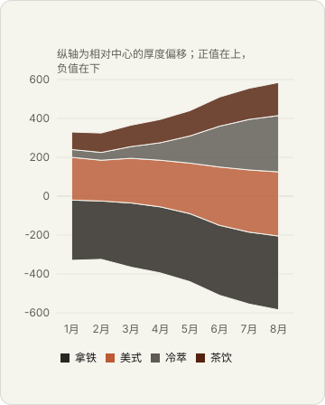</a><br><b>流图</b><br><sub><code>stream</code></sub></td>
<td align="center" valign="top" width="50%"><a href="gallery/zh-CN/chart-split-compare.svg">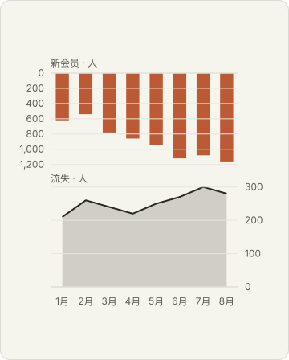</a><br><b>上下对照</b><br><sub><code>split-compare</code></sub></td>
</tr>
</table>

<table>
<tr>
<td align="center"><a href="gallery/zh-CN/chart-combo.svg">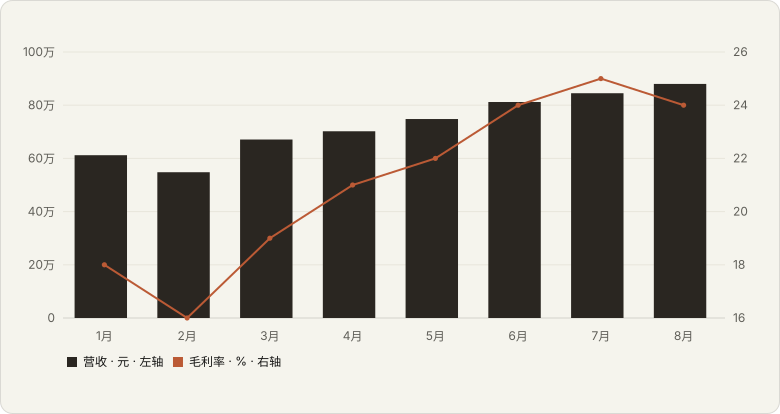</a><br><b>双轴组合</b><br><sub><code>combo</code></sub></td>
</tr>
</table>

<table>
<tr>
<td align="center"><a href="gallery/zh-CN/chart-bump.svg">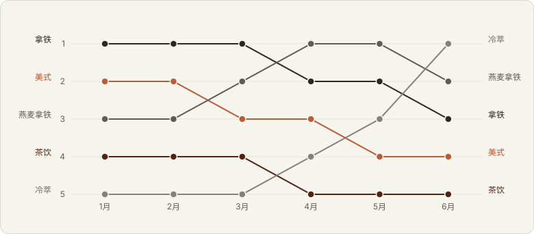</a><br><b>排名变动</b><br><sub><code>bump</code></sub></td>
</tr>
</table>

<table>
<tr>
<td align="center"><a href="gallery/zh-CN/chart-launch-fan.svg">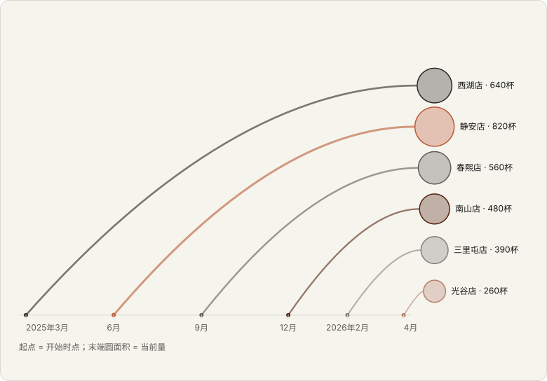</a><br><b>从开张到现在</b><br><sub><code>launch-fan</code></sub></td>
</tr>
</table>

<a id="comparison"></a>

#### 比较、目标与区间

<table>
<tr>
<td align="center" valign="top" width="50%"><a href="gallery/zh-CN/chart-bar.svg">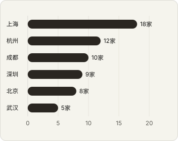</a><br><b>横向比较</b><br><sub><code>bar</code></sub></td>
<td align="center" valign="top" width="50%"><a href="gallery/zh-CN/chart-column.svg">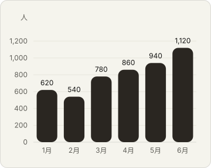</a><br><b>纵向比较</b><br><sub><code>column</code></sub></td>
</tr>
</table>

<table>
<tr>
<td align="center" valign="top" width="50%"><a href="gallery/zh-CN/chart-dumbbell.svg">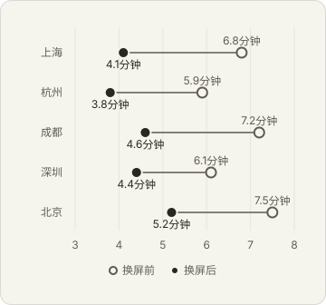</a><br><b>前后差距</b><br><sub><code>dumbbell</code></sub></td>
<td align="center" valign="top" width="50%"><a href="gallery/zh-CN/chart-bullet.svg">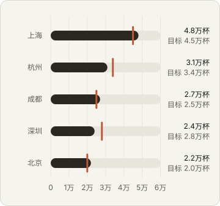</a><br><b>实际与目标</b><br><sub><code>bullet</code></sub></td>
</tr>
</table>

<table>
<tr>
<td align="center" valign="top" width="33%"><a href="gallery/zh-CN/chart-slope.svg">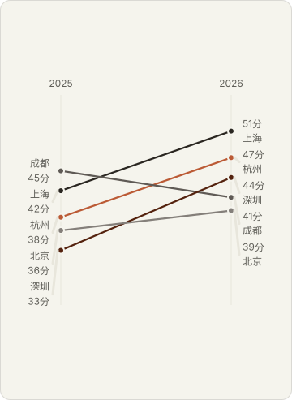</a><br><b>变化方向</b><br><sub><code>slope</code></sub></td>
<td align="center" valign="top" width="33%"><a href="gallery/zh-CN/chart-interval.svg">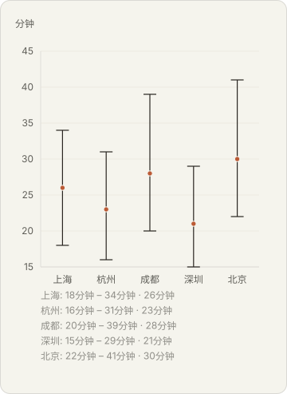</a><br><b>区间与中位数</b><br><sub><code>interval</code></sub></td>
<td align="center" valign="top" width="33%"><a href="gallery/zh-CN/chart-gauge.svg">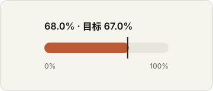</a><br><b>完成度</b><br><sub><code>gauge</code></sub></td>
</tr>
</table>

<a id="composition"></a>

#### 构成与增减

<table>
<tr>
<td align="center" valign="top" width="50%"><a href="gallery/zh-CN/chart-share.svg">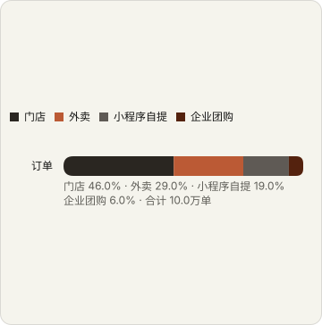</a><br><b>占比条</b><br><sub><code>share</code></sub></td>
<td align="center" valign="top" width="50%"><a href="gallery/zh-CN/chart-funnel.svg">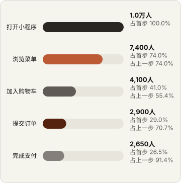</a><br><b>漏斗</b><br><sub><code>funnel</code></sub></td>
</tr>
</table>

<table>
<tr>
<td align="center" valign="top" width="50%"><a href="gallery/zh-CN/chart-pie.svg">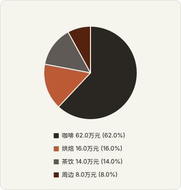</a><br><b>饼图</b><br><sub><code>pie</code></sub></td>
<td align="center" valign="top" width="50%"><a href="gallery/zh-CN/chart-donut.svg"></a><br><b>环形图</b><br><sub><code>donut</code></sub></td>
</tr>
</table>

<table>
<tr>
<td align="center" valign="top" width="50%"><a href="gallery/zh-CN/chart-radial-share.svg">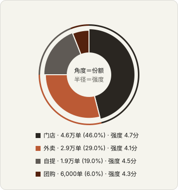</a><br><b>份额与强度</b><br><sub><code>radial-share</code></sub></td>
<td align="center" valign="top" width="50%"><a href="gallery/zh-CN/chart-waffle.svg">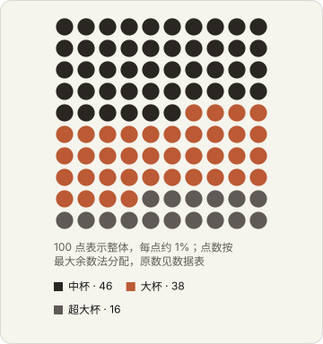</a><br><b>百格图</b><br><sub><code>waffle</code></sub></td>
</tr>
</table>

<table>
<tr>
<td align="center" valign="top" width="50%"><a href="gallery/zh-CN/chart-rose.svg">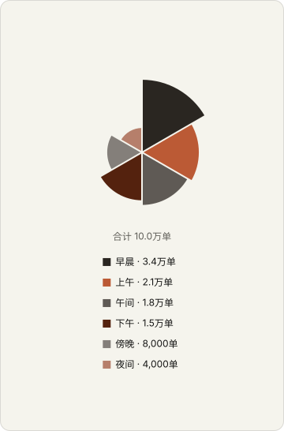</a><br><b>玫瑰图</b><br><sub><code>rose</code></sub></td>
<td align="center" valign="top" width="50%"><a href="gallery/zh-CN/chart-tally.svg">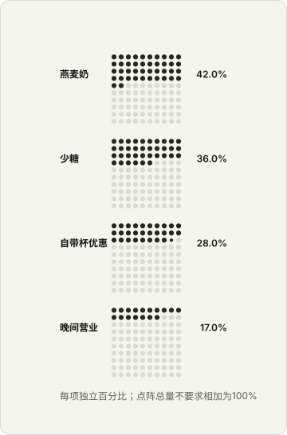</a><br><b>多选比例</b><br><sub><code>tally</code></sub></td>
</tr>
</table>

<table>
<tr>
<td align="center"><a href="gallery/zh-CN/chart-waterfall.svg">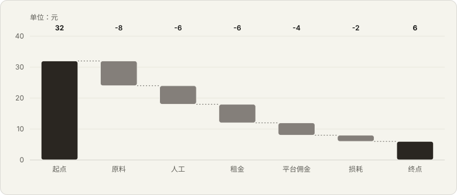</a><br><b>瀑布</b><br><sub><code>waterfall</code></sub></td>
</tr>
</table>

<a id="distribution"></a>

#### 分布与相关

<table>
<tr>
<td align="center" valign="top" width="50%"><a href="gallery/zh-CN/chart-histogram.svg">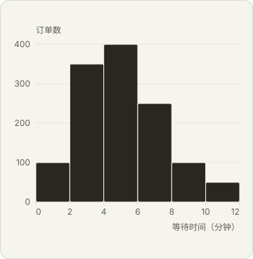</a><br><b>直方图</b><br><sub><code>histogram</code></sub></td>
<td align="center" valign="top" width="50%"><a href="gallery/zh-CN/chart-scatter.svg">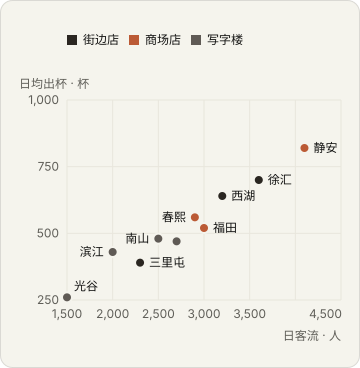</a><br><b>散点图</b><br><sub><code>scatter</code></sub></td>
</tr>
</table>

<table>
<tr>
<td align="center" valign="top" width="33%"><a href="gallery/zh-CN/chart-boxplot.svg">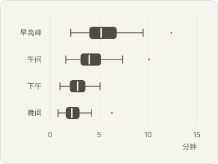</a><br><b>箱线图</b><br><sub><code>boxplot</code></sub></td>
<td align="center" valign="top" width="33%"><a href="gallery/zh-CN/chart-violin.svg">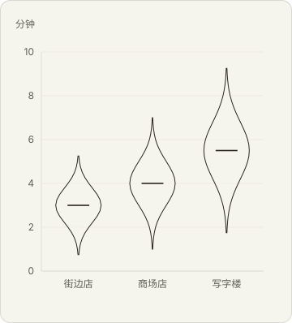</a><br><b>小提琴图</b><br><sub><code>violin</code></sub></td>
<td align="center" valign="top" width="33%"><a href="gallery/zh-CN/chart-strip.svg">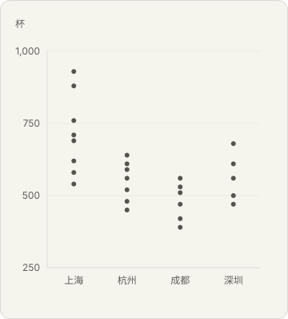</a><br><b>散点条</b><br><sub><code>strip</code></sub></td>
</tr>
</table>

<a id="matrix"></a>

#### 矩阵与多维

<table>
<tr>
<td align="center" valign="top" width="33%"><a href="gallery/zh-CN/chart-heatmap.svg">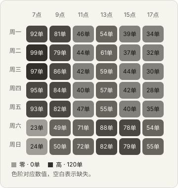</a><br><b>热力图</b><br><sub><code>heatmap</code></sub></td>
<td align="center" valign="top" width="33%"><a href="gallery/zh-CN/chart-bubble-matrix.svg">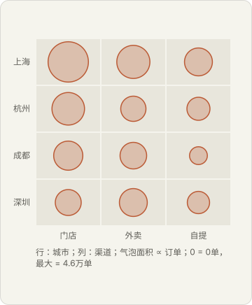</a><br><b>气泡矩阵</b><br><sub><code>bubble-matrix</code></sub></td>
<td align="center" valign="top" width="33%"><a href="gallery/zh-CN/chart-radar.svg">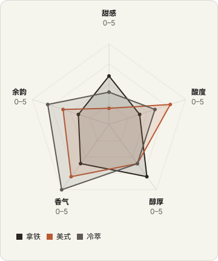</a><br><b>雷达图</b><br><sub><code>radar</code></sub></td>
</tr>
</table>

<table>
<tr>
<td align="center"><a href="gallery/zh-CN/chart-parallel.svg">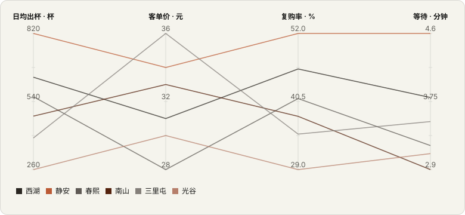</a><br><b>平行坐标</b><br><sub><code>parallel</code></sub></td>
</tr>
</table>

<table>
<tr>
<td align="center"><a href="gallery/zh-CN/chart-calendar.svg">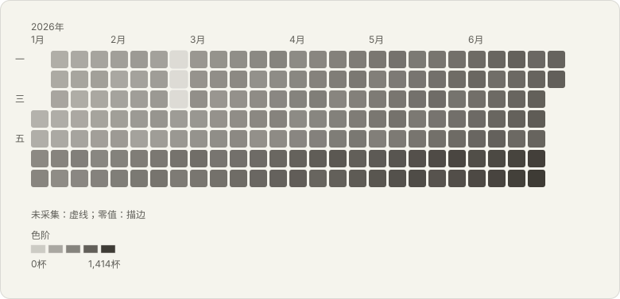</a><br><b>日历</b><br><sub><code>calendar</code></sub></td>
</tr>
</table>

<a id="hierarchy"></a>

#### 层级

<table>
<tr>
<td align="center" valign="top" width="50%"><a href="gallery/zh-CN/chart-tree.svg">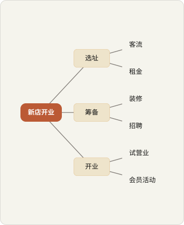</a><br><b>层级树</b><br><sub><code>tree</code></sub></td>
<td align="center" valign="top" width="50%"><a href="gallery/zh-CN/chart-treemap.svg">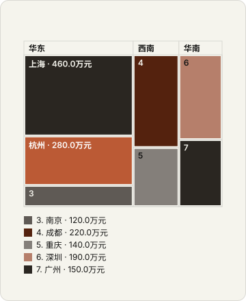</a><br><b>矩形树图</b><br><sub><code>treemap</code></sub></td>
</tr>
</table>

<table>
<tr>
<td align="center"><a href="gallery/zh-CN/chart-mindmap.svg">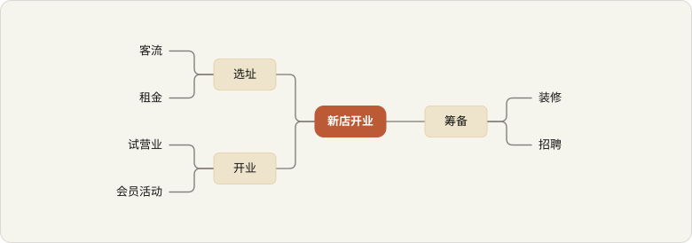</a><br><b>脑图</b><br><sub><code>mindmap</code></sub></td>
</tr>
</table>

<table>
<tr>
<td align="center"><a href="gallery/zh-CN/chart-sunburst.svg">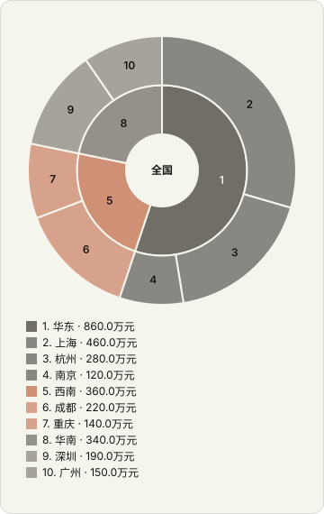</a><br><b>旭日图</b><br><sub><code>sunburst</code></sub></td>
</tr>
</table>

<a id="relations"></a>

#### 网络、流量与路径

<table>
<tr>
<td align="center"><a href="gallery/zh-CN/chart-network.svg">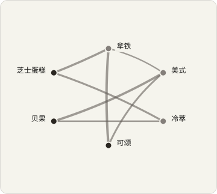</a><br><b>关系网络</b><br><sub><code>network</code></sub></td>
</tr>
</table>

<table>
<tr>
<td align="center"><a href="gallery/zh-CN/chart-sankey.svg">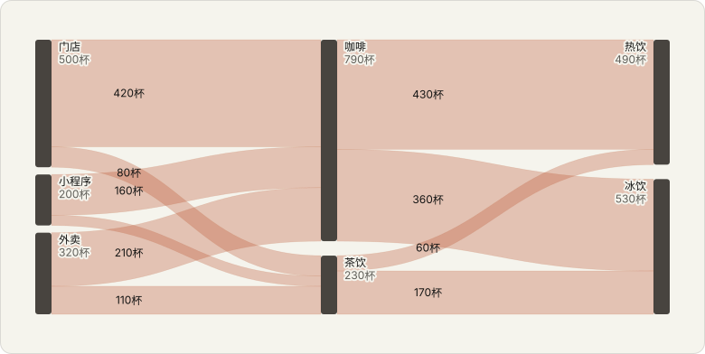</a><br><b>桑基图</b><br><sub><code>sankey</code></sub></td>
</tr>
</table>

<table>
<tr>
<td align="center"><a href="gallery/zh-CN/chart-threads.svg">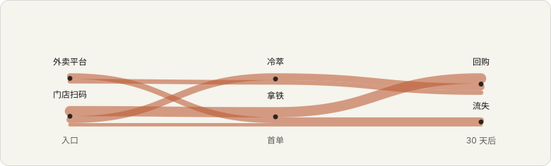</a><br><b>路径流向</b><br><sub><code>threads</code></sub></td>
</tr>
</table>

<a id="geography"></a>

#### 地图

<table>
<tr>
<td align="center"><a href="gallery/zh-CN/chart-choropleth.svg">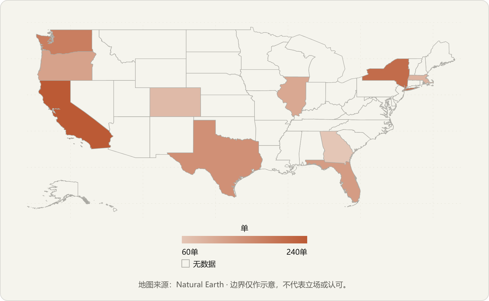</a><br><b>分区着色</b><br><sub><code>choropleth</code></sub></td>
</tr>
</table>

<table>
<tr>
<td align="center"><a href="gallery/zh-CN/chart-geo-scatter.svg">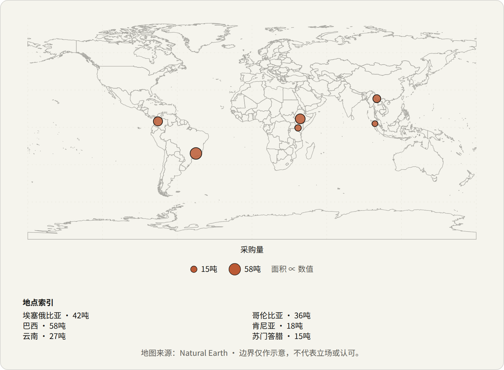</a><br><b>地图散点</b><br><sub><code>geo-scatter</code></sub></td>
</tr>
</table>

<a id="diagrams"></a>

### 结构图

[流程、状态与旅程](#process) · [时序与数据模型](#model) · [四种写法的语法图](#grammar) · [排期、看板与协议](#planning) · [架构、分层与目录](#architecture) · [C4 的五个视角](#c4) · [Mermaid 数值图](#mermaid-data) · [分析与策略](#analysis) · [一棵树，八种脑图布局](#mindmaps)

<a id="process"></a>

#### 流程、状态与旅程

<table>
<tr>
<td align="center"><a href="gallery/zh-CN/diagram-flowchart.svg">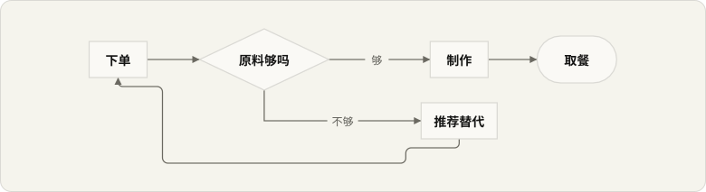</a><br><b>流程图</b><br><sub><code>flowchart</code></sub></td>
</tr>
</table>

<table>
<tr>
<td align="center" valign="top" width="33%"><a href="gallery/zh-CN/diagram-stateDiagram-v2.svg">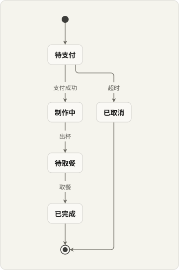</a><br><b>状态图</b><br><sub><code>stateDiagram-v2</code></sub></td>
<td align="center" valign="top" width="33%"><a href="gallery/zh-CN/diagram-journey.svg">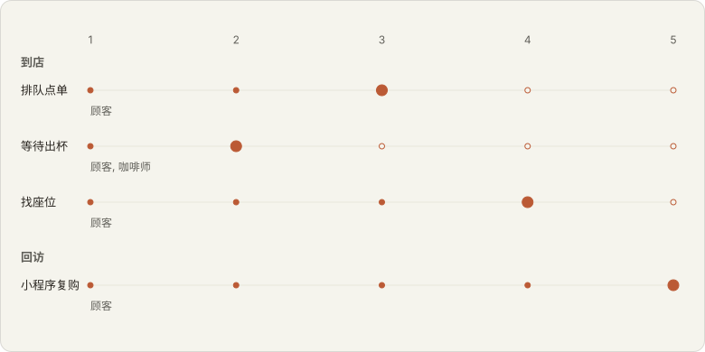</a><br><b>体验旅程</b><br><sub><code>journey</code></sub></td>
<td align="center" valign="top" width="33%"><a href="gallery/zh-CN/diagram-swimlane-beta.svg">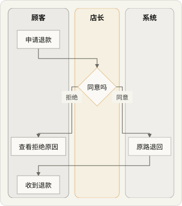</a><br><b>Mermaid 泳道图</b><br><sub><code>swimlane-beta</code></sub></td>
</tr>
</table>

<table>
<tr>
<td align="center"><a href="gallery/zh-CN/diagram-swimlane.svg">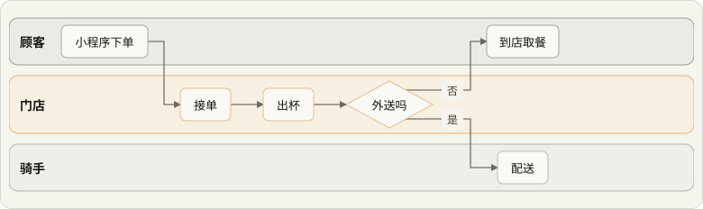</a><br><b>泳道图</b><br><sub><code>swimlane</code></sub></td>
</tr>
</table>

<table>
<tr>
<td align="center"><a href="gallery/zh-CN/diagram-agentflow-beta.svg">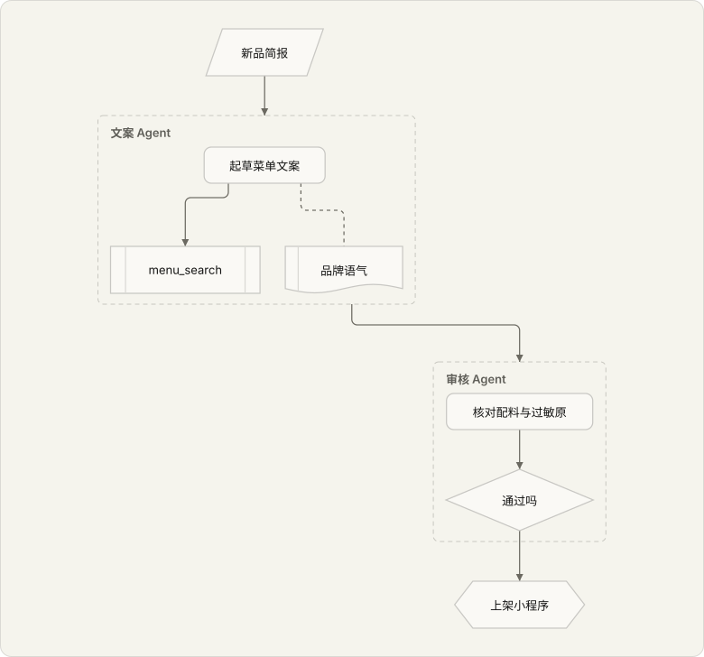</a><br><b>Agent 流程</b><br><sub><code>agentflow-beta</code></sub></td>
</tr>
</table>

<table>
<tr>
<td align="center"><a href="gallery/zh-CN/diagram-eventmodeling.svg"></a><br><b>事件建模</b><br><sub><code>eventmodeling</code></sub></td>
</tr>
</table>

<a id="model"></a>

#### 时序与数据模型

<table>
<tr>
<td align="center"><a href="gallery/zh-CN/diagram-sequenceDiagram.svg"></a><br><b>时序图</b><br><sub><code>sequenceDiagram</code></sub></td>
</tr>
</table>

<table>
<tr>
<td align="center" valign="top" width="50%"><a href="gallery/zh-CN/diagram-zenuml.svg"></a><br><b>ZenUML</b><br><sub><code>zenuml</code></sub></td>
<td align="center" valign="top" width="50%"><a href="gallery/zh-CN/diagram-requirementDiagram.svg"></a><br><b>需求图</b><br><sub><code>requirementDiagram</code></sub></td>
</tr>
</table>

<table>
<tr>
<td align="center" valign="top" width="50%"><a href="gallery/zh-CN/diagram-usecase-beta.svg"></a><br><b>用例图</b><br><sub><code>usecase-beta</code></sub></td>
<td align="center" valign="top" width="50%"><a href="gallery/zh-CN/diagram-classDiagram.svg"></a><br><b>类图</b><br><sub><code>classDiagram</code></sub></td>
</tr>
</table>

<table>
<tr>
<td align="center"><a href="gallery/zh-CN/diagram-erDiagram.svg"></a><br><b>ER 图</b><br><sub><code>erDiagram</code></sub></td>
</tr>
</table>

<a id="grammar"></a>

#### 四种写法的语法图

<table>
<tr>
<td align="center"><a href="gallery/zh-CN/diagram-railroad-beta.svg"></a><br><b>函数式</b><br><sub><code>railroad-beta</code></sub></td>
</tr>
</table>

<table>
<tr>
<td align="center" valign="top" width="50%"><a href="gallery/zh-CN/diagram-railroad-ebnf-beta.svg"></a><br><b>EBNF</b><br><sub><code>railroad-ebnf-beta</code></sub></td>
<td align="center" valign="top" width="50%"><a href="gallery/zh-CN/diagram-railroad-peg-beta.svg"></a><br><b>PEG</b><br><sub><code>railroad-peg-beta</code></sub></td>
</tr>
</table>

<table>
<tr>
<td align="center"><a href="gallery/zh-CN/diagram-railroad-abnf-beta.svg"></a><br><b>ABNF</b><br><sub><code>railroad-abnf-beta</code></sub></td>
</tr>
</table>

<a id="planning"></a>

#### 排期、看板与协议

<table>
<tr>
<td align="center"><a href="gallery/zh-CN/diagram-gantt.svg"></a><br><b>甘特图</b><br><sub><code>gantt</code></sub></td>
</tr>
</table>

<table>
<tr>
<td align="center"><a href="gallery/zh-CN/diagram-timeline.svg"></a><br><b>时间线</b><br><sub><code>timeline</code></sub></td>
</tr>
</table>

<table>
<tr>
<td align="center"><a href="gallery/zh-CN/diagram-gitGraph.svg"></a><br><b>Git 分支</b><br><sub><code>gitGraph</code></sub></td>
</tr>
</table>

<table>
<tr>
<td align="center"><a href="gallery/zh-CN/diagram-kanban.svg"></a><br><b>看板</b><br><sub><code>kanban</code></sub></td>
</tr>
</table>

<table>
<tr>
<td align="center"><a href="gallery/zh-CN/diagram-packet.svg"></a><br><b>报文位域</b><br><sub><code>packet</code></sub></td>
</tr>
</table>

<a id="architecture"></a>

#### 架构、分层与目录

<table>
<tr>
<td align="center" valign="top" width="50%"><a href="gallery/zh-CN/diagram-layers.svg"></a><br><b>分层图</b><br><sub><code>layers</code></sub></td>
<td align="center" valign="top" width="50%"><a href="gallery/zh-CN/diagram-treeView-beta.svg"></a><br><b>目录树</b><br><sub><code>treeView-beta</code></sub></td>
</tr>
</table>

<table>
<tr>
<td align="center"><a href="gallery/zh-CN/diagram-blocks.svg"></a><br><b>总览图</b><br><sub><code>blocks</code></sub></td>
</tr>
</table>

<table>
<tr>
<td align="center"><a href="gallery/zh-CN/diagram-architecture-beta.svg"></a><br><b>架构图</b><br><sub><code>architecture-beta</code></sub></td>
</tr>
</table>

<table>
<tr>
<td align="center"><a href="gallery/zh-CN/diagram-block.svg"></a><br><b>块图</b><br><sub><code>block</code></sub></td>
</tr>
</table>

<a id="c4"></a>

#### C4 的五个视角

<table>
<tr>
<td align="center" valign="top" width="50%"><a href="gallery/zh-CN/diagram-C4Context.svg"></a><br><b>系统上下文</b><br><sub><code>C4Context</code></sub></td>
<td align="center" valign="top" width="50%"><a href="gallery/zh-CN/diagram-C4Dynamic.svg"></a><br><b>动态</b><br><sub><code>C4Dynamic</code></sub></td>
</tr>
</table>

<table>
<tr>
<td align="center" valign="top" width="50%"><a href="gallery/zh-CN/diagram-C4Container.svg"></a><br><b>容器</b><br><sub><code>C4Container</code></sub></td>
<td align="center" valign="top" width="50%"><a href="gallery/zh-CN/diagram-C4Component.svg"></a><br><b>组件</b><br><sub><code>C4Component</code></sub></td>
</tr>
</table>

<table>
<tr>
<td align="center"><a href="gallery/zh-CN/diagram-C4Deployment.svg"></a><br><b>部署</b><br><sub><code>C4Deployment</code></sub></td>
</tr>
</table>

<a id="mermaid-data"></a>

#### Mermaid 数值图

<table>
<tr>
<td align="center" valign="top" width="50%"><a href="gallery/zh-CN/diagram-pie.svg"></a><br><b>饼图</b><br><sub><code>pie</code></sub></td>
<td align="center" valign="top" width="50%"><a href="gallery/zh-CN/diagram-sankey.svg"></a><br><b>桑基图</b><br><sub><code>sankey</code></sub></td>
</tr>
</table>

<table>
<tr>
<td align="center" valign="top" width="33%"><a href="gallery/zh-CN/diagram-xychart.svg"></a><br><b>XY 图</b><br><sub><code>xychart</code></sub></td>
<td align="center" valign="top" width="33%"><a href="gallery/zh-CN/diagram-treemap.svg"></a><br><b>矩形树图</b><br><sub><code>treemap</code></sub></td>
<td align="center" valign="top" width="33%"><a href="gallery/zh-CN/diagram-radar-beta.svg"></a><br><b>雷达图</b><br><sub><code>radar-beta</code></sub></td>
</tr>
</table>

<a id="analysis"></a>

#### 分析与策略

<table>
<tr>
<td align="center"><a href="gallery/zh-CN/diagram-quadrantChart.svg"></a><br><b>四象限</b><br><sub><code>quadrantChart</code></sub></td>
</tr>
</table>

<table>
<tr>
<td align="center"><a href="gallery/zh-CN/diagram-ishikawa.svg"></a><br><b>鱼骨图</b><br><sub><code>ishikawa</code></sub></td>
</tr>
</table>

<table>
<tr>
<td align="center"><a href="gallery/zh-CN/diagram-cynefin-beta.svg"></a><br><b>Cynefin 框架</b><br><sub><code>cynefin-beta</code></sub></td>
</tr>
</table>

<table>
<tr>
<td align="center"><a href="gallery/zh-CN/diagram-venn-beta.svg"></a><br><b>韦恩图</b><br><sub><code>venn-beta</code></sub></td>
</tr>
</table>

<table>
<tr>
<td align="center"><a href="gallery/zh-CN/diagram-wardley-beta.svg"></a><br><b>Wardley 地图</b><br><sub><code>wardley-beta</code></sub></td>
</tr>
</table>

<a id="mindmaps"></a>

#### 一棵树，八种脑图布局

<table>
<tr>
<td align="center"><a href="gallery/zh-CN/diagram-mindmap.svg"></a><br><b>Mermaid 脑图</b><br><sub><code>mindmap</code></sub></td>
</tr>
</table>

<table>
<tr>
<td align="center"><a href="gallery/zh-CN/mindmap-bilateral.svg"></a><br><b>双侧</b><br><sub><code>mindmap / bilateral</code></sub></td>
</tr>
</table>

<table>
<tr>
<td align="center" valign="top" width="33%"><a href="gallery/zh-CN/mindmap-right.svg"></a><br><b>向右</b><br><sub><code>mindmap / right</code></sub></td>
<td align="center" valign="top" width="33%"><a href="gallery/zh-CN/mindmap-left.svg"></a><br><b>向左</b><br><sub><code>mindmap / left</code></sub></td>
<td align="center" valign="top" width="33%"><a href="gallery/zh-CN/mindmap-brace.svg"></a><br><b>括号</b><br><sub><code>mindmap / brace</code></sub></td>
</tr>
</table>

<table>
<tr>
<td align="center"><a href="gallery/zh-CN/mindmap-radial.svg"></a><br><b>放射</b><br><sub><code>mindmap / radial</code></sub></td>
</tr>
</table>

<table>
<tr>
<td align="center"><a href="gallery/zh-CN/mindmap-org.svg"></a><br><b>组织</b><br><sub><code>mindmap / org</code></sub></td>
</tr>
</table>

<table>
<tr>
<td align="center"><a href="gallery/zh-CN/mindmap-fishbone.svg"></a><br><b>鱼骨</b><br><sub><code>mindmap / fishbone</code></sub></td>
</tr>
</table>

<table>
<tr>
<td align="center"><a href="gallery/zh-CN/mindmap-timeline.svg"></a><br><b>时间线</b><br><sub><code>mindmap / timeline</code></sub></td>
</tr>
</table>

<a id="variants"></a>

### 受控变体

[柱、线与标记](#variants-marks) · [占比与阶段](#variants-part) · [目标、差距与分布](#variants-value) · [矩阵、日历与网络](#variants-pattern)

<a id="variants-marks"></a>

#### 柱、线与标记

<table>
<tr>
<td align="center" valign="top" width="50%"><a href="gallery/zh-CN/variant-bar-solid.svg"></a><br><b>横向比较 · 实心</b><br><sub><code>bar / solid</code></sub></td>
<td align="center" valign="top" width="50%"><a href="gallery/zh-CN/variant-bar-lollipop.svg"></a><br><b>横向比较 · 棒棒糖</b><br><sub><code>bar / lollipop</code></sub></td>
</tr>
</table>

<table>
<tr>
<td align="center" valign="top" width="50%"><a href="gallery/zh-CN/variant-bar-rungs.svg"></a><br><b>横向比较 · 单位刻度</b><br><sub><code>bar / rungs</code></sub></td>
<td align="center" valign="top" width="50%"><a href="gallery/zh-CN/variant-column-lollipop.svg"></a><br><b>纵向比较 · 棒棒糖</b><br><sub><code>column / lollipop</code></sub></td>
</tr>
</table>

<table>
<tr>
<td align="center" valign="top" width="50%"><a href="gallery/zh-CN/variant-bar-pictorial.svg"></a><br><b>横向比较 · 图标</b><br><sub><code>bar / pictorial</code></sub></td>
<td align="center" valign="top" width="50%"><a href="gallery/zh-CN/variant-column-rungs.svg"></a><br><b>纵向比较 · 单位刻度</b><br><sub><code>column / rungs</code></sub></td>
</tr>
</table>

<table>
<tr>
<td align="center" valign="top" width="50%"><a href="gallery/zh-CN/variant-column-solid.svg"></a><br><b>纵向比较 · 实心</b><br><sub><code>column / solid</code></sub></td>
<td align="center" valign="top" width="50%"><a href="gallery/zh-CN/variant-line-barcode.svg"></a><br><b>走势 · 条码</b><br><sub><code>line / barcode</code></sub></td>
</tr>
</table>

<table>
<tr>
<td align="center" valign="top" width="50%"><a href="gallery/zh-CN/variant-column-pictorial.svg"></a><br><b>纵向比较 · 图标</b><br><sub><code>column / pictorial</code></sub></td>
<td align="center" valign="top" width="50%"><a href="gallery/zh-CN/variant-line-counter.svg"></a><br><b>走势 · 末值突出</b><br><sub><code>line / counter</code></sub></td>
</tr>
</table>

<a id="variants-part"></a>

#### 占比与阶段

<table>
<tr>
<td align="center" valign="top" width="50%"><a href="gallery/zh-CN/variant-share-solid.svg"></a><br><b>占比条 · 实心</b><br><sub><code>share / solid</code></sub></td>
<td align="center" valign="top" width="50%"><a href="gallery/zh-CN/variant-share-ticks.svg"></a><br><b>占比条 · 刻度</b><br><sub><code>share / ticks</code></sub></td>
</tr>
</table>

<table>
<tr>
<td align="center" valign="top" width="50%"><a href="gallery/zh-CN/variant-donut-solid.svg"></a><br><b>环形图 · 实心</b><br><sub><code>donut / solid</code></sub></td>
<td align="center" valign="top" width="50%"><a href="gallery/zh-CN/variant-donut-ticks.svg"></a><br><b>环形图 · 刻度</b><br><sub><code>donut / ticks</code></sub></td>
</tr>
</table>

<table>
<tr>
<td align="center" valign="top" width="50%"><a href="gallery/zh-CN/variant-funnel-bars.svg"></a><br><b>漏斗 · 横条</b><br><sub><code>funnel / bars</code></sub></td>
<td align="center" valign="top" width="50%"><a href="gallery/zh-CN/variant-funnel-hourglass.svg"></a><br><b>漏斗 · 沙漏</b><br><sub><code>funnel / hourglass</code></sub></td>
</tr>
</table>

<table>
<tr>
<td align="center" valign="top" width="50%"><a href="gallery/zh-CN/variant-waffle-dots.svg"></a><br><b>百格图 · 点阵</b><br><sub><code>waffle / dots</code></sub></td>
<td align="center" valign="top" width="50%"><a href="gallery/zh-CN/variant-waffle-field.svg"></a><br><b>百格图 · 疏朗点阵</b><br><sub><code>waffle / field</code></sub></td>
</tr>
</table>

<a id="variants-value"></a>

#### 目标、差距与分布

<table>
<tr>
<td align="center" valign="top" width="50%"><a href="gallery/zh-CN/variant-gauge-bar.svg"></a><br><b>完成度 · 条形</b><br><sub><code>gauge / bar</code></sub></td>
<td align="center" valign="top" width="50%"><a href="gallery/zh-CN/variant-gauge-arc.svg"></a><br><b>完成度 · 圆弧</b><br><sub><code>gauge / arc</code></sub></td>
</tr>
</table>

<table>
<tr>
<td align="center" valign="top" width="50%"><a href="gallery/zh-CN/variant-gauge-ticks.svg"></a><br><b>完成度 · 刻度</b><br><sub><code>gauge / ticks</code></sub></td>
<td align="center" valign="top" width="50%"><a href="gallery/zh-CN/variant-dumbbell-solid.svg"></a><br><b>前后差距 · 实心</b><br><sub><code>dumbbell / solid</code></sub></td>
</tr>
</table>

<table>
<tr>
<td align="center" valign="top" width="33%"><a href="gallery/zh-CN/variant-histogram-solid.svg"></a><br><b>直方图 · 实心</b><br><sub><code>histogram / solid</code></sub></td>
<td align="center" valign="top" width="33%"><a href="gallery/zh-CN/variant-dumbbell-rungs.svg"></a><br><b>前后差距 · 单位刻度</b><br><sub><code>dumbbell / rungs</code></sub></td>
<td align="center" valign="top" width="33%"><a href="gallery/zh-CN/variant-scatter-plumb.svg"></a><br><b>散点图 · 垂线</b><br><sub><code>scatter / plumb</code></sub></td>
</tr>
</table>

<table>
<tr>
<td align="center"><a href="gallery/zh-CN/variant-waterfall-solid.svg"></a><br><b>瀑布 · 实心</b><br><sub><code>waterfall / solid</code></sub></td>
</tr>
</table>

<table>
<tr>
<td align="center"><a href="gallery/zh-CN/variant-waterfall-rungs.svg"></a><br><b>瀑布 · 单位刻度</b><br><sub><code>waterfall / rungs</code></sub></td>
</tr>
</table>

<table>
<tr>
<td align="center" valign="top" width="50%"><a href="gallery/zh-CN/variant-histogram-rungs.svg"></a><br><b>直方图 · 单位刻度</b><br><sub><code>histogram / rungs</code></sub></td>
<td align="center" valign="top" width="50%"><a href="gallery/zh-CN/variant-scatter-dots.svg"></a><br><b>散点图 · 点阵</b><br><sub><code>scatter / dots</code></sub></td>
</tr>
</table>

<a id="variants-pattern"></a>

#### 矩阵、日历与网络

<table>
<tr>
<td align="center" valign="top" width="33%"><a href="gallery/zh-CN/variant-heatmap-cells.svg"></a><br><b>热力图 · 方格</b><br><sub><code>heatmap / cells</code></sub></td>
<td align="center" valign="top" width="33%"><a href="gallery/zh-CN/variant-heatmap-dots.svg"></a><br><b>热力图 · 点阵</b><br><sub><code>heatmap / dots</code></sub></td>
<td align="center" valign="top" width="33%"><a href="gallery/zh-CN/variant-heatmap-arc.svg"></a><br><b>热力图 · 圆弧</b><br><sub><code>heatmap / arc</code></sub></td>
</tr>
</table>

<table>
<tr>
<td align="center"><a href="gallery/zh-CN/variant-calendar-cells.svg"></a><br><b>日历 · 方格</b><br><sub><code>calendar / cells</code></sub></td>
</tr>
</table>

<table>
<tr>
<td align="center"><a href="gallery/zh-CN/variant-calendar-dots.svg"></a><br><b>日历 · 点阵</b><br><sub><code>calendar / dots</code></sub></td>
</tr>
</table>

<table>
<tr>
<td align="center" valign="top" width="50%"><a href="gallery/zh-CN/variant-network-lines.svg"></a><br><b>关系网络 · 连线</b><br><sub><code>network / lines</code></sub></td>
<td align="center" valign="top" width="50%"><a href="gallery/zh-CN/variant-network-membrane.svg"></a><br><b>关系网络 · 弦膜</b><br><sub><code>network / membrane</code></sub></td>
</tr>
</table>

<table>
<tr>
<td align="center"><a href="gallery/zh-CN/variant-mindmap-editorial.svg"></a><br><b>脑图 · 编辑式</b><br><sub><code>mindmap / editorial</code></sub></td>
</tr>
</table>

<table>
<tr>
<td align="center"><a href="gallery/zh-CN/variant-mindmap-cards.svg"></a><br><b>脑图 · 卡片式</b><br><sub><code>mindmap / cards</code></sub></td>
</tr>
</table>
<!-- gallery:end -->

<a id="full-gallery"></a>

## 生成可筛选的 KChart 图谱

```sh
node skills/html-view/scripts/lab/showcase/generate.mjs
# 或选择一个新的本地目录
node skills/html-view/scripts/lab/showcase/generate.mjs --out ./kchart-showcase
```

打开输出目录中的 `index.html`。默认显示 Claude，可以按主题和图型筛选、搜索关键词并查看声明。每套内置主题均可预览，展册含 45 种基础图、38 项受控变体、40 种 Mermaid 图型、3 种原生结构图和 8 种脑图布局。图太宽时在图框内滚动，也可以直接打开原尺寸 SVG。生成器拒绝写入未知的非空目录和符号链接，不会覆盖仓库中的预览图。

[返回仓库首页](../../README.md) · [主题对照](../../README.md#themes)
