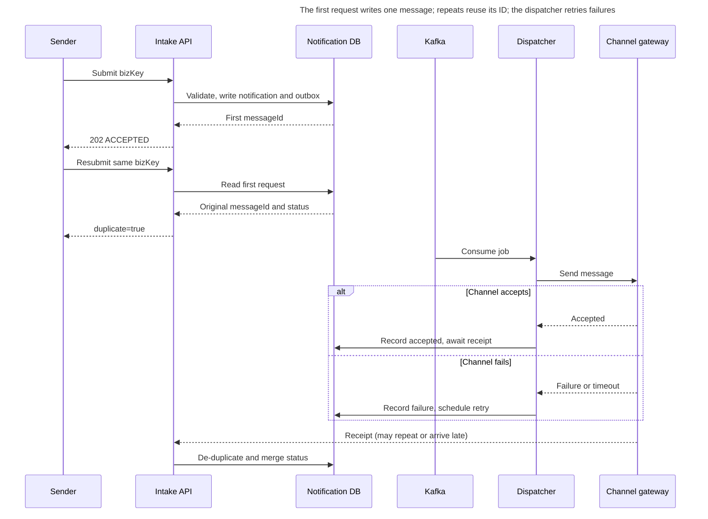
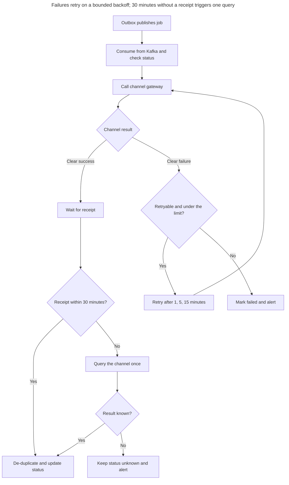

# Unified Notification Platform — Technical Design

> Review recommendation: route the three sending systems through one notification service, built as "idempotent request write + Kafka dispatch + channel result write-back". This unifies validation and delivery status. It does not promise exactly-once delivery through external channels, and it cannot recall a message that has been sent. Every name, endpoint and payload here is a synthetic example. "3 people, 6 weeks" is a planning assumption for the review, not a committed schedule.

## Goals, scope and boundaries

Orders, marketing and customer support each call SMS, email and push directly today. Preferences, rate limits, retries and status tracking are therefore spread across three systems. The goal is one notification entry point between senders and channels: it applies preferences and rate limits in one place, dispatches to channels asynchronously, collects receipts and raises alerts on failures.

| Area | This design owns | Not owned / depends on |
|---|---|---|
| Intake and policy | Authentication, validation, `bizKey` idempotency, preferences and marketing rate limits | Senders supply stable business keys and valid template variables; the source and freshness of preference data are still open |
| Dispatch | Persisting jobs, consuming from Kafka, choosing the channel, scheduled retries | Availability of Kafka and the channel gateway; channel rate limits and SLAs were not provided |
| Results | Receiving and de-duplicating receipts, platform status, one active status query, alerts | Final delivery and receipt semantics are defined by each external channel |
| Not supported | Rejecting marketing requests for unsubscribed users, with the reason recorded | Messages already handed to a channel cannot be recalled; no exactly-once guarantee across external channels |

For a given `bizKey`, the platform always returns the `messageId` created first and never creates a second business message on retry. If a channel call times out after the channel actually accepted it, a retry can still produce an external duplicate. Callers and the user experience have to accept this limit.

## Architecture and modules

The layers follow responsibilities and dependencies. Senders depend only on the intake API, never on a channel. Figure 2 shows the static module boundaries; Figures 3 and 4 show the dispatch order.

```layers
---
title: One entry point for all senders; the policy service governs jobs that depend on channels
---
- Senders | Three systems submit through one API
  - Senders: Orders, Marketing, Support
- Platform | Validation, orchestration and status
  - Intake API: Auth, Validation, Idempotency
  - Policy service: Preferences, Rate limits
  - Dispatch: Kafka consumer, Retries
  - Receipts and alerts: Status updates, Status query, Alerts
- Infrastructure | Persistence and messaging
  - Notification DB {db}: Requests, Status, Receipts
  - Kafka {ext}: Async jobs
- Channels | Exactly-once is outside our control
  - Channel gateway {ext}: SMS, Email, Push
```

```blocks
---
title: Intake, policy, dispatch and receipts are separate; persistent records span requests and dispatch
---
col
  box Senders
    Orders, Marketing, Support
  box Notification platform
    Intake API, Idempotency record
    Policy service
    Job orchestration
    Receipt handling, Alerts
  box Storage and queue
    Notification DB, Job outbox
    Kafka
  box External channels
    Channel gateway, SMS, Email, Push
Senders -> Notification platform: Submit
Notification platform -> Storage and queue: Write request and job
Storage and queue -> External channels: Async dispatch
```

The intake transaction first writes the notification record and an outbox row. An outbox publisher sends pending events to Kafka and marks them published on success, so a committed database write can never leave a job stranded outside the queue. Consumers claim jobs idempotently by `messageId`. Producer and consumer deployment sizes and capacity still need measurement and are not invented here.

### Key trade-offs

| Choice | Alternatives | Trade-off |
|---|---|---|
| Kafka jobs + outbox | Call channels on the request thread; or poll a jobs table | Async dispatch isolates slow channels, and the outbox covers the missing distributed transaction between the database and Kafka. The cost is eventual consistency, backlog monitoring and handling duplicate consumption |
| One policy service for all checks | Each sender checks preferences and rate limits itself | Consistent rules and an audit trail for rejections, at the price of a platform dependency and a shared failure point |
| The platform tracks status; channels own final delivery | Promise end-to-end exactly-once | External channels do not always support idempotency or transactions. We choose traceable, retryable delivery and accept the duplicate risk |
| Daily marketing count updated atomically per user and day | Read the count, then write | An atomic conditional update prevents overselling under concurrency; time zone, day boundaries and how fast an unsubscribe takes effect still need business sign-off |

## Data model and rules

A relational database holds the business facts, designed first for traceability. Sharding, archiving and retention are decided once traffic and compliance requirements are known.

| Record | Key fields / constraints | Purpose |
|---|---|---|
| `notification` | Primary key `message_id`; unique `biz_key`; `sender`, `category`, `user_id`, `channel`, `status`, `created_at`, `updated_at` | Request idempotency and current status |
| `notification_payload` | Unique `message_id`; template ID and a snapshot of variables (access-controlled) | Retries reuse the same business content; encryption of sensitive fields and retention are open |
| `outbox` | Primary key `event_id`; `message_id`, `published_at`, `created_at` | Reliable job events |
| `delivery_attempt` | `message_id`, `attempt_no`, `scheduled_at`, `result`, `provider_ref` | Audit of every channel call and retry |
| `receipt` | Unique channel receipt key (when available); `message_id`, `provider_status`, `received_at` | De-duplicate receipts and update channel status |
| `marketing_daily_count` | Unique per `user_id` and business day; `count` | Reserves quota when the platform accepts a request; at most 2 per user per day |

Request handling order: check format and credentials → look up `bizKey` → if it exists, return the original `messageId` and its status → for marketing, check unsubscribe (reject and write nothing if unsubscribed) → atomically reserve the rate-limit count → write the notification and outbox row in one transaction → return `202`. Any failed transaction rolls back completely, and a request over the rate limit creates no job. A repeated request returns the first message ID and does not count again. Concurrent requests are settled by the unique constraint on `bizKey`: the losing request reads and returns the committed record. The model assumes `bizKey` is unique across all three senders. If keys are only unique within each sender, the unique constraint becomes `(sender, biz_key)` and the duplicate lookup changes with it.

"Reject unsubscribed requests and store nothing" means no notification, outbox, receipt or rate-limit record is written. Whether the security access log may keep a request summary is still open; it must never contain message bodies. Key management for encrypted content fields, data retention and deletion all need a security and privacy review before launch.

## API contract

The API is HTTPS with JSON. Authentication, versioning and quotas are for the platform owner to confirm. The fields and responses below are synthetic. The current design requires `bizKey` to be unique across the order, marketing and support senders; whether senders guarantee this with namespaces is still to be confirmed.

```http
POST /v1/notifications
Content-Type: application/json
Authorization: Bearer <token>
```

```json
{
  "bizKey": "order:O-2048:paid",
  "sender": "order",
  "category": "transactional",
  "userId": "U-120",
  "channel": "sms",
  "templateId": "order-paid-v1",
  "variables": {"orderNo": "O-2048"}
}
```

A first submission returns `202` with a `messageId` and `status=ACCEPTED`. Submitting the same `bizKey` again returns the first `messageId`, the current platform status and `duplicate=true`. Reusing a key with a different body returns `409 BIZ_KEY_CONFLICT` and keeps the original content. A malformed request returns `400`, failed authentication `401/403`, an unsubscribed marketing request the rejection code `MARKETING_UNSUBSCRIBED` with nothing stored, and a marketing request over the daily limit of 2 returns `429 MARKETING_DAILY_LIMIT`. When the service is unavailable it returns `503`, and the caller may retry with the same `bizKey`.

Synthetic response: `{"messageId":"N-7f31","status":"ACCEPTED","duplicate":false}`. Status lookup is proposed as `GET /v1/notifications/{messageId}`. It returns the platform status, attempt count and last update time, and never reports "accepted by the channel" as "delivered to the user".

## Dispatch, failures and idempotency

A Kafka message carries `messageId`, `channel`, a reference to the template snapshot, `attemptNo` and the scheduled dispatch time, and no personal data it does not need. When a job is due, the consumer takes it and calls the channel gateway. On a clear channel failure the job is retried after 1, 5 and 15 minutes, at most 3 times. "At most 3 times" is ambiguous: this document reads it as up to 3 retries after the first send, so at most 4 calls in total, and asks the review to confirm. Permanent rejections, such as an address the channel reports as invalid, are not retried. Which errors are retryable comes from a channel error-code map that is still pending channel integration.

Every dispatch writes an attempt record. Duplicate Kafka consumption is filtered by message status and attempt records, and duplicate outbox publishing is absorbed by idempotent consumers. Channel requests carry a provider idempotency key such as `messageId` when the channel supports one, but its effect depends on each channel contract and is not an end-to-end guarantee. When a timeout leaves the result unknown, the attempt is recorded as `UNKNOWN` and the platform waits for a receipt or a query; retrying immediately could deliver twice. The backoff schedule and the meaning of "at most 3 times" must be fixed before implementation.

If there is still no receipt 30 minutes after sending, the platform queries the channel once for that `messageId`. The result goes through the same status merge. A failed or still-unknown query does not trigger endless polling: the message is left pending and an alert is raised. A late receipt must never move a final status backwards. Duplicate receipts are removed by channel receipt ID; when a channel has no stable receipt ID, a de-duplication window is built from the message, the status and the channel timestamp. The window and conflict rules are still open.



The sequence covers the first submission, a repeated submission and a channel failure. Marketing unsubscribes are rejected before any database write and are left out of the diagram. A channel accepting a message does not mean the user received it.

## Retry and receipt flow



The retry intervals in the flow follow the brief; whether the first send is followed by three more retries is still to be confirmed. The receipt query runs at most once, and an unknown result never turns into endless polling.

## Rollout, rollback and operations

The switch happens in three steps. First, enable the platform for a small share of order traffic and keep a switch back to the old direct path. Once API acceptance, preferences and rate limits, outbox publishing, channel receipts and alerts all check out end to end, bring in support and then marketing. Retire the old direct calls only after reconciliation confirms that no traffic still uses them. Rollout percentages, observation windows and thresholds for each step must come from the production baseline. There are no measurements yet, so no numbers are filled in.

The review sets the rollback triggers. Suggested triggers are abnormal error responses, a queue backlog that keeps growing, complaints about duplicate delivery, and preference or rate-limit errors. Rollback first stops new traffic into the platform or switches senders back to direct calls, and pauses or cancels only jobs that have not been dispatched. Messages already handed to a channel cannot be recalled. Messages the platform has already created must not be silently replayed through the old direct path, or duplicates will multiply. While the old path is active, every `bizKey` the new platform accepted must stay queryable and protected from a second submission. After recovery, the team must decide who takes over unfinished jobs and how to reconcile them.

Monitoring should cover at least: accepted and rejected requests by reason, idempotency conflicts, unsubscribe and rate-limit rejections, how long outbox rows stay unpublished, Kafka backlog, channel call results and latency, retry counts, results of the 30-minute query, late and duplicate receipts, and alert delivery. Thresholds, on-call ownership and alert routes are for the operations review. This design does not make up metric thresholds.

## Acceptance criteria

| Check | Verifiable result |
|---|---|
| Idempotency | Repeated requests with the same `bizKey` return the same first `messageId`; concurrent requests create one business record and one logical job; a key reused with a different body returns `409` |
| Unsubscribe | Unsubscribed marketing requests are rejected; no new notification, outbox, receipt or marketing count records appear |
| Marketing rate limit | At most 2 marketing notifications are reserved per user per business day; concurrency and transaction tests never exceed it. The time zone of the business day must be decided first |
| Async dispatch | Every written notification eventually reaches Kafka; simulated publish retries and duplicate consumption create no duplicate business records |
| Retries | Fault injection confirms the 1, 5 and 15 minute schedule and the "at most 3" rule; the total call count follows the definition the review confirms |
| Receipts and queries | Duplicate receipts do not change counts twice; after 30 minutes without a receipt exactly one query runs; unknown results stay unknown and raise an alert |
| Rollback | Rollout traffic can be stopped and switched to the old path; messages already handed to channels are not resent or described as recallable; pending messages have a reconciliation list |
| Offline document | The HTML has no remote resources; desktop, mobile and print checks pass; screenshots of at least four figures are reviewed; exported PDF and PNG open |

These criteria cover functions and fault injection and contain no invented performance baseline. Throughput, capacity and SLA thresholds are set separately once real traffic and downstream limits are known.

## Resources and planning assumptions

This section only lists the resources the design would add; sizes are estimated after traffic is measured. They are a relational notification database (notification, outbox, attempt, receipt and count tables with unique indexes); Kafka (a notification job topic, the outbox publisher and a dispatch consumer group); the channel gateway API with its receipt and query dependencies; and the monitoring and alerting platform. Daily record growth, retention, message size, peak rate, concurrency, storage, QPS and scaling specs are all unknown. They need measurement before any request for resources, and this document makes no capacity commitment.

"3 people, 6 weeks" is a review assumption, not an approved schedule. It has to cover intake and rules, async dispatch and channel adapters, and receipts plus operational acceptance. It is blocked by external channel integration, the preference data source and the security review. Owners, milestone dates and who confirms the schedule are still to be decided.

## Open decisions

1. Does "at most 3 times" mean three retries, or three calls including the first send? This document assumes three retries; acceptance must follow the final decision.
2. Is `bizKey` unique across all three senders? The model assumes global uniqueness; if keys are only unique per sender, the identity becomes `(sender, bizKey)`.
3. Which time zone defines the marketing day, and how do requests across midnight and changes to unsubscribe status take effect? If a channel fails after the platform accepted a request, is the marketing quota released? The current design keeps it reserved.
4. What is the authoritative source of preference and unsubscribe data, how is it synchronized, and does the check fail open or fail closed when that source is down? The safe default for marketing is fail closed; the policy for transactional notifications needs a decision.
5. For channel calls that time out with an unknown result, is there a usable channel idempotency key and query API? What are the receipt unique key, the status mapping and the rules for late, conflicting receipts?
6. May a minimal security audit record be kept for rejected requests? How are body encryption, access rights and retention decided?
7. Who confirms rollout percentages, observation windows, rollback thresholds, alert owners, SLAs and capacity targets?
8. During a rollback, are accepted but undispatched jobs paused, dispatched by the new platform, or moved to the old path? How is reconciliation done so that nothing is sent twice?
9. Does the "3 people, 6 weeks" assumption hold, and can external integrations and business decisions be ready within that window?
