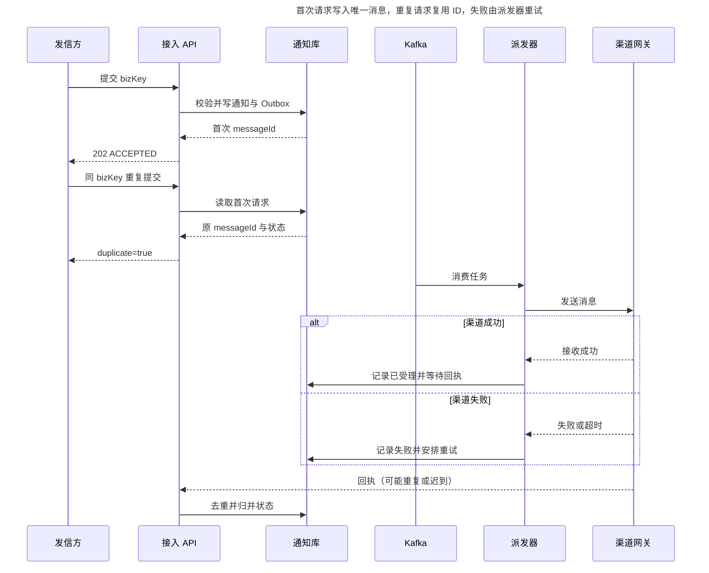
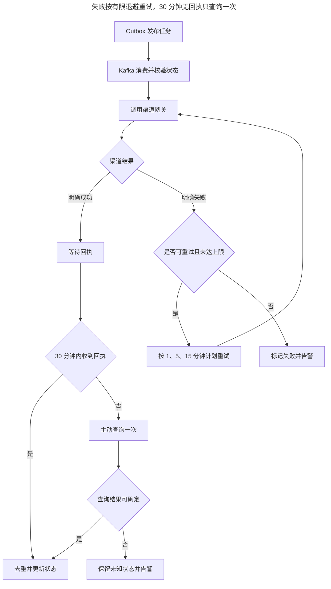

# 统一通知平台技术方案

> 评审结论：建议以独立通知服务收敛三类发信方，采用“请求幂等写入 + Kafka 异步派发 + 渠道结果回写”的方案。该方案统一业务校验和投递状态，但不承诺外部渠道恰好一次投递，也不能撤回已发消息。本文所有名称、接口和报文均为合成示例，3 人、6 周为评审排期假设，不是已承诺计划。

## 目标、范围与边界

订单、营销、客服当前分别直连短信、邮件、推送，导致偏好、频控、失败重试和状态追踪分散。目标是在发送方与渠道之间增加统一通知入口，集中执行偏好与频控，异步调度渠道，接收回执并对异常告警。

| 范围 | 本方案负责 | 不负责 / 依赖 |
|---|---|---|
| 接入与策略 | 身份鉴别、参数校验、`bizKey` 幂等、偏好及营销频控 | 发送方提供稳定业务键与合法模板变量；偏好数据来源、更新时效需确认 |
| 派发 | 任务持久化、Kafka 异步消费、渠道选择及按计划重试 | Kafka 与渠道网关可用性；渠道限流与具体 SLA 未提供 |
| 结果 | 接收并去重回执、维护平台状态、无回执主动查询一次、告警 | 渠道最终投递与回执语义由外部渠道决定 |
| 不支持 | 明确拒绝退订营销请求；记录拒绝原因 | 已交给渠道的消息无法撤回；平台不保证跨外部渠道恰好一次 |

平台对同一 `bizKey` 返回首次创建的 `messageId`，不因重试生成第二条业务消息。若渠道调用超时而实际已接收，重试仍可能造成外部重复，调用方和用户体验需接受这一限制。

## 架构与模块

架构按职责和依赖分层；发信方只依赖接入 API，不直接依赖渠道。静态模块边界见图 2；派发顺序见图 3 与图 4。

```layers
---
title: 统一入口收敛发送方，策略服务管控投递任务并依赖渠道
---
- 业务接入层 | 三类系统以统一 API 提交通知
  - 发信方: 订单, 营销, 客服
- 通知服务层 | 校验、编排和状态管理
  - 接入 API: 鉴权, 参数校验, 幂等
  - 策略服务: 偏好, 频控
  - 派发调度: Kafka 消费, 重试
  - 回执告警: 状态更新, 查询, 告警
- 基础设施层 | 平台持久化与消息传递
  - 通知库 {db}: 请求, 状态, 回执
  - Kafka {ext}: 异步任务
- 外部渠道层 | 平台无法保证其恰好一次
  - 渠道网关 {ext}: 短信, 邮件, 推送
```

```blocks
---
title: 接入、策略、调度与回执各自形成边界，持久化记录贯穿请求和派发
---
col
  box 发送方
    订单, 营销, 客服
  box 通知平台
    接入 API, 幂等登记
    策略服务
    任务编排
    回执处理, 告警
  box 持久化与队列
    通知库, 任务 Outbox
    Kafka
  box 外部渠道
    渠道网关, 短信, 邮件, 推送
发送方 -> 通知平台: 提交通知
通知平台 -> 持久化与队列: 写入请求和任务
持久化与队列 -> 外部渠道: 异步派发
```

接入事务先写通知记录与 Outbox；Outbox 发布器将待发事件写入 Kafka，成功后标记已发布，避免数据库提交成功但任务未入队。消费者按 `messageId` 幂等领取任务。生产者、消费者的精确部署规模与容量均待测量，不在此虚构。

### 关键设计取舍

| 选择 | 备选 | 取舍 |
|---|---|---|
| Kafka 异步任务 + Outbox | 请求线程直接调用渠道；或数据库轮询任务表 | 异步隔离渠道慢响应；Outbox 弥补数据库与 Kafka 无分布式事务。代价是最终一致、需监控积压并处理重复消费 |
| 统一策略服务集中校验 | 各发信方自行判断偏好和频控 | 规则口径一致、拒绝有审计；引入平台依赖与集中故障面 |
| 平台记录投递状态，渠道负责最终投递 | 承诺端到端 exactly-once | 外部渠道不一定支持幂等或事务，不能承诺恰好一次；选择可追踪、可重试，但暴露重复风险 |
| 每日营销计数按用户与自然日原子更新 | 先查后写计数 | 原子条件更新避免并发超发；时区、跨日边界和退订生效时效仍需业务确认 |

## 数据模型与规则

建议关系型数据库保存业务事实，初期按可追溯性设计；分库分表、归档与保留期须在获得流量和合规要求后决定。

| 记录 | 关键字段 / 约束 | 用途 |
|---|---|---|
| `notification` | `message_id` 主键；`biz_key` 唯一；`sender`、`category`、`user_id`、`channel`、`status`、`created_at`、`updated_at` | 请求幂等与当前状态 |
| `notification_payload` | `message_id` 唯一；模板标识、变量快照（受控访问） | 重试使用相同业务内容；敏感字段加密及保留期待定 |
| `outbox` | `event_id` 主键；`message_id`、`published_at`、`created_at` | 可靠投递任务事件 |
| `delivery_attempt` | `message_id`、`attempt_no`、`scheduled_at`、`result`、`provider_ref` | 每次渠道调用及重试审计 |
| `receipt` | 渠道回执键唯一（可用时）；`message_id`、`provider_status`、`received_at` | 去重并更新渠道状态 |
| `marketing_daily_count` | `user_id`、业务日唯一；`count` | 平台接受请求时占用名额，最高 2 条/用户/日 |

请求处理顺序：格式与鉴权校验 → 查询 `bizKey` → 若已存在，返回原 `messageId` 和现状 → 若为营销，校验退订（退订则拒绝且不写任何通知数据）→ 对频控计数执行原子预留 → 同一事务写通知及 Outbox → 返回 `202`。任一事务失败整体回滚；达到频控上限不创建发送任务。重复请求命中时返回首次消息 ID，不重复计数。并发请求用 `bizKey` 唯一约束裁决：冲突方读取并返回已提交记录。当前数据模型按 `bizKey` 跨三个发送方全局唯一设计；若业务键仅在各发送方内唯一，应将唯一约束改为 `(sender, biz_key)` 并更新请求查重规则。

“退订即拒绝且不落库”指拒绝请求不写通知、Outbox、回执或频控记录；安全访问日志是否保留请求摘要属于待决策，不得记录消息正文。数据库对内容字段的加密密钥管理、数据保留和删除策略上线前需经安全与隐私评审。

## API 契约

接口采用 HTTPS JSON；鉴权方式、版本治理与调用配额待平台所有者确认。以下字段与响应是合成示例；当前方案要求 `bizKey` 在订单、营销、客服三个发送方之间全局唯一，是否由发送方命名空间确保待确认。

```http
POST /v1/notifications
Content-Type: application/json
Authorization: Bearer <token>
```

```json
{
  "bizKey": "order:O-2048:paid",
  "sender": "order",
  "category": "transactional",
  "userId": "U-120",
  "channel": "sms",
  "templateId": "order-paid-v1",
  "variables": {"orderNo": "O-2048"}
}
```

首次接受返回 `202` 与 `messageId`、`status=ACCEPTED`。相同 `bizKey` 再次提交返回首次 `messageId` 与当前平台状态，并标注 `duplicate=true`；若调用者复用相同键却提交不同正文，返回 `409 BIZ_KEY_CONFLICT`，不覆盖首次内容。格式错误返回 `400`，认证失败 `401/403`，营销退订 `拒绝码 MARKETING_UNSUBSCRIBED` 且无业务落库，营销达到 2 条上限返回 `429 MARKETING_DAILY_LIMIT`。服务暂不可用返回 `503`，调用方可用原 `bizKey` 重试。

合成响应：`{"messageId":"N-7f31","status":"ACCEPTED","duplicate":false}`。状态查询建议为 `GET /v1/notifications/{messageId}`；返回平台处理状态、尝试次数及更新时间，不把“渠道已接收”误报成“用户已送达”。

## 派发、失败与幂等

Kafka 消息包含 `messageId`、`channel`、模板快照引用、`attemptNo` 和计划派发时间，不包含不必要的个人信息。消费者在任务到期时取出消息并调用渠道网关。渠道明确失败时按第 1、5、15 分钟后重试，最多 3 次；次数定义存在歧义：本文暂按“初次发送后最多再重试 3 次”解释，总调用最多 4 次，请评审确认。永久拒绝（例如渠道明确判定地址无效）不再重试；失败是否属于可重试由渠道错误码映射表明确，当前待渠道联调确认。

每次派发记录 attempt。Kafka 重复消费由消息状态和尝试记录去重；Outbox 发布重复由消费者幂等吸收。渠道请求带可用时的 provider idempotency key（如 `messageId`），但其效果依赖具体渠道合同，不作为端到端保证。超时结果不确定时记录 `UNKNOWN` 并等待回执或查询；若错误地立刻重试，可能重复投递。退避时间与“最多 3 次”的口径需在实现前锁定。

发送后 30 分钟仍无回执，对该 `messageId` 主动查询一次；查询结果进入同一状态归并逻辑，查询失败或仍未知不无限轮询，产生待处理状态并告警。迟到回执不得把最终状态倒退；重复回执按渠道回执 ID 去重，若渠道无稳定回执 ID，则用消息、状态和渠道时间构造去重窗口，窗口与冲突规则待确认。



时序图覆盖首次提交、重复提交和渠道失败分支；营销退订在写库前拒绝，图中省略。外部渠道的接收确认不等于终端用户实际收到。

## 重试与回执处理流程



流程图中的计划重试间隔遵循 brief；是否初次发送后再重试三次存在口径待确认。回执查询最多一次，查询结果未知时不进入无限轮询。

## 灰度、回滚与运维

分三步切换：先让通知平台对订单小范围流量启用并保留原链路回退开关；校验 API 接受、偏好/频控、Outbox 入队、渠道回执和告警闭环后，再逐步纳入客服、营销；通过对账确认旧直连流量停止后，才下线旧调用。灰度比例、观察窗口和每阶段阈值均需依据现网基线制定，当前没有测量数据，不能预填数值。

回滚触发条件由评审确定，建议包含：错误响应异常、队列持续积压、重复投递投诉或偏好/频控错误。回滚先停止新流量进入平台或将发送方切回直连，仅对尚未派发的任务暂停/取消；已经交给渠道的消息不可撤回。不能将平台已创建消息静默重放到旧直连，否则会放大重复投递。切回旧链路期间，新平台已受理的 `bizKey` 必须可查询并防止二次提交；恢复后需确定未完成任务由谁接管及对账方式。

监控建议至少覆盖请求接受/拒绝分类、幂等冲突、退订与频控拒绝、Outbox 未发布时长、Kafka 积压、各渠道调用结果与延迟、重试次数、30 分钟查询结果、迟到/重复回执、告警送达。阈值、值班责任和告警通道待运维评审。指标阈值不能由本方案凭空设定。

## 验收标准

| 验收项 | 可检查结果 |
|---|---|
| 幂等 | 同 `bizKey` 多次请求返回相同首次 `messageId`；并发请求只有一条业务记录和一条逻辑任务；键冲突且正文不同返回 `409` |
| 退订 | 营销退订请求被拒绝；通知、Outbox、回执、营销计数均无新增记录 |
| 营销频控 | 同用户同业务日最多成功预留 2 条营销通知；并发压测/事务测试不得超额。业务日时区需先确定 |
| 异步派发 | 通知写入与任务最终可达 Kafka；模拟发布重试、重复消费不产生重复业务记录 |
| 重试 | 故障注入验证失败后 1、5、15 分钟计划与最多 3 次重试口径；断言总调用次数以评审确认定义为准 |
| 回执与查询 | 重复回执不重复改变计数；无回执满 30 分钟仅主动查询一次；未知结果保留未知并告警 |
| 回滚 | 灰度流量可停止并切回旧链路；已交给渠道的消息不重发、不宣称可撤回；待处理消息有对账清单 |
| 离线文档 | HTML 无远程资源；桌面/手机/打印检查、四张图以上截图目检；导出 PDF 与 PNG 可打开 |

验收是功能和故障注入场景，不包含任何虚构性能基线。吞吐、容量与 SLA 验收阈值应在获得实际流量和下游限制后另行确定。

## 资源与计划假设

资源方案仅列出拟引入的资源，数值需求待流量测量后评估：通知关系型数据库（通知、Outbox、尝试、回执、计数表及唯一索引）；Kafka（通知任务 topic、Outbox 发布者、派发消费者组）；渠道网关接口与回执/查询依赖；监控告警平台。日增记录、保留周期、消息大小、峰值速率、并发量、存储量、QPS 与扩容规格均未知，需补充测量后申请，不据此作容量承诺。

3 人、6 周是评审假设而非已批准排期。该假设须覆盖接入/规则、异步调度/渠道适配、回执/运维验收，并受外部渠道联调、偏好数据源和安全评审阻塞；具体负责人、里程碑日期和排期确认人待定。

## 待决策事项

1. “最多 3 次”是最多三次重试还是包含首次发送总共三次？本文暂按三次重试理解，验收须以最终决议为准。
2. `bizKey` 是否跨三个发送方全局唯一？当前按全局唯一建模；若各发送方各自唯一，需采用 `(sender, bizKey)` 作为唯一身份。
3. 营销自然日采用哪个时区；跨午夜请求、退订变更的生效时效如何定义？平台接受后渠道失败是否释放营销名额？当前按占用名额设计。
4. 偏好和退订数据的权威来源、同步方式、故障时 fail-open 还是 fail-closed？安全默认建议营销 fail-closed，业务通知策略需明确。
5. 对超时不确定的渠道调用，是否有可用的渠道幂等键及查询能力；回执唯一键、状态映射与迟到冲突规则是什么？
6. 用户拒绝请求是否允许保留最小化安全审计记录；正文加密、访问权限与数据保留期如何定？
7. 灰度比例、观察窗口、回滚阈值、告警责任人、SLA 与容量指标由谁确认？
8. 已受理但未派发任务在回滚期间暂停、继续由新平台派发还是转移旧链路？如何对账避免重复？
9. 3 人、6 周的假设是否成立；外部依赖联调与业务决策是否能在该窗口内就绪？
