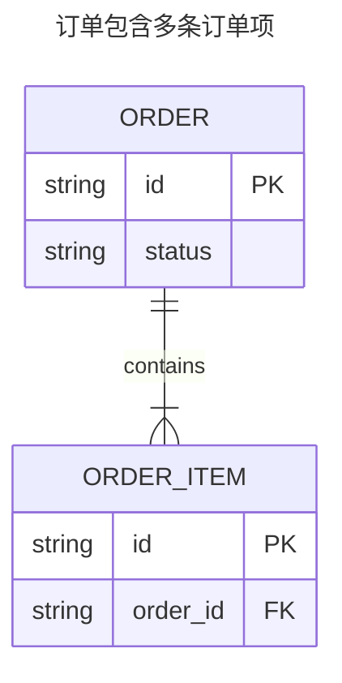

# 数据模型图

实体、类或需求之间的静态关系适合用本族。它们不表示执行流程；选择与问题相符的语义，不把三种图型互相替代。

## erDiagram

实体可写显示名及属性，键标记限 `PK`、`FK`、`UK`；关系用基数端点和标签表示，支持实线与虚线关系以及方向。最多 30 个实体、50 条关系。实体块必须闭合，端点和基数须合法；解析失败会报告位置，不要省略无法确认的字段或关系。



## classDiagram

最多 40 个节点、60 条边、240 行。关系运算符限 `<|--`、`<|..`、`..|>`、`*--`、`--*`、`o--`、`--o`、`..>`、`-->`、`--`、`..`；不接受头行选项（如 `direction`）。支持 `class ID`、`class ID as "显示名"`、类体属性与简单类型/方法，以及受控继承、组合、聚合、依赖和关联关系。端点基数可写在两端。受控关系语句以外的声明报错；只保留能明确表达的类成员与关系，不补造方法。

## requirementDiagram

最多 40 个节点、60 条边、240 行；不接受头行选项（如 `direction`）。支持 `requirement`、`functionalRequirement`、`performanceRequirement`、`interfaceRequirement`、`physicalRequirement`、`designConstraint`、`element` 类型；属性限 `id`、`text`、`risk`、`verifymethod`、`owner`、`docref`。关系限 `satisfies`、`contains`、`derives`、`refines`、`traces`、`copies`、`verifies`。其他字段或关系会报错，应改用受支持属性而非假设兼容 Mermaid 全语法。

上述关系图可在前言区或正文写 `title`。阅读文档应为每张图提供图题；未知语句、字段或端点必须按诊断修正。

语法轨道图则用于说明一门语法接受哪些符号、以什么顺序匹配。每条规则占一行；圆角框表示字面量，方框表示规则引用，虚线框表示特殊项，分支、绕行线和返回线分别表示选择、可选和重复。宽图保持原字号，在图框内横向滚动。

## railroad-beta

用构造器直接描述轨道。规则写作 `名称 = 表达式;`，支持 `terminal`、`nonterminal`、`special`、`sequence`、`choice`、`optional`、`zeroOrMore`、`oneOrMore`。

```mermaid
railroad-beta
title "键值对"
pair = sequence(nonterminal("key"), terminal(":"), nonterminal("key"));
key = choice(terminal("name"), terminal("id"));
```

## railroad-ebnf-beta

规则使用 `=` 或 `::=`，以 `;` 结束。`|` 表示选择，顺序项之间的逗号可省略；`[A]` 与 `A?` 等价，`{A}` 与 `A*` 等价，`A+` 表示至少一次。支持 `? 特殊项 ?` 和例外写法 `A - B`。

```mermaid
railroad-ebnf-beta
title "列表"
list = "[" [ item { "," item } ] "]";
item = "a" | "b";
```

## railroad-abnf-beta

规则写作 `名称 = 表达式;`。用 `/` 分隔选项、双引号包住字面量，重复次数写在项目前，例如 `2*4item`；`[item]` 等价于 `0*1item`。`%x30-39` 等数值字面量照原样显示。

```mermaid
railroad-abnf-beta
title "短代码"
code = 2*4unit ["-"];
unit = %x30-39 / "A";
```

## railroad-peg-beta

规则使用 `<-` 并以 `;` 结束。`/` 的选项按书写顺序从上到下排列；`&` 和 `!` 是不消耗输入的前瞻，将显示在虚线框中。`.` 匹配任意一个字符，`?`、`*`、`+` 写在项之后。

```mermaid
railroad-peg-beta
title "标识符"
Identifier <- !Keyword Letter Letter*;
Keyword <- "if" / "else";
Letter <- "a" / "b" / "_";
```
