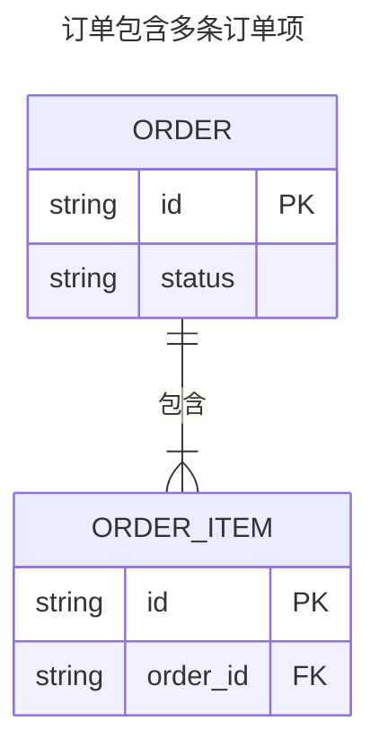

# 数据模型图

实体、类或需求之间的静态关系适合用本族。它们不表示执行流程；选择与问题相符的语义，不把三种图型互相替代。

## erDiagram

实体可写 `ID["显示名"]`，属性块中依次写类型、名称、可选 `PK` / `FK` / `UK` 标记和带引号的注释。关系用基数端点和标签表示，支持实线 `--`、虚线 `..` 及基数词形（如 `only one`）。可用 `direction` 和 `subgraph … end`；跨组连线可能使子图继承外层方向并给出提示。无专用配置键，支持[通用样式、链接和图标](mermaid.md)。无效基数或未闭合的实体块报错。



## classDiagram

别名 `classDiagram-v2`。支持 `class ID["显示名"]`、类体属性与方法、`~T~` 泛型、`namespace X { … }`、`note` / `note for` 和 `<<注解>>`。继承、组合、聚合、依赖、关联及 `()--` 棒棒糖接口均可用；关系可带端点基数和标签。支持通用样式（用 `cssClass` 分配类样式）、链接和图标。`class.hideEmptyMembersBox` 隐藏空成员区，`class.hierarchicalNamespaces` 控制命名空间层级。头行选项或未闭合块报错；指向未知类的 `note for` 会提示。

## requirementDiagram

别名 `requirement`。需求块有 `requirement`、`functionalRequirement`、`performanceRequirement`、`interfaceRequirement`、`physicalRequirement`、`designConstraint`，可写 `id`、`text`、`risk`、`verifymethod`；`element` 可写 `type`、`docref`。`A - satisfies -> B` 可换用 `contains`、`derives`、`refines`、`traces`、`copies`、`verifies`，也可写反向关系。方向放在独立 `direction` 行。支持通用样式、链接和标签图标，无专用配置键。非法字段（如 `owner`）、值、关系或头行选项报错；重复声明给出提示。

三种关系图均可用前言 `title`，需求图还可用正文 `title`。阅读文档应为每张图提供图题。

语法轨道图则用于说明一门语法接受哪些符号、以什么顺序匹配。每条规则占一行；圆角框表示字面量，方框表示规则引用，虚线框表示特殊项，分支、绕行线和返回线分别表示选择、可选和重复。宽图保持原字号，在图框内横向滚动。四种轨道图共享 `config.railroad`：`padding`、`verticalSeparation`、`horizontalSeparation`、`arcRadius`、`fontSize`、`showMarkers`、`markerRadius`、`compactMode`。支持通用样式、链接、规则的 `:::` 类和 `::icon(…)` 后缀。规则重复或引用未定义规则会提示；语法错误（包括未闭合的字符串或分组）会阻止渲染。

## railroad-beta

用构造器直接描述轨道。规则写作 `名称 = 表达式;`，支持 `terminal`、`nonterminal`、`special`、`sequence`、`choice`、`optional`、`zeroOrMore`、`oneOrMore`。

```mermaid
railroad-beta
title "键值对"
pair = sequence(nonterminal("key"), terminal(":"), nonterminal("key"));
key = choice(terminal("name"), terminal("id"));
```

## railroad-ebnf-beta

规则使用 `=` 或 `::=`，以 `;` 结束。`|` 表示选择，顺序项之间的逗号可省略；`[A]` 与 `A?` 等价，`{A}` 与 `A*` 等价，`A+` 表示至少一次。支持 `? 特殊项 ?` 和例外写法 `A - B`。

```mermaid
railroad-ebnf-beta
title "列表"
list = "[" [ item { "," item } ] "]";
item = "a" | "b";
```

## railroad-abnf-beta

规则写作 `名称 = 表达式;`。用 `/` 分隔选项、双引号包住字面量，重复次数写在项目前，例如 `2*4item`；`[item]` 等价于 `0*1item`。`%x30-39` 等数值字面量照原样显示。

```mermaid
railroad-abnf-beta
title "短代码"
code = 2*4unit ["-"];
unit = %x30-39 / "A";
```

## railroad-peg-beta

规则使用 `<-` 并以 `;` 结束。`/` 的选项按书写顺序从上到下排列；`&` 和 `!` 是不消耗输入的前瞻，将显示在虚线框中。`.` 匹配任意一个字符，`?`、`*`、`+` 写在项之后。

```mermaid
railroad-peg-beta
title "标识符"
Identifier <- !Keyword Letter Letter*;
Keyword <- "if" / "else";
Letter <- "a" / "b" / "_";
```
