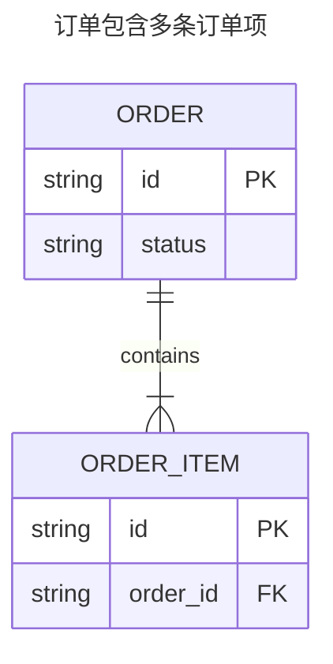

# 数据模型图

实体、类或需求之间的静态关系适合用本族。它们不表示执行流程；选择与问题相符的语义，不把三种图型互相替代。

## erDiagram

实体可写显示名及属性，键标记限 `PK`、`FK`、`UK`；关系用基数端点和标签表示，支持实线与虚线关系以及方向。最多 30 个实体、50 条关系。实体块必须闭合，端点和基数须合法；解析失败会报告位置，不要省略无法确认的字段或关系。

## classDiagram

最多 40 个节点、60 条边、240 行。关系运算符限 `<|--`、`<|..`、`..|>`、`*--`、`--*`、`o--`、`--o`、`..>`、`-->`、`--`、`..`；不接受头行选项（如 `direction`）。支持 `class ID`、`class ID as "显示名"`、类体属性与简单类型/方法，以及受控继承、组合、聚合、依赖和关联关系。端点基数可写在两端。受控关系语句以外的声明报错；只保留能明确表达的类成员与关系，不补造方法。

## requirementDiagram

最多 40 个节点、60 条边、240 行；不接受头行选项（如 `direction`）。支持 `requirement`、`functionalRequirement`、`performanceRequirement`、`interfaceRequirement`、`physicalRequirement`、`designConstraint`、`element` 类型；属性限 `id`、`text`、`risk`、`verifymethod`、`owner`、`docref`。关系限 `satisfies`、`contains`、`derives`、`refines`、`traces`、`copies`、`verifies`。其他字段或关系会报错，应改用受支持属性而非假设兼容 Mermaid 全语法。

本族三型均可在前言区写 `title`，关系图也接受正文 `title`。阅读文档应为每张图提供图题；未知语句、字段或端点必须按诊断修正。
