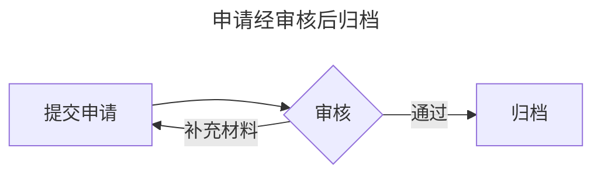

# 流程与状态图

表达一般流程、条件分支、状态迁移、用户旅程或跨角色交接。节点归属和责任交接重要时用 `swimlane`；只表示模块依赖时不要画成流程。

## flowchart

`flowchart`（别名 `graph`）支持 `TB`/`TD`/`BT`/`LR`/`RL` 方向、节点、连线、标签及子图（最多嵌套 3 层）；最多 30 节点、50 条边。矩形 `[]`、子程序 `[[]]`、圆柱 `[( )]`、圆 `()`、stadium `([])`、菱形 `{}`、六边形 `{{}}` 可用；连线标签可写 `A -->|通过| B`。状态分类使用 `:::new`、`:::info`、`:::ok`、`:::warn`、`:::danger`、`:::ext` 或 `class A ok`。`classDef`、`style`、`linkStyle`、`click`、`call` 和 `@{ shape: ... }` 不支持；这些写法产生诊断，移除样式/回调并改用状态分类。



## stateDiagram-v2

状态图（别名 `stateDiagram`）支持 `[*]` 起止点、状态转换及 `state "名称" as id`；最多 30 状态、50 条转换，复合状态最多嵌套 2 层。`<<choice>>`、`<<fork>>`、`<<join>>` 和转换说明可用。并发区 `--` 与 `note` 不支持；出现时会报错，改用明确状态和转换，不要当作注释忽略。

## journey

旅程图用 `section 名称` 分组，以 `任务名: 分数: 参与者, 参与者` 声明体验任务。分数必须为 1–5，最多 80 项、240 行；分值显示为五级刻度，不会按本图数据重新归一化。用虚构或来源明确的体验评分，不要把分数当百分比。

## swimlane

原生 `swimlane` 以 `lane 泳道名` 声明责任方，泳道内缩进声明节点，之后用 flowchart 连线语法连接节点；方向仅 `TB` / `LR`。最多 6 条泳道、30 个节点、50 条关系、3 条回边，节点标签最多 3 行、宽度受限（最大 208px）。每个节点须且仅须归属一条泳道，跨泳道关系引用已声明节点；缩进、归属、方向冲突或超限都会报错。

```swimlane
---
title: 客户端请求经服务端校验并查询
---
swimlane LR
lane 客户端
  request[提交请求]
  result[接收结果]
lane 服务端
  validate[校验]
  query[查询]
request -->|请求| validate
validate -->|通过| query
query -->|响应| result
```

Mermaid flowchart、stateDiagram-v2 与 journey 可用前言区 `title`，阅读文档必须给图题。原生泳道也可用前言 `title`；无标题不应靠源码外的文字补足图自身的阅读语境。
