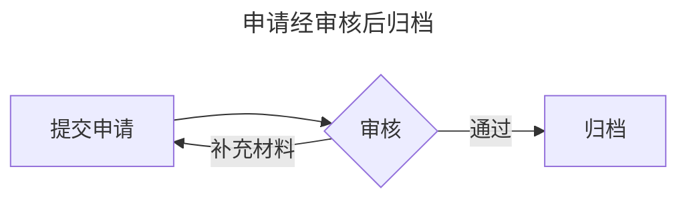

# 流程与状态图

表达一般流程、条件分支、状态迁移、用户旅程或跨角色交接。节点归属和责任交接重要时用 `swimlane`；只表示模块依赖时不要画成流程。

## flowchart

`graph` 和 `flowchart-elk` 都是 `flowchart` 的别名；后者仍用 KChart 布局并告警。方向用 `TB` / `TD` / `BT` / `LR` / `RL`。支持嵌套 `subgraph … end`、`A -->|通过| B`、常用括号形状及 `A@{ shape: …, label: …, icon: … }`。未知形状、未闭合子图等结构问题报错。支持[通用样式、链接和图标](mermaid.md)，`flowchart.inheritDir` 控制子图是否继承方向；曲线及边动画不采用，并给出警告。



## stateDiagram-v2

别名 `stateDiagram`。支持 `[*]`、`state "名称" as id`、带标签的转换、复合状态、并发分隔 `--`、`<<choice>>` / `<<fork>>` / `<<join>>` 与 `note`。复合块未闭合会报错；`hide empty description` 和 `scale` 忽略并告警。支持通用样式、链接和标签图标；方向用 `direction`，无需配置键。

## journey

旅程图用 `section 名称` 分组，以 `任务名: 分数: 参与者, 参与者` 声明任务；没有参与者时可写 `任务名: 分数`。评分必须在 1–5 之间，小数会按原值定位并给出提示。每行的表情位置对应带标题的固定 1–5 评分轴；表情的无障碍标签保留准确分数。参与者按首次出现排序，图例和任务中的圆点使用对应的主题色。评分应是虚构示例或有明确来源的体验数据，不应当作百分比。

正文 `title` 优先于前言标题，支持 `accTitle` 和 `accDescr`。在前言 `config.journey` 可设置 `taskFontSize`、`maxLabelWidth`、`leftMargin` 及无外框 SVG 的 `titleFontSize`；自定义调色板忽略并报 `IGNORED_STYLE`。支持通用样式、链接和标签图标；用从零开始的 `task:N` 引用任务。无效评分报错。

## swimlane

原生 `swimlane` 以 `lane 泳道名` 声明责任方，泳道内缩进声明节点，之后用 flowchart 连线语法连接节点；方向仅 `TB` / `LR`。最多 6 条泳道、30 个节点、50 条关系、3 条回边，节点标签最多 3 行、宽度受限（最大 208px）。每个节点须且仅须归属一条泳道，跨泳道关系引用已声明节点；缩进、归属、方向冲突或超限都会报错。

```swimlane
---
title: 客户端请求经服务端校验并查询
---
swimlane LR
lane 客户端
  request[提交请求]
  result[接收结果]
lane 服务端
  validate[校验]
  query[查询]
request -->|请求| validate
validate -->|通过| query
query -->|响应| result
```

## swimlane-beta

Mermaid 泳道图。默认 `TB`；可在头行或单独的 `direction` 行用 `TB` / `TD` / `BT` / `LR` / `RL`，多处声明不得冲突。每个顶层 `subgraph 泳道名 … end` 或 `subgraph id [泳道名] … end` 定义一条泳道；在其中用 flowchart 写法声明节点。连线可跨泳道，但两端必须是节点。未归属节点放进独立泳道并提示；简单嵌套子图显示为泳道内的组框。

矩形、圆角矩形、菱形、胶囊和圆形可用；其他已知形状回退为圆角矩形并提示。可使用带标签的连线、虚线、粗线和隐形排版连线 `~~~`。支持通用样式、链接和标签图标，无专用配置键。缩进式 `lane` 声明是原生 `swimlane` 写法，不适用于此型。

## eventmodeling

Event Modeling 按源码顺序排时间帧：`tf 编号 类型 名称` 可写成 `timeframe`，`rf` 可写成 `resetframe`。编号为 1–3 位数字且不得重复；类型为 `ui`、`cmd` / `command`、`evt` / `event`、`rmo` / `readmodel`、`pcr` / `processor`。

- 泳道依次归入界面/自动化、命令/读模型、事件三组，只显示用到的泳道。两段名称 `命名空间.实体`（标识符用英文字母、数字和下划线）按命名空间细分泳道；三段及以上的名称不拆出命名空间。
- `tf` 未显式指定来源时，从最近的、位于不同泳道的前一帧连入；`rf` 不推断入边。重复写 `->> 编号` 可指定多个来源，覆盖推断。来源类型不匹配仅提示，显式连线仍绘制。连线采用正交走线。
- 帧可附 `{ 数据 }` 或带引号的内联数据，也可用 `[[名称]]` 引用多行 `data 名称 { … }`（结束 `}` 单独顶格一行）。数据按文本显示，窄屏超过四行时显示省略行数，悬停可见全文。`note`、`entity` 和 `gwt` 显示在泳道下方。
- 支持正文或前言区 `title`、`accTitle` / `accDescr` 无障碍字段。标题支持常见实体、换行和 `fa:fa-…` 图标，未知图标只提示；数据正文不解释为标签或 HTML。前言区或初始化指令中的 `eventmodeling.padding` 控制外边距（8–120 px），`rowHeight` 不生效并报 `IGNORED_CONFIG`。重复编号或引用不存在的帧、数据块会报错；通用样式或点击语句也不接受。窄屏将泳道名放在各泳道上方，必要时在图框内横向滚动。

## agentflow-beta

智能体工作流。头行可指定 `TB` / `TD` / `BT` / `LR` / `RL`。用 `flow agent["智能体"] … end` 嵌套分组，`global … end` 声明不归入分组的共享节点，`connector api["外部服务"]` 声明连接器。节点用 `id["标签"]@{ shape: task }`，角色形状有 `task`、`tool`、`input`、`decision`、`refdoc`、`action`。`-->` 表示顺序，`-.-` 表示引用，`--x` 表示失败；边可带文字标签。

`agent@{ view: collapsed }` 将分组折成一个节点并保留与外部的连线。`instruction`、`model`、`connectorRef` 等元数据显示在提示中；适合宽度时，在节点上额外显示 `params` / `returns`。配置 `agentflow.wrappingWidth` 调整换行宽度。支持通用样式、链接和标签图标；ELK、未采用的间距覆盖和边动画会告警，未知形状提示并回退为 `task`，无效边语法报错。

Mermaid flowchart、stateDiagram-v2 与 journey 可用前言区 `title`，阅读文档必须给图题。原生泳道也可用前言 `title`；无标题不应靠源码外的文字补足图自身的阅读语境。
