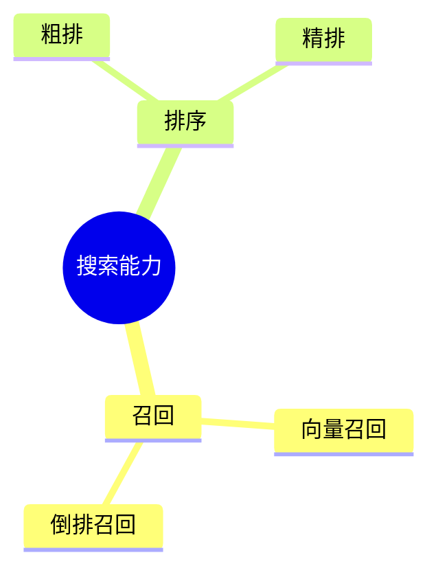

# 层级图

组织、分类或逐级拆分适合用树；围绕一个主题向外展开适合用脑图。需要卡片、注释或数值时，使用 KChart 声明，不要把 Mermaid 脑图当成可自由定制的布局。

## 图型 `tree`

用于固定的组织、分类或分解关系。KChart `data` 是含 `label`、可选 `children` 的单个根节点；支持 `right`、`left`、`org`、`brace`，默认 `right`。最多 80 个节点、5 层。节点可带 `note`、`value` 与受控 `status`；采用真实层级，超过上限拆图。

## 图型 `mindmap`

需要节点读数、附注或卡片构图时使用同样的 KChart 层级数据，支持下列八种布局和 `variant: "cards"`。以下用法适用于直接写 Mermaid 脑图。

## mindmap

Mermaid `mindmap` 只接受一个根节点，最多 80 个节点、5 层（含根），标签最多 3 行。缩进表达父子关系，Tab 和同级缩进不一致会报错。`(( ))`、`{{ }}`、`)) ((`、`[ ]`、`( )`、`) (` 只剥除外壳并保留文字，不承诺形状语义。节点状态单独放在节点下一行：`:::new`、`:::info`、`:::ok`、`:::warn`、`:::danger` 或 `:::ext`；行内状态、图标指令及 Mermaid 头行参数不支持，检查报错后应移除或改成受支持写法。

脑图可在前言 `config.layout` 中选择 `bilateral`（默认）、`right`、`left`、`radial`、`org`、`brace`、`fishbone`、`timeline`。`tidy-tree`、`dagre`、`elk` 按默认布局绘制；其他名称报错。`theme`、`look`、`themeVariables`、`mindmap.colorBy` 不影响绘制。

不要把脑图节点形状写成视觉承诺，也不要用超出限制的节点或缩写掩盖范围；超过上限时拆图并说明拆分范围。需要节点注释、数值或卡片式布局时改用 KChart `tree` 或 `mindmap` 声明。

## ishikawa

也接受 `ishikawa-beta`。鱼骨图用缩进表达：第一行是要分析的问题，下一级是原因类别（如 Process、User、Equipment），再下级是具体原因，可继续细分。用于原因分类，不表达时间或流程。共享样式与安全链接可按节点 ID 指定：问题为 `root`，原因按源码顺序依次为 `n1`、`n2`……。

## treeView-beta

目录树：用 `├──`、`└──`、`│` 画出的文件树，或按缩进逐行写名称；以 `/` 结尾的名称是目录。适合展示代码库或文档结构。名称后可写 `:::highlight` 或状态类、`icon(名称)` 及 `## 描述`（描述放在最后）。默认给目录和文件绘制内置图标；`icon(none)` 隐藏当前图标，未知图标省略并提示。前置 `config.treeView` 支持 `showIcons: false`（全图隐藏）、`filenameIcons`、`extensionIcons`（键带点，如 `.ts`）、`rowIndent`、`paddingX`、`paddingY`、`lineThickness`；间距和线宽保持在可读范围内。共享样式与安全链接以显示名称为目标（目录名不带末尾 `/`）。
