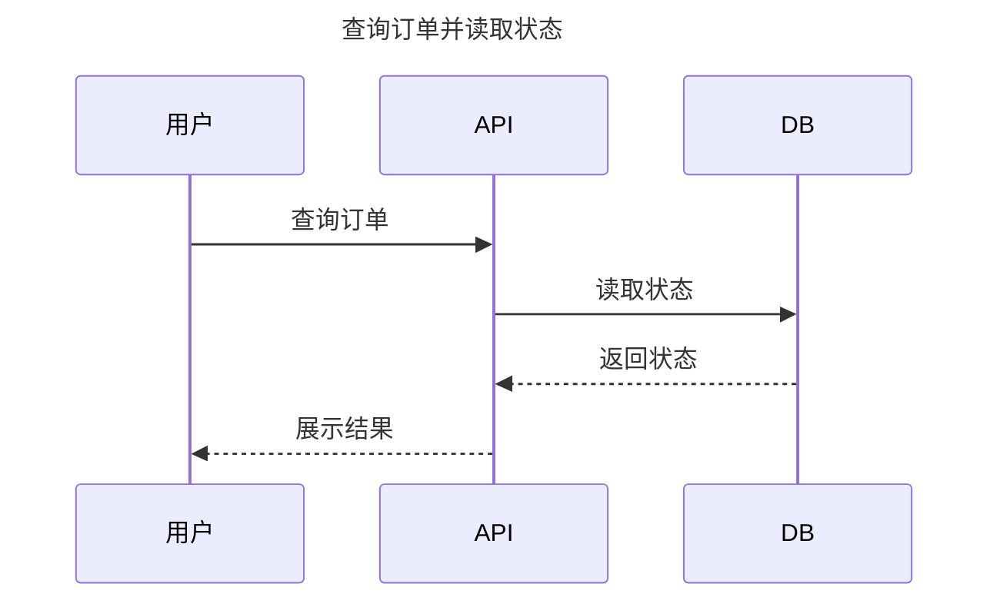

# 时序图

参与者间调用、消息和返回有明确先后时使用时序图。模块静态依赖不代表发生顺序；不要用时序图代替架构关系图。

## sequenceDiagram

声明 `participant` 或 `actor`，消息使用受控箭头表达同步、返回、异步或丢失；支持自调用、激活、`Note`、`box` 分组及 `rect` 区段。组合片段 `alt/else`、`opt`、`loop`、`par/and`、`critical/option`、`break` 都以 `end` 结束，最多嵌套两层。最多 8 个参与者、40 条消息，标签最多 3 行。激活必须配对；`rect` 不接受颜色，外观由主题控制；不支持的语句会报错，不得当作已绘制。

## zenuml

受控 `zenuml` 支持参与者、`Client->API: request` 消息、`Client.call()` 调用和单行嵌套调用 `Client.call() { API.handle() }`；可用 `title` 正文语句。其他 ZenUML 语法不支持，检查会给出源码位置和改法；不要假定完整兼容。

## usecase-beta

UML 用例图，默认 `LR`，可用 `direction TB` / `TD` / `BT` / `LR` / `RL`。`actor ID("显示名")` 声明参与者；`ID("名称")` 表示椭圆用例，`ID[名称]` 表示矩形用例。`systemBoundary "系统名" … end` 包住参与者和用例，不能嵌套；边界可用 `@{ type: package }` 显示页签。参与者支持 `@{ type: hollow }`、`@{ type: awesome }` 或 `@{ icon: "fa:user" }`；无法解析的图标会提示并回退为普通参与者。可加 `<<构造型>>`，普通/空心参与者与椭圆用例可加 `@{ business: true }`。

在边界外写关系：`-->`、`<--`、`--`、`--o`、`o--`、`--x`、`x--`；`A -- "标签" --> B` 是带标签的关联，`A --|> B` 是同类元素间的泛化，`A ..> : include B` / `A ..> : extend B` 是用例间的虚线依赖。`note for ID "文字"` 添加注释，`json ID@{ "key": "value" }` 将严格 JSON 对象展开为表格。

支持 `classDef`、`class`、`style`、`linkStyle`、`:::类名` 和安全链接。颜色映射到 KChart 状态色，不保留原 CSS 或执行点击回调、边动画。支持前言 `title` 与正文 `accTitle` / `accDescr`；`config.usecase` 中可调 `actorFontSize` / `usecaseFontSize`（限制为 12–16 px）和 `diagramPadding`。间距、字体家族、配色方案和 ELK 等布局选项不应用；窄容器横向滚动。

时序图可使用前言区 `title`；`zenuml` 也可用正文 `title`。阅读文档的图题必须来自图源码，不支持的额外标题选项应删除，不要以外部段落替代。
