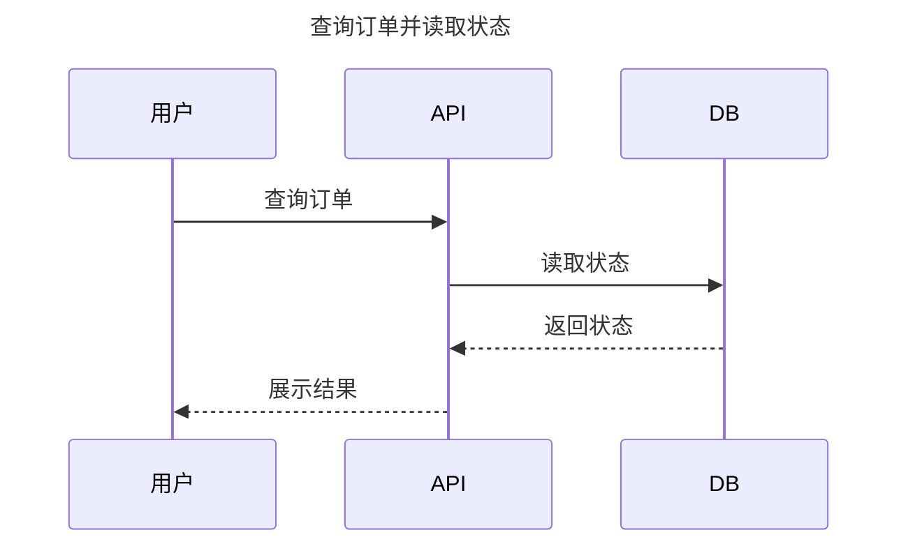

# 时序图

参与者间调用、消息和返回有明确先后时使用时序图。模块静态依赖不代表发生顺序；不要用时序图代替架构关系图。

## sequenceDiagram

- 使用 `participant`、`actor` 声明参与者，可用 `as` 设置别名，或用 `@{ type: database, alias: 订单库 }` 设置类型与别名。类型包括 `participant`、`actor`、`boundary`、`control`、`entity`、`database`、`queue`、`collections`。支持 `create` / `destroy`；下一条消息必须发给新建参与者，或涉及即将销毁的参与者。
- 支持实线和虚线的普通、双向、无箭头、叉形、异步和半箭头，以及 `()` 中心连接与自调用。`activate` / `deactivate` 或消息箭头后的 `+` / `-` 控制激活条；结束激活必须有对应的开始，未结束的激活持续到生命线终点。`autonumber [起始值 [步长]]` 为消息编号，`autonumber off` 停止编号。
- `Note left of`、`Note right of` 和 `Note over` 可添加注释；`Note over A,B` 横跨两条生命线及其间的参与者。`alt/else`、`opt`、`loop`、`par/and`（含 `par_over`）、`critical/option`、`break`、`box` 和 `rect` 以 `end` 结束。`box` 与 `rect` 可使用 `rgb()` 等颜色，映射为主题状态色；无法映射的颜色显示为中性色并给出警告。
- 支持前言区 `title` 或正文 `title:`。可用 `config.sequence.mirrorActors: false` 隐藏底部参与者卡片，或用 `config.sequence.showSequenceNumbers: true` 默认开启编号。支持[通用样式、链接和图标](mermaid.md)；未知的参与者类型提示后按普通方框绘制。
- `link A: 文档 @ https://example.com` 与 `links A: {"文档":"/help"}` 为参与者卡片保留第一个安全 URL；省略弹出菜单并给出 `IGNORED_INTERACTION`；`properties`、`details` 也不显示弹出内容。
- 片段未闭合或激活、销毁等操作无效时会报错。图过宽时在图框内横向滚动，不缩小字号。

## zenuml

KChart 原生解析 Mermaid 12.3.0 文档中的 `zenuml`，不加载 Mermaid 的 ZenUML 插件。可用正文 `title` 或前言区标题。

- 可写 `A` 声明参与者、`A as Alice` 设置别名，也可直接在消息中引用。`@Actor A`、`@Boundary B`、`@Control C`、`@Entity E`、`@Database DB`、`@Collections L`、`@Queue Q` 使用对应的时序图外观；如 `@EC2`、`@S3` 的其他注解用普通参与者显示，并汇总成一条警告。写 `@Actor User`，不要写 `@Actor(User)`。
- `A->B: 请求` 是异步消息。`B.method(args)` 从当前调用者发出同步调用；顶层没有显式调用者时使用匿名角色。`A->B.method() { C.handle() }` 指定调用者并嵌套调用，激活条覆盖调用块。
- 调用块里的 `return result` 向其调用者画虚线回复；`x = B.method()` 带标签 `x` 的回复。跨层可写 `@return A->B: result` 或 `@reply A->B: result`，也可把注解单独写在消息的上一行。`new C` / `new C(args)` 在首次使用处创建参与者，生命线从创建处开始。
- 消息前的 `//` 注释作为消息上方的时序注释框显示，参与者注释忽略；保留 Markdown 强调的文字，不画强调样式。
- `while`、`for`、`forEach`、`loop` 映射为 `loop`；`if` 映射为 `alt`，保留 `else if` / `else` 分支。`opt`、`par` 使用同名片段，`par` 的直接子语句按分支分隔。`try` / `catch` / `finally` 共用通用片段框与分隔线，保留原关键字，不使用插件专用异常图标。
- 图形采用 KChart 的时序样式，不复刻插件的层级编号。没有专用配置键；未实现的扩展语法（包括通用样式和点击）会报错。

## usecase-beta

UML 用例图，默认 `LR`，可用 `direction TB` / `TD` / `BT` / `LR` / `RL`。`actor ID("显示名")` 声明参与者；`ID("名称")` 表示椭圆用例，`ID[名称]` 表示矩形用例。`systemBoundary "系统名" … end` 包住参与者和用例，不能嵌套；边界可用 `@{ type: package }` 显示页签。参与者支持 `@{ type: hollow }`、`@{ type: awesome }` 或 `@{ icon: "fa:user" }`；无法解析的图标会提示并回退为普通参与者。可加 `<<构造型>>`，普通/空心参与者与椭圆用例可加 `@{ business: true }`。

在边界外写关系：`-->`、`<--`、`--`、`--o`、`o--`、`--x`、`x--`；`A -- "标签" --> B` 是带标签的关联，`A --|> B` 是同类元素间的泛化，`A ..> : include B` / `A ..> : extend B` 是用例间的虚线依赖。`note for ID "文字"` 添加注释，`json ID@{ "key": "value" }` 将严格 JSON 对象展开为表格。

支持通用样式、链接和图标，不执行边动画。`config.usecase` 中可调 `actorFontSize` / `usecaseFontSize`（12–16 px，越界忽略并告警）和 `diagramPadding`。无效的参与者变体、业务类型或关系报错。

时序图可使用前言区 `title`；`zenuml` 也可用正文 `title`。阅读文档的图题必须来自图源码，不支持的额外标题选项应删除，不要以外部段落替代。
