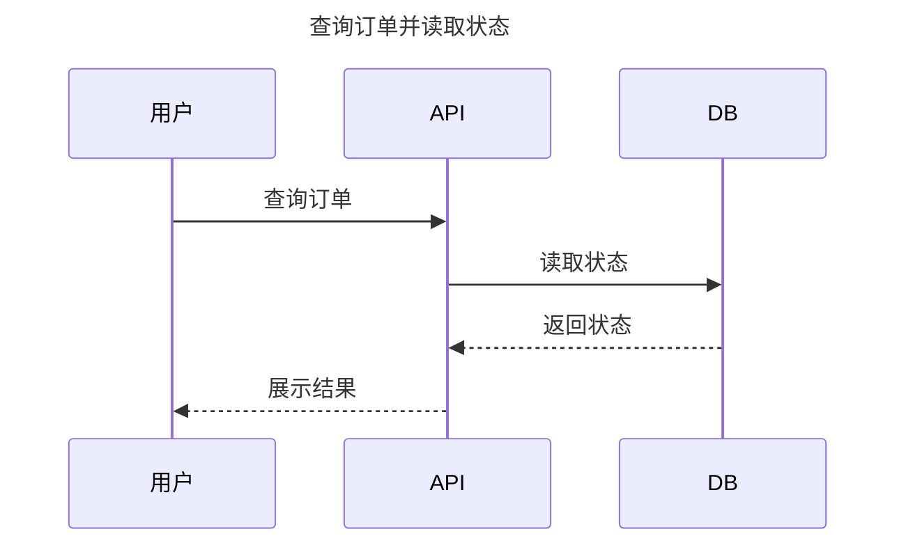

# 时序图

参与者间调用、消息和返回有明确先后时使用时序图。模块静态依赖不代表发生顺序；不要用时序图代替架构关系图。

## sequenceDiagram

- 使用 `participant`、`actor` 声明参与者，可用 `as` 设置别名，或用 `@{ type: database, alias: 订单库 }` 设置类型与别名。类型包括 `participant`、`actor`、`boundary`、`control`、`entity`、`database`、`queue`、`collections`。支持 `create` / `destroy`；下一条消息必须发给新建参与者，或涉及即将销毁的参与者。
- 支持实线和虚线的普通、双向、无箭头、叉形、异步和半箭头，以及 `()` 中心连接与自调用。`activate` / `deactivate` 或消息箭头后的 `+` / `-` 控制激活条；结束激活必须有对应的开始，未结束的激活持续到生命线终点。`autonumber [起始值 [步长]]` 为消息编号，`autonumber off` 停止编号。
- `Note left of`、`Note right of` 和 `Note over` 可添加注释；`Note over A,B` 横跨两条生命线及其间的参与者。`alt/else`、`opt`、`loop`、`par/and`（含 `par_over`）、`critical/option`、`break`、`box` 和 `rect` 以 `end` 结束。`box` 与 `rect` 可使用 `rgb()` 等颜色，映射为主题状态色；无法映射的颜色显示为中性色并给出警告。
- 支持前言区 `title` 或正文 `title:`。可用 `config.sequence.mirrorActors: false` 隐藏底部参与者卡片，或用 `config.sequence.showSequenceNumbers: true` 默认开启编号。`classDef`、`class`、`style`、`linkStyle` 和内联 `:::类名` 可设置主题状态色，不保留任意 CSS。支持内置图标；未知图标只告警，不绘制占位符。
- `link A: 文档 @ https://example.com` 与 `links A: {"文档":"/help"}` 为参与者卡片保留第一个安全 URL；省略弹出菜单并给出 `IGNORED_INTERACTION`。通用 `click` 链接也可用，回调不会执行。
- 最多 20 个参与者、200 条消息、4 层嵌套；参与者名称、消息和注释换行后最多 4 行。图过宽时在图框内横向滚动，不缩小字号。

## zenuml

受控 `zenuml` 支持参与者、`Client->API: request` 消息、`Client.call()` 调用和单行嵌套调用 `Client.call() { API.handle() }`；可用 `title` 正文语句。其他 ZenUML 语法不支持，检查会给出源码位置和改法；不要假定完整兼容。

## usecase-beta

UML 用例图，默认 `LR`，可用 `direction TB` / `TD` / `BT` / `LR` / `RL`。`actor ID("显示名")` 声明参与者；`ID("名称")` 表示椭圆用例，`ID[名称]` 表示矩形用例。`systemBoundary "系统名" … end` 包住参与者和用例，不能嵌套；边界可用 `@{ type: package }` 显示页签。参与者支持 `@{ type: hollow }`、`@{ type: awesome }` 或 `@{ icon: "fa:user" }`；无法解析的图标会提示并回退为普通参与者。可加 `<<构造型>>`，普通/空心参与者与椭圆用例可加 `@{ business: true }`。

在边界外写关系：`-->`、`<--`、`--`、`--o`、`o--`、`--x`、`x--`；`A -- "标签" --> B` 是带标签的关联，`A --|> B` 是同类元素间的泛化，`A ..> : include B` / `A ..> : extend B` 是用例间的虚线依赖。`note for ID "文字"` 添加注释，`json ID@{ "key": "value" }` 将严格 JSON 对象展开为表格。

支持 `classDef`、`class`、`style`、`linkStyle`、`:::类名` 和安全链接。颜色映射到 KChart 状态色，不保留原 CSS 或执行点击回调、边动画。支持前言 `title` 与正文 `accTitle` / `accDescr`；`config.usecase` 中可调 `actorFontSize` / `usecaseFontSize`（限制为 12–16 px）和 `diagramPadding`。间距、字体家族、配色方案和 ELK 等布局选项不应用；窄容器横向滚动。

时序图可使用前言区 `title`；`zenuml` 也可用正文 `title`。阅读文档的图题必须来自图源码，不支持的额外标题选项应删除，不要以外部段落替代。
