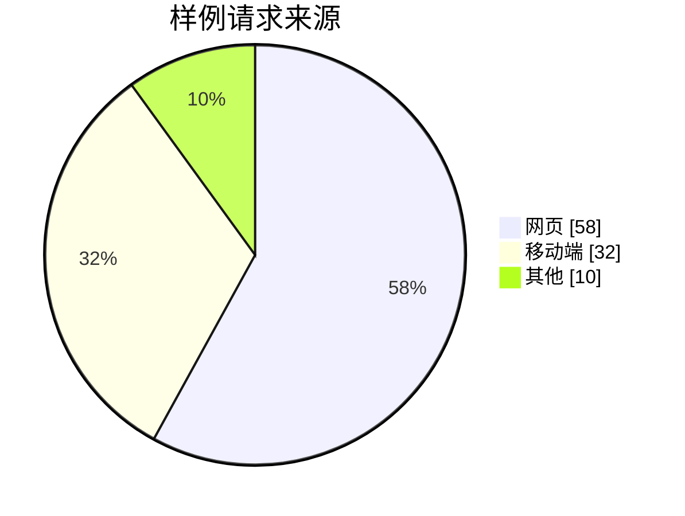

# 时间与网格图

排期、事件、版本分支、看板、报文位域和四象限使用本族。每类只表达自己的时间或空间语义；一般步骤用流程图，角色交接用泳道图。

## gantt

以 `dateFormat YYYY-MM-DD` 指定日期格式，可用 `axisFormat %Y-%m`、`section` 和带状态/ID/日期/依赖的任务。只接受 YYYY-MM-DD；不支持排除日期、刻度间隔、today marker 或非 `Nd` 依赖时长。重复、未知、歧义 ID 及依赖循环均报错。最多 80 项、240 行；不可用格式应按诊断修正，不会静默绘制。

每个 `section` 名在左侧单独占一行，任务名写在其下。时间轴从首个任务所在月的 1 日开始。`crit` 的条形用强调色，`milestone` 画成菱形；`done`、`active`、`crit`、`milestone` 按图的语言写在任务名下，如「已完成」「进行中」。

## timeline

使用 `section 名称` 分组，以 `时点 : 事件[: 事件…]` 声明事件，续行可用 `: 事件`。最多 80 项、240 行；日期和事件按实际材料书写，不补造时间点。

## gitGraph

支持 `commit`（可带 id、tag、type）、`branch`、`checkout`、`merge`；至少需要一个提交，commit ID 不得重复。最多 80 项、240 行；缺少分支或提交引用会报错。

## kanban

列使用 `columnId[列标题]`，下一缩进层写 `cardId[卡片标题]`。列和卡片 ID 唯一，卡片缩进层级一致，不接受 Tab。缩进或引用错误须修复，不能把卡片误识别为列。

## packet

也接受 `packet-beta`。字段写 `起始位-结束位: "字段名"`、单个位 `位: "字段名"`，或用 `+位数: "字段名"` 紧接上一字段；字段从第 0 位起连续、不重叠，总计不超过 4096 位。默认每行 32 位，可用 `packet.bitsPerRow` 调整。

## quadrantChart

轴使用 `x-axis 左 --> 右`、`y-axis 下 --> 上`，`quadrant-1` 至 `quadrant-4` 依次为右上、左上、左下、右下，点写 `名称: x, y`。坐标限定 0 到 1；越界值报错，应按实际坐标修正，不能截断。

```mermaid
---
title: 关键交付按影响与成本分布
---
quadrantChart
  x-axis 低成本 --> 高成本
  y-axis 低影响 --> 高影响
  quadrant-1 优先投入
  quadrant-2 评估后续
  quadrant-3 暂缓
  quadrant-4 快速完成
  交付A: 0.8, 0.9
  交付B: 0.3, 0.6
```

所有时间族类型最多 80 项、240 行；空行和 `%%` 注释忽略。`accTitle`、`accDescr`、头行选项及未实现语句报错。可用前言区 `title`；时间族也支持正文 `title`，正文 title 优先于前言。阅读文档必须提供标题，不支持的语句按诊断移除或改写。

## Mermaid 数值图

用以下写法读取已有声明；从原数据起稿时用 [KChart 通则](../charts/common.md)。不支持任意配置、样式或坐标。

## pie

写 `"类别" : 数值`，数值非负且总量大于零。`showData` 可接受；图例按同样的规则显示原值和比例。更多构成图见 [构成](../charts/composition.md)。

## xychart

也接受 `xychart-beta`。写 `x-axis [分类…]`、可选 `y-axis` 与 `line [数值…]` 或 `bar [数值…]`；数值长度须等于分类数。混用线和柱时按同一量纲读取。见 [趋势](../charts/trend.md)。

## sankey

也接受 `sankey-beta`。逐行写 `来源,目的,权重`（CSV，可加引号），权重必须为正；中间节点流入与流出不必相等，节点按两者较大值绘制。见[网络](../charts/network.md)。

## radar-beta

`axis A, B, C` 定义轴，`curve 名称{4, 3, 5}` 定义序列；每条序列与轴数一致。见[矩阵](../charts/matrix.md)。

## treemap

也接受 `treemap-beta`。以缩进表达层级，叶子写 `"名称" : 数值`；留一棵树，叶权重非负。见[构成](../charts/composition.md)。


