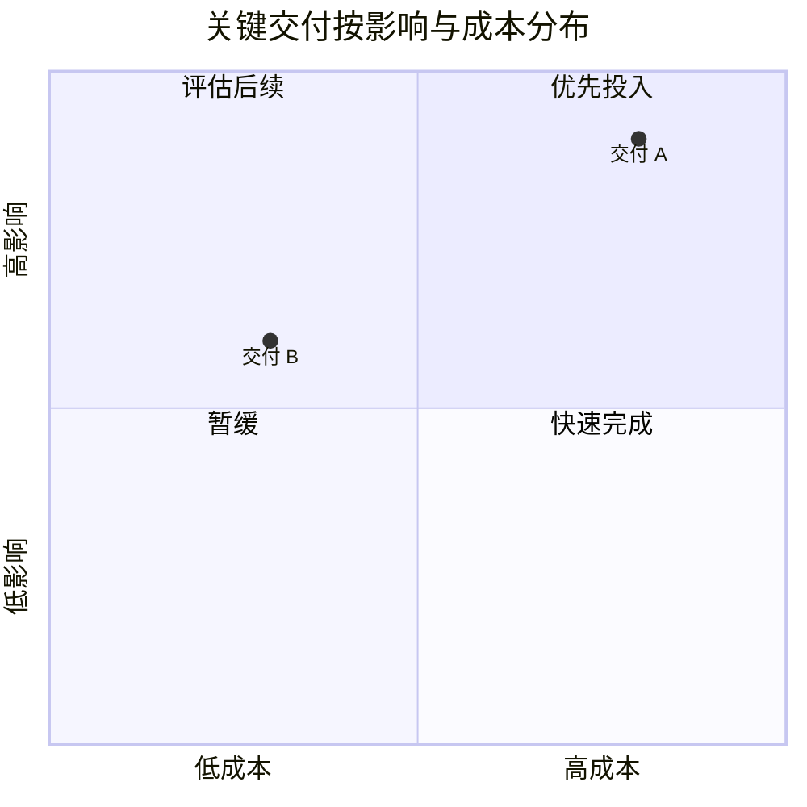
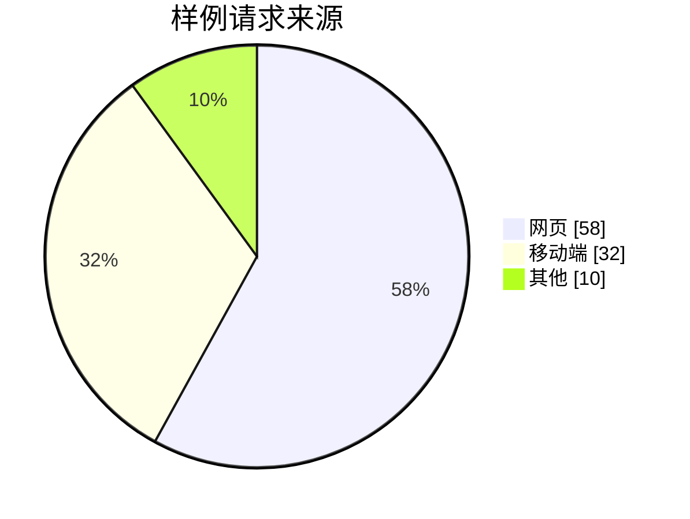

# 时间与网格图

排期、事件、版本分支、看板、报文位域和四象限使用本族。配置、样式、链接、图标和诊断见 [Mermaid 通则](mermaid.md)。

## gantt

用 `section 名称` 分组，任务写 `任务: [状态,] [ID,] 起点, 结束值`。状态包括 `done`、`active`、`crit`、`milestone`、`vert`。`after ID…` 取最晚结束，`until ID…` 取最早起点；时长用 `ms` / `s` / `m` / `h` / `d` / `w` / `M` / `y`。`excludes` 可列日期、英文星期名或 `weekends`，`includes` 覆盖排除项；排除日延长按时长定义的任务，不改显式结束日。

日期按 UTC 解析。`config.gantt` 支持 `dateFormat`、`axisFormat`、`tickInterval`、`weekday`、`weekend`、`topAxis`、`inclusiveEndDates`、`displayMode`、`todayDate`、`todayMarker`；前言 `displayMode: compact` 也可用。默认没有今日标记；指定范围内的 `todayDate` 才会显示，`todayMarker off` 可关闭，自定义标记样式告警。支持通用样式、链接和标签图标。重复 ID 或依赖循环报错；未知任务引用、无效结束值会提示。注释请另起一行，行尾 `%%` 可以是语句值。

## timeline

默认 `LR` 水平排布，`timeline TD` 改用竖轴；其他方向报错。用 `section 名称` 分组，以 `时段 : 事件 : 事件…` 声明，续行写 `: 事件`；续行前必须已有时段。时段是标签，不解析日期。`config.timeline` 支持 `disableMulticolor`、`leftMargin`、`taskFontSize`、`padding`。支持通用样式、链接和标签图标；分别以从零开始的 `period:N`、`period:N:event:M` 引用时段和事件。

## gitGraph

头行可用 `LR:`、`TB:`、`BT:`。支持 `commit`（`id`、`msg`、`tag`、`type`）、`branch`、`checkout` / `switch`、`merge`、`cherry-pick`；未知分支或无效的拣选引用报错。普通提交 ID 重复会提示并保留两次提交，后续引用指向最新的提交；重复的合并提交 ID 报错。

`config.gitGraph` 支持 `showBranches`、`showCommitLabel`、`mainBranchName`、`mainBranchOrder`、`parallelCommits`、`diagramPadding`、`titleTopMargin`；`rotateCommitLabel: true` 不采用并告警。支持通用样式与链接；提交文字中的图标单独按文本降级并告警。

## kanban

用 `columnId[列标题]` 声明列，再缩进写 `cardId[卡片标题]`。可用 `@{ label: …, ticket: …, assigned: …, priority: …, icon: … }`；支持通用样式、链接、`:::类名` 和 `:::icon(引用)`。已知优先级（`Very Low` 到 `Very High`）用主题色，未知优先级提示。缺列或重复卡片 ID 会报错。

`config.kanban` 支持 `sectionWidth`、`padding`、`ticketBaseUrl`；工单链接模板用 `#TICKET#`，只保留安全的 HTTP(S) 地址。

## packet

别名 `packet-beta`。字段写 `起始位-结束位: "字段名"`、`位: "字段名"` 或 `+位数: "字段名"`；从第 0 位起连续，不允许缺口或重叠。`config.packet` 支持 `bitsPerRow`（默认 32）、`bitOrder`（可用 `descending`）、`showBits`、`bitWidth`、`rowHeight`、`paddingX`、`paddingY`。支持通用样式、`:::类名` 和链接；字段图标不绘制并告警。

## quadrantChart

轴写 `x-axis 左 --> 右`、`y-axis 下 --> 上`，`quadrant-1` 至 `quadrant-4` 依次为右上、左上、左下、右下。点写 `名称: [x, y]`，坐标须在 0 到 1 之间，越界报错。支持通用样式、链接与点的 `:::类名`，也可设置点的半径和描边；无法映射的颜色告警，图标按文本降级。

`config.quadrantChart` 支持 `chartWidth`、`chartHeight`、`pointRadius`、`pointLabelFontSize`、`xAxisPosition`、`yAxisPosition`、`quadrantPadding`、`xAxisLabelPadding`、`yAxisLabelPadding`、`quadrantTextTopPadding`、`pointTextPadding`。

## Mermaid 数值图

读取已有 Mermaid 声明时参照下列写法；从原数据起稿时可用 [KChart 声明](../charts/common.md)。

## pie

写 `"类别" : 数值`，数值须非负且总量大于零。`showData` 可写，但不改变绘制效果；图例始终显示原值与比例。重复类别保留首项，多出的类别可合并为「其他」，并给出提示。`pie.textPosition` 调整扇区标签位置；不接受通用样式或点击语句。

## xychart

别名 `xychart-beta`。写 `x-axis [分类…]`（也可用数值范围）、`y-axis 最小值 --> 最大值`、`line [数值…]` 或 `bar [数值…]`；序列可命名。分类与序列长度不同时给出提示，多余的值省略，不足则补零。`horizontal` 告警后仍纵向画；Y 轴不裁掉范围外的数据。无专用配置键；非法数值或通用样式、点击语句报错。

## sankey

别名 `sankey-beta`。逐行写 `来源,目的,权重`（CSV，可加引号），权重必须为正，否则报错；中间节点按流入与流出两者较大值绘制。`sankey.showValues`、`sankey.prefix`、`sankey.suffix` 控制数值及单位显示；`linkColor`、`nodeAlignment` 等外观设置忽略并告警。支持通用样式与节点链接。

## radar-beta

`axis A, B, C` 定义轴，`curve 名称{4, 3, 5}` 定义序列，也可按轴名指定值。`config.radar` 支持 `ticks`、`min`、`max`、`showLegend`、`graticule`，正文也可设置这些项。按位置写的曲线与轴数不符时跳过并提示；未知轴名、无效范围或通用样式、点击语句报错。

## treemap

别名 `treemap-beta`。用空格缩进表达层级；叶子写 `"名称" : 数值`，分组不写数值。多个根会合成一棵树；Tab、同级缩进不一致、分组带权重或叶子缺少数值均报错。支持通用样式、`:::类名` 与链接。`treemap.showValues` 控制是否显示数值，`treemap.valueFormat` 支持小数位数、百分比、千位分隔等有限格式，其他格式告警。
