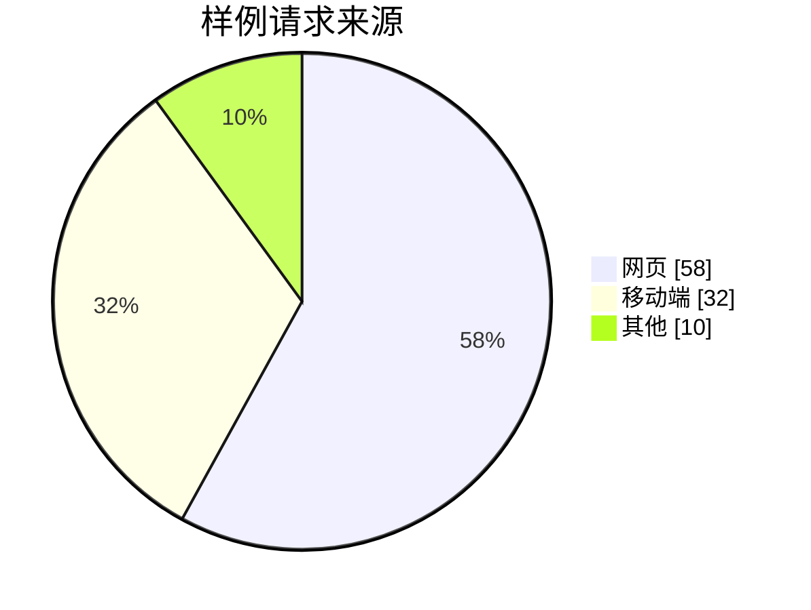

# 时间与网格图

排期、事件、版本分支、看板、报文位域和四象限使用本族。每类只表达自己的时间或空间语义；一般步骤用流程图，角色交接用泳道图。

## gantt

用 `section 名称` 分组；任务可写 `任务: [状态,] [ID,] 起点, 结束值`，也可只写结束值（从上一任务结束时开始）。结束值是日期、时长（`ms`、`s`、`m`、`h`、`d`、`w`、`M`、`y`）或 `until ID…`（取最早的起点）；`after ID…` 取最晚的结束时间。重复 ID 或依赖循环会报错；未知引用会提示，并使用可解析的引用或固定基准日。

日期按 UTC 解析，`dateFormat` 默认 `YYYY-MM-DD`，也可指定如 `HH:mm`、Unix 秒 `X` 或毫秒 `x`。`axisFormat` 使用 `%Y-%m`、`%H:%M` 一类的刻度格式；不支持的格式标记会报错。无法解析的结束值会提示并画成零时长。使用 `tickInterval 1week`、`weekday monday`、`topAxis` 调整刻度；无效间隔回退为自动刻度。`excludes` 可列日期、英文星期名或 `weekends`，`includes` 覆盖排除项；`weekend friday` 可把周末改为周五和周六。排除日会延长按时长定义的任务，不改显式结束日；`inclusiveEndDates` 将显式结束日期纳入任务。

任务条采用主题浅色填充及描边；`done`、`active`、`crit` 有不同的状态样式，`milestone` 用菱形，`vert` 用全高虚线并把名称和日期放在同一标签。前言 `displayMode: compact` 在条形与标签都有空间时合并任务行。任务名优先写在自己的条形内，其次写在右侧或左侧；状态文字跟随任务，左栏只留分组名。Today 标记默认不画；仅在前言配置 `config.gantt.todayDate`（`YYYY-MM-DD`）且该日在排期范围内时显示；`todayMarker off` 可关闭，自定义标记样式不生效。任务可用 `:::状态类`、`class` 或 `style` 映射到主题色；`click ID href "URL"` 只生成安全链接，`call` 回调忽略并提示。任务上限为 2,000 个。

## timeline

`timeline` 或 `timeline LR` 将时段从左往右排，事件逐条列在各时段下方；`timeline TD` 按竖轴从上往下排，事件卡片在右侧。使用 `section 名称` 分组，以 `时段 : 事件 : 事件…` 声明，续行可用 `: 事件`。时段是原样标签，不解析也不补造日期。长标签会换行，窄视口下可在图框内滚动。

在前言 `config.timeline` 可设置 `disableMulticolor`、`leftMargin`、`taskFontSize` 和 `padding`。时段及事件支持 `:::状态类`；样式和安全链接可分别引用从零开始的 `period:N`、`period:N:event:M`。标签支持换行、实体和可解析的本地图标；未知图标会提示。时段和事件合计最多 2,000 个。

## gitGraph

支持 `commit`（可带 id、tag、type）、`branch`、`checkout`、`merge`；至少需要一个提交，commit ID 不得重复。最多 80 项、240 行；缺少分支或提交引用会报错。

## kanban

列使用 `columnId[列标题]`，下一缩进层写 `cardId[卡片标题]`。列和卡片 ID 唯一，卡片缩进层级一致，不接受 Tab。缩进或引用错误须修复，不能把卡片误识别为列。

## packet

也接受 `packet-beta`。字段写 `起始位-结束位: "字段名"`、单个位 `位: "字段名"`，或用 `+位数: "字段名"` 紧接上一字段；字段从第 0 位起连续、不重叠，总计不超过 4096 位。默认每行 32 位，可用 `packet.bitsPerRow` 调整。

## quadrantChart

轴使用 `x-axis 左 --> 右`、`y-axis 下 --> 上`，`quadrant-1` 至 `quadrant-4` 依次为右上、左上、左下、右下，点写 `名称: x, y`。坐标限定 0 到 1；越界值报错，应按实际坐标修正，不能截断。

```mermaid
---
title: 关键交付按影响与成本分布
---
quadrantChart
  x-axis 低成本 --> 高成本
  y-axis 低影响 --> 高影响
  quadrant-1 优先投入
  quadrant-2 评估后续
  quadrant-3 暂缓
  quadrant-4 快速完成
  交付A: 0.8, 0.9
  交付B: 0.3, 0.6
```

空行和独立一行的 `%%` 注释会忽略；Gantt 的行尾 `%%` 可属于语句值（例如轴格式中的字面百分号），注释请另起一行。可写 `accTitle: …`、`accDescr: …` 或 `accDescr {…}` 设置无障碍文本。阅读文档必须提供图题，可用前言 `title`；Gantt、Timeline 的正文 `title` 优先。方向、条目与大小限制按图型而异，不支持的语句请按诊断处理。

## Mermaid 数值图

用以下写法读取已有声明；从原数据起稿时用 [KChart 通则](../charts/common.md)。不支持任意配置、样式或坐标。

## pie

写 `"类别" : 数值`，数值非负且总量大于零。`showData` 可接受；图例按同样的规则显示原值和比例。更多构成图见 [构成](../charts/composition.md)。

## xychart

也接受 `xychart-beta`。写 `x-axis [分类…]`、可选 `y-axis` 与 `line [数值…]` 或 `bar [数值…]`；数值长度须等于分类数。混用线和柱时按同一量纲读取。见 [趋势](../charts/trend.md)。

## sankey

也接受 `sankey-beta`。逐行写 `来源,目的,权重`（CSV，可加引号），权重必须为正；中间节点流入与流出不必相等，节点按两者较大值绘制。见[网络](../charts/network.md)。

## radar-beta

`axis A, B, C` 定义轴，`curve 名称{4, 3, 5}` 定义序列；每条序列与轴数一致。见[矩阵](../charts/matrix.md)。

## treemap

也接受 `treemap-beta`。以缩进表达层级，叶子写 `"名称" : 数值`；留一棵树，叶权重非负。见[构成](../charts/composition.md)。


